<p align="center">
  
</p>

<p align="center" style="font-size: 16pt; line-height: 1.5;">
  Universidad Peruana de Ciencias Aplicadas<br>
  Carrera de Ingeniería de Software
</p>

<br>

<p align="center" style="font-size: 14pt; margin-bottom: 5px;">
  <strong> 1ASI0572 Desarrollo de Soluciones IoT</strong>
</p>

<p align="center" style="font-size: 12pt; margin-bottom: 5px;">
  NRC: 8721
</p>

<p align="center" style="font-size: 12pt; margin-bottom: 5px;">
  Docente: Javier Antonio Prudencio Vidal
</p>

<p align="center" style="font-size: 16pt;">
  <strong>Trabajo Parcial (TB1)</strong>
</p>

<br>

<p align="center" style="font-size: 12pt; margin-bottom: 5px;">
  Equipo
</p>

<p align="center" style="font-size: 14pt;">
  <strong>[Nombre del equipo]</strong>
</p>

<br>

<p align="center" style="font-size: 12pt; margin-bottom: 5px;">
  Proyecto
</p>

<p align="center" style="font-size: 14pt;">
  <strong>Innova Carty</strong>
</p>

<br>

<p align="center" style="font-size: 12pt;">
  <strong>Integrantes</strong>
</p>

<div align="center">
<table style="margin: 0 auto; border-collapse:collapse; border:none;">
  <tr>
    <th align="left" style="border:none; padding:0.3em 1.5em 0.3em 0;">
      <strong style="font-size:1.1em;">Código</strong>
    </th>
    <th align="left" style="border:none; padding:0.3em 0;">
      <strong style="font-size:1.1em;">Apellidos y Nombres</strong>
    </th>
  </tr>
  <tr>
    <td style="border:none; padding:0.3em 1.5em 0.3em 0;">U20201B29</td>
    <td style="border:none; padding:0.3em 0;">Berrocal Ramirez Omar Christian</td>
  </tr>
  <tr>
    <td style="border:none; padding:0.3em 1.5em 0.3em 0;">U202120569</td>
    <td style="border:none; padding:0.3em 0;">Crisanto Calle Deybbi anderson</td>
  </tr>
  <tr>
    <td style="border:none; padding:0.3em 1.5em 0.3em 0;">U20231D534</td>
    <td style="border:none; padding:0.3em 0;">Diaz Fiestas Jorge Luis</td>
  </tr>
  <tr>
    <td style="border:none; padding:0.3em 1.5em 0.3em 0;">U202215285</td>
    <td style="border:none; padding:0.3em 0;">Huanca Navarro Gustavo Esau</td>
  </tr>
  <tr>
    <td style="border:none; padding:0.3em 1.5em 0.3em 0;">U20211d760</td>
    <td style="border:none; padding:0.3em 0;">Paico Calderon, July Zelmira</td>
  </tr>
  <tr>
    <td style="border:none; padding:0.3em 1.5em 0.3em 0;">U20221A525</td>
    <td style="border:none; padding:0.3em 0;">Pardo Chumpitazi, Kevin Patrick</td>
  </tr>
  <tr>
    <td style="border:none; padding:0.3em 1.5em 0.3em 0;">U201912401</td>
    <td style="border:none; padding:0.3em 0;">Trillo Hernandez, Anghel Melanie</td>
  </tr>
</table>
</div>

<br>
<p align="center">Octubre 2026</p>

<div style="page-break-after: always;"></div>

---

# Registro de versiones del Informe

| Versión | Fecha      | Autor(es)                                                                                                                                                                                                                                        | Descripción de modificación                                                                                                                                                 |
|---------|------------|--------------------------------------------------------------------------------------------------------------------------------------------------------------------------------------------------------------------------------------------------|-----------------------------------------------------------------------------------------------------------------------------------------------------------------------------|
| 1       | 15/09/2026 | Berrocal Ramirez Omar Christian <br> Crisanto Calle Deybbi Anderson <br> Diaz Fiestas Jorge Luis <br> Huanca Navarro Gustavo Esau <br> Paico Calderon, July Zelmira <br> Pardo Chumpitazi, Kevin Patrick <br> Trillo Hernandez, Anghel Melanie   | Capítulo I: Introducción <br> Capítulo II: Requirements Elicitation & Analysis. <br> Capítulo III: Requirements Specification. <br> Capítulo IV: Solution Software Design.  |
| 2       | 07/10/2026 | Berrocal Ramirez Omar Christian <br> Crisanto Calle Deybbi Anderson <br> Diaz Fiestas Jorge Luis <br> Huanca Navarro Gustavo Esau <br> Paico Calderon, July Zelmira <br> Pardo Chumpitazi, Kevin Patrick <br> Trillo Hernandez, Anghel Melanie   | Correcciones del Avance 1 (AV1). <br> Capítulo V: Solution UI/UX Design. <br> Capítulo VI: Product Implementation, Validation & Deployment. |

<div style="page-break-after: always;"></div>

---

## Contenido

### [ABET – EAC - Student Outcome](#abet--eac---student-outcome-5)

### [Capítulo I: Introducción](#capítulo-i-introducción)
- [1.1. Startup Profile](#11-startup-profile)
  - [1.1.1. Descripción de la Startup](#111-descripción-de-la-startup)
  - [1.1.2. Perfiles de integrantes del equipo](#112-perfiles-de-integrantes-del-equipo)
- [1.2. Solution Profile](#12-solution-profile)
  - [1.2.1. Antecedentes y problemática](#121-antecedentes-y-problemática)
  - [1.2.2. Lean UX Process](#122-lean-ux-process)
    - [1.2.2.1. Lean UX Problem Statements](#1221-lean-ux-problem-statements)
    - [1.2.2.2. Lean UX Assumptions](#1222-lean-ux-assumptions)
    - [1.2.2.3. Lean UX Hypothesis Statements](#1223-lean-ux-hypothesis-statements)
    - [1.2.2.4. Lean UX Canvas](#1224-lean-ux-canvas)
- [1.3. Segmentos objetivo](#13-segmentos-objetivo)

### [Capítulo II: Requirements Elicitation & Analysis](#capítulo-ii-requirements-elicitation--analysis)
- [2.1. Competidores](#21-competidores)
  - [2.1.1. Análisis competitivo](#211-análisis-competitivo)
  - [2.1.2. Estrategias y tácticas frente a competidores](#212-estrategias-y-tácticas-frente-a-competidores)
- [2.2. Entrevistas](#22-entrevistas)
  - [2.2.1. Diseño de entrevistas](#221-diseño-de-entrevistas)
  - [2.2.2. Registro de entrevistas](#222-registro-de-entrevistas)
  - [2.2.3. Análisis de entrevistas](#223-análisis-de-entrevistas)
- [2.3. Needfinding](#23-needfinding)
  - [2.3.1. User Personas](#231-user-personas)
  - [2.3.2. User Task Matrix](#232-user-task-matrix)
  - [2.3.3. User Journey Mapping](#233-user-journey-mapping)
  - [2.3.4. Empathy Mapping](#234-empathy-mapping)
- [2.4. Big Picture EventStorming](#24-big-picture-eventstorming)
- [2.5. Ubiquitous Language](#25-ubiquitous-language)

### [Capítulo III: Requirements Specification](#capítulo-iii-requirements-specification)
- [3.1. User Stories](#31-user-stories)
- [3.2. Impact Mapping](#32-impact-mapping)
- [3.3. Product Backlog](#33-product-backlog)

### [Capítulo IV: Solution Software Design](#capítulo-iv-solution-software-design)
- [4.1. Strategic-Level Domain-Driven Design](#41-strategic-level-domain-driven-design)
  - [4.1.1. Design-Level EventStorming](#411-design-level-eventstorming)
    - [4.1.1.1. Candidate Context Discovery](#4111-candidate-context-discovery)
    - [4.1.1.2. Domain Message Flows Modeling](#4112-domain-message-flows-modeling)
    - [4.1.1.3. Bounded Context Canvases](#4113-bounded-context-canvases)
  - [4.1.2. Context Mapping](#412-context-mapping)
  - [4.1.3. Software Architecture](#413-software-architecture)
    - [4.1.3.1. Software Architecture System Landscape Diagram](#4131-software-architecture-system-landscape-diagram)
    - [4.1.3.2. Software Architecture Context Level Diagrams](#4132-software-architecture-context-level-diagrams)
    - [4.1.3.3. Software Architecture Container Level Diagrams](#4133-software-architecture-container-level-diagrams)
    - [4.1.3.4. Software Architecture Deployment Diagrams](#4134-software-architecture-deployment-diagrams)
- [4.2. Tactical-Level Domain-Driven Design](#42-tactical-level-domain-driven-design)
  - [4.2.1. Bounded Context: Smart Shopping Bounded Context](#421-bounded-context-smart-shopping-bounded-context)
    - [4.2.1.1. Domain Layer](#4211-domain-layer)
    - [4.2.1.2. Interface Layer](#4212-interface-layer)
    - [4.2.1.3. Application Layer](#4213-application-layer)
    - [4.2.1.4. Infrastructure Layer](#4214-infrastructure-layer)
    - [4.2.1.5. Bounded Context Software Architecture Component Level Diagrams](#4215-bounded-context-software-architecture-component-level-diagrams)
    - [4.2.1.6. Bounded Context Software Architecture Code Level Diagrams](#4216-bounded-context-software-architecture-code-level-diagrams)
      - [4.2.1.6.1. Bounded Context Domain Layer Class Diagrams](#42161-bounded-context-domain-layer-class-diagrams)
      - [4.2.1.6.2. Bounded Context Database Design Diagram](#42162-bounded-context-database-design-diagram)
  - [4.2.2. Bounded Context: Payment & Checkout Bounded Context](#422-bounded-context-payment--checkout-bounded-context)
    - [4.2.2.1. Domain Layer](#4221-domain-layer)
    - [4.2.2.2. Interface Layer](#4222-interface-layer)
    - [4.2.2.3. Application Layer](#4223-application-layer)
    - [4.2.2.4. Infrastructure Layer](#4224-infrastructure-layer)
    - [4.2.2.5. Bounded Context Software Architecture Component Level Diagrams](#4225-bounded-context-software-architecture-component-level-diagrams)
    - [4.2.2.6. Bounded Context Software Architecture Code Level Diagrams](#4226-bounded-context-software-architecture-code-level-diagrams)
      - [4.2.2.6.1. Bounded Context Domain Layer Class Diagrams](#42261-bounded-context-domain-layer-class-diagrams)
      - [4.2.2.6.2. Bounded Context Database Design Diagram](#42262-bounded-context-database-design-diagram)
  - [4.2.3. Bounded Context: Catalog & Pricing Bounded Context](#423-bounded-context-catalog--pricing-bounded-context)
    - [4.2.3.1. Domain Layer](#4231-domain-layer)
    - [4.2.3.2. Interface Layer](#4232-interface-layer)
    - [4.2.3.3. Application Layer](#4233-application-layer)
    - [4.2.3.4. Infrastructure Layer](#4234-infrastructure-layer)
    - [4.2.3.5. Bounded Context Software Architecture Component Level Diagrams](#4235-bounded-context-software-architecture-component-level-diagrams)
    - [4.2.3.6. Bounded Context Software Architecture Code Level Diagrams](#4236-bounded-context-software-architecture-code-level-diagrams)
      - [4.2.3.6.1. Bounded Context Domain Layer Class Diagrams](#42361-bounded-context-domain-layer-class-diagrams)
      - [4.2.3.6.2. Bounded Context Database Design Diagram](#42362-bounded-context-database-design-diagram)
  - [4.2.4. Bounded Context: Operations & Security Bounded Context](#424-bounded-context-operations--security-bounded-context)
    - [4.2.4.1. Domain Layer](#4241-domain-layer)
    - [4.2.4.2. Interface Layer](#4242-interface-layer)
    - [4.2.4.3. Application Layer](#4243-application-layer)
    - [4.2.4.4. Infrastructure Layer](#4244-infrastructure-layer)
    - [4.2.4.5. Bounded Context Software Architecture Component Level Diagrams](#4245-bounded-context-software-architecture-component-level-diagrams)
    - [4.2.4.6. Bounded Context Software Architecture Code Level Diagrams](#4246-bounded-context-software-architecture-code-level-diagrams)
      - [4.2.4.6.1. Bounded Context Domain Layer Class Diagrams](#42461-bounded-context-domain-layer-class-diagrams)
      - [4.2.4.6.2. Bounded Context Database Design Diagram](#42462-bounded-context-database-design-diagram)

### [Capítulo V: Solution UI/UX Design](#capítulo-v-solution-uiux-design)
- [5.1. Style Guidelines](#51-style-guidelines)
  - [5.1.1. General Style Guidelines](#511-general-style-guidelines)
  - [5.1.2. Web, Mobile and IoT Style Guidelines](#512-web-mobile-and-iot-style-guidelines)
- [5.2. Information Architecture](#52-information-architecture)
  - [5.2.1. Organization Systems](#521-organization-systems)
  - [5.2.2. Labeling Systems](#522-labeling-systems)
  - [5.2.3. SEO Tags and Meta Tags](#523-seo-tags-and-meta-tags)
  - [5.2.4. Searching Systems](#524-searching-systems)
  - [5.2.5. Navigation Systems](#525-navigation-systems)
- [5.3. Landing Page UI Design](#53-landing-page-ui-design)
  - [5.3.1. Landing Page Wireframe](#531-landing-page-wireframe)
  - [5.3.2. Landing Page Mock-up](#532-landing-page-mock-up)
- [5.4. Applications UX/UI Design](#54-applications-uxui-design)
  - [5.4.1. Applications Wireframes](#541-applications-wireframes)
  - [5.4.2. Applications Wireflow Diagrams](#542-applications-wireflow-diagrams)
  - [5.4.3. Applications Mock-ups](#543-applications-mock-ups)
  - [5.4.4. Applications User Flow Diagrams](#544-applications-user-flow-diagrams)
- [5.5. Applications Prototyping](#55-applications-prototyping)
- [5.6. IoT Device Design](#56-iot-device-design)

### [Capítulo VI: Product Implementation, Validation & Deployment](#capítulo-vi-product-implementation-validation--deployment)
- [6.1. Software Configuration Management](#61-software-configuration-management)
  - [6.1.1. Software Development Environment Configuration](#611-software-development-environment-configuration)
  - [6.1.2. Source Code Management](#612-source-code-management)
  - [6.1.3. Source Code Style Guide & Conventions](#613-source-code-style-guide--conventions)
  - [6.1.4. Software Deployment Configuration](#614-software-deployment-configuration)
- [6.2. Landing Page, Services & Applications Implementation](#62-landing-page-services--applications-implementation)
  - [6.2.1. Sprint 1](#621-sprint-1)
    - [6.2.1.1. Sprint Planning 1](#6211-sprint-planning-1)
    - [6.2.1.2. Aspect Leaders and Collaborators](#6212-aspect-leaders-and-collaborators)
    - [6.2.1.3. Sprint Backlog 1](#6213-sprint-backlog-1)
    - [6.2.1.4. Development Evidence for Sprint Review](#6214-development-evidence-for-sprint-review)
    - [6.2.1.5. Testing Suite Evidence for Sprint Review](#6215-testing-suite-evidence-for-sprint-review)
    - [6.2.1.6. Execution Evidence for Sprint Review](#6216-execution-evidence-for-sprint-review)
    - [6.2.1.7. Services Documentation Evidence for Sprint Review](#6217-services-documentation-evidence-for-sprint-review)
    - [6.2.1.8. Software Deployment Evidence for Sprint Review](#6218-software-deployment-evidence-for-sprint-review)
    - [6.2.1.9. Team Collaboration Insights during Sprint](#6219-team-collaboration-insights-during-sprint)
  - [6.2.2. Sprint 2](#622-sprint-2)
    - [6.2.2.1. Sprint Planning 2](#6221-sprint-planning-2)
    - [6.2.2.2. Aspect Leaders and Collaborators](#6222-aspect-leaders-and-collaborators)
    - [6.2.2.3. Sprint Backlog 2](#6223-sprint-backlog-2)
    - [6.2.2.4. Development Evidence for Sprint Review](#6224-development-evidence-for-sprint-review)
    - [6.2.2.5. Testing Suite Evidence for Sprint Review](#6225-testing-suite-evidence-for-sprint-review)
    - [6.2.2.6. Execution Evidence for Sprint Review](#6226-execution-evidence-for-sprint-review)
    - [6.2.2.7. Services Documentation Evidence for Sprint Review](#6227-services-documentation-evidence-for-sprint-review)
    - [6.2.2.8. Software Deployment Evidence for Sprint Review](#6228-software-deployment-evidence-for-sprint-review)
    - [6.2.2.9. Team Collaboration Insights during Sprint](#6229-team-collaboration-insights-during-sprint)
- [6.3. Validation Interviews](#63-validation-interviews)
  - [6.3.1. Diseño de Entrevistas](#631-diseño-de-entrevistas)
  - [6.3.2. Registro de Entrevistas](#632-registro-de-entrevistas)
  - [6.3.3. Evaluaciones según heurísticas](#633-evaluaciones-según-heurísticas)
- [6.4. Video About-the-Product](#64-video-about-the-product)

### [Conclusiones](#conclusiones)

### [Bibliografía](#bibliografía)

### [Anexos](#anexos)

<div style="page-break-after: always;"></div>

---

## ABET – EAC - Student Outcome 5

| Criterio específico | Acciones realizadas | Conclusiones |
|--------------------|--------------------|--------------|
| Trabaja en equipo para proporcionar liderazgo en forma conjunta | **Trillo Hernández, Anghel Melanie (AV1)** <br> Lideró el análisis de las entrevistas y el diseño estratégico del dominio: elaboró el Candidate Context Discovery, los Bounded Context Canvases de los cuatro contextos (Smart Shopping, Payment & Checkout, Catalog & Pricing y Operations & Security) y el primer diagrama de base de datos de la solución. Coordinó con el equipo los nombres de los contextos y del lenguaje ubicuo para que los capítulos II, III y IV usaran los mismos términos. <br><br> **Trillo Hernández, Anghel Melanie (TB1)** <br> Lideró el Design-Level EventStorming en Miro (los diez pasos, de la lluvia de eventos a los bounded contexts) y el Domain Message Flows Modeling con Domain Storytelling (cinco escenarios). Completó el diseño táctico de los cuatro bounded contexts: capas Domain, Interface, Application e Infrastructure, diagramas de componentes C4, diagramas de clases UML y diagramas de base de datos con un script SQL por contexto. En el Sprint 1 implementó los botones de llamada a la acción del Landing Page, el detalle del carrito con discrepancia de peso y el modal de edición de peso nominal y tolerancia. <br><br> **Trillo Hernández, Anghel Melanie (AV2)** <br> Lideró la documentación de la revisión del Sprint 2: redactó la evidencia de desarrollo, de testing, de ejecución y de documentación de servicios a partir de los commits de los repositorios del backend, la consola web, la app móvil y el Landing Page, y tomó las capturas de la consola y de Swagger UI. En el backend implementó los unit tests con JUnit y Mockito y los acceptance tests BDD en Gherkin de las historias del sprint; estas pruebas detectaron un error al crear las órdenes de compra, que corrigió antes de integrarlo a main. Además mejoró la interacción del Landing Page con estados *hover* y la animación del carrito del hero. <br><br> **Paico Calderón, July (AV1)** <br> Asumió el liderazgo del aspecto de Gestión del Sprint dentro de la matriz LACX, coordinando la planificación del Sprint 1 junto al equipo y conduciendo la definición de los segmentos objetivo y de las estrategias y tácticas frente a competidores, lo que permitió alinear al equipo en torno a una visión común del producto desde las primeras etapas del proyecto. <br><br> **Paico Calderón, July (TB1)** <br> Mantuvo su rol de liderazgo en la Gestión del Sprint, actualizando el Sprint Backlog y completando la caracterización del segundo segmento dentro de los User Personas, asegurando que las decisiones de planificación se tomaran de manera conjunta con los demás integrantes del equipo. <br><br> **Crisanto Calle, Deybbi (AV1)** <br> Lideró el aspecto de Testing dentro de la matriz LACX, proponiendo conjuntamente con el equipo la construcción del User Journey Mapping y del Big Picture EventStorming a partir de los hallazgos de las entrevistas y los mapas de empatía, articulando el trabajo de needfinding con el diseño técnico de la solución. <br><br> **Crisanto Calle, Deybbi (TB1)** <br> Continuó liderando el aspecto de Testing, coordinando con el equipo la definición de la suite de pruebas y la elaboración de los diagramas de despliegue y de la capa de dominio, lo que requirió sincronizar su trabajo con los avances de arquitectura y desarrollo de los demás miembros. <br><br> **Huanca Navarro, Gustavo Esau (AV1)** <br> Asumió como responsable el diseño táctico del Smart Shopping Bounded Context: elaboró las capas Interface, Application e Infrastructure y el diagrama de componentes C4 del contexto, alineándolos con la capa de dominio y con los nombres del lenguaje ubicuo acordados por el equipo. Además, condujo una de las entrevistas del primer segmento (compradores) y redactó su perfil profesional. <br><br> **Huanca Navarro, Gustavo Esau (TB1)** <br> Lideró los aspectos de Landing Page y Frontend Web App en la matriz LACX: coordinó las tareas de ambos productos, revisó e integró las ramas `feature/*` en `develop` y validó el resultado con el equipo. Preparó y condujo la Sprint Planning 1, en la que se definieron el Sprint Goal, la velocidad de 20 Story Points y los líderes de cada aspecto. En el capítulo V elaboró los User Flow Diagrams y los prototipos de las aplicaciones, que sirvieron de referencia a los demás integrantes al implementar las pantallas. <br><br> **Huanca Navarro, Gustavo Esau (AV2)** <br> Preparó y condujo la Sprint Planning 2 (6.2.2.1), en la que el equipo fijó el Sprint Goal y una velocidad de 39 Story Points a partir de la revisión y la retrospectiva del Sprint 1. Propuso la matriz de líderes y colaboradores del Sprint 2 (6.2.2.2) con un aspecto liderado por cada integrante, incluidos quienes no lideraron ninguno en el Sprint 1. Lideró el aspecto Device Gateway y Telemetría (TS01): coordinó con el equipo de backend el contrato entre el ESP32 y la API (reporte de tags RFID, peso, batería y zona, eventos y consulta de estado con `X-Device-Key`) del que dependen US06, US05 y US08. <br><br> **Berrocal Ramirez, Omar Christian (Av1)** <br> Colaboré con mis compañeros para establecer la meta del primer avance y realizar los artefactos de Lean UX Canva para sintetizar lo elaborado del lean ux process por mis compañeros. <br><br> **Berrocal Ramirez, Omar Christian (TB1)** <br> Participé de las reuniones y los acuerdos tomados en el chat grupal, continuando con la elaboración de artefactos faltantes y corrección de impact mapping. Además realicé la redacción de la configuración del software, en coordinación con el equipo para la desción de tecnologías a usar en la elaoración de la solución y alineado a la arquitectura propuesta.<br><br> **Díaz Fiestas, Jorge Luis (AV1)** <br> Lideró la descripción de la startup (misión y propuesta de valor de Innova Carty) y el diseño de las entrevistas para los dos segmentos objetivo: definió el objetivo, la metodología semiestructurada y las preguntas complementarias y principales que el equipo usó para validar los supuestos del Lean UX Canvas. Elaboró el diagrama de contexto C4 (nivel 1), identificando a los actores y los sistemas externos (Yape/Plin, red de tarjetas y sistema POS) que sirvieron de base para los diagramas de contenedores y de despliegue. <br><br> **Díaz Fiestas, Jorge Luis (TB1)** <br> Lideró los Web, Mobile and IoT Style Guidelines, el Organization Systems de la arquitectura de información y el IoT Device Design del Smart Cart: sensores y actuadores sobre ESP32, circuito, estados LED y flujos de interacción, incluido el flujo de alerta por discrepancia de peso. En el Sprint 1 lideró la API fake con json-server y su documentación (US11 y US13), implementó el formulario de solicitud de demo del Landing Page y el refresco automático del dashboard de la consola web, y elaboró las secciones de Services Documentation, Software Deployment y Team Collaboration Insights. <br><br> **Pardo Chumpitazi, Kevin Patrick (AV1)** <br> Lideró la síntesis cualitativa de las entrevistas y la elaboración de los Empathy Maps en UXPressia para los dos segmentos objetivo (Comprador Moderno y Administrador de Tienda), estructurando los hallazgos en cuadrantes conductuales (pensamientos, percepciones, dolores y ganancias esperadas). Asimismo, participó activamente en las sesiones conjuntas de modelado de dominio, colaborando en la definición inicial del Big Picture EventStorming y en la delimitación estratégica de los bounded contexts del sistema. <br><br> **Pardo Chumpitazi, Kevin Patrick (TB1)** <br> Lideró la definición formal del Context Mapping (sección 4.1.2), modelando en Mermaid y sustentando las relaciones estratégicas entre los cuatro bounded contexts (OHS/PL, Customer/Supplier, Pub/Sub y ACL) y el análisis de alternativas frente a arquitecturas monolíticas o de Shared Kernel. En el capítulo VI lideró la sección 6.1.4 (Software Deployment Configuration), definiendo los procedimientos de CI/CD, configuración de entornos y despliegue del Frontend en Vercel y Backend/Base de Datos en Render vinculados al diagrama C4. Además, consolidó la corrección metodológica de los Empathy Maps alineándolos estrictamente a los arquetipos de User Personas (Juan López y María Fuentes). | **Conclusión general (AV1):** <br> El liderazgo se distribuyó por capítulos y secciones del informe: cada integrante asumió como responsable una parte (perfiles, entrevistas, needfinding, user stories, backlog, EventStorming, bounded contexts, arquitectura) y el resto revisó y complementó su trabajo. Así todos lideraron al menos un entregable y nadie concentró las decisiones del producto. <br><br> **Conclusión general (TB1):** <br> En el TB1 el equipo pasó a un liderazgo por aspectos: en la Sprint Planning 1 se asignó un líder a Landing Page y Frontend Web App, API fake, Testing, Despliegue y Gestión del Sprint, y todos los integrantes colaboraron en los demás aspectos. El diseño táctico de los bounded contexts y el diseño UX/UI también se repartieron por responsable, lo que permitió avanzar en paralelo y mantener la coherencia entre el dominio, las pantallas y el código. <br><br> **Conclusión general (AV2):** <br> En el AV2 el liderazgo se organizó por historia de usuario: en el Sprint Backlog 2 cada integrante quedó a cargo de una historia (TS01, TS02, TS03, US04, US05, US06 y US08), desde la telemetría del carrito hasta el pago. Como todas dependen de la misma API, los responsables acordaron los endpoints y el contrato con el dispositivo, de modo que el carrito, la consola web y la app móvil trabajan sobre el mismo estado del carrito. |
| Crea un entorno colaborativo e inclusivo, establece metas, planifica tareas y cumple objetivos | **Trillo Hernández, Anghel Melanie (AV1)** <br> Trabajó e integró sus avances mediante pull requests revisados por el equipo. Compartió el análisis de entrevistas y los canvases para que los demás integrantes los usaran como base de las user stories y de la arquitectura, y cumplió sus secciones dentro del plazo del AV1. <br><br> **Trillo Hernández, Anghel Melanie (TB1)** <br> Usó el tablero de Miro como espacio común para que el equipo revisara el EventStorming, los message flows y los canvases. Mantuvo alineados los diagramas con el informe (mismos agregados, eventos, tablas e historias de usuario), organizó sus cambios en commits separados con Conventional Commits y completó las tareas que se le asignaron en el Sprint Backlog 1. <br><br> **Trillo Hernández, Anghel Melanie (AV2)** <br> Ordenó las evidencias del capítulo VI por sprint para que cada integrante sepa dónde agregar sus capturas. Integró sus cambios con commits separados por sección siguiendo Conventional Commits y el flujo GitFlow mediante pull requests, y documentó en el README del backend cómo ejecutar las pruebas para que el resto del equipo pueda correrlas. <br><br> **Paico Calderón, July (AV1)** <br> Planificó y dio seguimiento a tareas transversales del informe, cumpliendo con la elaboración de la carátula, el registro de versiones, los segmentos objetivo, las estrategias frente a competidores, los User Personas, el Product Backlog y los diagramas de contenedores de la arquitectura de software, estableciendo metas claras y cumpliendo los objetivos trazados para el Sprint 1. <br><br> **Paico Calderón, July (TB1)** <br> Planificó y ejecutó la actualización del Sprint Backlog y del Labeling System, además de completar los User Personas del segundo segmento, manteniendo un entorno colaborativo con el equipo para el cumplimiento de los objetivos pendientes de la primera etapa. <br><br> **Crisanto Calle, Deybbi (AV1)** <br> Estableció y cumplió metas vinculadas al diseño centrado en el usuario y a la arquitectura de la solución, completando el análisis competitivo, el User Journey Mapping, el Big Picture EventStorming, los diagramas de despliegue, la capa de dominio y los diagramas de clases de la capa de dominio por bounded context. <br><br> **Crisanto Calle, Deybbi (TB1)** <br> Planificó y gestionó las tareas correspondientes a la evidencia de la suite de pruebas para el Sprint Review, colaborando de forma inclusiva con los demás integrantes para contrastar el trabajo de testing con el backlog del Sprint 1, dejando pendientes de planificación las evaluaciones heurísticas y el video del producto para etapas posteriores. <br><br> **Huanca Navarro, Gustavo Esau (AV1)** <br> Planificó y cumplió dentro del plazo del AV1 las secciones que se le asignaron (perfil, entrevista del primer segmento y diseño táctico del Smart Shopping Bounded Context), integrándolas mediante su rama `feature/gustavo` hacia `develop`. Compartió los diagramas de componentes del contexto para que el resto del equipo mantuviera la misma estructura en los demás bounded contexts. <br><br> **Huanca Navarro, Gustavo Esau (TB1)** <br> Estableció junto al equipo el objetivo del Sprint 1 y registró la planificación (6.2.1.1) y la matriz de líderes y colaboradores (6.2.1.2), de modo que cada integrante supiera qué aspecto lideraba y en cuáles colaboraba. Implementó las secciones de propuesta de valor y "Cómo funciona" del Landing Page (US01) y el inicio de sesión del personal en la consola web (US11), publicó ambos productos en Vercel y documentó la evidencia de desarrollo del sprint (6.2.1.4). <br><br> **Huanca Navarro, Gustavo Esau (AV2)** <br> Registró la planificación y la matriz de liderazgo del Sprint 2 para que cada integrante supiera qué historia y qué aspecto le correspondía. Mantuvo publicados el Landing Page y la Web Console en Vercel y, el 10/11/2026, volvió a desplegar la Web Console en producción con el commit `9cddb79`, ya conectada al backend en Render; verificó el inicio de sesión y el Dashboard en la URL pública y preparó las capturas de la evidencia de despliegue. Revisó las secciones del capítulo VI del Sprint 2 contrastándolas con los commits de los repositorios antes de integrarlas. <br><br> **Berrocal Ramirez, Omar Christian (Av1)** <br> Trabajé y colaboré con el equipo para cumplir los objetivos y la meta trazada del primer avance, consultando siempre para poder generar un ambiente de familiaridad y empatía entre el equipo. <br><br> **Berrocal Ramirez, Omar Christian (TB1)** <br> Planifiqué junto al equipo los estandares y convenciones a seguir a lo largo del desarrollo del software y tener un panorama claro de lo que se trabajará. Así mismo modifiqué el impact mapping para que se refleje mejor la intención de mejora del problema en meta propuesta para el usuario y los US que nos harán lograrlo.<br><br> **Díaz Fiestas, Jorge Luis (AV1)** <br> Compartió con el equipo el guion de entrevistas para que todos lo aplicaran con el mismo criterio y el análisis y los User Personas partieran de preguntas comunes. Integró sus avances mediante pull requests hacia `develop` y cumplió sus secciones dentro del plazo del AV1. <br><br> **Díaz Fiestas, Jorge Luis (TB1)** <br> Alineó los lineamientos IoT con la paleta de los General Style Guidelines y con el Smart Shopping Bounded Context, para que el diseño del dispositivo usara los mismos estados y eventos que el resto del informe. Documentó los endpoints de la API fake en el README del repositorio para que los integrantes del frontend consumieran los mismos recursos bajo `/api/v1`, organizó sus cambios con Conventional Commits y completó las tareas que se le asignaron en el Sprint Backlog 1. <br><br> **Pardo Chumpitazi, Kevin Patrick (AV1)** <br> Estableció metas de trabajo alineadas a la planificación del equipo para el primer avance, integrando sus aportes mediante su rama de trabajo bajo el flujo GitFlow. Promovió un entorno inclusivo al contrastar los hallazgos de las entrevistas con los compañeros encargados de los User Personas y del backlog, garantizando que las necesidades reales de los usuarios quedaran reflejadas fielmente en los artefactos de needfinding dentro de los plazos establecidos. <br><br> **Pardo Chumpitazi, Kevin Patrick (TB1)** <br> Planificó y ejecutó las tareas asignadas para el cierre del TB1 cumpliendo los estándares de calidad del equipo: gestionó sus contribuciones en la rama `feature/kevin-points` mediante Conventional Commits, coordinó en el chat grupal la alineación de la cuota mínima de entrevistas según la rúbrica y levantó las observaciones del feedback docente en los mapas de empatía y la configuración de despliegue. Integró sus cambios a través de Pull Requests revisados y validados, asegurando la consistencia entre los diagramas y la documentación final del entregable. | **Conclusión general (AV1):** <br> El equipo estableció como meta entregar los primeros capítulos del informe. Se coordinó por Discord, registró en el informe al responsable de cada sección, trabajó con GitFlow (una rama `feature/*` por integrante y pull requests hacia `develop`) y usó Miro para las sesiones colaborativas de EventStorming. Con estas prácticas se cumplió la entrega del AV1. <br><br> **Conclusión general (TB1):** <br> Para el TB1 el equipo fijó el Sprint Goal de publicar el Landing Page y la primera versión de la consola web, planificó el Sprint 1 con una velocidad de 20 Story Points y gestionó las tareas en Jira. Adoptó Conventional Commits y la revisión de cambios antes de integrarlos a `develop`, y completó los Story Points comprometidos, además de los capítulos de arquitectura y diseño UX/UI. <br><br> **Conclusión general (AV2):** <br> Para el AV2 el equipo se propuso integrar la solución de punta a punta en el Sprint 2: reemplazar la API fake por el backend en Spring Boot con Supabase desplegado en Render, conectar la consola web, desarrollar la app móvil e integrar el prototipo físico del carrito. Mantuvo GitFlow con ramas `feature/*` integradas a `develop` y luego a main mediante pull requests, documentó la API con OpenAPI y agregó pruebas automatizadas al backend, que permitieron detectar y corregir un error antes de la entrega. |

<div style="page-break-after: always;"></div>

---

# Capítulo I: Introducción

## 1.1. Startup Profile

### 1.1.1. Descripción de la Startup

Innova Carty es una empresa emergente orientada a la innovación tecnológica en el sector *retail*. Nuestra misión es transformar la experiencia de compra en establecimientos físicos mediante la integración de sistemas IoT, Edge Computing y pasarelas de pago digitales. Buscamos eliminar las fricciones tradicionales en el proceso de compra, como las largas colas en caja y la falta de control en tiempo real sobre el presupuesto del consumidor, dotando a los carritos de supermercado de capacidades autónomas, analíticas y de seguridad.

### 1.1.2. Perfiles de integrantes del equipo

| **Integrante**                                                                                                                                       | **Perfil** | **Foto**                                               |
|------------------------------------------------------------------------------------------------------------------------------------------------------|------------|--------------------------------------------------------|
| **Jorge Luis Díaz Fiestas** <br><br> **Código:** U20231D534 <br><br> **Carrera:** Ingeniería de Software <br><br> **Rol:** Miembro de equipo         | Fullstack Developer e IA Automation Specialist. Con experiencia en arquitecturas distribuidas, desarrollo frontend/backend (React, TypeScript, NestJS, Python) y automatización. En el proyecto lidera el diseño del Edge API, la integración del microcontrolador ESP32 y la sincronización con la nube. |     |
| **Omar Christian Berrocal Ramirez** <br><br> **Código:** U20201B529 <br><br> **Carrera:** Ingeniería de Software <br><br> **Rol:** Miembro de equipo | Con experiencia en desarrollo fullstack de sistemas y su arquitectura. En el proyecto colabora en la planificación y desarrollo de los servicios. |     |
| **Pardo Chumpitazi, Kevin Patrick** <br><br> **Código:** U20221A525 <br><br> **Carrera:** Ingeniería de Software <br><br> **Rol:** Miembro de equipo | Estudiante de Ingeniería de Software con interés en el desarrollo de software orientado a arquitecturas web y servicios distribuidos. Posee conocimientos en lenguajes de programación como Java, C#, TypeScript y bases de datos relacionales. En el proyecto colabora en la especificación de requisitos, diseño de bounded contexts y soporte en la integración de servicios. |   |
| **Paico Calderon, July Zelmira** <br><br> **Código:** U20211D760 <br><br> **Carrera:** Ingeniería de Software <br><br> **Rol:** Miembro de equipo    | Estudiante de Ingeniería de Software con interés en arquitecturas web y gestión de proyectos de software. Posee conocimientos en C# (ASP.NET Core, Entity Framework Core), Java (Spring Boot), Angular y bases de datos relacionales como MySQL, así como el manejo de sprints en Jira y gestión en MS Project.  |     |
| **Trillo Hernández, Anghel Melanie** <br><br> **Código:** u201912401 <br><br> **Carrera:** Ingeniería de Software <br><br> **Rol:** Miembro de equipo                          | Estudiante de la carrera de Ingeniería de Software de la Universidad Peruana de Ciencias Aplicadas (UPC), lo que me gusta de la carrera es desarrollar soluciones innovadoras que contribuyen a la sociedad. Me considero una persona responsable y orientada a resultados. Asimismo, me comprometo a colaborar en el equipo de forma continua. |  |
| **Crisanto Calle Deybi Anderson** <br><br> **Código:** U202120569 <br><br> **Carrera:** Ingeniería de Software <br><br> **Rol:** Miembro de equipo                          | Estudiante de la carrera de Ingeniería de Software en la Universidad Peruana de Ciencias Aplicadas (UPC). Soy muy colaborativo al momento de trabajar en equipo, me gusta aprender de los demás y compartir mis conocimientos respecto a un tema. Fuera del ámbito académico, soy músico y me gusta tocar el piano, así como los videojuegos en primera persona. |  |
| **Huanca Navarro, Gustavo Esau** <br><br> **Código:** U202215285 <br><br> **Carrera:** Ingeniería de Software <br><br> **Rol:** Miembro de equipo | Estudiante de Ingeniería de Software de la Universidad Peruana de Ciencias Aplicadas (UPC), orientado al desarrollo backend y al diseño de arquitecturas robustas. Posee conocimientos en Java (Spring Boot), C# (.NET), bases de datos relacionales y Domain-Driven Design. En el proyecto se encarga del diseño táctico del Smart Shopping Bounded Context (Interface, Application e Infrastructure Layers y diagrama de componentes C4) y de los User Flows y prototipos de las aplicaciones. |  |

---


## 1.2. Solution Profile

En esta sección, se presenta en detalle el perfil de la solución, respaldado por un sólido fundamento de antecedentes y desarrollado de manera metódica, siguiendo el proceso de Lean UX.

### 1.2.1. Antecedentes y problemática

#### A. Antecedentes y Contexto de la Problemática
El sector comercial minorista (*retail*) y las cadenas de supermercados atraviesan una profunda transformación en sus modelos operativos y de atención al cliente. En el contexto peruano, el comercio moderno representa una porción estratégica del Producto Bruto Interno y del empleo formal; no obstante, los establecimientos físicos enfrentan tensiones críticas derivadas de la ineficiencia de las cajas registradoras convencionales, las cuales operan de forma centralizada y secuencial. Esta fricción operativa genera cuellos de botella y tiempos de espera desproporcionados en horarios de alta afluencia, deteriorando la satisfacción neta del cliente (CSAT) y elevando la tasa de abandono de carritos. Estudios sobre la calidad del servicio en el sector retail metropolitano demuestran que los consumidores locales son altamente exigentes y priorizan la seguridad, la agilidad en la atención y la certidumbre transaccional como factores determinantes de su fidelidad (Delgado De La Vega, 2026). Paralelamente, la adopción de medios de pago móviles en el Perú se ha acelerado de manera sostenida: reportes oficiales del Banco Central de Reserva del Perú (Vega et al., 2025) evidencian que las billeteras digitales y las transferencias interoperables mediante códigos QR concentran más del 70% de las operaciones de bajo valor, consolidando un estándar cotidiano que la infraestructura tradicional de los supermercados todavía no aprovecha en un esquema de autoservicio desatendido.

Por otro lado, desde la perspectiva de las operaciones de tienda, las pérdidas económicas ocasionadas por mermas y salidas de mercancía no registradas representan un riesgo crítico. En cadenas de supermercados locales, los desajustes operativos y la falta de mecanismos tecnológicos automatizados para el seguimiento de existencias pueden representar mermas superiores al 5% de las ventas en volumen y comprometer más del 15% del margen de utilidad (Villalobos Paz, 2023). Si bien a nivel internacional se ha demostrado la viabilidad técnica de emplear identificación por radiofrecuencia (RFID) para el rastreo simultáneo de artículos en carritos de compra (Yuziv Duda, 2024), las soluciones comerciales actuales o bien trasladan la incomodidad al usuario forzándolo a utilizar su teléfono móvil personal durante todo el trayecto (*Scan & Go*), o bien dependen de hardware físico tradicional (POS bancarios) que encarece la implementación y eleva los costos de mantenimiento.

#### B. Diagnóstico Situacional: The 5 'W's y 2 'H's
Para sistematizar la problemática identificada en el dominio de estudio, se aplicó la técnica analítica de las 5 'W's y 2 'H's:

* **Who (Quién):** Clientes habituales de supermercados (consumidores digitalizados que requieren optimizar su tiempo y controlar su presupuesto de compra) y administradores de operaciones retail responsables del control de inventarios, prevención de pérdidas y supervisión del piso de venta.
* **What (Qué):** Pérdida de tiempo excesiva en filas de facturación tradicionales, falta de visibilidad del monto total acumulado durante el trayecto en tienda y riesgo operativo de sustracción o salida de mercancía sin registrar pago (merma comercial).
* **Where (Dónde):** Hipermercados y supermercados físicos de formato autoservicio situados en zonas urbanas de alta densidad comercial.
* **When (Cuándo):** En franjas horarias de máxima afluencia (fines de semana, quincenas y fechas festivas), donde el tiempo de permanencia en la cola de caja llega a superar al tiempo empleado en la selección de productos.
* **Why (Por qué):** La arquitectura de cobro actual es centralizada, análoga y secuencial; los clientes carecen de herramientas interactivas embebidas en el carrito para auditar su presupuesto en vivo, y las tiendas no disponen de una validación cruzada automática (peso y sensórica) antes de que el cliente cruce la salida.
* **How (Cómo):** El consumidor se entera del costo final únicamente al llegar al mostrador de caja, exponiéndose a descuidos presupuestarios o solicitudes de retiro de productos frente a la cajera, mientras que la tienda asume costos de congestión operativa y desbalance de inventarios en sus pasillos.
* **How Much (Cuánto):** Incremento directo en el abandono de carritos, disminución en los índices de satisfacción del cliente (CSAT) y pérdidas operativas por mermas comerciales que pueden comprometer más del 15% de la rentabilidad neta de la categoría (Villalobos Paz, 2023).

#### C. Enunciado del Problema (Problem Statement)
Los consumidores frecuentes de supermercados en áreas urbanas enfrentan una experiencia de compra ineficiente caracterizada por largos tiempos de espera en cajas registradoras y la imposibilidad de monitorear su presupuesto en tiempo real, lo que genera insatisfacción y deserción de compra. Al mismo tiempo, los operadores de retail sufren pérdidas financieras significativas derivadas de mermas comerciales y cuellos de botella en la facturación. Esta situación se debe a la persistencia de mecanismos de cobro centralizados y a la carencia de unidades de compra inteligentes que integren verificación física de productos y cobro digital desatendido en el propio punto de recolección.

#### D. Puntos Clave que Resuelve la Solución
La plataforma **Innova Carty** resuelve los aspectos críticos del problema mediante:
1. **Autonomía y Eliminación de Colas:** Habilita el cobro sin cajero (*Cashierless Checkout*) directamente en la unidad móvil mediante la lectura automática de artículos vía RFID y la liquidación instantánea por códigos QR interoperables (Yape/Plin).
2. **Control Presupuestario en Tiempo Real:** Proporciona una pantalla táctil integrada (*On-Cart Display*) que actualiza el balance acumulado con cada producto agregado o retirado, notificando al usuario mediante alertas visuales si alcanza el umbral de su presupuesto límite asignado.
3. **Prevención Automatizada de Mermas:** Realiza una conciliación cruzada inmediata entre la lectura de las etiquetas RFID y el incremento de masa registrado por celdas de carga (*Weight Confirmation*), bloqueando el flujo de pago ante inconsistencias o desvíos perimetrales no autorizados (*Geofencing*).

#### E. Objetivos y Restricciones del Proyecto
* **Objetivo General:** Desarrollar un sistema de carrito de compras inteligente con tecnología IoT, procesamiento en el borde (Edge API), servicios RESTful en la nube y aplicaciones de usuario para agilizar el proceso de compra, controlar el presupuesto del consumidor y mitigar mermas operativas en supermercados.
* **Objetivos Específicos:**
  1. Diseñar e implementar un prototipo físico de Smart Cart equipado con lector RFID, celda de carga de peso y pantalla interactiva para la recolección autónoma de artículos.
  2. Implementar un backend en la nube bajo principios de Domain-Driven Design (DDD) y arquitectura orientada a servicios RESTful para gestionar sesiones de compra, telemetría y pasarelas de pago digitales.
  3. Desarrollar una consola web para supervisores de tienda orientada al monitoreo en tiempo real de unidades activas, gestión de inventario y resolución de alertas de auditoría.
  4. Desarrollar un Landing Page responsivo y accesible optimizado con etiquetas SEO para difundir la propuesta de valor del sistema y captar alianzas con establecimientos minoristas.
* **Restricciones y Delimitación del Alcance:**
  * **Conectividad:** La comunicación entre el carrito inteligente y los servicios de backend depende de cobertura de red inalámbrica Wi-Fi local provista en el establecimiento retail.
  * **Ecosistema de Pagos:** El módulo de cobro autónomo se delimita a la generación de códigos QR dinámicos compatibles con billeteras digitales nacionales (Yape/Plin) y pasarelas con confirmación asíncrona vía webhook, sin incorporar datáfonos físicos para tarjetas con chip dentro del carrito.
  * **Categoría de Productos:** La validación automática de peso aplica a mercancía preenvasada y codificada con etiquetas RFID pasivas estandarizadas en catálogo; productos a granel sin empaque previo requieren pesaje y etiquetado previo en balanzas de sección.

### 1.2.2. Lean UX Process

#### 1.2.2.1. Lean UX Problem Statements

> The current state of retail supermarket shopping has focused mainly on serving frequent shoppers through centralized checkout lanes with manual barcode scanning, while leaving store operations managers dependent on reactive security personnel, manual shelf audits, and end-of-day discrepancy reconciliations.
>
> What existing products and services fail to address is the lack of real-time cumulative budget tracking during the in-store customer journey, the complete elimination of physical checkout bottlenecks via autonomous on-cart mobile payments, and the absence of automated cross-validation between item scanning and physical weight to prevent merchandise shrinkage before exit.
>
> Our product, Innova Carty, will address this gap by deploying an IoT-enabled Smart Cart platform equipped with automated RFID sensing, integrated load-cell weight verification at the edge, a dynamic touch display for budget monitoring with instant Peruvian QR payment processing (Yape/Plin), and an operational web console with geofencing security.
>
> Our initial focus will be frequent modern urban shoppers seeking speed and financial control, as well as supermarket operations managers striving to reduce front-end labor bottlenecks and mitigate inventory shrinkage.
>
> We will know we are successful when we observe a 30% reduction in customer checkout waiting times, an 80% adoption rate of QR self-checkout among target shoppers, a 50% decrease in unverified merchandise exit incidents, and a measurable increase in overall store customer satisfaction (CSAT).

#### 1.2.2.2. Lean UX Assumptions

##### Business Assumptions
* We believe that supermarket chain operators are willing to invest in modernizing their shopping cart fleet if it significantly reduces cashier operating expenses and front-end labor bottlenecks.
* We believe that physical retail stores value real-time customer purchasing analytics and on-floor telemetry to optimize product restocking, store layout, and inventory management.
* We believe that retail businesses prioritize accelerating shopper flow and floor rotation during peak demand periods to maximize revenue per square meter.

##### Business Outcome Assumptions
* We believe we will achieve a 30% reduction in average checkout waiting and transaction times across retail branches.
* We believe we will achieve at least a 50% decrease in operational merchandise shrinkage and unauthorized exit losses.
* We believe we will increase frequent customer retention and loyalty by improving overall store customer satisfaction (CSAT) by 25%.
* We believe we will reduce maintenance and operating expenses associated with traditional mechanical checkout lanes by migrating toward autonomous self-checkout stations.

##### User Assumptions
* We believe that modern urban shoppers frequently utilize mobile digital wallets (Yape, Plin) and banking apps for their everyday purchases.
* We believe that supermarket shoppers experience friction, frustration, and social discomfort when subjected to long, slow-moving checkout lines.
* We believe that consumers prefer an integrated self-service unit embedded directly into the cart over using their personal smartphones throughout the entire physical shopping journey.
* We believe that floor supervisors and store security personnel require centralized mobile tools to monitor security alerts and resolve inventory discrepancies without unnecessary manual patrols.

##### User Outcome and Benefit Assumptions
* We believe that consumers will attain financial peace of mind and strict budget control by knowing their cumulative cart balance in real time before paying.
* We believe that users will save between 15 and 20 minutes per grocery visit by completely bypassing traditional cashier lines.
* We believe that shoppers will experience an autonomous, frictionless purchasing journey with zero billing surprises or item-return embarrassment at checkout.
* We believe that store operations managers will attain total real-time traceability and control over cart units in circulation, lowering operational stress related to theft and shrinkage.

##### Feature Assumptions
* We believe that an automated multi-tag UHF RFID reader and antenna array embedded within the cart chassis will instantly register deposited or removed items without manual barcode scanning.
* We believe that a precision load-cell weight confirmation system integrated into the bottom tray of the smart cart will perform edge validation to detect unverified or unscanned merchandise.
* We believe that an interactive on-cart touch display with proactive visual threshold alerts will provide continuous visibility and control over personal shopping budgets.
* We believe that an integrated Peruvian QR payment generator supporting interoperable digital wallets (Yape and Plin) will facilitate instant checkout and electronic exit authorization.
* We believe that an IoT-enabled geofencing security subsystem with automated wheel-locking mechanisms will prevent unauthorized store removals and unverified perimeter exits.

#### 1.2.2.3. Lean UX Hypothesis Statements

Siguiendo la metodología de Lean UX (Gothelf & Seiden, 3rd Edition), se formula un enunciado de hipótesis por cada una de las soluciones funcionales identificadas en los *Feature Assumptions*, empleando la plantilla oficial en inglés:

* **Hypothesis Statement 1 (RFID Automated Scanning):**
  > **We believe we will achieve** a 30% reduction in customer checkout waiting times and higher front-end throughput  
  > **If** frequent supermarket shoppers  
  > **Attain** immediate item identification and zero manual scanning friction while adding or removing products  
  > **With** an automated multi-tag UHF RFID reader and antenna array embedded within the cart chassis.

* **Hypothesis Statement 2 (Load-Cell Weight Verification):**
  > **We believe we will achieve** at least a 50% decrease in merchandise shrinkage and unverified exit losses  
  > **If** supermarket operations managers and loss prevention supervisors  
  > **Attain** immediate edge-level discrepancy validation between physical cart weight and digital item registry  
  > **With** a precision load-cell weight confirmation system integrated into the bottom tray of the smart cart.

* **Hypothesis Statement 3 (On-Cart Budget Display):**
  > **We believe we will achieve** a 25% increase in customer net satisfaction (CSAT) and repeat store visits  
  > **If** budget-conscious urban shoppers  
  > **Attain** continuous financial control and instant visibility over accumulated spending before reaching payment  
  > **With** an interactive on-cart touch display featuring dynamic threshold configurations and proactive visual budget alerts.

* **Hypothesis Statement 4 (Dynamic QR Autonomous Payment):**
  > **We believe we will achieve** an 80% adoption rate of cashierless digital payments and reduced cashier operating expenses  
  > **If** tech-savvy retail consumers  
  > **Attain** a completely autonomous self-checkout experience completed in under sixty seconds without queuing  
  > **With** an integrated dynamic Peruvian QR payment generator supporting interoperable wallets (Yape and Plin) with asynchronous cloud confirmation.

* **Hypothesis Statement 5 (Geofencing Perimeter Security):**
  > **We believe we will achieve** zero unauthorized store cart removals and enhanced asset security across physical retail branches  
  > **If** store security staff and facility administrators  
  > **Attain** automated perimeter enforcement and immediate security telemetry for unverified cart movements  
  > **With** an IoT-enabled geofencing security subsystem with automated wheel-locking mechanisms triggered upon exit line breaches without a verified digital receipt.

  
#### 1.2.2.4. Lean UX Canvas

<table border="1px">
    <thead>
        <tr>
            <th colspan="3" style="text-align: left; font-size: 18px; padding: 10px;">Lean UX Canvas (v2)</th>
        </tr>
    </thead>
    <tbody>
        <tr>
            <td colspan="1" style="width: 33%; vertical-align: top; padding: 10px;">
                <div style="display: flex; align-items: center;">
                    <strong>1. Business Problem</strong>
                </div>
                <ul style="font-size: 12px; padding-left: 15px;">
                    <li>Pérdida de tiempo y cuellos de botella en filas de pago tradicionales durante horarios de alta afluencia.</li>
                    <li>Incertidumbre presupuestaria del cliente al no visualizar el costo acumulado durante su recorrido.</li>
                    <li>Pérdidas financieras derivadas de mermas comerciales y salida de mercancía sin registrar pago.</li>
                    <li>Abandono de carritos y saturación del personal de tienda en conciliaciones manuales.</li>
                </ul>
            </td>
            <td rowspan="2" colspan="1" style="width: 34%; vertical-align: top; padding: 10px;">
                <div style="display: flex; align-items: center;">
                    <strong>5. Solutions</strong>
                </div>
                <ul style="font-size: 12px; padding-left: 15px;">
                    <li><strong>Smart Cart IoT:</strong> Unidades equipadas con hardware integrado (módulo de lectura RFID, celdas de carga y sistema de geofencing).</li>
                    <li><strong>Validación Edge Local:</strong> Verificación continua entre los productos leídos por radiofrecuencia y la masa registrada por la celda de carga para prevenir mermas.</li>
                    <li><strong>Pantalla Interactiva con QR:</strong> Interfaz embebida en el carrito que muestra el presupuesto en vivo y genera códigos QR dinámicos para pago con Yape o Plin.</li>
                    <li><strong>Web Operations Console:</strong> Plataforma web de administración para supervisión en tiempo real de carritos, telemetría y resolución de alertas de seguridad.</li>
                </ul>
            </td>
            <td colspan="1" style="width: 33%; vertical-align: top; padding: 10px;">
                <div style="display: flex; align-items: center;">
                    <strong>2. Business Outcomes</strong>
                </div>
                <ul style="font-size: 12px; padding-left: 15px;">
                    <li>Reducción del 30% en el tiempo promedio de atención y espera en el cobro en tienda.</li>
                    <li>Disminución de al menos el 50% en pérdidas por mermas y salidas no autorizadas de mercancía.</li>
                    <li>Incremento del 25% en la satisfacción neta del cliente (CSAT) y mayor retención.</li>
                    <li>Adopción del 80% del cobro desatendido vía QR interoperable frente a las cajas tradicionales.</li>
                </ul>
            </td>
        </tr>
        <tr>
            <td colspan="1" style="vertical-align: top; padding: 10px;">
                <div style="display: flex; align-items: center;">
                    <strong>3. Users</strong>
                </div>
                <ul style="font-size: 12px; padding-left: 15px;">
                    <li><strong>Compradores Frecuentes de Supermercados:</strong> Consumidores urbanos que buscan autonomía, agilidad en sus compras y control estricto de su presupuesto.</li>
                    <li><strong>Administradores de Operaciones Retail:</strong> Supervisores de piso de venta enfocados en agilizar el flujo de clientes y mitigar el riesgo de pérdidas.</li>
                </ul>
            </td>
            <td colspan="1" style="vertical-align: top; padding: 10px;">
                <div style="display: flex; align-items: center;">
                    <strong>4. User Outcomes & Benefits</strong>
                </div>
                <ul style="font-size: 12px; padding-left: 15px;">
                    <li><strong>Control Presupuestario en Tiempo Real:</strong> Conocer el saldo acumulado exacto antes del momento de pago, evitando sorpresas.</li>
                    <li><strong>Eliminación de Filas:</strong> Liquidación autónoma e inmediata que ahorra entre 15 y 20 minutos por visita.</li>
                    <li><strong>Trazabilidad y Seguridad:</strong> Supervisión operativa sin fricciones y validación automática de salida.</li>
                </ul>
            </td>
        </tr>
        <tr>
            <!-- 6. Hypotheses -->
            <td colspan="1" style="vertical-align: top; padding: 10px;">
                <div style="display: flex; align-items: center;">
                    <strong>6. Hypotheses</strong>
                </div>
                <p style="font-size: 12px; margin-top: 5px; line-height: 1.4;">
                    <strong>We believe we will achieve</strong> a 30% reduction in checkout times and 50% less shrinkage<br><br>
                    <strong>If</strong> frequent shoppers and store operations managers<br><br>
                    <strong>Attain</strong> autonomous scanning, real-time budget tracking, and instant weight discrepancy validation<br><br>
                    <strong>With</strong> the Innova Carty IoT platform equipped with RFID, load cells, and on-cart QR payments.
                </p>
            </td>
            <!-- 7. What's the most important thing we need to learn first? -->
            <td colspan="1" style="vertical-align: top; padding: 10px;">
                <div style="display: flex; align-items: center;">
                    <strong>7. What's the most important thing we need to learn first?</strong>
                </div>
                <ul style="font-size: 12px; padding-left: 15px;">
                    <li><strong>Aceptación:</strong> ¿Los compradores se adaptan de forma autónoma a la pantalla del carrito sin necesidad de soporte del personal?</li>
                    <li><strong>Precisión:</strong> ¿La validación cruzada RFID y peso detecta mermas sin generar falsas alarmas que incomoden al usuario?</li>
                    <li><strong>Velocidad:</strong> ¿La confirmación asíncrona del pago QR es lo bastante ágil para autorizar la salida en menos de 60 segundos?</li>
                </ul>
            </td>
            <!-- 8. What's the least amount of work we need to do to learn that next important thing? -->
            <td colspan="1" style="vertical-align: top; padding: 10px;">
                <div style="display: flex; align-items: center;">
                    <strong>8. What's the least amount of work we need to do to learn that next important thing?</strong>
                </div>
                <ul style="font-size: 12px; padding-left: 15px;">
                    <li><strong>Prototipo Funcional de Banco:</strong> Probar la lectura RFID y la celda de carga en un entorno de pruebas con artículos estándar de retail.</li>
                    <li><strong>Prueba de Usabilidad Checkout QR:</strong> Evaluar la tasa de éxito y el tiempo de respuesta al generar QR dinámicos frente a usuarios muestra.</li>
                    <li><strong>Simulación de Mermas:</strong> Ejecutar pruebas de desbalance intencional de peso para verificar la activación del bloqueo perimetral.</li>
                </ul>
            </td>
        </tr>
    </tbody>
</table>

## 1.3. Segmentos objetivo

Esta sección describe los dos segmentos clave vinculados al dominio de autoservicio minorista de Innova Carty, detallando sus atributos demográficos, psicográficos, conductuales y el sustento estadístico basado en investigaciones del sector.

---

### Segmento 1: Comprador Moderno / Consumidor Final

Consumidores urbanos digitalizados que realizan compras regulares de despensa familiar o personal en supermercados e hipermercados. Este grupo prioriza la optimización de su tiempo, la certidumbre financiera sobre su gasto y la autonomía durante el trayecto en tienda, recurriendo habitualmente a soluciones de cobro digital para evitar fricciones en caja.

| **Aspecto** | **Detalle** |
| :--- | :--- |
| **Rango de edad** | 20 a 50 años (jóvenes adultos, profesionales independientes y jefes de hogar en etapa económicamente activa). |
| **Nivel socioeconómico** | NSE A, B y C (consumidores con poder adquisitivo medio-alto y alta tenencia de teléfonos inteligentes). |
| **Geografía** | Zonas urbanas consolidadas y distritos metropolitanos con alta penetración de canal moderno y cadenas de autoservicio (ej. San Borja, Surco, Miraflores, Lima Metropolitana). |
| **Perfil psicográfico** | Prácticos, organizados, orientados a la tecnología, sensibles a la pérdida de tiempo y conscientes del control de sus gastos personales. |
| **Comportamiento de compra** | Visitas semanales o quincenales a supermercados físicos con listas planificadas de artículos de canasta básica y perecibles. |
| **Estadísticas de sustento** | • **Penetración de pagos móviles:** En el Perú, las transacciones mediante billeteras digitales interoperables (Yape y Plin) alcanzaron aproximadamente 802 millones de operaciones mensuales, representando el 70.1% de los pagos digitales minoristas de bajo valor (Vega et al., 2025).<br>• **Exigencia del consumidor:** En supermercados metropolitanos, la garantía y certidumbre en las transacciones constituye el factor con mayor impacto positivo en la satisfacción del cliente, mientras que las colas de facturación representan la mayor fricción del servicio físico (Delgado De La Vega, 2026). |
| **Problema principal** | Desconocimiento del costo acumulado durante el recorrido (riesgo de exceder su presupuesto) y pérdida excesiva de tiempo en filas de cobro centralizadas durante horas de alta congestión. |

---

### Segmento 2: Administrador de Tienda / Operaciones Retail

Profesionales y directivos encargados de la administración operativa, supervisión de piso de venta, control de inventario y prevención de pérdidas (*shrinkage*) en establecimientos comerciales minoristas. Su objetivo principal es asegurar la rentabilidad del local, agilizar el flujo de atención al cliente y garantizar la concordancia continua entre el inventario teórico y las existencias físicas.

| **Aspecto** | **Detalle** |
| :--- | :--- |
| **Rango de edad** | 25 a 55 años (profesionales titulados, mandos medios o asistentes con experiencia en áreas de administración, ingeniería industrial, logística o retail management). |
| **Rol ocupacional** | Gerentes de tienda, jefes de operaciones de piso, supervisores de prevención de pérdidas y encargados de abastecimiento e inventarios. |
| **Geografía** | Sedes de cadenas de supermercados, hipermercados y tiendas de autoservicio en las principales ciudades del país. |
| **Perfil psicográfico** | Metódicos, analíticos, orientados a métricas de eficiencia operativa (KPIs de merma, rotación de clientes y margen por metro cuadrado) y enfocados en la reducción de costos logísticos. |
| **Estadísticas de sustento** | • **Impacto económico de mermas:** En cadenas de supermercados peruanas, las pérdidas operativas y desajustes de stock en categorías críticas superan el 5% de la venta en volumen físico y comprometen más del 15% del margen de utilidad bruta si no se cuenta con sistemas automatizados de trazabilidad (Villalobos Paz, 2023).<br>• **Efectividad tecnológica:** La implementación de sistemas de radiofrecuencia (RFID) e instrumentación de pesaje ha demostrado viabilidad experimental para automatizar el control de existencias en carritos de compra, eliminando los errores del conteo manual tradicional (Yuziv Duda, 2024; Villalobos Paz, 2023). |
| **Problema principal** | Salida no detectada de mercancía no facturada (mermas comerciales por omisión o sustracción), saturación de cajas registradoras en horarios pico y altos costos operativos de personal en líneas de facturación. |


<div style="page-break-after: always;"></div>

---

# Capítulo II: Requirements Elicitation & Analysis

## 2.1. Competidores

### 2.1.1. Análisis competitivo ###

<table border="1px">
    <thead>
        <th colspan="11">Competitive Analysis Landscape</th>
    </thead>
    <tbody>
        <tr>
            <td rowspan="2" colspan="2">¿Por qué realizar este análisis?</td>
            <td colspan="9">Indicar en este espacio la pregunta que se busca responder o el propósito principal del análisis.</td>
        </tr>
        <tr>
            <td colspan="9">El propósito de este análisis es entender cómo funcionan y qué características poseen las soluciones de compra inteligente actuales, con el fin de potenciar las ventajas únicas de Innova Carty (pago ágil por QR peruano y control estricto de presupuesto) y aprovechar las barreras de costo y fricción de la competencia.</td>
        </tr>
        <tr>
            <tr>
                <td colspan="3">(En la cabecera colocar nombre y logo de cada competidor)</td>
                <td colspan="2">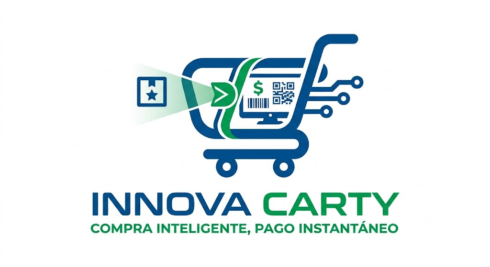<br>Innova Carty (Nuestro)</td>
                <td colspan="2"><br>Scan & Go (Apps)</td>
                <td colspan="2">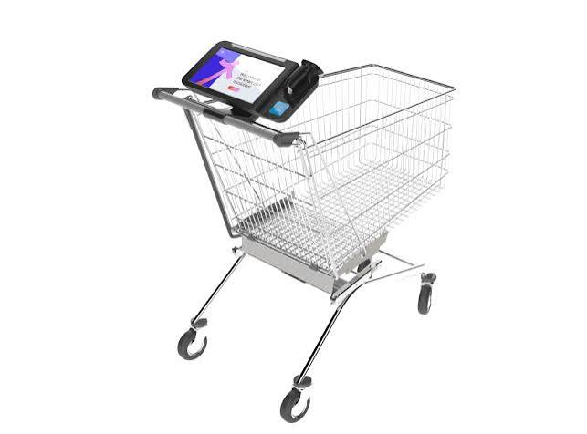<br>Smart-Cart</td>
                <td colspan="2">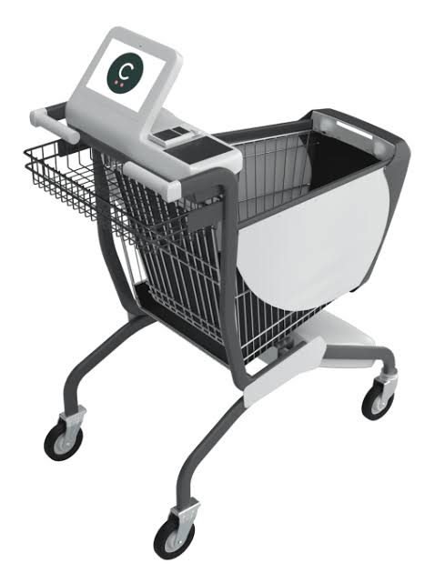<br>Caper Cart</td>
            </tr>
        </tr>
        <tr>
            <td rowspan="2" colspan="1">Perfil</td>
            <td colspan="2">Descripción general</td>
            <td colspan="2">Carrito inteligente IoT que escanea productos, calcula presupuesto en tiempo real y cobra vía QR local.</td>
            <td colspan="2">Aplicación móvil de supermercados donde el cliente usa su celular para escanear y pagar.</td>
            <td colspan="2">Carrito con tablet y datáfono físico integrado desarrollado para supermercados en Colombia.</td>
            <td colspan="2">Carrito premium con cámaras de IA de visión computacional y sensores de peso.</td>
        </tr>
        <tr>
            <td colspan="2">Ventaja competitiva<br>¿Qué valor ofrece?</td>
            <td colspan="2">Pagos universales por QR (Yape/Plin), control de límite de gasto y mínima fricción física.</td>
            <td colspan="2">No requiere inversión en hardware físico por parte del supermercado.</td>
            <td colspan="2">Respaldo de red de pagos (Credibanco), permite usar tarjetas de crédito físicas en el carrito.</td>
            <td colspan="2">Experiencia "Throw & Go": el usuario lanza el producto y las cámaras lo reconocen automáticamente.</td>
        </tr>
        <tr>
            <td rowspan="2" colspan="1">Perfil de Marketing</td>
            <td colspan="2">Mercado objetivo</td>
            <td colspan="2">Supermercados y clientes de retail en Perú enfocados en ahorro de tiempo y presupuesto.</td>
            <td colspan="2">Consumidores digitalizados que ya compran en cadenas de supermercados peruanos.</td>
            <td colspan="2">Cadenas de supermercados en Colombia y la región andina.</td>
            <td colspan="2">Grandes corporaciones de retail en Estados Unidos y mercados de primer mundo.</td>
        </tr>
        <tr>
            <td colspan="2">Estrategia de Marketing</td>
            <td colspan="2">Venta B2B destacando fidelización mediante Yape/Plin y la alerta de presupuesto límite.</td>
            <td colspan="2">Promociones in-store y descuentos exclusivos por usar la app del supermercado.</td>
            <td colspan="2">Alianzas corporativas directas entre la red de procesamiento y minoristas.</td>
            <td colspan="2">Presencia en grandes ferias globales de retail y respaldo corporativo de Instacart.</td>
        </tr>
        <tr>
            <td rowspan="3" colspan="1">Perfil de Producto</td>
            <td colspan="2">Producto & Servicio</td>
            <td colspan="2">Hardware (Carrito) con lector, pantalla táctil y software de pagos QR integrado.</td>
            <td colspan="2">Software (App móvil) instalada en el smartphone del usuario final.</td>
            <td colspan="2">Hardware (Carrito) adaptado con un terminal de pago POS robusto.</td>
            <td colspan="2">Hardware (Carrito premium) con tecnología de reconocimiento de imágenes 360°.</td>
        </tr>
        <tr>
            <td colspan="2">Precio & Costos</td>
            <td colspan="2">Costo medio de hardware. Gratuito para el consumidor final.</td>
            <td colspan="2">Inversión en software para el retail. Cero costo de hardware extra por carrito.</td>
            <td colspan="2">Costo alto B2B por la inclusión de terminales POS tradicionales.</td>
            <td colspan="2">Muy alto (miles de dólares) por uso intensivo de cámaras e IA.</td>
        </tr>
        <tr>
            <td colspan="2">Canales</td>
            <td colspan="2">Tiendas físicas retail y demostraciones piloto.</td>
            <td colspan="2">App Store, Google Play y banners en tienda.</td>
            <td colspan="2">Venta corporativa B2B.</td>
            <td colspan="2">Venta corporativa B2B.</td>
        </tr>
        <tr>
            <td rowspan="5">Análisis SWOT</td>
            <td colspan="10">Elabore un análisis para su startup y competidores. Las fortalezas deben respaldar oportunidades y reforzar ventajas competitivas.</td>
        </tr>
        <tr>
            <td colspan="2">Fortalezas</td>
            <td colspan="2">Fuerte enfoque en inclusión financiera (pagos QR) y alertas para no exceder presupuesto.</td>
            <td colspan="2">Escalabilidad inmediata y cero mantenimiento de hardware para el supermercado.</td>
            <td colspan="2">Soporte técnico directo de una gran procesadora de pagos tradicional.</td>
            <td colspan="2">Tecnología de punta, nula fricción al comprar y marca global reconocida.</td>
        </tr>
        <tr>
            <td colspan="2">Debilidades</td>
            <td colspan="2">El desarrollo y mantenimiento del hardware en los locales requiere inversión inicial.</td>
            <td colspan="2">Alta fricción: el usuario gasta batería y maniobra incómodamente con celular y productos.</td>
            <td colspan="2">El POS físico es pesado, tosco y propenso a sufrir daños en el carrito.</td>
            <td colspan="2">Costos prohibitivos para Latam; infraestructura muy compleja de mantener.</td>
        </tr>
        <tr>
            <td colspan="2">Oportunidades</td>
            <td colspan="2">Masiva adopción de billeteras digitales en Perú y demanda por evitar colas.</td>
            <td colspan="2">Integración nativa con programas de fidelidad como CMR o Tarjeta Oh!</td>
            <td colspan="2">Expansión hacia otros países sudamericanos con infraestructura de pagos similar.</td>
            <td colspan="2">Sinergia con ecosistemas de delivery y recolección de macrodatos de consumo.</td>
        </tr>
        <tr>
            <td colspan="2">Amenazas</td>
            <td colspan="2">Vandalismo hacia la pantalla o sensores, y rechazo de cadenas conservadoras.</td>
            <td colspan="2">Baja tasa de retención si el usuario prefiere no usar su teléfono personal.</td>
            <td colspan="2">Reemplazo por tecnologías de pago digital puro (QR) sin terminales físicos.</td>
            <td colspan="2">Tiendas sin cajeros (cámaras en el techo) que volverían obsoletos los carritos.</td>
        </tr>
    </tbody>
</table>

### 2.1.2. Estrategias y tácticas frente a competidores

Las estrategias preliminares de Innova Carty se construyen a partir del análisis competitivo anterior. Buscan contrarrestar las fortalezas de cada competidor, aprovechar sus debilidades y ubicar a la startup en el espacio que hoy ninguno ocupa: un carrito físico de costo medio, con pago por QR peruano (Yape/Plin) y control estricto del presupuesto del cliente.

#### Estrategia general

Innova Carty se posicionará como la opción **intermedia y localizada**. Es más económica que las soluciones con cámaras de IA (Caper Cart) y con POS físico (Smart-Cart). Es menos incómoda que las apps móviles (Scan & Go), porque el usuario no depende de su batería ni de su celular para escanear. Y está adaptada a los hábitos de pago del consumidor peruano.

#### Estrategias y tácticas por competidor

**Frente a Scan & Go (Apps)**

- **Fortaleza a contrarrestar:** no exige que el supermercado invierta en hardware, por lo que escala rápido.
- **Debilidad a aprovechar:** genera alta fricción, porque el usuario gasta batería y maniobra con el celular y los productos.
- **Estrategia:** diferenciación por experiencia de compra. El carrito tiene lector y pantalla propios, así que el cliente no necesita el celular para comprar.
- **Tácticas:**
  - Mostrar en las demostraciones piloto la comodidad de comprar con las manos libres, frente a comprar con el celular.
  - Ofrecer un modelo de alquiler o renting del hardware, para que el supermercado no asuma toda la inversión inicial y se reduzca su ventaja de "cero hardware".
  - Mantener la app móvil solo como complemento (consulta del presupuesto, historial de compras), sin hacerla obligatoria.

**Frente a Smart-Cart**

- **Fortaleza a contrarrestar:** cuenta con el respaldo de una red de pagos (Credibanco) y acepta tarjetas físicas.
- **Debilidad a aprovechar:** el POS físico es pesado, tosco y propenso a dañarse. Además, su costo B2B es alto.
- **Estrategia:** liderazgo en costos y adaptación al mercado local. Se reemplaza el terminal físico por un pago digital ligero mediante QR.
- **Tácticas:**
  - Integrar Yape y Plin, billeteras de uso masivo en Perú que no requieren terminal físico ni comisiones de datáfono tradicionales.
  - Destacar en la propuesta comercial el menor costo de mantenimiento por carrito, al no tener partes de pago pesadas ni frágiles.
  - Comunicar el pago por QR como una opción de inclusión financiera para clientes que no usan tarjeta de crédito.

**Frente a Caper Cart**

- **Fortaleza a contrarrestar:** ofrece tecnología de punta, una marca global y una experiencia sin fricción ("Throw & Go").
- **Debilidad a aprovechar:** sus costos son prohibitivos para Latinoamérica y su infraestructura es muy compleja de mantener.
- **Estrategia:** no competir en tecnología sino en accesibilidad. Se ofrece una solución "suficientemente inteligente" a una fracción del costo.
- **Tácticas:**
  - Dirigirse a supermercados medianos y de barrio, que no pueden pagar miles de dólares por carrito.
  - Usar sensores de peso y lector de productos, más simples que las cámaras de IA, para mantener bajos el costo y la complejidad del mantenimiento.
  - Comunicar que el carrito puede desplegarse por etapas, empezando con pocas unidades en un piloto, sin transformar toda la tienda.

#### Aprovechamiento de oportunidades y respuesta a amenazas

| Contexto                                                                                                 | Táctica de Innova Carty                                                                                                          |
|----------------------------------------------------------------------------------------------------------|----------------------------------------------------------------------------------------------------------------------------------|
| **Oportunidad:** adopción masiva de billeteras digitales en Perú                                         | Convertir el pago por QR en el eje del mensaje comercial y del producto.                                                         |
| **Oportunidad:** demanda por evitar colas                                                                | Medir y demostrar en los pilotos el tiempo ahorrado en caja.                                                                     |
| **Oportunidad:** programas de fidelidad (CMR, Tarjeta Oh!) que los competidores integran de forma nativa | Plantear integraciones de fidelización como una fase posterior de la hoja de ruta.                                               |
| **Amenaza:** vandalismo a la pantalla o a los sensores                                                   | Diseñar carcasas resistentes y sumar el sensor de peso y la alarma antirrobo, con notificación al panel del supermercado.        |
| **Amenaza:** rechazo de cadenas conservadoras                                                            | Ofrecer pilotos de bajo riesgo y compartir con el supermercado los datos de uso y de ahorro de tiempo.                           |
| **Amenaza:** tiendas sin cajeros (tecnología tipo Caper Cart)                                            | Enfocarse en el segmento de costo medio, donde esa tecnología aún no es viable, y mantener actualizable el software del carrito. |
| **Debilidad propia:** inversión inicial en hardware                                                      | Aplicar el modelo de renting o de pago por uso, y priorizar pocas unidades por local al inicio.                                  |

#### Ventajas que se buscan reforzar

1. **Pago local y universal:** QR con Yape/Plin, sin terminales físicos.
2. **Control estricto del presupuesto:** alerta al cliente cuando se acerca a su límite de gasto, algo que ninguno de los tres competidores destaca.
3. **Costo intermedio:** más accesible que Smart-Cart y Caper Cart, sin depender del celular del usuario como Scan & Go.


## 2.2. Entrevistas

### 2.2.1. Diseño de entrevistas

**Objetivo de las entrevistas:** Validar (o refutar) las suposiciones clave del Lean UX Canvas —que los compradores frecuentes desconocen cuánto llevan gastado durante su recorrido, y que los administradores de tienda enfrentan pérdidas operativas por mercancía no registrada y cuellos de botella en caja— antes de avanzar con el diseño de la solución.

**Metodología:** Entrevistas semiestructuradas de 5–10 minutos, presenciales o virtuales, considerando al menos 3 personas por segmento objetivo. Se estructuran en preguntas complementarias (datos demográficos, entorno tecnológico y hábitos para la elaboración del arquetipo) y preguntas principales (enfocadas en el flujo de compra, cuellos de botella y problemas reales).


#### Segmento 1: Comprador Moderno / Consumidor Final

##### Preguntas Complementarias (Demográficas y Psicográficas)
* ¿Cuál es su nombre completo, edad, estado civil y ocupación actual?
* ¿En qué distrito reside actualmente y con quiénes vive en su hogar?
* ¿Qué dispositivos electrónicos utiliza con mayor frecuencia (smartphone iOS/Android, laptop, tablet)?
* ¿Cuáles son las aplicaciones móviles y billeteras digitales que utiliza en su día a día (ej. Yape, Plin, banca móvil)?
* ¿Qué marcas de supermercados o retail prefiere visitar y por qué?

##### Preguntas Principales
* **Caldeamiento:** Cuéntame de tu última visita al supermercado. ¿Con qué frecuencia compras y en qué supermercado sueles hacerlo?
* **Comportamiento actual:** ¿Cómo llevas la cuenta de cuánto vas gastando mientras haces tus compras? ¿Te ha pasado que el total en caja fue distinto a lo que esperabas? ¿Qué hiciste en ese momento?
* **Dolor con el proceso actual:** ¿Cómo describirías la experiencia de espera en caja, especialmente en fines de semana o quincena?
* **Pagos digitales:** ¿Qué medios de pago usas normalmente en el supermercado? ¿Qué tan cómodo te sientes pagando con QR o billetera digital?
* **Cierre:** Si pudieras cambiar algo de tu experiencia de compra, ¿qué sería? ¿Qué tan dispuesto estarías a usar un carrito que te muestre el total en tiempo real y te permita pagar sin pasar por caja?

---

#### Segmento 2: Administrador de Tienda / Operaciones Retail

##### Preguntas Complementarias (Demográficas y Profesionales)
* ¿Cuál es su nombre completo, edad, profesión y cargo actual dentro del supermercado?
* ¿Cuántos años de experiencia tiene en la gestión de tiendas, piso de venta o control de inventarios?
* ¿En qué sede o formato de tienda labora y cuál es el volumen aproximado de clientes que transitan al día?
* ¿Qué herramientas informáticas, dispositivos móviles o sistemas ERP utiliza cotidianamente para supervisar las operaciones de tienda?
* ¿Qué canales de comunicación interna emplea para coordinar incidencias con el personal de seguridad y cajeros?

##### Preguntas Principales
* **Caldeamiento:** Cuénteme sobre su rutina diaria de supervisión en tienda. ¿Cuáles son los momentos de mayor tensión o congestión operativa durante la semana?
* **Cuellos de botella en cobro:** ¿Qué impacto tienen las colas en las cajas registradoras durante los horarios punta sobre la operación del personal y la satisfacción del cliente?
* **Gestión y prevención de mermas:** ¿Cómo gestionan actualmente la salida no verificada de productos o pérdidas en sala? ¿Qué tan complejo resulta conciliar el inventario físico con las ventas del día?
* **Adopción tecnológica:** ¿Qué iniciativas de auto-atención o control automatizado han implementado previamente y qué limitaciones o resistencias observaron en el personal o en los clientes?
* **Cierre:** Si pudiera implementar una solución tecnológica para automatizar el cobro y la validación de mercancía en sala, ¿qué requerimientos críticos de control y seguridad exigiría su equipo de operaciones?

### 2.2.2. Registro de entrevistas

#### Segmento 1: Comprador Moderno / Consumidor Final

##### Entrevista 1:

| Atributo | Detalle |
| --- | --- |
| Nombre | Joan Smit Rodriguez Rodriguez |
| Edad | 23 años |
| Distrito | Santiago de Surco |
| Ocupación | Analista júnior de marketing y estudiante |
| Fecha de entrevista | 16 de setiembre de 2026 |
| Timing | 00:00 - 05:19 (Duración: 5 min 19 s) |
| Enlace a la grabación | *[Ver en Microsoft Stream](https://upcedupe-my.sharepoint.com/:v:/g/personal/u20221a525_upc_edu_pe/IQC3NwWisOFtTqMQvQK8CiI7AXs9WZxF2Ps1J77UpPVe3ns?e=QH3VkI&nav=eyJyZWZlcnJhbEluZm8iOnsicmVmZXJyYWxBcHAiOiJTdHJlYW1XZWJBcHAiLCJyZWZlcnJhbFZpZXciOiJTaGFyZURpYWxvZy1MaW5rIiwicmVmZXJyYWxBcHBQbGF0Zm9ybSI6IldlYiIsInJlZmVycmFsTW9kZSI6InZpZXcifX0%3D)* |
| Captura de pantalla de la grabación |  |
| Resumen | Joan Smit reside en Santiago de Surco junto a su familia. Se desempeña como analista júnior de marketing y estudiante, manejando un estilo de vida activo y altamente digitalizado. Sus dispositivos de uso diario son un smartphone Android y una laptop Windows, interactuando constantemente a través de canales digitales como banca móvil (BCP e Interbank), redes sociales y billeteras digitales (Yape y Plin), las cuales utiliza de forma predeterminada para evitar el uso de efectivo. Suele acudir a supermercados de retail como Plaza Vea y Metro una o dos veces por semana, priorizando la cercanía a su domicilio y las promociones vigentes. Joan Smit manifiesta que su principal frustración ocurre en dos momentos críticos: la falta de control del gasto acumulado en tiempo real durante su recorrido (lo que en ocasiones le genera descuadres presupuestarios e incomodidad social al tener que solicitar el retiro de productos frente a la cajera) y los tiempos excesivos de espera en filas de pago tradicionales durante fines de semana y quincenas, llegando a perder entre 20 y 25 minutos. Se muestra sumamente receptivo y entusiasta ante la adopción de un carrito inteligente con IoT, señalando que una interfaz que le brinde visibilidad continua de su saldo acumulado y le permita efectuar un auto-pago inmediato mediante código QR con Yape o Plin optimizaría significativamente su experiencia de compra al erradicar por completo las colas en caja. |

##### Entrevista 2:

| Atributo | Detalle |
| --- | --- |
| Nombre | Max Sifuentes |
| Edad | 20 años |
| Distrito | Chorrillos |
| Ocupación | Estudiante de Ingeniería de Sistemas (UPC) |
| Fecha de entrevista | 17 de setiembre de 2026 |
| Timing | 00:00 - 06:34 (Duración: 6 min 34 s) |
| Enlace a la grabación | *[Ver en Microsoft Stream](https://upcedupe-my.sharepoint.com/personal/u202120569_upc_edu_pe/_layouts/15/stream.aspx?id=%2Fpersonal%2Fu202120569%5Fupc%5Fedu%5Fpe%2FDocuments%2FEntrevista%202%20Max%20Sifuentes%2Emp4&nav=eyJyZWZlcnJhbEluZm8iOnsicmVmZXJyYWxBcHAiOiJPbmVEcml2ZUZvckJ1c2luZXNzIiwicmVmZXJyYWxBcHBQbGF0Zm9ybSI6IldlYiIsInJlZmVycmFsTW9kZSI6InZpZXciLCJyZWZlcnJhbFZpZXciOiJNeUZpbGVzTGlua0NvcHkifX0&ga=1&referrer=StreamWebApp%2EWeb&referrerScenario=AddressBarCopied%2Eview%2E9e52c550%2D7f7d%2D43d5%2Da457%2D26843fc11f20)* |
| Captura de pantalla de la grabación |  |
| Resumen | Max es un estudiante de Ingeniería de Sistemas en la UPC de 20 años. Realiza compras en supermercados entre una y dos veces por semana, acudiendo principalmente a Hiperbodegas y Plaza Vea por su cercanía. Para controlar sus gastos, redondea mentalmente los precios hacia arriba y maneja saldos específicos en cuentas separadas de Interbank, ya que su método de pago exclusivo es digital a través de Apple Wallet y Plin. Manifiesta que su principal frustración son las esperas "brutales" e innecesarias al momento de pagar en caja, causadas por la mala organización de las tiendas y la inhabilitación de cajas rápidas. Max se muestra sumamente receptivo e interesado ante la adopción de un carrito inteligente IoT; destaca que contar con el presupuesto exacto en tiempo real, evitar problemas de verificación de precios y tener la capacidad de auto-pago rápido sin pasar por la caja tradicional optimizaría significativamente su experiencia de compra, e incluso lo motivaría a visitar las tiendas con mayor frecuencia. |

##### Entrevista 3:

| Atributo | Detalle |
| --- | --- |
| Nombre | Vanessa Samillan Garcia |
| Edad | 23 años |
| Distrito | Parcona (Ica) |
| Ocupación | Estudiante de Medicina Humana |
| Fecha de entrevista | 20 de setiembre de 2026 |
| Timing | 00:00 - 03:33 (Duración: 3 min 33 s) |
| Enlace a la grabación | *[Ver en Microsoft Stream](https://upcedupe-my.sharepoint.com/:v:/g/personal/u202215285_upc_edu_pe/IQA7Hyr_M3qiRLRqvRt78HfwASxywEBzCxnvKRJ_pO5RJgQ?nav=eyJyZWZlcnJhbEluZm8iOnsicmVmZXJyYWxBcHAiOiJPbmVEcml2ZUZvckJ1c2luZXNzIiwicmVmZXJyYWxBcHBQbGF0Zm9ybSI6IldlYiIsInJlZmVycmFsTW9kZSI6InZpZXciLCJyZWZlcnJhbFZpZXciOiJNeUZpbGVzTGlua0NvcHkifX0&e=NbgLXX)* |
| Captura de pantalla de la grabación |  |
| Resumen | Vanessa Samillan Garcia es estudiante de Medicina Humana, tiene 23 años y reside en Parcona, Ica, junto a su hermana. Usa principalmente laptop y celular; sus billeteras digitales de uso cotidiano son Yape y Plin. Prefiere supermercados grandes con buenos precios, sobre todo Metro y Plaza Vea, y suele hacer una compra mensual de alimentos. Lleva el gasto calculando mentalmente los precios durante el recorrido. Describe la espera en caja como bastante estresante: incluso cuando hace compras pequeñas y va a caja rápida, debe hacer colas largas y pierde mucho tiempo. En compras pequeñas paga en efectivo y en compras más grandes usa tarjeta. Se muestra dispuesta a probar un carrito inteligente que muestre el total en tiempo real a medida que coloca productos y permita pagar sin pasar por caja, porque le ahorraría tiempo innecesario en colas. |

#### Segmento 2: Administrador de Tienda / Operaciones

##### Entrevista 1:

|              Atributo               | Detalle                                                                                                                                                                                                                                                                                                                                                                                                                                                                                                                                                                                                                                                                                                                                                                                                                                                                                                                                                                                                                                                                                                                                                                                                                                                                                                                                                                                                                                                                                             |
|:-----------------------------------:|:----------------------------------------------------------------------------------------------------------------------------------------------------------------------------------------------------------------------------------------------------------------------------------------------------------------------------------------------------------------------------------------------------------------------------------------------------------------------------------------------------------------------------------------------------------------------------------------------------------------------------------------------------------------------------------------------------------------------------------------------------------------------------------------------------------------------------------------------------------------------------------------------------------------------------------------------------------------------------------------------------------------------------------------------------------------------------------------------------------------------------------------------------------------------------------------------------------------------------------------------------------------------------------------------------------------------------------------------------------------------------------------------------------------------------------------------------------------------------------------------------|
|               Nombre                | Erick Junior Shapiama Tello                                                                                                                                                                                                                                                                                                                                                                                                                                                                                                                                                                                                                                                                                                                                                                                                                                                                                                                                                                                                                                                                                                                                                                                                                                                                                                                                                                                                                                                                         |
|                Edad                 | 35 años                                                                                                                                                                                                                                                                                                                                                                                                                                                                                                                                                                                                                                                                                                                                                                                                                                                                                                                                                                                                                                                                                                                                                                                                                                                                                                                                                                                                                                                                                             |
|              Distrito               | Chorrillos                                                                                                                                                                                                                                                                                                                                                                                                                                                                                                                                                                                                                                                                                                                                                                                                                                                                                                                                                                                                                                                                                                                                                                                                                                                                                                                                                                                                                                                                                          |
|              Ocupación              | Técnico en administración                                                                                                                                                                                                                                                                                                                                                                                                                                                                                                                                                                                                                                                                                                                                                                                                                                                                                                                                                                                                                                                                                                                                                                                                                                                                                                                                                                                                                                                                           |
|         Fecha de entrevista         | 20 de setiembre de 2026                                                                                                                                                                                                                                                                                                                                                                                                                                                                                                                                                                                                                                                                                                                                                                                                                                                                                                                                                                                                                                                                                                                                                                                                                                                                                                                                                                                                                                                                             |
|               Timing                | 00:00 - 04:35 (Duración: 7 min 53 s)                                                                                                                                                                                                                                                                                                                                                                                                                                                                                                                                                                                                                                                                                                                                                                                                                                                                                                                                                                                                                                                                                                                                                                                                                                                                                                                                                                                                                                                                |
|        Enlace a la grabación        | [*Ver en Microsoft Stream*](https://upcedupe-my.sharepoint.com/:v:/g/personal/u20211d760_upc_edu_pe/IQBOG0JX4uP1QpOy6faiXd2fAWIuSWI_aVvNyI_z6i_uHN4?nav=eyJyZWZlcnJhbEluZm8iOnsicmVmZXJyYWxBcHAiOiJPbmVEcml2ZUZvckJ1c2luZXNzIiwicmVmZXJyYWxBcHBQbGF0Zm9ybSI6IldlYiIsInJlZmVycmFsTW9kZSI6InZpZXciLCJyZWZlcnJhbFZpZXciOiJNeUZpbGVzTGlua0NvcHkifX0&e=IzgM2m)                                                                                                                                                                                                                                                                                                                                                                                                                                                                                                                                                                                                                                                                                                                                                                                                                                                                                                                                                                                                                                                                                                                                           |
| Captura de pantalla de la grabación |                                                                                                                                                                                                                                                                                                                                                                                                                                                                                                                                                                                                                                                                                                                                                                                                                                                                                                                                                                                                                                                                                                                                                                                                                                                                                                                                                                                                                            |
|               Resumen               | El entrevistado es un jefe de operaciones de 35 años, con unos 10 años de experiencia en retail (cajero, supervisor de piso y ahora jefatura) y cuatro en el cargo actual, en una sede de Lima. Supervisa el piso de venta, las cajas y la seguridad, apoyándose en laptop o tablet, el punto de venta, el inventario central, las cámaras y un grupo de mensajería. Identifica la zona de cajas como el principal cuello de botella, sobre todo los viernes por la tarde, los fines de semana y en quincena, por la falta de personal, las fallas de equipos y las cajas de autoservicio que requieren ayuda. La mercadería que sale sin pago se controla con revisiones aleatorias de boletas y bolsas en la salida y con cámaras. Ese control no alcanza en horas punta sin generar más cola, y las mermas solo se detectan tarde, en el inventario. Las colas se miden de forma indirecta (libro de reclamaciones, encuestas y conteos ocasionales), sin datos en tiempo real. Está abierto a evaluar la solución si demuestra ahorro en personal de caja y en mermas, y empezaría con un piloto de pocas unidades. Para confiar en el pago dentro del carrito pide cuatro condiciones: que no haya falsos bloqueos a clientes honestos, que los pagos se concilien con su sistema de ventas, que el hardware resista el uso rudo y que haya un panel en tiempo real con las alertas de los carritos. Además, insiste en que la tecnología nueva debe integrarse con los sistemas que ya usa.   |


##### Entrevista 2:

| Atributo | Detalle |
| :--- | :--- |
| Nombre | Camila [apellido — completar] |
| Edad | 28 años |
| Distrito | [completar] |
| Ocupación | Encargada de operaciones en tienda retail |
| Fecha de entrevista | [completar] |
| Timing | [completar duración] |
| Enlace a la grabación | [Ver en YouTube](https://youtu.be/kIMXW7XIeIk) |
| Captura de pantalla de la grabación | <a href="https://youtu.be/kIMXW7XIeIk" target="_blank"></a> |
| Resumen | Camila tiene 28 años y se desempeña como encargada de operaciones en una tienda retail, con cinco años de experiencia en el sector y dos en su puesto actual. Supervisa el funcionamiento general de la tienda: inventario, atención al cliente, cajas, reposición y coordinación de personal en horas de alta afluencia. Identifica las colas en caja como el principal problema en horarios punta, lo que obliga a movilizar personal de otras áreas y genera quejas de clientes, sobre todo en fines de semana y quincenas. Sobre el control de mercancía, señala que el proceso actual (paso por caja más supervisión interna) siempre conlleva el riesgo de que algún producto no se registre correctamente, generando diferencias de inventario, pérdidas económicas y revisiones adicionales del personal. Actualmente gestionan ventas e inventario mediante sistemas de punto de venta. Se muestra receptiva a la idea de un carrito que identifique productos y envíe información en tiempo real al sistema, y considera positivo que el cliente pueda escanear, ver el total y pagar desde el carrito, ya que reduciría la afluencia en cajas en momentos de alta demanda. Condiciona su adopción a que el sistema sea seguro y confiable, se integre con el punto de venta e inventario existentes, sea fácil de usar tanto para clientes como para trabajadores, y cuente con mecanismos para detectar productos no registrados. Considera que podría reducir costos operativos de caja, aunque señala que habría que evaluar el costo de implementar y mantener los equipos. Se muestra dispuesta a probar el sistema, siempre que primero se haga una prueba piloto controlada que demuestre seguridad y correcto funcionamiento. |

### 2.2.3. Análisis de entrevistas

#### Segmento 1: Comprador Moderno / Consumidor Final

##### Perfil
* **Demografía:** Jóvenes y adultos de 20 a 30 años (estudiantes universitarios y analistas júnior) residentes en distritos urbanos de Lima Metropolitana (ej. Santiago de Surco).
* **Ecosistema Tecnológico:** Usuarios intensivos de smartphones con sistemas operativos Android e iOS.
* **Canales Financieros:** Operación 100% digital a través de billeteras móviles (**Yape**, **Plin**), tarjetas digitalizadas en **Apple Wallet** y aplicativos de banca móvil (**BCP**, **Interbank**). Desestiman el uso de efectivo en supermercados.
* **Hábitos de Compra:** Acuden entre 1 y 2 veces por semana a cadenas como Plaza Vea, Metro e Hiperbodegas, motivados principalmente por la proximidad a su domicilio y las promociones comerciales activas.

##### Hallazgos Cualitativos

| Variable de Análisis | Hallazgo Cualitativo Extraído |
| :--- | :--- |
| **Control Presupuestal** | Ante la falta de herramientas en tienda, recurren a métodos analógicos de cálculo mental: sumas aproximadas, redondeo hacia arriba y separación deliberada de saldos en cuentas bancarias para evitar sobregiros. |
| **Fricción en Caja (Dolor 1)** | **Incomodidad social y vergüenza:** Al descubrir el total recién frente a la cajera, se ven obligados a solicitar la anulación o retiro de productos en público frente a otros clientes en la fila. |
| **Pérdida de Tiempo (Dolor 2)** | **Esperas prolongadas:** Filas de 20 a 25 minutos en quincenas y fines de semana descritas como "brutales e innecesarias", agravadas por la inoperatividad de cajas rápidas de autoservicio. |
| **Transparencia de Precios** | Desconfianza recurrente provocada por discrepancias entre los precios exhibidos en las etiquetas de góndola y los valores cobrados en la terminal de caja. |
| **Receptividad Tecnológica** | Adopción entusiasta de la solución IoT. Valoran el cálculo en tiempo real y el autopago; manifiestan que erradicar las colas incrementaría su frecuencia de visita física a la tienda. |


##### Pains, Needs y Drivers de Adopción

* **Pains (Dolores Críticos):**
  * Incertidumbre financiera durante el recorrido.
  * Vergüenza social por anulación de productos en caja.
  * Tiempos muertos de 20 a 25 minutos en filas tradicionales.
  * Errores de precios de góndola versus sistema.

* **Needs (Necesidades Clave):**
  * Visibilidad instantánea y acumulada del subtotal en el carrito.
  * Verificación inmediata de precios y promociones automáticas al escanear.
  * Proceso de egreso autónomo y rápido.

* **Drivers de Adopción (Ganancias Esperadas):**
  * Autopago digital directo en la pantalla del carrito vía QR interoperable (Yape/Plin) y pagos sin contacto (NFC / Apple Wallet).
  * Eliminación total de la descarga de productos hacia fajas de cobro tradicionales.

##### Insights Clave 

* **Insight 1 (La carga cognitiva del cálculo analógico):**
  > *"Comprar en el supermercado no es solo elegir productos, es un ejercicio de estrés mental donde debo sumar, redondear y rezar para que el total en caja coincida con lo que tengo en mi cuenta bancaria."*  

  **Interpretación:** El usuario no carece de dinero, carece de predictibilidad. Obligar al cliente a asumir el rol de calculadora humana genera fatiga de decisión y frustración prematura antes de terminar el recorrido.

* **Insight 2 (El costo emocional de la anulación pública):**
  > *"Llegar a la caja y pedir que me retiren un producto me hace sentir juzgado por la cajera y por toda la fila que espera detrás de mí."*  

  **Interpretación:** La falta de visibilidad del monto acumulado trasciende el aspecto financiero: se convierte en un problema de estatus y vergüenza social. El carrito inteligente actúa como un escudo que devuelve la dignidad y el control privado sobre el presupuesto.

* **Insight 3 (El tiempo como factor de lealtad comercial):**
  > *"No dejo de ir al supermercado por falta de ganas de comprar, sino porque sé que perder 25 minutos en una fila arruina el resto de mi tarde."*  

  **Interpretación:** Las cajas tradicionales actúan como un detractor activo de la compra física. Eliminar el punto de cobro centralizado no es solo una mejora de conveniencia; desbloquea una mayor frecuencia de visita y ticket acumulado en clientes jóvenes.

#### Segmento 2: Administrador de Tienda / Operaciones

##### Perfil
* **Demografía y Rol:** Jefes de tienda, supervisores de piso de venta y encargados de prevención de pérdidas (28 a 50 años) en supermercados de cadena en Lima Metropolitana.
* **Formación:** Nivel técnico o universitario en Administración, Ingeniería Industrial o carreras afines.
* **Entorno de Trabajo:** Manejan software ERP de retail (SAP, Oracle Retail), terminales de Punto de Venta (POS), dispositivos móviles de inventario (PDAs/handhelds) y circuitos cerrados de televisión (CCTV).
* **Objetivos de Negocio:** Maximizar el flujo y rotación de clientes por hora, reducir las colas en horas pico, salvaguardar la rentabilidad y mantener el índice de merma desconocida dentro de los márgenes tolerados.

##### Hallazgos Cualitativos

| Variable de Análisis | Hallazgo Operativo Simulado |
| :--- | :--- |
| **Cuellos de Botella** | En horas punta (viernes tarde, fines de semana y quincenas) la línea de cajas colapsa. Pese a habilitar el 100% de terminales, el tiempo físico de descarga, escaneo y embolsado limita el flujo, generando abandono de carritos en pasillos y caídas en satisfacción (NPS). |
| **Riesgo de Merma** | Alerta ante la "merma invisible". Las cajas de auto-cobro ya sufren de omisión de ítems o sustitución de códigos. Se exige que el carrito cuente con validaciones mecánicas o volumétricas para evitar el retiro de productos sin registrar pago. |
| **Sincronización Técnica** | Resistencia a herramientas no integradas. Es obligatorio que el carrito sincronice su base de datos en tiempo real con el inventario central, promociones vigentes y reglas de precios del ERP/POS de la cadena. |
| **Durabilidad de Hardware** | Alta preocupación por el mantenimiento. Los carritos sufren maltrato continuo: choques en piso de venta, exposición a líquidos y traslado brusco en playas de estacionamiento exteriores. |

##### Pains, Needs y Drivers de Adopción

* **Pains (Dolores Críticos):**
  * Sobrecarga operativa y costo de horas extras en cajas tradicionales durante picos de demanda.
  * Pérdida desconocida (merma no detectada) derivada del auto-escaneo desatendido.
  * Descuadres contables generados por discrepancias de inventario en tiempo real.
  * Costo elevado por rotura o mantenimiento de equipamiento electrónico en tienda.

* **Needs (Necesidades Clave):**
  * Mecanismos de auditoría rápidos y confiables en la zona perimetral de salida.
  * Integración nativa con la infraestructura tecnológica de inventario y facturación preexistente.
  * Materiales de alta resistencia física e impermeabilidad en pantallas y sensores.

* **Drivers de Adopción (Ganancias Esperadas):**
  * Descongestión de la zona frontal de cajas y redistribución de personal hacia tareas de reposición y atención al cliente.
  * Proceso de salida validado en menos de 5 segundos mediante tótems o balizas de comprobación de ticket digital.
  * Reducción verificada del porcentaje de merma mediante sensores de concordancia de peso en la cesta.

##### Insights Clave

* **Insight 1 (El dilema de la velocidad frente al control):**
  > *"Quiero que el cliente salga lo más rápido posible para rotar la tienda, pero cada segundo que le quito al proceso de cobro tradicional siento que le abro la puerta a la merma no detectada."*  

  **Interpretación:** La agilidad sin trazabilidad es percibida como un riesgo inaceptable para los mandos de tienda. Para operaciones, la innovación no reside en quitar al cajero, sino en reemplazar la supervisión humana por una validación algorítmica y física (sensores de peso) que no incremente las pérdidas.

* **Insight 2 (El rechazo a la fricción tecnológica aislada):**
  > *"Si la tecnología no se habla de forma transparente con el ERP que ya usamos, no me está resolviendo un problema de colas; me está creando una pesadilla contable y de auditoría al final del turno."*  

  **Interpretación:** Los administradores priorizan la coherencia de datos sobre la novedad visual. Cualquier hardware en piso debe integrarse a la lógica de negocio preexistente sin exigir reprocesos de conciliación al cierre de jornada.

* **Insight 3 (La dura realidad del piso de venta):**
  > *"Un carrito de supermercado en Lima es tratado como una herramienta de carga pesada, no como un iPad. Si no resiste golpes, lluvia y rampas de estacionamiento, la inversión muere en el taller de mantenimiento."*  

  **Interpretación:** El éxito de la solución en tienda depende tanto de la robustez mecánica e industrial del hardware como de la calidad del software. La confiabilidad física es la condición previa para que operaciones acepte la tecnología.

#### Matriz Comparativa Cruzada

| Dimensión | Segmento 1: Comprador Moderno | Segmento 2: Administrador de Tienda |
| :--- | :--- | :--- |
| **Métrica Principal** | Reducción del tiempo total de compra y control exacto del presupuesto. | Reducción del porcentaje de merma y aumento de tickets facturados por hora. |
| **Principal Fricción** | Espera en filas y vergüenza social al anular productos en caja. | Cuellos de botella en picos comerciales y riesgo de hurto en autopago. |
| **Requerimiento Crítico** | Pantalla con saldo acumulado en vivo y cobro con Yape, Plin o Apple Wallet. | Integración nativa con ERP de inventario y sensores de peso antifraude. |
| **Riesgo Percibido** | Errores en precios de oferta o pérdida de señal de red al momento de pagar. | Vandalismo, rotura de pantallas y salida de mercancía no facturada. |
---

## 2.3. Needfinding

### 2.3.1. User Personas

#### Comprador Moderno / Consumidor Final

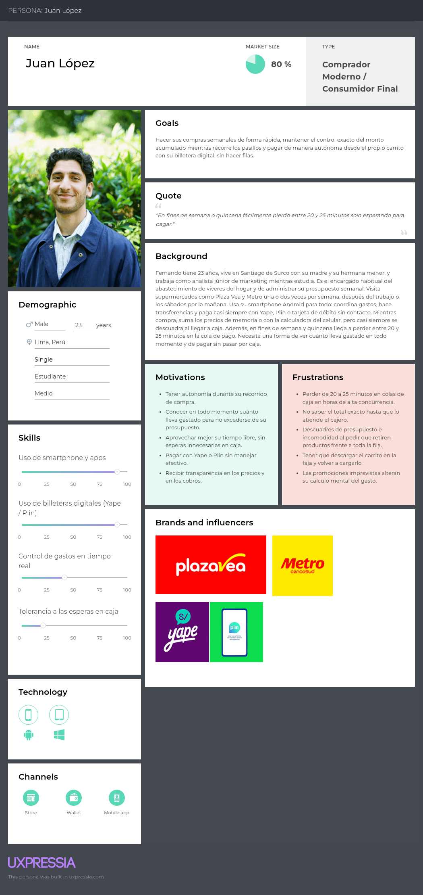


#### Administrador de Tienda / Operaciones

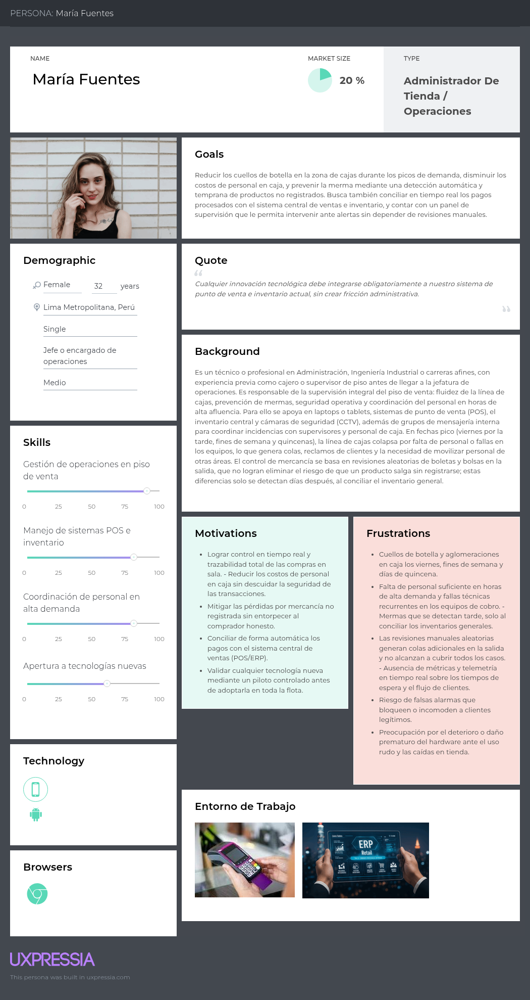

### 2.3.2. User Task Matrix

|Tarea |Frecuencia|Importancia|
|------- |---------|----------|
|Activar el carrito inteligente| Alta | Media |
|Escanear productos  | Alta | Alta |
|Consultar acumulado de compra  | Alta | Alta |
|Registrar presupuesto límite | Media | Media |
|Actualizar lista del carrito | Alta | Alta|
|Alertas de inconsistencia | Baja | Alta |
|Pagar con QR | Alta | Alta |
|Validar comprobante | Alta | Media |


### 2.3.3. User Journey Mapping

En esta sección se muestran los User Journey Maps, que describen de principio a fin el recorrido que viven nuestros segmentos objetivo antes de la implementación de la solución propuesta.

**Segmento 1: Comprador Moderno / Consumidor Final**


**Segmento 2: Administrador de Tienda / Operaciones**


### 2.3.4. Empathy Mapping

En esta sección se sintetizan los hallazgos cualitativos y conductuales obtenidos durante la fase de entrevistas de investigación. Para comprender a profundidad las necesidades, frustraciones y motivaciones de nuestros usuarios, el equipo estructuró los mapas de empatía utilizando la plataforma UXPressia. El proceso se centró en posicionar al arquetipo de cada segmento en el centro para responder metódicamente a los cuadrantes clave: qué piensa y siente, qué ve, qué oye, qué dice y hace, identificando a partir de ello sus principales dolores (*Pains*) y beneficios esperados (*Gains*).

#### Segmento 1: Comprador Moderno / Consumidor Final

El mapa de empatía para el Segmento 1 representa a jóvenes y adultos que realizan compras periódicas en cadenas de supermercados, priorizan el ahorro de tiempo, administran un presupuesto delimitado y utilizan billeteras digitales de forma cotidiana. A través de este artefacto se evidencian las fricciones causadas por la falta de visibilidad del monto acumulado y la incomodidad de las colas tradicionales de facturación.

<p align="center">
  
</p>
<p align="center"><em>Figura: Mapa de Empatía para el Segmento 1 elaborado en UXPressia.</em></p>

---

#### Segmento 2: Administrador de Tienda / Operaciones

El mapa de empatía para el Segmento 2 sintetiza los hallazgos conductuales y operativos de los responsables del piso de venta y prevención de pérdidas en establecimientos de retail. Este arquetipo evidencia la tensión constante que enfrentan durante los horarios pico entre agilizar el tránsito en la línea de cajas y mantener la trazabilidad rigurosa de los inventarios para evitar la merma comercial no detectada.

<p align="center">
  
</p>
<p align="center"><em>Figura: Mapa de Empatía para el Segmento 2 elaborado en UXPressia.</em></p>

## 2.4. Big Picture EventStorming
El Big Picture Event Storming nos permite tener una visión clara y completa de cómo funcionan los procesos dentro de nuestra solución. A través de esta técnica visual identificamos los eventos más importantes, los posibles problemas y también las oportunidades de mejora. De esta manera, podemos centrarnos en procesos clave para analizarlos de forma más detallada. Algunos de estos procesos claves son los siguientes:


---

## 2.5. Ubiquitous Language

Esta sección establece el Ubiquitous Language (Lenguaje Ubicuo) de la solución Innova Carty, formalizando un vocabulario unificado y riguroso entre los miembros del equipo y los interesados del negocio (*stakeholders*). De acuerdo con las directrices de Domain-Driven Design planteadas por Eric Evans, las definiciones se centran exclusivamente en los procesos, reglas y conceptos propios del dominio de compras en retail y supervisión operativa en tienda física, omitiendo terminología técnica de desarrollo de software para garantizar una comunicación fluida, inequívoca y transversal.

* **Audit Flag (Marca de Auditoría):** Señalización operativa aplicada sobre una compra cuando se registran anomalías persistentes entre los artículos leídos y las comprobaciones físicas de la unidad.
* **Budget Limit (Límite de Presupuesto):** Monto monetario máximo fijado voluntariamente por el consumidor antes o durante su recorrido para regular su gasto en tienda.
* **Budget Threshold Alert (Alerta de Umbral de Presupuesto):** Advertencia visual emitida al comprador cuando el costo acumulado de los artículos alcanza o supera el 90% del límite financiero preestablecido.
* **Cashierless Checkout (Cobro sin Cajero):** Procedimiento comercial mediante el cual el consumidor realiza el pago íntegro de su canasta de compra directamente desde el carrito, prescindiendo de la intervención de un cajero tradicional.
* **Digital Receipt (Comprobante Electrónico):** Boleta o factura de venta emitida inmediatamente tras la confirmación de la transacción, disponible para visualización del cliente y verificación de salida.
* **Discrepancy (Discrepancia):** Estado de incongruencia detectado en la canasta cuando la lectura de un artículo no coincide con los parámetros esperados de carga del producto ingresado.
* **Exit Clearance (Autorización de Salida):** Estado comercial y de seguridad que certifica que todos los productos contenidos en la canasta han sido pagados satisfactoriamente, habilitando el retiro formal de la mercancía.
* **Geofence Perimeter (Perímetro de Seguridad en Tienda):** Límite físico y geográfico delimitado dentro del establecimiento comercial fuera del cual las unidades de compra no deben transitar sin una autorización de salida activa.
* **Instant QR Payment (Pago Instantáneo por QR):** Mecanismo de cobro dinámico presentado en el punto de interacción del carrito que permite liquidar la compra mediante billeteras digitales interoperables (como Yape o Plin) o banca móvil.
* **Item Catalog (Catálogo de Artículos):** Registro oficial de productos comercializados por el supermercado que contiene descripciones comerciales, precios unitarios, pesos promedio nominales y márgenes de variación.
* **Item Tare Weight (Margen de Tolerancia de Peso):** Variación de masa permitida para un producto debido a envolturas, empaques secundarios, humedad o diferencias naturales en alimentos envasados.
* **Merchandise Shrinkage (Merma Comercial):** Pérdida económica que sufre el establecimiento minorista debido a sustracción indebida, manipulación incorrecta o salida de productos sin registro de pago.
* **On-Cart Display (Pantalla Integrada al Carrito):** Panel visual montado en la estructura física del carrito que expone al consumidor el resumen detallado de su compra, el saldo acumulado, las alertas y el código de pago.
* **Order Item (Artículo de Compra):** Bien o producto individual seleccionado por el comprador y colocado dentro de la canasta comercial.
* **Real-Time Total (Total Acumulado en Tiempo Real):** Valor monetario consolidado de los productos válidamente registrados en la canasta de compra que se actualiza instantáneamente tras cada adición o retiro.
* **Return of Item (Devolución / Retiro de Artículo):** Acto comercial mediante el cual el cliente retira un artículo de su canasta, provocando el descuento del monto correspondiente en el total acumulado de la compra.
* **RFID Product Tag (Etiqueta RFID de Producto):** Identificador electrónico pasivo adherido a la mercancía del supermercado que transmite los datos comerciales del artículo al aproximarse al área de recepción del carrito.
* **Shopping Cart Lock (Bloqueo Preventivo del Carrito):** Medida de seguridad física o inmovilización de ruedas aplicada a una unidad de compra cuando se detecta un intento de salida no autorizada fuera del perímetro comercial.
* **Shopping Session (Sesión de Compra):** Intervalo continuo que inicia cuando un consumidor toma un carrito para comenzar a elegir productos y finaliza cuando concluye el pago y la verificación de salida del local.
* **Smart Cart (Carrito Inteligente):** Unidad física móvil de recolección de productos adaptada con elementos de censado, pesaje y visualización interactiva para gestionar compras autónomas.
* **Store Floor Supervisor (Supervisor de Piso de Venta):** Personal operativo responsable de supervisar la fluidez de las compras, atender contingencias de cobro y autorizar salidas excepcionales en tienda.
* **Unverified Merchandise (Mercancía No Verificada):** Todo artículo presente físicamente en la canasta de compra que carece de registro formal de lectura o validación comercial.
* **Weight Confirmation (Confirmación por Peso):** Validación física realizada en la canasta del carrito para comprobar que la variación de masa corresponda al peso nominal del artículo registrado.


# Capítulo III: Requirements Specification

## 3.1. User Stories

En esta sección se formalizan los requisitos funcionales de la solución Innova Carty mediante el desglose de Épicas (Epics), Historias de Usuario (User Stories) e Historias Técnicas (Technical Stories). La especificación contempla la experiencia integral de la plataforma: la interacción del visitante en el Landing Page, la autonomía del Comprador Moderno en el Smart Cart, la gestión operativa del Administrador de Tienda, y los servicios de backend para desarrolladores. Todos los criterios de aceptación siguen la sintaxis formal de Gherkin (Given-When-Then), redactados en tiempo presente y tercera persona, garantizando verificabilidad e independencia de detalles superfluos de interfaz.

| Epic / Story ID | Título | Descripción | Criterios de Aceptación | Relacionado con (Epic ID) |
| :--- | :--- | :--- | :--- | :--- |
| **EP01** | Landing Page y Difusión del Modelo de Negocio | Como visitante de la plataforma, deseo acceder a un portal web informativo y accesible para conocer las ventajas comerciales, la tecnología del Smart Cart y los canales de contacto de Innova Carty. | N/A (Contenedor de alto nivel) | N/A |
| **US01** | Presentación de la Propuesta de Valor en Landing Page | Como visitante consumidor, deseo visualizar la explicación del funcionamiento del carrito inteligente en la página de inicio para entender cómo me ayuda a ahorrar tiempo y controlar mi presupuesto. | **Escenario 1: Visualización de características clave**<br>Dado que el visitante carga la página de inicio del Landing Page, cuando se desplaza hacia la sección principal de beneficios, entonces el sistema presenta de forma interactiva el flujo de escaneo RFID, control de presupuesto y cobro inmediato por QR.<br><br>**Escenario 2: Redirección al prototipo interactivo**<br>Dado que el visitante se encuentra en la sección principal, cuando hace clic en el botón de llamada a la acción "Conocer Solución", entonces el sistema lo redirige a la sección interactiva con la demostración de los productos digitales. | EP01 |
| **US02** | Registro de Contacto Corporativo para Supermercados | Como visitante del segmento administrador de retail, deseo enviar una solicitud de información comercial a través de un formulario web para evaluar la implementación de los Smart Carts en mi cadena de tiendas. | **Escenario 1: Envío de solicitud comercial válido**<br>Dado que el representante de supermercado completa los campos obligatorios de RUC, razón social, correo corporativo y cantidad estimada de unidades, cuando pulsa en "Solicitar Demostración", entonces el sistema registra los datos comerciales y presenta un mensaje de confirmación de envío.<br><br>**Escenario 2: Detección de correo o campos inválidos**<br>Dado que el visitante ingresa un formato de correo electrónico no válido o deja campos vacíos requeridos, cuando intenta enviar el formulario, entonces el sistema bloquea el envío y resalta visualmente los campos con inconsistencias. | EP01 |
| **US03** | Consulta de Términos del Servicio y Políticas de Privacidad | Como visitante, deseo consultar los términos y condiciones de servicio y las políticas de protección de datos personales en el pie de página para verificar la confiabilidad de la plataforma. | **Escenario 1: Acceso a políticas legales**<br>Dado que el visitante navega por cualquier sección del Landing Page, cuando hace clic en el enlace "Términos y Condiciones" ubicado en el pie de página, entonces el sistema despliega el documento formal con las cláusulas de tratamiento de datos personales y garantías de seguridad. | EP01 |
| **EP02** | Control y Seguimiento del Presupuesto en el Carrito (Segmento 1) | Como comprador moderno, deseo definir y monitorear mi límite de gasto en tiempo real en la pantalla del carrito para no excederme del dinero que tengo disponible. | N/A (Contenedor de alto nivel) | N/A |
| **US04** | Configuración de Presupuesto Límite de Compra | Como comprador moderno, deseo ingresar un monto tope de dinero al iniciar mi sesión de compra para recibir avisos preventivos si estoy próximo a superarlo. | **Escenario 1: Ingreso de presupuesto válido**<br>Dado que el comprador inicia una sesión en la pantalla del carrito, cuando digita un monto monetario mayor a cero y confirma la asignación, entonces el sistema establece dicho valor como el límite presupuestario de la sesión activa.<br><br>**Escenario 2: Ingreso de valores no permitidos**<br>Dado que el comprador intenta ingresar un valor negativo o caracteres no numéricos, cuando presiona confirmar, entonces el sistema deniega el registro y solicita ingresar un monto válido en soles. | EP02 |
| **US05** | Visualización Dinámica del Total Acumulado | Como comprador moderno, deseo ver reflejado el costo total y el desglose de productos al instante en la pantalla del carrito cada vez que agrego un producto para conocer exactamente cuánto voy a pagar. | **Escenario 1: Actualización de saldo al ingresar artículo**<br>Dado que el comprador coloca un artículo validado en el carrito, cuando el sensor registra la lectura, entonces el sistema incrementa el monto acumulado sumando el precio unitario del artículo y actualiza la lista en pantalla.<br><br>**Escenario 2: Alerta de umbral de presupuesto superado**<br>Dado que la suma acumulada de los artículos alcanza o supera el 90% del límite de presupuesto fijado, cuando el sistema recalcula el total, entonces emite una alerta visual en pantalla notificando la cercanía al límite establecido. | EP02 |
| **EP03** | Lectura, Validación y Autonomía de Compra (Segmento 1) | Como comprador moderno, deseo registrar artículos mediante RFID y liquidar mi compra autónomamente por QR para evitar filas en caja tradicional. | N/A (Contenedor de alto nivel) | N/A |
| **US06** | Registro Automático de Artículo mediante Lectura RFID | Como comprador moderno, deseo que el carrito detecte el producto al introducirlo en la canasta para agregarlo a mi orden sin necesidad de buscar códigos de barras manualmente. | **Escenario 1: Lectura de etiqueta exitosa**<br>Dado que el comprador deposita un artículo con etiqueta RFID válida en la cesta, cuando el lector del carrito detecta el código pasivo, entonces el sistema recupera la información comercial del artículo y lo asocia a la orden activa.<br><br>**Escenario 2: Etiqueta no reconocida o dañada**<br>Dado que el código RFID ingresado no existe en el catálogo local de la tienda, cuando se ejecuta el censado, entonces el sistema emite un aviso sonoro y visual indicando que el artículo debe ser reintentado o reportado. | EP03 |
| **US07** | Retiro y Descuento de Artículo de la Canasta | Como comprador moderno, deseo retirar un artículo del carrito y que el monto total se descuente de manera automática para prescindir de productos que decida no llevar. | **Escenario 1: Retiro de producto validado**<br>Dado que el comprador extrae un artículo previamente cargado, cuando el sensor de carga detecta una reducción equivalente al peso del artículo y el lector confirma su extracción, entonces el sistema resta el precio del artículo del total acumulado y lo retira de la lista en pantalla. | EP03 |
| **US08** | Liquidación de Orden y Pago Autónomo con QR Dinámico | Como comprador moderno, deseo generar un código QR único por el total de mi canasta en la pantalla del carrito para pagar con mi billetera digital sin pasar por cajas. | **Escenario 1: Emisión de código QR para pago**<br>Dado que el comprador finaliza la selección de productos y no existen discrepancias activas, cuando pulsa la opción "Proceder al Pago", entonces el sistema genera y despliega en pantalla un código QR dinámico asociado a la orden y al monto exacto.<br><br>**Escenario 2: Confirmación inmediata de pago**<br>Dado que el comprador completa la transferencia desde Yape o Plin, cuando la pasarela notifica la recepción conforme de los fondos, entonces el carrito despliega el comprobante digital y genera la autorización de salida. | EP03 |
| **EP04** | Prevención de Mermas y Validación de Peso (Segmento 2) | Como administrador de operaciones, deseo que el sistema verifique automáticamente la correspondencia física de peso de los artículos para evitar la sustracción de mercancía no registrada. | N/A (Contenedor de alto nivel) | N/A |
| **US09** | Validación de Peso en Canasta contra Catálogo | Como administrador de operaciones, deseo que el carrito contraste el incremento de peso medido por las celdas de carga con el peso teórico del catálogo para certificar que el producto ingresado sea auténtico. | **Escenario 1: Peso coincidente dentro de tolerancia**<br>Dado que un artículo RFID ha sido detectado, cuando las celdas de carga registran un incremento de peso que se ubica dentro del rango de tolerancia nominal del producto, entonces el sistema valida la inclusión del artículo satisfactoriamente.<br><br>**Escenario 2: Discrepancia por masa no identificada**<br>Dado que se registra un aumento de peso sin una lectura RFID válida asociada, cuando transcurren 3 segundos, entonces el sistema activa un estado de discrepancia e inmoviliza temporalmente la opción de pago. | EP04 |
| **US10** | Detección de Retiro No Registrado de Productos | Como administrador de operaciones, deseo que el carrito alerte si se retira mercancía sin pasar por el proceso formal de devolución para evitar manipulaciones indebidas en los pasillos. | **Escenario 1: Disminución de peso sin lectura de baja**<br>Dado que se detecta una disminución de peso en la celda de carga pero la etiqueta RFID no confirma la acción de retiro, cuando transcurre el tiempo de verificación, entonces el sistema emite una advertencia al usuario y registra el evento en la bitácora de auditoría. | EP04 |
| **EP05** | Supervisión en Piso de Venta y Seguridad Perimetral (Segmento 2) | Como administrador de operaciones, deseo monitorizar las unidades en circulación, gestionar alertas en tiempo real y controlar el perímetro de salida para asegurar la integridad de la tienda. | N/A (Contenedor de alto nivel) | N/A |
| **US11** | Monitoreo en Tiempo Real desde Consola Web Operativa | Como administrador de operaciones, deseo visualizar en un tablero web el estado de todos los carritos activos en tienda (en compra, con discrepancia, pagado) para intervenir oportunamente. | **Escenario 1: Visualización del mapa y estado de carritos**<br>Dado que el administrador inicia sesión en la aplicación web de operaciones, cuando carga el módulo de monitoreo, entonces el sistema expone el listado completo de unidades activas, indicando su ID, estado de sesión, saldo actual y alertas vigentes.<br><br>**Escenario 2: Asistencia y desbloqueo manual por supervisor**<br>Dado que un carrito se encuentra bloqueado por discrepancia de peso, cuando el supervisor acude, verifica el contenido e ingresa sus credenciales de auditoría, entonces el sistema restablece la sesión y permite al cliente continuar su compra. | EP05 |
| **US12** | Control Perimetral y Bloqueo por Geofencing | Como administrador de operaciones, deseo que el sistema bloquee las ruedas del carrito e impida la salida si una unidad cruza el perímetro sin autorización de pago emitida. | **Escenario 1: Intento de cruce perimetral sin pago**<br>Dado que una unidad se aproxima al perímetro de salida sin un comprobante de pago emitido, cuando el sensor perimetral detecta la proximidad del carrito, entonces el sistema dispara una alarma acústica y activa el freno electromecánico del carrito.<br><br>**Escenario 2: Tránsito de salida autorizado**<br>Dado que el carrito posee estado "Paid" con autorización de salida vigente, cuando cruza el arco perimetral de la tienda, entonces el sistema registra la salida conforme y concluye la sesión sin disparar bloqueos. | EP05 |
| **US13** | Gestión y Actualización del Catálogo de Productos y Tolerancias | Como administrador de operaciones, deseo actualizar precios, pesos nominales y márgenes de tolerancia de los productos para mantener calibrada la validación de los carritos inteligentes. | **Escenario 1: Actualización de parámetros de peso**<br>Dado que el administrador accede al módulo de inventario, cuando modifica el peso nominal o el rango de tolerancia de un SKU y guarda los cambios, entonces el sistema propaga la nueva regla a la base de datos central y a los servicios edge. | EP05 |
| **EP06** | Servicios RESTful y Telemetría IoT en la Nube | Como desarrollador de software, deseo contar con servicios web RESTful robustos y seguros para sincronizar la telemetría del carrito, procesar órdenes de compra y conectar el backend central con los dispositivos edge. | N/A (Contenedor de alto nivel) | N/A |
| **TS01** | Recepción e Ingesta de Telemetría desde Dispositivo Edge | Como desarrollador del backend, deseo exponer un endpoint RESTful HTTP POST para recibir lecturas periódicas de peso, estado de carga de batería e identificadores de artículos desde el Edge API del carrito. | **Escenario 1: Procesamiento exitoso de telemetría**<br>Dado un payload JSON válido que contiene el identificador único del carrito, valor numérico de peso y lista de etiquetas RFID detectadas, cuando el Edge Service realiza una petición HTTP POST al endpoint `/api/v1/telemetry`, entonces el servicio responde con código HTTP 201 Created y persiste el evento en la base de datos.<br><br>**Escenario 2: Payload con estructura o datos corruptos**<br>Dado un cuerpo de solicitud JSON con atributos obligatorios ausentes o tipos de datos inconsistentes, cuando se envía la petición HTTP POST a `/api/v1/telemetry`, entonces el servicio rechaza la solicitud retornando código HTTP 400 Bad Request y un detalle del error de validación. | EP06 |
| **TS02** | Creación y Consulta de Órdenes de Compra | Como desarrollador de aplicaciones cliente, deseo disponer de endpoints RESTful para aperturar sesiones de compra y consultar el balance económico consolidado en cualquier instante. | **Escenario 1: Creación de nueva orden de compra**<br>Dado que una unidad inicia recorrido, cuando la aplicación envía una petición HTTP POST al recurso `/api/v1/orders` con el ID del carrito, entonces el API responde con código HTTP 201 Created retornando el identificador único de la orden generada.<br><br>**Escenario 2: Consulta del balance acumulado de orden**<br>Dado un identificador de orden existente, cuando el cliente efectúa una solicitud HTTP GET al recurso `/api/v1/orders/{orderId}`, entonces el servicio retorna código HTTP 200 OK con el objeto JSON que desglosa los artículos registrados, subtotales y el monto acumulado actual. | EP06 |
| **TS03** | Webhook de Confirmación de Pagos Externos | Como desarrollador del backend, deseo procesar notificaciones asíncronas vía webhook desde la pasarela de pagos digitales para conciliar transacciones en tiempo real. | **Escenario 1: Notificación de abono confirmada por pasarela**<br>Dado que la pasarela externa despacha una petición HTTP POST al endpoint `/api/v1/payments/webhook` con firma criptográfica válida y estado aprobado, cuando el servicio valida el webhook, entonces actualiza el estado de la orden a "Paid" y retorna código HTTP 200 OK.<br><br>**Escenario 2: Firma de seguridad no verificada**<br>Dado que la solicitud webhook presenta una firma digital adulterada o ausente, cuando el servicio valida las cabeceras de autenticación, entonces deniega el procesamiento retornando código HTTP 401 Unauthorized. | EP06 |

## 3.2. Impact Mapping

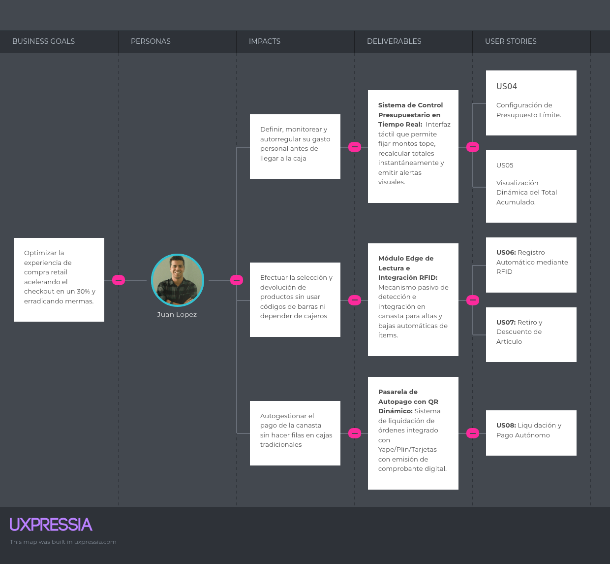

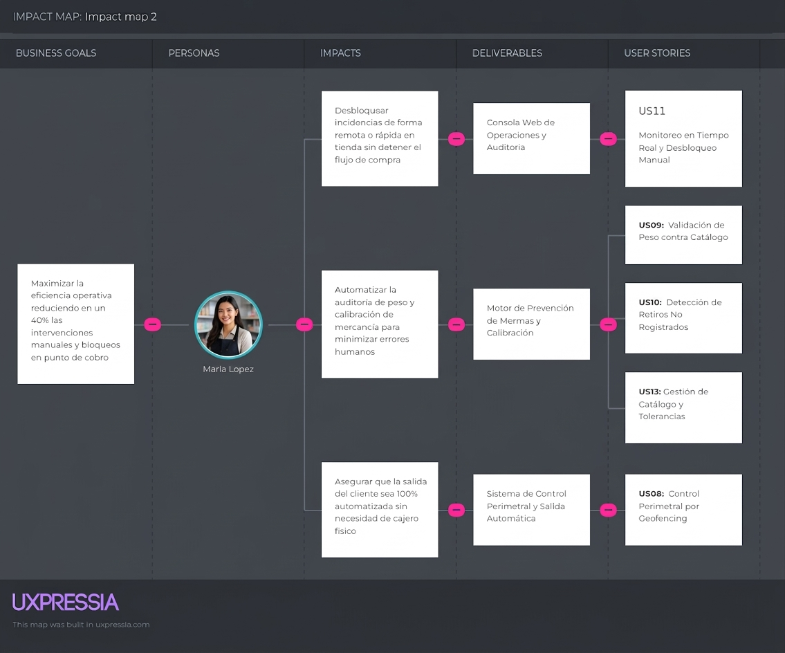
---

## 3.3. Product Backlog

El Product Backlog de Innova Carty se ordena según el valor que cada historia aporta al negocio. Las historias del Landing Page van al inicio para que se consideren desde el primer sprint. Les siguen los servicios base y el flujo central de la solución: registro de productos, control de presupuesto, validación por peso y pago por QR. Al final quedan las funcionalidades de supervisión y de gestión operativa. Las estimaciones usan la escala de Story Points 1 / 2 / 3 / 5 / 8.

| # Orden   | User Story Id   | Título                                                          | Descripción                                                                                                                                                                                                               | Story Points (1 / 2 / 3 / 5 / 8)   |
|:---------:|:---------------:|:----------------------------------------------------------------|:--------------------------------------------------------------------------------------------------------------------------------------------------------------------------------------------------------------------------|:----------------------------------:|
|     1     |      US01       | Presentación de la Propuesta de Valor en Landing Page           | Como visitante consumidor, deseo visualizar la explicación del funcionamiento del carrito inteligente en la página de inicio para entender cómo me ayuda a ahorrar tiempo y controlar mi presupuesto.                     |                 3                  |
|     2     |      US02       | Registro de Contacto Corporativo para Supermercados             | Como visitante del segmento administrador de retail, deseo enviar una solicitud de información comercial a través de un formulario web para evaluar la implementación de los Smart Carts en mi cadena de tiendas.         |                 3                  |
|     3     |      US03       | Consulta de Términos del Servicio y Políticas de Privacidad     | Como visitante, deseo consultar los términos y condiciones de servicio y las políticas de protección de datos personales en el pie de página para verificar la confiabilidad de la plataforma.                            |                 1                  |
|     4     |      TS02       | Creación y Consulta de Órdenes de Compra                        | Como desarrollador de aplicaciones cliente, deseo disponer de endpoints RESTful para aperturar sesiones de compra y consultar el balance económico consolidado para conocer en cualquier instante el estado de una orden. |                 5                  |
|     5     |      TS01       | Recepción e Ingesta de Telemetría desde Dispositivo Edge        | Como desarrollador del backend, deseo exponer un endpoint RESTful HTTP POST para recibir las lecturas de peso, batería e identificadores de artículos del Edge API para persistir la telemetría del carrito en la nube.   |                 5                  |
|     6     |      US06       | Registro Automático de Artículo mediante Lectura RFID           | Como comprador moderno, deseo que el carrito detecte el producto al introducirlo en la canasta para agregarlo a mi orden sin necesidad de buscar códigos de barras manualmente.                                           |                 8                  |
|     7     |      US05       | Visualización Dinámica del Total Acumulado                      | Como comprador moderno, deseo ver reflejado el costo total y el desglose de productos al instante en la pantalla del carrito para conocer exactamente cuánto voy a pagar.                                                 |                 5                  |
|     8     |      US04       | Configuración de Presupuesto Límite de Compra                   | Como comprador moderno, deseo ingresar un monto tope de dinero al iniciar mi sesión de compra para recibir avisos preventivos si estoy próximo a superarlo.                                                               |                 3                  |
|     9     |      US08       | Liquidación de Orden y Pago Autónomo con QR Dinámico            | Como comprador moderno, deseo generar un código QR único por el total de mi canasta en la pantalla del carrito para pagar con mi billetera digital sin pasar por cajas.                                                   |                 8                  |
|    10     |      TS03       | Webhook de Confirmación de Pagos Externos                       | Como desarrollador del backend, deseo procesar notificaciones asíncronas vía webhook desde la pasarela de pagos digitales para conciliar las transacciones en tiempo real.                                                |                 5                  |
|    11     |      US09       | Validación de Peso en Canasta contra Catálogo                   | Como administrador de operaciones, deseo que el carrito contraste el incremento de peso medido por las celdas de carga con el peso teórico del catálogo para certificar que el producto ingresado sea auténtico.          |                 8                  |
|    12     |      US07       | Retiro y Descuento de Artículo de la Canasta                    | Como comprador moderno, deseo retirar un artículo del carrito y que el monto total se descuente de manera automática para prescindir de los productos que decida no llevar.                                               |                 5                  |
|    13     |      US10       | Detección de Retiro No Registrado de Productos                  | Como administrador de operaciones, deseo que el carrito alerte si se retira mercancía sin pasar por el proceso formal de devolución para evitar manipulaciones indebidas en los pasillos.                                 |                 5                  |
|    14     |      US11       | Monitoreo en Tiempo Real desde Consola Web Operativa            | Como administrador de operaciones, deseo visualizar en un tablero web el estado de todos los carritos activos en tienda para intervenir oportunamente ante cualquier incidencia.                                          |                 8                  |
|    15     |      US12       | Control Perimetral y Bloqueo por Geofencing                     | Como administrador de operaciones, deseo que el sistema bloquee las ruedas del carrito e impida la salida si una unidad cruza el perímetro sin autorización de pago para asegurar la integridad de la tienda.             |                 8                  |
|    16     |      US13       | Gestión y Actualización del Catálogo de Productos y Tolerancias | Como administrador de operaciones, deseo actualizar precios, pesos nominales y márgenes de tolerancia de los productos para mantener calibrada la validación de los carritos inteligentes.                                |                 5                  |

<div style="page-break-after: always;"></div>

---


# Capítulo IV: Solution Software Design

## 4.1. Strategic-Level Domain-Driven Design

### 4.1.1. Design-Level EventStorming

El EventStorming, los Domain Message Flows y los Bounded Context Canvases de esta sección se elaboraron en un tablero colaborativo de Miro, disponible en el siguiente enlace: [Tablero de Miro de Innova Carty](https://miro.com/app/board/uXjVEd-agkM=/).

#### 4.1.1.1. Candidate Context Discovery

El equipo hizo el EventStorming de Innova Carty en Miro en diez pasos. Cada paso parte del tablero del paso anterior y le agrega una capa más, hasta llegar a los agregados y a los bounded contexts que se usan en el resto del capítulo. La notación de colores es la misma en todos los pasos: eventos en naranja, comandos en azul, actores en amarillo, políticas en rosado, *read models* en verde, sistemas externos en morado, *pain points* en rombos rojos e integraciones entre agregados en negro.

**Paso 1. Unstructured Exploration (lluvia de eventos)**

El equipo escribió en pasado todo lo que ocurre durante una compra con el Smart Cart, sin ordenar ni filtrar: desde el registro de un producto en el catálogo hasta la salida de la tienda. El resultado son más de cuarenta eventos de dominio, como *Producto detectado por RFID*, *Peso medido*, *QR dinámico generado* o *Freno del carrito activado*.

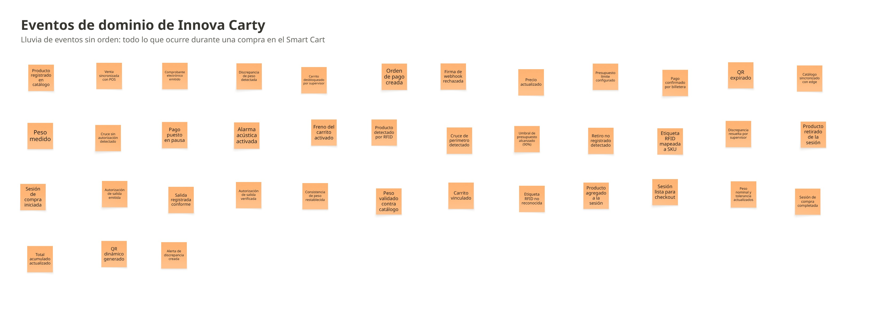

**Paso 2. Timelines**

Los eventos se ordenaron en el tiempo y se agruparon en cinco líneas de flujo: **ShoppingSession** (vinculación del carrito, presupuesto y registro de productos), **WeightValidation** (consistencia entre RFID y peso), **Payment** (QR dinámico, comprobante y autorización de salida), **Catalog** (catálogo maestro) y **PerimeterSecurity** (perímetro de salida). Debajo de la línea principal quedan los caminos alternativos, como *Etiqueta RFID no reconocida*, *QR expirado* o *Firma de webhook rechazada*.

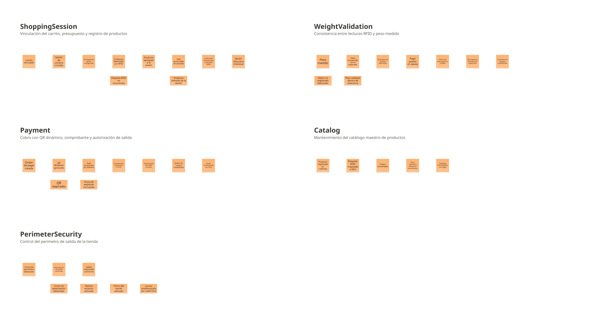

**Paso 3. Pain Points**

Sobre cada línea de tiempo se marcaron las dudas y los riesgos del negocio que todavía no tenían respuesta. Por ejemplo, qué hace el comprador si la etiqueta RFID está dañada, cómo validar productos frescos cuyo peso varía, qué pasa si el webhook de Yape/Plin llega tarde o cómo evitar bloquear a un cliente que sí pagó. Estos puntos guiaron las reglas de negocio de los pasos siguientes (tolerancias de peso, espera de 3 s antes de marcar una discrepancia, expiración del QR).

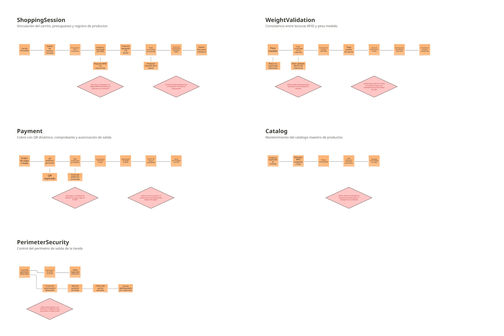

**Paso 4. Pivotal Points**

Se armó el flujo de punta a punta y se identificaron los eventos pivote, es decir, los que cierran una fase del negocio y cambian el estado del proceso. El flujo quedó dividido en cinco fases: **Catálogo listo** (*Catálogo sincronizado con edge*), **Inicio de compra** (*Sesión de compra iniciada*), **Compra y validación** (*Sesión lista para checkout*), **Pago** (*Pago confirmado por billetera*) y **Salida** (*Salida registrada conforme*).

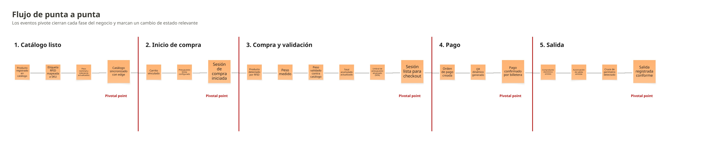

**Paso 5. Commands**

Para cada evento se agregó el comando que lo provoca (por ejemplo, *Vincular carrito*, *Configurar presupuesto límite*, *Proceder al pago*, *Actualizar peso y tolerancia*) y el actor que lo ejecuta: el **Comprador**, el **Supervisor de piso** o el **Administrador de tienda**. En este paso la línea *PerimeterSecurity* se amplió a **OperationsSecurity**, porque también incluye las alertas y la intervención del supervisor, y *Catalog* pasó a llamarse **CatalogPricing**.

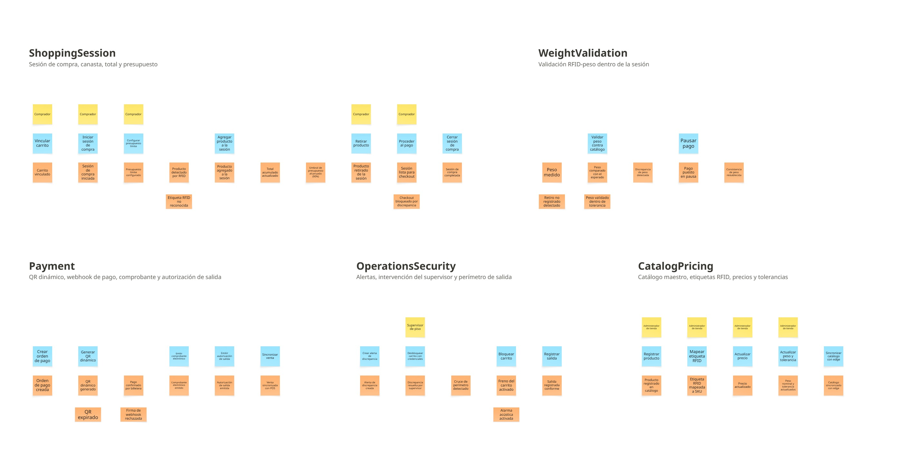

**Paso 6. Policies**

Se agregaron las políticas que disparan comandos de forma automática a partir de un evento, con la forma "cuando… entonces…". Por ejemplo: *cuando se detecta una etiqueta RFID válida* se agrega el producto a la sesión, *cuando la diferencia de peso supera la tolerancia por más de 3 s* se pausa el pago y *cuando el carrito cruza sin autorización de salida* se bloquea el carrito. Las líneas moradas muestran los primeros enlaces entre flujos: la sesión lista para checkout crea la orden de pago, y la discrepancia de peso llega a OperationsSecurity.

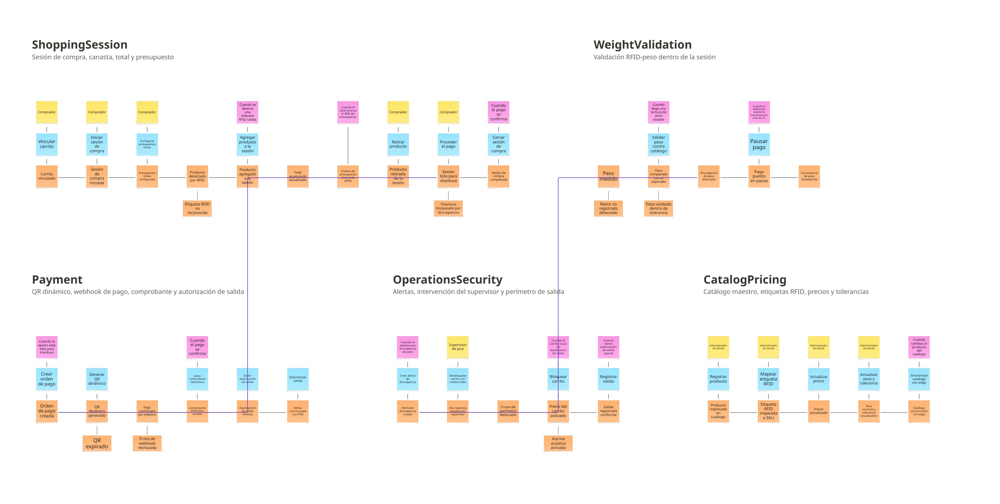

**Paso 7. Read Models**

Se identificó la información que cada actor necesita ver para tomar una decisión antes de ejecutar un comando. Así aparecen las vistas del On-Cart Display y de la app (*Código QR del carrito*, *Lista de productos en canasta*, *Total y presupuesto en pantalla*, *QR de pago en pantalla*, *Historial de compras*) y las de la Web Console (*Panel de alertas*, *Mapa de carritos activos*, *Edición de producto*).

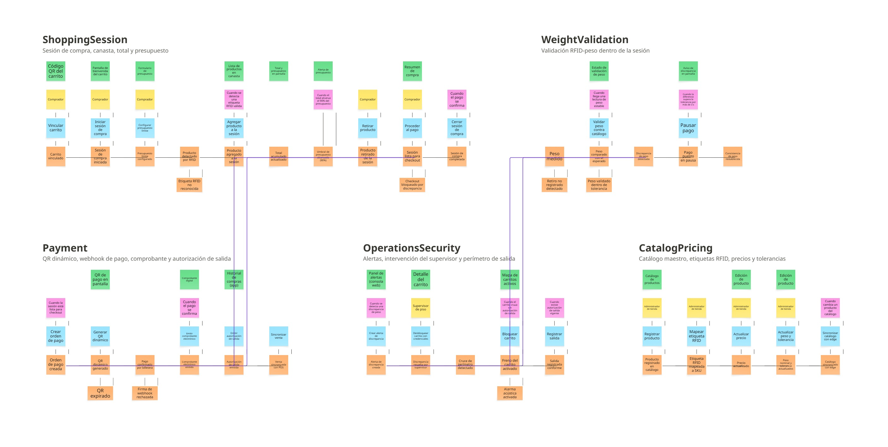

**Paso 8. External Systems**

Se añadieron los sistemas externos y los dispositivos que originan eventos sin intervención de una persona: el **Lector RFID** y la **Celda de carga**, que llegan a través del Edge API; las billeteras **Yape / Plin**, que confirman el pago por webhook; el **Sistema POS** del supermercado, con el que se sincroniza la venta; y el **Sensor perimetral** del arco de salida.

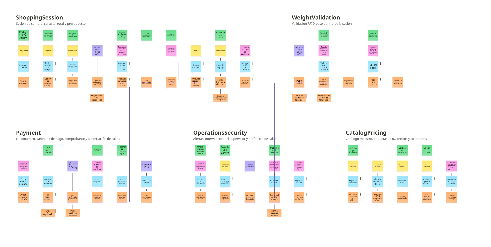

**Paso 9. Aggregates**

Los flujos se agruparon en agregados, que son los objetos que protegen las reglas de negocio y garantizan la consistencia de cada transacción: **ShoppingSession** (que reúne el flujo de la sesión y la validación de peso), **PaymentTransaction**, **ProductCatalogItem** y **SecurityIncident**. Las tarjetas negras representan los comandos que integran un agregado con otro: *Crear orden de pago*, *Cerrar sesión de compra*, *Crear alerta de discrepancia*, *Registrar salida* y *Aplicar nueva tolerancia de peso*.

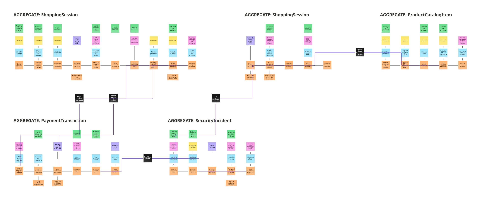

**Paso 10. Bounded Contexts**

Por último, los agregados se agruparon en los cuatro bounded contexts de la solución: **Smart Shopping** (ShoppingSession), **Payment & Checkout** (PaymentTransaction), **Catalog & Pricing** (ProductCatalogItem) y **Operations & Security** (SecurityIncident). Las conexiones moradas entre contextos muestran la integración que se detalla en los Domain Message Flows y en los Bounded Context Canvases de las secciones siguientes; por ejemplo, Smart Shopping consulta el producto por RFID a Catalog & Pricing y solicita la orden de pago a Payment & Checkout.

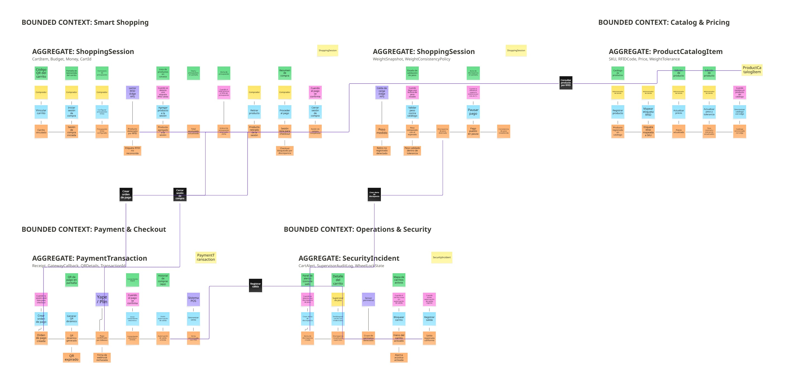

#### 4.1.1.2. Domain Message Flows Modeling

En esta sección el equipo muestra cómo colaboran los bounded contexts para resolver los casos principales del negocio. Se aplicó la técnica de **Domain Storytelling**: cada escenario se cuenta como una historia numerada en la que un actor o un sistema externo envía un mensaje, un bounded context lo procesa y, como resultado, publica un evento o envía un comando a otro contexto. Los escenarios se eligieron a partir de los eventos pivote y de las integraciones entre agregados identificadas en el EventStorming (sección 4.1.1).

Todos los diagramas usan la misma notación:

* **Actor** (óvalo negro): persona que inicia la historia, como el Comprador, el Supervisor de piso o el Administrador de tienda.
* **Bounded Context** (nube lila): Smart Shopping, Payment & Checkout, Catalog & Pricing u Operations & Security.
* **System** (rectángulo blanco): sistema externo o dispositivo, como el Edge API, Yape / Plin, el Smart Cart o la Web Console.
* **Mensajes** (notas numeradas con sus campos): eventos en naranja, comandos en celeste y políticas en rosado. El número indica el orden de la historia.

##### Escenario 1: Inicio de sesión de compra y registro de producto por RFID

El Comprador inicia la sesión desde el carrito con el comando *Iniciar sesión de compra* (`cartId`, `budgetLimit`). Smart Shopping crea la sesión y publica *Sesión de compra iniciada*, que se muestra en el On-Cart Display y en la app. Cuando el comprador coloca un artículo, el Edge API envía *Producto detectado* con la etiqueta RFID leída. Smart Shopping consulta a Catalog & Pricing el producto por RFID para obtener su precio y peso nominal, y publica *Producto agregado a la sesión* con el subtotal actualizado (US04, US05, US06).

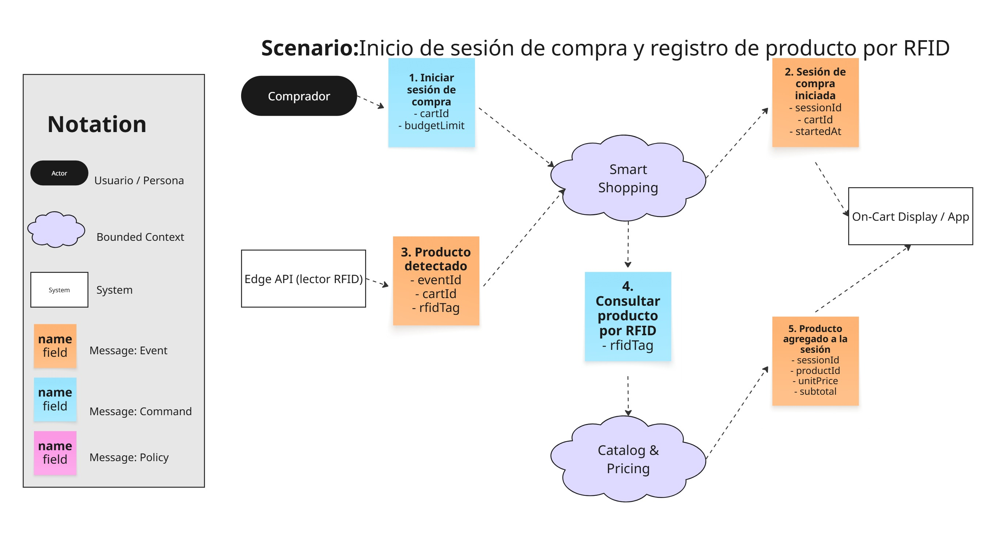

##### Escenario 2: Discrepancia de peso y desbloqueo por supervisor

La celda de carga reporta *Peso medido* a través del Edge API. Smart Shopping compara el peso con el esperado y, si la diferencia supera la tolerancia por más de 3 segundos, aplica la política correspondiente y publica *Discrepancia de peso detectada*. Operations & Security recibe el evento, crea la alerta y la muestra en la Web Console. El Supervisor de piso revisa el carrito y ejecuta *Desbloquear carrito* con sus credenciales; Operations & Security publica *Discrepancia resuelta por supervisor* y Smart Shopping retoma la sesión (US09, US10).

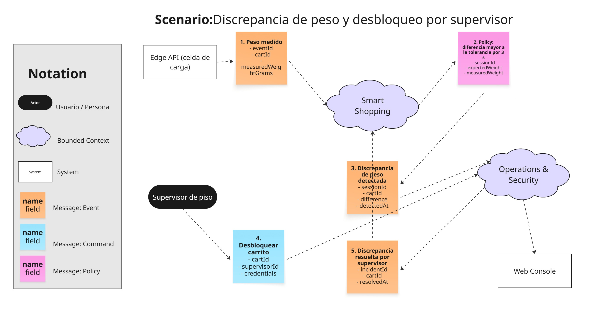

##### Escenario 3: Pago con QR dinámico y autorización de salida

El Comprador elige *Proceder al pago*. Smart Shopping valida la sesión y envía a Payment & Checkout el comando *Crear orden de pago* con el monto final. Payment & Checkout genera el QR dinámico y espera la confirmación de Yape / Plin, que llega por webhook con firma (*Pago confirmado*). Tras validar la firma, Payment & Checkout publica *Pago confirmado*, con el que Smart Shopping cierra la sesión, y *Autorización de salida emitida*, que Operations & Security usa para permitir la salida del carrito (US08, TS03).

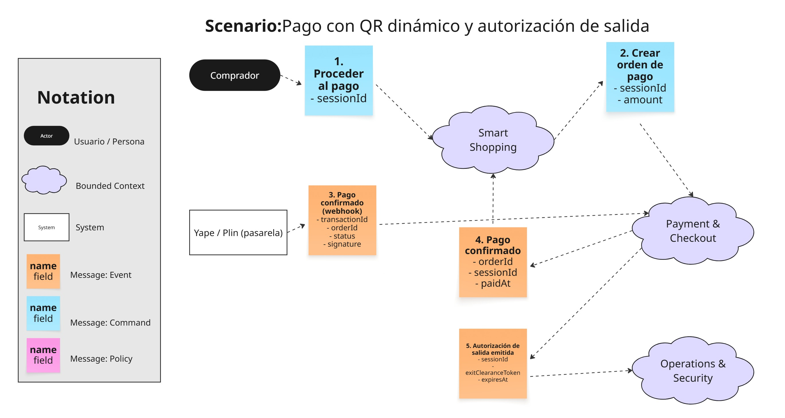

##### Escenario 4: Intento de salida sin autorización de pago

El sensor perimetral del arco de salida reporta *Cruce de perímetro detectado*. Operations & Security comprueba que el carrito no tiene una autorización de salida vigente y aplica la política de bloqueo: envía el comando *Bloquear carrito* al Smart Cart (ESP32), que activa el freno y la alarma. Luego publica *Freno del carrito activado*, que aparece como incidente en la Web Console para que el personal intervenga (US12).

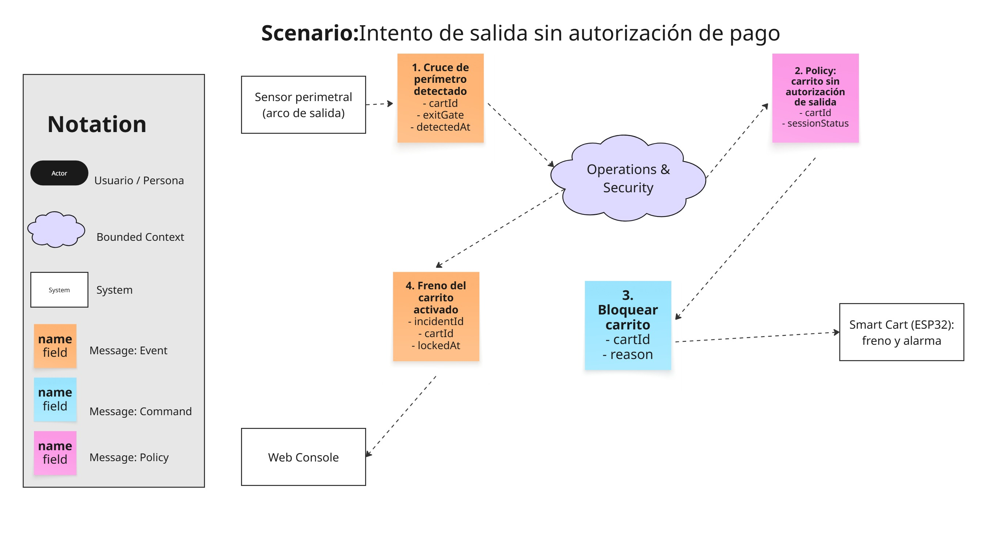

##### Escenario 5: Actualización de precio, peso y tolerancia de un producto

El Administrador de tienda ejecuta *Actualizar peso y tolerancia* desde la Web Console (`sku`, `unitPrice`, `nominalWeightGrams`, `weightToleranceGrams`). Catalog & Pricing guarda el cambio y publica *Peso nominal y tolerancia actualizados*. Por la política de propagación, el cambio se envía al gateway de tienda (edge); al terminar se publica *Catálogo sincronizado con edge*, de modo que Smart Shopping valide las siguientes lecturas con los valores nuevos (US13).

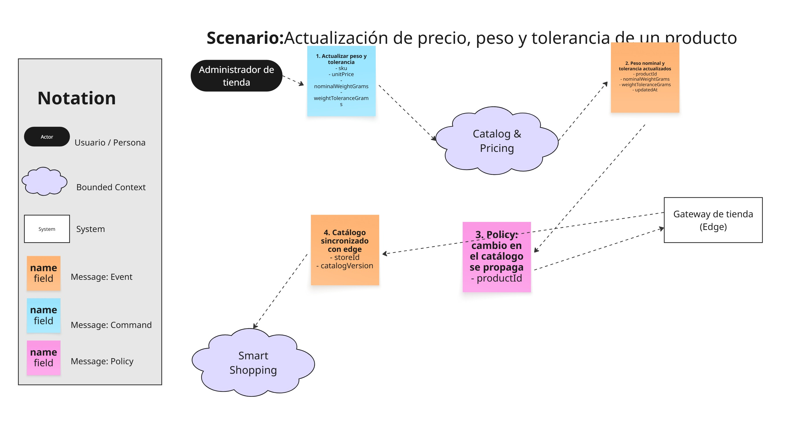

#### 4.1.1.3. Bounded Context Canvases

##### Operations and security context

Modela el monitoreo de discrepancias físicas, gestión de alertas a la consola de supervisores, auditoría con credenciales de personal y control perimetral por *geofencing* (bloqueo electromecánico de ruedas).

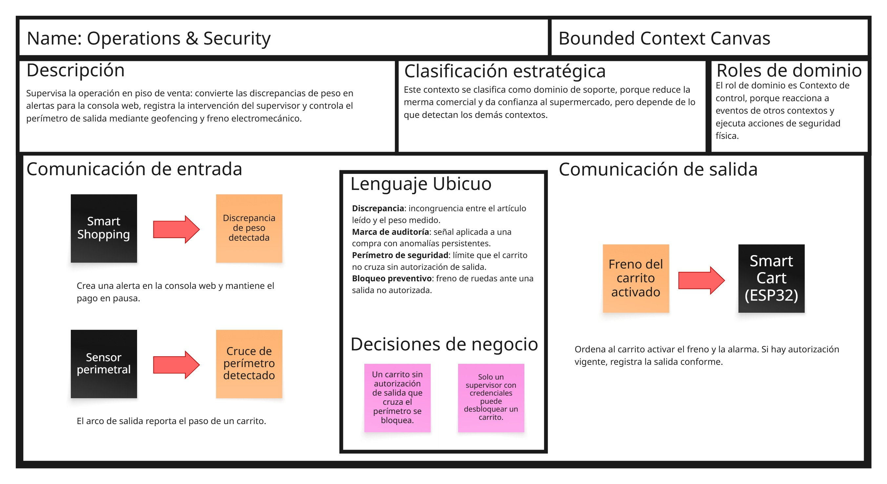

#####  Catalog and Pricing Context

Especifica la sincronización del catálogo maestro de productos, mapeo de etiquetas RFID, precios vigentes y márgenes de tolerancia de peso nominal.

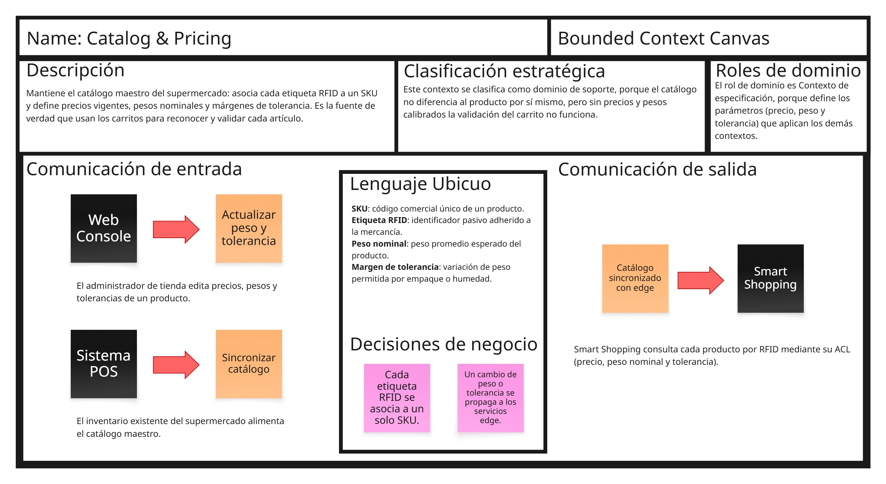

#####  Payment and Checkout Context

Detalla la generación de QR dinámicos, consumo de webhooks de billeteras digitales (Yape/Plin), emisión de comprobante electrónico y generación del token de liberación para la salida.

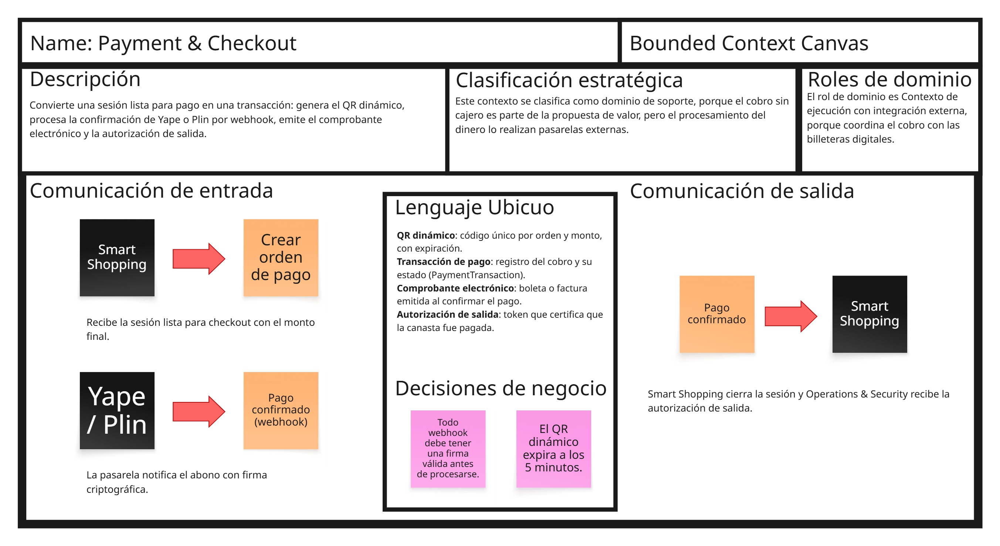

##### Smart Shopping Context
Define las responsabilidades principales de la sesión de compra, gestión de canasta, cálculo de total en tiempo real, reglas de consistencia peso/RFID y alertas de límite de presupuesto.

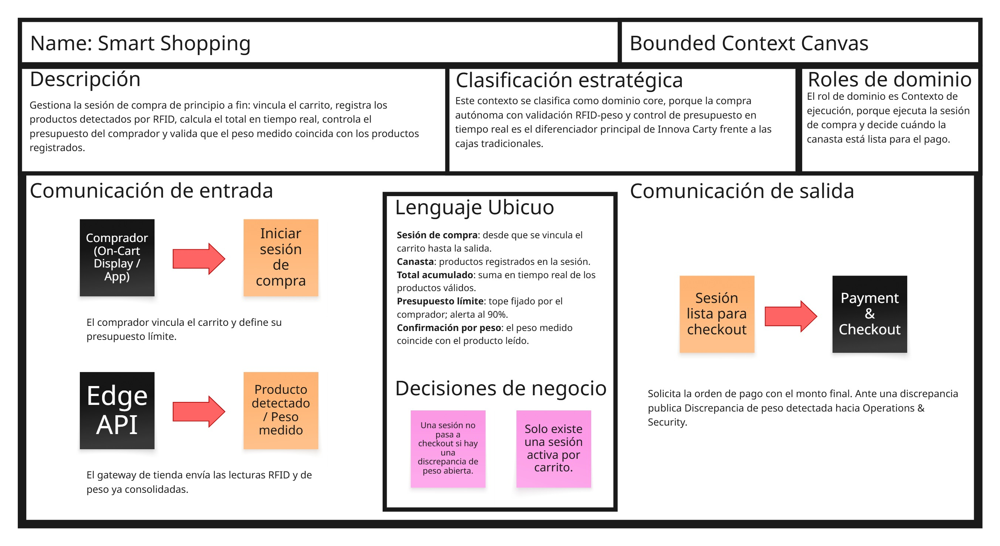

### 4.1.2. Context Mapping

El Context Mapping (Mapa de Contextos) establece la estructura formal de integración, las dependencias organizacionales y los patrones de diseño estratégico de Domain-Driven Design (DDD) entre los cuatro Bounded Contexts identificados para la plataforma Innova Carty: **Smart Shopping Context**, **Catalog and Pricing Context**, **Payment and Checkout Context** y **Operations and Security Context**. El propósito es definir límites claros de contexto, garantizar la autonomía del ciclo de vida de cada servicio y gobernar los flujos de mensajería sincrónica y asincrónica entre el borde físico (*Edge API* en el carrito) y los microservicios en la nube.

#### Identificación de las Relaciones Iniciales y Patrones

##### 1. Catalog and Pricing Context $\rightarrow$ Smart Shopping Context

* **Patrón:** Open Host Service (OHS) / Published Language (PL)
* **Relación:** `Catalog and Pricing (U)` $\rightarrow$ `Smart Shopping (D)`
* **Justificación:** El contexto de Catálogo y Precios centraliza los datos maestros de los productos (identificadores SKU, códigos de etiquetas RFID pasivas, nombres comerciales, precios unitarios oficiales, peso nominal y márgenes de tolerancia de masa). El carrito inteligente (*Smart Shopping*) requiere esta información como fuente de verdad para validar las lecturas de los artículos introducidos en la canasta y calcular subtotales. *Catalog and Pricing* se expone como un servicio abierto y estandarizado (*Open Host Service*) que publica esquemas de datos JSON inmutables (*Published Language*) mediante un RESTful API. De este modo, los carritos consultan y sincronizan catálogos locales en caché sin acoplarse a los esquemas de bases de datos internas del ERP o sistemas de inventario del supermercado.

##### 2. Smart Shopping Context $\rightarrow$ Payment and Checkout Context

* **Patrón:** Customer / Supplier + Anticorruption Layer (ACL)
* **Relación:** `Smart Shopping (U)` $\rightarrow$ `Payment and Checkout (D)`
* **Justificación:** Cuando el consumidor concluye la recolección de artículos y solicita pagar en la pantalla táctil del carrito, *Smart Shopping* provee la orden de compra con el saldo consolidado y los identificadores de productos. *Payment and Checkout* actúa como proveedor del servicio de cobranza (*Supplier*), supeditado a las especificaciones y prioridades del carrito (*Customer*). Se implementa un *Anticorruption Layer (ACL)* en el contexto de pago para aislar el dominio de compra de la variabilidad de las pasarelas externas y billeteras digitales peruanas (Yape y Plin). El ACL traduce los eventos de orden completada en solicitudes de generación de códigos QR dinámicos e ingesta de webhooks asíncronos, retornando un comprobante electrónico y un token criptográfico de liberación de salida sin contaminar las reglas de la canasta.

##### 3. Smart Shopping Context $\rightarrow$ Operations and Security Context

* **Patrón:** Publisher / Subscriber + Anticorruption Layer (ACL)
* **Relación:** `Smart Shopping (U)` $\rightarrow$ `Operations and Security (D)`
* **Justificación:** Durante el recorrido en tienda, la unidad móvil genera eventos de telemetría y seguridad en tiempo real (inconsistencia física entre la lectura RFID y el sensor de peso, nivel crítico de batería, o intento de cruzar la línea de caja sin comprobante). *Smart Shopping* actúa como publicador (*Publisher*) despachando estos eventos de dominio a un bus de mensajería. *Operations and Security* actúa como suscriptor (*Subscriber*) y emplea un *Anticorruption Layer (ACL)* para transformar esos eventos en alertas visuales de piso en la consola web de supervisores o en comandos inmediatos de bloqueo electromecánico de ruedas (*geofencing*). Esto asegura que la lógica de supervisión de mermas y auditoría de personal no imponga restricciones ni sobrecargue el procesamiento de la compra en el dispositivo embebido.

##### 4. Operations and Security Context $\rightarrow$ Catalog and Pricing Context

* **Patrón:** Customer / Supplier
* **Relación:** `Operations and Security (U)` $\rightarrow$ `Catalog and Pricing (D)`
* **Justificación:** Cuando el personal supervisor o el administrador de tienda detecta falsos positivos reiterados en una balanza de carrito (por ejemplo, discrepancias continuas causadas por variaciones en el empaque secundario de un lote de productos), se requiere recalibrar el peso nominal o el margen de tolerancia. En este flujo, *Operations and Security* solicita la actualización de los metadatos de calibración como cliente (*Customer*), y *Catalog and Pricing* actúa como proveedor (*Supplier*), actualizando los umbrales de masa en la base central para que se propaguen en las siguientes sincronizaciones de la flota.

---

#### Análisis de Alternativas y Preguntas Clave

##### 1. ¿Qué pasaría si Smart Shopping y Operations and Security compartieran la misma base de datos (Shared Kernel)?

* **Alternativa A: Publisher/Subscriber + ACL (Modelo Actual)**
  * **Ventajas:** Autonomía operativa y alta disponibilidad. Las fallas de red en la consola de supervisión o las consultas pesadas de auditoría no bloquean ni retrasan el pesaje y cálculo en la pantalla del carrito en sala.
  * **Desventajas:** Requiere la configuración y mantenimiento de un canal de eventos asíncronos y estructuras de mensajería.
* **Alternativa B: Shared Kernel (Base de datos compartida)**
  * **Ventajas:** Consistencia transaccional inmediata; ante cualquier discrepancia detectada por el sensor de peso, el carrito quedaría registrado instantáneamente en la base de auditoría del supervisor sin mediación de eventos.
  * **Desventajas:** Fuerte acoplamiento. Cualquier cambio en las tablas de auditoría, turnos de supervisores o historial de mermas obligaría a alterar el modelo de datos de la canasta del carrito, elevando la contención de bloqueos (*table locks*) en horas pico con docenas de carritos operando en simultáneo.
* **Decisión sustentada:** Mantener **Publisher/Subscriber + ACL**.
  * **Razón crítica:** La experiencia de compra directa del cliente en sala debe priorizar la baja latencia y funcionar incluso si la consola de administración está temporalmente inaccesible.
  * **Mitigación:** Implementar colas de mensajes con reintentos automáticos para asegurar que ninguna alerta de seguridad o merma se pierda en la red inalámbrica de la tienda.

##### 2. ¿Qué pasaría si Catalog and Pricing y Smart Shopping fueran un solo Bounded Context?

* **Alternativa A: Contextos separados con OHS/PL (Modelo Actual)**
  * **Ventajas:** Independencia funcional y límites claros. La gestión corporativa de precios, promociones e inventario retail evoluciona independientemente del ciclo de vida del software embebido de los carritos.
  * **Desventajas:** Sobrecarga de red al requerir endpoints de sincronización de catálogo periódico hacia el almacenamiento local del carrito.
* **Alternativa B: Unificar en un solo Bounded Context ("Shopping & Catalog")**
  * **Ventajas:** Consulta directa de datos de productos sin contratos de interfaz intermedios.
  * **Desventajas:** Creación de un modelo monolítico (*Big Ball of Mud*) donde las políticas de reposición de mercadería y reglas contables de retail colisionan con el algoritmo de verificación física de la canasta, dificultando las pruebas y el escalamiento del sistema.
* **Decisión sustentada:** Mantener **contextos separados con OHS/PL**.
  * **Razón crítica:** El catálogo maestro del supermercado obedece a normativas logísticas y administrativas centralizadas, mientras que el carrito inteligente es una unidad periférica orientada al autoservicio rápido y pesaje en tiempo real.
  * **Mitigación:** Configurar mecanismos de almacenamiento en caché local (*local edge cache*) en el carrito para que opere de forma ágil y autónoma durante la sesión de compra.

##### 3. ¿Qué pasaría si Payment and Checkout llamara directamente a los servicios de Smart Shopping sin usar una capa de traducción (Conformist)?

* **Alternativa A: Customer/Supplier + ACL (Modelo Actual)**
  * **Ventajas:** Protección frente a cambios de proveedores de pago. Si la integración de billeteras QR (Yape/Plin) cambia de formato, proveedor de pasarela o estándar de firma criptográfica, solo se actualiza el adaptador ACL sin afectar la estructura interna de la orden.
  * **Desventajas:** Creación de capas intermedias de mapeo y conversión de objetos de transferencia de datos (DTOs).
* **Alternativa B: Conformist (Adopción directa del modelo externo)**
  * **Ventajas:** Menor volumen de código en la capa de pagos al acoplar directamente las respuestas de las APIs bancarias a la sesión de compra.
  * **Desventajas:** Fragilidad extrema. Modificaciones imprevistas en los payloads de los webhooks de billeteras digitales quebrarían la lógica de facturación y el desbloqueo perimetral del carrito.
* **Decisión sustentada:** Mantener **Customer/Supplier + ACL**.
  * **Razón crítica:** La seguridad de la transacción y la confirmación de pago no pueden depender de la rigidez de terceros en un entorno desatendido de supermercado.
  * **Mitigación:** Diseñar contratos estrictos de salida que emitan un token de autorización claro y estandarizado para la apertura del arco de salida de la tienda.

---

#### Decisión Final

Luego de analizar las alternativas operativas y los requerimientos de resiliencia para el entorno de retail inteligente, el equipo adoptó una arquitectura modular desacoplada basada en los principios estratégicos de Domain-Driven Design (DDD):
* **Catalog and Pricing Context (Catálogo y Precios):** Opera como *Open Host Service (OHS)* bajo un *Published Language (PL)*, abasteciendo de forma estándar y segura las listas de productos, precios y tolerancias nominales de pesaje a los carritos.
* **Smart Shopping Context (Compra Inteligente):** Representa el *Core Domain* de la solución, gobernando la experiencia de compra en el carrito, la lectura sensorial RFID y de balanza, y el control de presupuesto acumulado.
* **Payment and Checkout Context (Pago y Facturación):** Implementa una relación *Customer/Supplier* mediada por un *Anticorruption Layer (ACL)* para garantizar la integración confiable con billeteras digitales nacionales (Yape/Plin) y la emisión del comprobante digital con token de salida.
* **Operations and Security Context (Operaciones y Seguridad):** Se integra mediante el patrón *Publisher/Subscriber* desacoplado con *ACL*, asegurando el monitoreo continuo de discrepancias en el piso de venta y el control perimetral por geocercas sin comprometer la fluidez de compra del consumidor.

---

#### Diagrama de Context Mapping

<p align="center">
  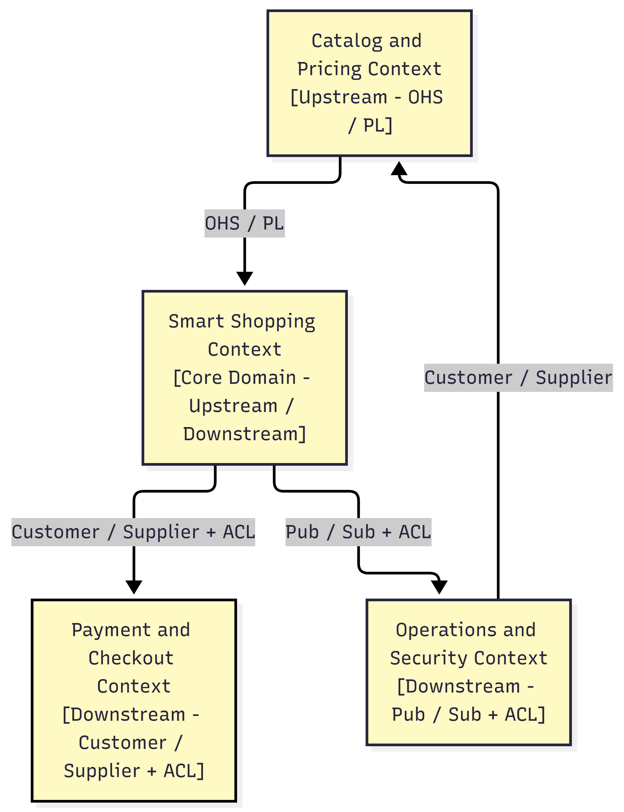
</p>
<p align="center"><em>Figura: Diagrama de Context Mapping para Innova Carty con relaciones Upstream/Downstream y patrones DDD.</em></p>

### 4.1.3. Software Architecture

#### 4.1.3.1. Software Architecture System Landscape Diagram

En este diagrama se presenta una visión global del ecosistema corporativo del supermercado. Su objetivo es mostrar cómo interactúan múltiples sistemas internos, actores operacionales y servicios externos de terceros dentro de la frontera del negocio, permitiendo a los stakeholders (CTO, Gerentes de Operaciones, Arquitectos) entender el encuadre estratégico del proyecto dentro de la empresa sin perderse en detalles técnicos de un solo software.

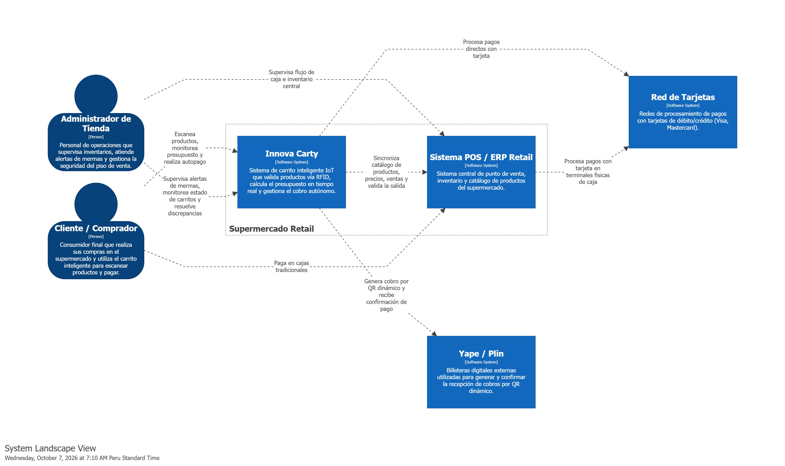


#### 4.1.3.2. Software Architecture Context Level Diagrams

El diagrama de contexto (nivel 1 del C4 Model) muestra a **Innova Carty** como una sola caja, sin detallar su arquitectura interna, junto con las personas que lo usan y los sistemas de software con los que se comunica. Se obtiene del System Landscape (4.1.3.1) quedándose solo con los elementos que tienen una relación directa con Innova Carty; por eso no aparecen relaciones que no pasan por el sistema, como el pago en las cajas tradicionales o el uso del POS por parte del administrador. Su objetivo es que cualquier stakeholder, técnico o no, entienda en un vistazo qué hace el sistema, para quién y de qué sistemas externos depende.

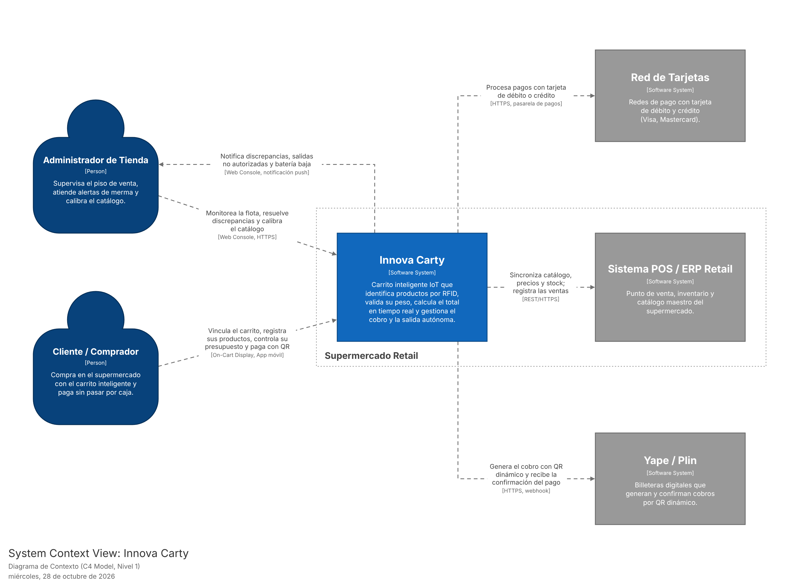

**Elementos del diagrama**

| Elemento | Tipo | Descripción |
| :--- | :--- | :--- |
| Cliente / Comprador | Persona | Consumidor final (Segmento 1). Vincula un carrito, registra sus productos, controla su presupuesto y paga con QR desde el On-Cart Display o la app móvil. |
| Administrador de Tienda | Persona | Personal de operaciones y prevención de pérdidas (Segmento 2). Supervisa la flota de carritos, atiende las alertas y calibra el catálogo desde la Web Console. |
| Innova Carty | Software System (en desarrollo) | Carrito inteligente IoT: identifica productos por RFID, valida su peso, calcula el total en tiempo real y gestiona el cobro y la autorización de salida. |
| Sistema POS / ERP Retail | Software System externo | Sistema de punto de venta e inventario que ya usa el supermercado. Es la fuente del catálogo maestro, de los precios y del stock, y recibe las ventas pagadas en el carrito. Está dentro de la frontera de la empresa (*Supermercado Retail*), pero no lo desarrolla el equipo. |
| Yape / Plin | Software System externo | Billeteras digitales que generan el QR dinámico y confirman el pago por *webhook*. |
| Red de Tarjetas | Software System externo | Redes de pago con tarjeta de débito y crédito (Visa, Mastercard). Es el medio alternativo a las billeteras y se usa a través de la pasarela de pagos, porque el carrito no tiene datáfono físico (1.2). |

**Relaciones**

| Origen | Destino | Descripción | Tecnología |
| :--- | :--- | :--- | :--- |
| Cliente / Comprador | Innova Carty | Vincula el carrito, registra sus productos, controla su presupuesto y paga con QR. | On-Cart Display, App móvil |
| Administrador de Tienda | Innova Carty | Monitorea la flota, resuelve discrepancias y calibra el catálogo. | Web Console, HTTPS |
| Innova Carty | Administrador de Tienda | Notifica discrepancias de peso, salidas no autorizadas y batería baja. | Web Console, notificación push |
| Innova Carty | Sistema POS / ERP Retail | Sincroniza catálogo, precios y stock, y registra las ventas pagadas. | REST/HTTPS |
| Innova Carty | Yape / Plin | Genera el cobro con QR dinámico y recibe la confirmación del pago. | HTTPS, webhook |
| Innova Carty | Red de Tarjetas | Procesa pagos con tarjeta de débito o crédito. | HTTPS, pasarela de pagos |

**Decisiones reflejadas en el diagrama**

* **El POS es la fuente del catálogo, no Innova Carty.** El supermercado ya administra sus productos y precios en el POS/ERP; Innova Carty los sincroniza y les agrega lo que el carrito necesita (peso nominal, tolerancia y etiqueta RFID). Así se evita mantener dos catálogos y se responde a la preocupación del Segmento 2 sobre la integración con el ERP (2.2.3).
* **Los pagos se delegan a terceros.** Innova Carty no procesa tarjetas ni dinero directamente: solicita el cobro a Yape/Plin o a la pasarela de pagos y espera su confirmación. Esto reduce el alcance de seguridad del sistema y corresponde a la relación *Customer/Supplier* con *Anticorruption Layer* del Payment & Checkout Context (4.1.2).
* **El administrador también recibe información del sistema.** Las alertas se envían a la Web Console sin que el administrador las consulte, porque en el piso de venta se necesita reaccionar en segundos ante una discrepancia o un intento de salida sin pago (US11, US12).
* **El hardware no aparece en este nivel.** El Smart Cart (ESP32 y sensores), el Edge API y los servicios en la nube son partes internas de Innova Carty y se detallan en el diagrama de contenedores (4.1.3.3) y en el diseño del dispositivo (5.6).

<details>
<summary><b>Diagram as code (Structurizr DSL)</b></summary>

```text
workspace "Innova Carty" "Carrito de compras inteligente IoT para supermercados" {

    model {
        cliente = person "Cliente / Comprador" "Compra en el supermercado con el carrito inteligente y paga sin pasar por caja."
        admin = person "Administrador de Tienda" "Supervisa el piso de venta, atiende alertas de merma y calibra el catálogo."

        group "Supermercado Retail" {
            innovaCarty = softwareSystem "Innova Carty" "Carrito inteligente IoT que identifica productos por RFID, valida su peso, calcula el total en tiempo real y gestiona el cobro y la salida autónoma."
            pos = softwareSystem "Sistema POS / ERP Retail" "Punto de venta, inventario y catálogo maestro del supermercado." "Existing System"
        }
        yape = softwareSystem "Yape / Plin" "Billeteras digitales que generan y confirman cobros por QR dinámico." "Existing System"
        tarjetas = softwareSystem "Red de Tarjetas" "Redes de pago con tarjeta de débito y crédito (Visa, Mastercard)." "Existing System"

        cliente -> innovaCarty "Vincula el carrito, registra sus productos, controla su presupuesto y paga con QR" "On-Cart Display, App móvil"
        admin -> innovaCarty "Monitorea la flota, resuelve discrepancias y calibra el catálogo" "Web Console, HTTPS"
        innovaCarty -> admin "Notifica discrepancias, salidas no autorizadas y batería baja" "Web Console, notificación push"
        innovaCarty -> pos "Sincroniza catálogo, precios y stock; registra las ventas" "REST/HTTPS"
        innovaCarty -> yape "Genera el cobro con QR dinámico y recibe la confirmación del pago" "HTTPS, webhook"
        innovaCarty -> tarjetas "Procesa pagos con tarjeta de débito o crédito" "HTTPS, pasarela de pagos"
    }

    views {
        systemContext innovaCarty "SystemContext" "Diagrama de Contexto (C4 Model, Nivel 1)" {
            include *
            autoLayout lr
        }

        styles {
            element "Person" {
                shape Person
                background #08427B
                color #ffffff
            }
            element "Software System" {
                background #1168BD
                color #ffffff
            }
            element "Existing System" {
                background #999999
                color #ffffff
            }
        }
    }
}
```

</details>

#### 4.1.3.3. Software Architecture Container Level Diagrams

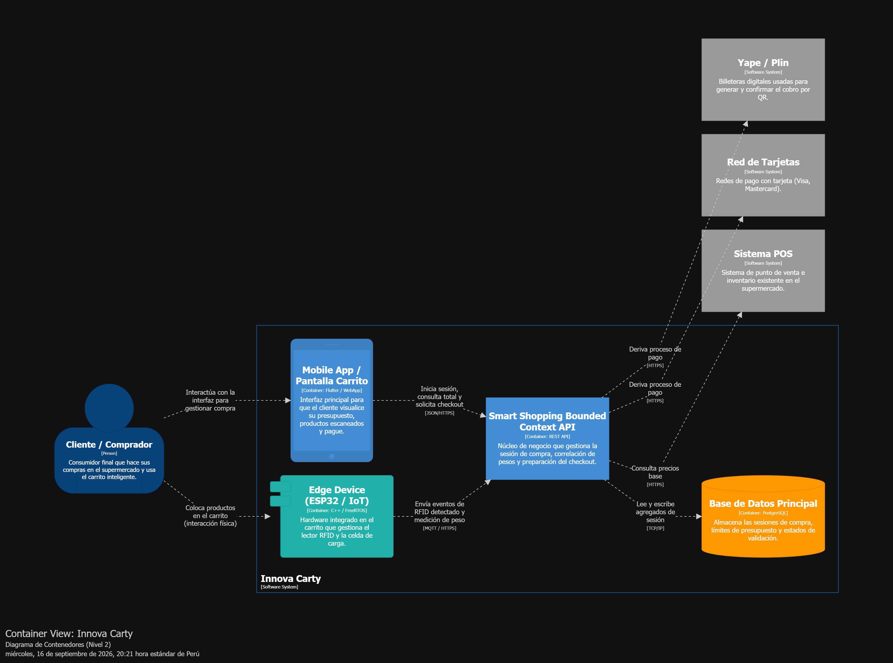

#### 4.1.3.4. Software Architecture Deployment Diagrams
En esta sección se muestra como se distribuye nuestro diagrama de despliegue de arquitectura: 


---

## 4.2. Tactical-Level Domain-Driven Design

### 4.2.1. Bounded Context: Smart Shopping Bounded Context

El Smart Shopping Bounded Context es el dominio core de Innova Carty: gestiona la sesión de compra desde que el comprador vincula el carrito hasta que la canasta queda pagada, registra los productos detectados por RFID, calcula el total y el presupuesto en tiempo real y valida que el peso medido coincida con los productos registrados. A continuación se presentan sus clases a manera de diccionario.

| Clase | Tipo | Propósito | Atributos principales | Métodos principales | Relaciones |
| :--- | :--- | :--- | :--- | :--- | :--- |
| `ShoppingSession` | Aggregate Root | Representa una sesión de compra y protege sus reglas: una sola sesión activa por carrito, no pasar a checkout con una discrepancia abierta y alertar al 90 % del presupuesto. | `id`, `cartId`, `customerId`, `status`, `budget`, `items`, `weightSnapshot`, `paymentPaused`, `startedAt`, `closedAt` | `setBudgetLimit()`, `addItem()`, `removeItem()`, `getSubtotal()`, `updateWeightSnapshot()`, `canCheckout()`, `markPendingCheckout()`, `complete()`, `cancel()` | Compone 0..* `CartItem`, un `Budget` y un `WeightSnapshot`; registra `ShoppingSessionEvent`. |
| `CartItem` | Entity | Producto registrado en la sesión tras la lectura RFID, con una copia del precio, peso nominal y tolerancia vigentes al momento de la detección. | `productId`, `rfidTag`, `productName`, `unitPrice`, `quantity`, `nominalWeight`, `weightTolerance`, `weightVerified`, `removed` | `getTotalPrice()`, `increaseQuantity()`, `markRemoved()`, `markWeightVerified()` | Pertenece a una `ShoppingSession`; se crea a partir de un `ProductSnapshot`. |
| `Budget` | Value Object | Presupuesto límite del comprador y monto ya gastado. | `limit`, `spent`, `thresholdReached` | `withSpent()`, `remaining()`, `usedPercent()`, `isNearLimit()`, `isExceeded()` | Usa `Money`. |
| `WeightSnapshot` | Value Object | Última comparación entre el peso medido y el esperado. | `measured`, `expected`, `status`, `mismatchSince` | `difference()`, `isConsistent()` | Usa `Weight` y `WeightValidationStatus`; lo produce `WeightConsistencyPolicy`. |
| `ProductSnapshot` | Value Object | Datos del producto que devuelve Catalog & Pricing, traducidos al lenguaje de este contexto. | `productId`, `name`, `unitPrice`, `nominalWeight`, `weightTolerance` | — | Lo devuelve `CatalogPricingPort`. |
| `Money` / `Weight` | Value Objects | Montos en soles y pesos en gramos, con sus operaciones aritméticas. | `amount`, `currency` / `grams` | `add()`, `subtract()`, `isGreaterThan()` / `difference()`, `isWithin()` | Usados por `Budget`, `CartItem` y `WeightSnapshot`. |
| `SessionId`, `CartId`, `CustomerId`, `ProductId`, `RfidTag` | Value Objects | Identificadores tipados; evitan mezclar ids de distintos conceptos. | `value` | — | `CartId` y `ProductId` referencian objetos de otros contextos solo por id. |
| `CheckoutReference` | Value Object | Respuesta de Payment & Checkout al solicitar la orden de pago. | `checkoutId`, `amount`, `status` | — | La devuelve `PaymentCheckoutPort`. |
| `SessionStatus` | Enumeration | Estados de la sesión. | `ACTIVE`, `PENDING_CHECKOUT`, `COMPLETED`, `CANCELLED` | — | Atributo de `ShoppingSession`. |
| `WeightValidationStatus` | Enumeration | Resultado de la validación de peso. | `CONSISTENT`, `MISMATCH` | — | Atributo de `WeightSnapshot`. |
| `WeightConsistencyPolicy` / `DefaultWeightConsistencyPolicy` | Domain Service (interfaz e implementación) | Compara el peso medido con la suma de pesos nominales y tolerancias, y marca una discrepancia solo si persiste más de 3 s. | `gracePeriod` | `evaluate()` | Evalúa `CartItem` y produce `WeightSnapshot`. |
| `ShoppingSessionRepository` | Repository (interfaz) | Contrato de persistencia del agregado. | — | `save()`, `findById()`, `findActiveByCartId()`, `existsActiveSessionByCartId()` | Persiste `ShoppingSession`; lo implementa la Infrastructure Layer. |
| `CatalogPricingPort` / `PaymentCheckoutPort` | Ports (interfaces) | Contratos hacia otros bounded contexts, implementados por las ACL. | — | `getProductByRfid()` / `createCheckout()` | Devuelven `ProductSnapshot` y `CheckoutReference`. |
| `ShoppingSessionEvent` y subclases | Domain Events | Hechos que publica el agregado: `ShoppingSessionStarted`, `ProductAddedToSession`, `ProductRemovedFromSession`, `BudgetThresholdReached`, `UnknownTagDetected`, `WeightMismatchDetected`, `WeightConsistencyRestored`, `ShoppingSessionReadyForCheckout`, `ShoppingSessionCompleted`, `ShoppingSessionCancelled`. | `sessionId`, `occurredAt` | — | Registrados por `ShoppingSession` y publicados por la Application Layer. |

#### 4.2.1.1. Domain Layer

La **Domain Layer** contiene el núcleo del contexto: las clases que representan la sesión de compra y las reglas de negocio que no dependen de HTTP, de la base de datos ni de los otros contextos.

* **Aggregate:** `ShoppingSession` es la única puerta de entrada para modificar la sesión. Toda operación (agregar o retirar un producto, fijar el presupuesto, actualizar el peso, pasar a checkout, cerrar o cancelar) se hace a través de sus métodos, que verifican primero que la sesión esté activa. Al cambiar de estado, el agregado registra el evento de dominio correspondiente para que la Application Layer lo publique.
* **Entity:** `CartItem` tiene identidad propia dentro de la sesión, porque un mismo producto puede agregarse, retirarse o verificarse por peso de forma independiente.
* **Value Objects:** `Budget`, `WeightSnapshot`, `ProductSnapshot`, `Money`, `Weight`, `CheckoutReference` y los identificadores tipados son inmutables y se comparan por valor. `Budget` encapsula la regla del 90 % (`isNearLimit()`) y `WeightSnapshot` el resultado de la validación de peso.
* **Domain Service:** `WeightConsistencyPolicy` resuelve una regla que no pertenece a una sola entidad: suma los pesos nominales de los productos activos, aplica la tolerancia de cada uno y solo marca `MISMATCH` cuando la diferencia se mantiene más de 3 segundos, para no generar falsas alarmas por el movimiento del carrito.
* **Factory:** el constructor de `ShoppingSession` cumple el rol de fábrica: crea la sesión en estado `ACTIVE`, con el presupuesto opcional y el evento `ShoppingSessionStarted`. `CartItem` se construye siempre a partir de un `ProductSnapshot`, de modo que el dominio no depende del modelo de Catalog & Pricing.
* **Repositories y Ports:** `ShoppingSessionRepository`, `CatalogPricingPort` y `PaymentCheckoutPort` son interfaces del dominio; sus implementaciones (JPA y las *Anti-Corruption Layers*) están en la Infrastructure Layer.
* **Enumerations y Domain Events:** `SessionStatus` y `WeightValidationStatus` limitan los estados válidos, y la jerarquía `ShoppingSessionEvent` define los hechos que este contexto comunica a Payment & Checkout, Operations & Security y a los clientes en tiempo real.

El diagrama de clases completo se presenta en la sección 4.2.1.6.1.

#### 4.2.1.2. Interface Layer

La **Interface Layer** del Smart Shopping Bounded Context contiene los puntos de entrada por los que el On-Cart Display, la app móvil y el Edge API interactúan con el contexto. Su responsabilidad es recibir solicitudes o eventos, validar su formato, transformarlos en *Commands* o *Queries* mediante *assemblers* y delegar la ejecución a la Application Layer. No contiene reglas de negocio ni accede a la base de datos. Se implementa con controladores REST de Spring Boot bajo el prefijo `/api/v1`.

##### Controllers

**1. ShoppingSessionsController**

Expone las operaciones de la sesión de compra que consumen el On-Cart Display y la app móvil.

| Método | Endpoint | Descripción | Respuesta | User Story |
| :--- | :--- | :--- | :--- | :--- |
| `POST` | `/api/v1/shopping-sessions` | Inicia una sesión para un carrito disponible (vinculación por código del carrito). | `201 ShoppingSessionResource` · `409` si el carrito ya tiene sesión activa | US04, TS02 |
| `GET` | `/api/v1/shopping-sessions/{sessionId}` | Devuelve productos, subtotal, presupuesto, porcentaje usado y estado de validación de peso. | `200 ShoppingSessionResource` · `404` | US05, TS02 |
| `GET` | `/api/v1/carts/{cartId}/shopping-sessions/active` | Obtiene la sesión activa de un carrito (usado al escanear el QR del carrito desde la app). | `200` · `404` | TS02 |
| `PUT` | `/api/v1/shopping-sessions/{sessionId}/budget` | Registra o actualiza el presupuesto límite. | `200` · `400` si el monto no es mayor a 0 | US04 |
| `POST` | `/api/v1/shopping-sessions/{sessionId}/checkout` | Valida la sesión y solicita la orden de pago al contexto Payment & Checkout. | `202 CheckoutResource` · `409` si hay una discrepancia abierta | US08 |
| `POST` | `/api/v1/shopping-sessions/{sessionId}/cancel` | Cancela una sesión no pagada (pulsación larga del botón físico). | `204` | — |

**2. CartEventsController**

Recibe del Edge API los eventos de los sensores del carrito ya consolidados en el gateway de tienda, de modo que el contexto no depende de los detalles del ESP32, del lector RFID ni de la celda de carga.

| Método | Endpoint | Evento de entrada | Acción |
| :--- | :--- | :--- | :--- |
| `POST` | `/api/v1/carts/{cartId}/events/product-detected` | `ProductDetected` (etiqueta RFID leída) | `AddItemToSessionCommand` |
| `POST` | `/api/v1/carts/{cartId}/events/product-removed` | `ProductRemoved` (etiqueta que deja de leerse) | `RemoveItemFromSessionCommand` |
| `POST` | `/api/v1/carts/{cartId}/events/weight-measured` | `WeightMeasured` (lectura de peso estable) | Publica `WeightMeasured` para `WeightMeasuredEventHandler` |

Los eventos llevan un `eventId` generado en el edge; el controlador responde `202 Accepted` y descarta duplicados por `eventId` (idempotencia), ya que el Edge API reintenta el envío cuando pierde conectividad (TS01).

##### Resources (DTOs)

| Resource | Atributos | Uso |
| :--- | :--- | :--- |
| `StartShoppingSessionResource` | `cartId`, `customerId` *(opcional)*, `budgetLimit` *(opcional)* | Entrada de `POST /shopping-sessions` |
| `SetBudgetLimitResource` | `amount` | Entrada de `PUT /budget` |
| `ShoppingSessionResource` | `sessionId`, `cartId`, `status`, `items[]`, `subtotal`, `budgetLimit`, `remainingBudget`, `budgetUsedPercent`, `weightValidationStatus`, `startedAt` | Salida para el On-Cart Display y la app |
| `CartItemResource` | `rfidTag`, `productName`, `unitPrice`, `quantity`, `totalPrice`, `weightVerified` | Línea de producto dentro de la sesión |
| `CartEventResource` | `eventId`, `rfidTag`, `occurredAt` | Entrada de `product-detected` y `product-removed` |
| `WeightMeasurementResource` | `eventId`, `measuredWeightGrams`, `occurredAt` | Entrada de `weight-measured` |
| `CheckoutResource` | `sessionId`, `checkoutId`, `amount`, `status` | Salida de `POST /checkout` |

##### Assemblers

* `StartShoppingSessionCommandFromResourceAssembler`: `StartShoppingSessionResource` → `StartShoppingSessionCommand`.
* `SetBudgetLimitCommandFromResourceAssembler`: `SetBudgetLimitResource` → `SetBudgetLimitCommand`.
* `CartEventCommandFromResourceAssembler`: `CartEventResource` → `AddItemToSessionCommand` o `RemoveItemFromSessionCommand` según el endpoint.
* `ShoppingSessionResourceFromEntityAssembler`: agregado `ShoppingSession` → `ShoppingSessionResource`, para no exponer objetos del dominio.

##### Manejo de errores

Un `@RestControllerAdvice` traduce las excepciones de dominio a respuestas HTTP homogéneas (`ProblemDetail`, RFC 9457): `SessionNotFoundException` → `404`, `ActiveSessionAlreadyExistsException` → `409`, `InvalidBudgetException` → `400`, `CheckoutBlockedByDiscrepancyException` → `409`.

#### 4.2.1.3. Application Layer

La **Application Layer** orquesta los casos de uso del contexto: recibe *Commands* y *Queries*, carga el agregado desde el repositorio, delega las reglas al Domain Layer, persiste los cambios y publica los eventos de dominio resultantes. Cada servicio es transaccional (`@Transactional`) y no conoce detalles de HTTP ni de la base de datos.

##### Command Handlers

**ShoppingSessionCommandService** (implementa `ShoppingSessionCommandService` del dominio)

| Command | Flujo | Evento publicado | User Story |
| :--- | :--- | :--- | :--- |
| `StartShoppingSessionCommand` | Verifica que el carrito no tenga sesión activa (`existsActiveSessionByCartId`) y crea el agregado en estado `ACTIVE`. | `ShoppingSessionStarted` | US04, TS02 |
| `SetBudgetLimitCommand` | Valida que el monto sea mayor a 0 y actualiza `Budget`. | — | US04 |
| `AddItemToSessionCommand` | Obtiene por RFID el producto, precio y peso nominal mediante `CatalogPricingAcl`; si la etiqueta no existe, registra el aviso de etiqueta no reconocida. Agrega el `CartItem` y recalcula el total. Si `Budget.isNearLimit()` pasa a verdadero (≥ 90 %), publica la alerta. | `ProductAddedToSession`, `BudgetThresholdReached`, `UnknownTagDetected` | US05, US06 |
| `RemoveItemFromSessionCommand` | Retira el producto y descuenta su importe del total. | `ProductRemovedFromSession` | US07 |
| `CancelShoppingSessionCommand` | Cambia el estado a `CANCELLED` y libera el carrito. | `ShoppingSessionCancelled` | — |

**CheckoutPreparationService**

* `prepareCheckout(sessionId)`: comprueba que la sesión esté `ACTIVE`, que el `WeightSnapshot` sea consistente y que el total sea mayor a 0; si no, lanza `CheckoutBlockedByDiscrepancyException` (US08, escenario 1).
* `requestCheckout(sessionId)`: marca la sesión como `PENDING_CHECKOUT` y solicita a Payment & Checkout, mediante `PaymentCheckoutAcl`, la orden de pago con el monto final. Publica `ShoppingSessionReadyForCheckout`.

##### Query Handlers

**ShoppingSessionQueryService**

* `handle(GetShoppingSessionByIdQuery)` → sesión con sus productos y totales.
* `handle(GetActiveSessionByCartIdQuery)` → sesión activa del carrito.
* `handle(GetShoppingSessionSummaryQuery)` → subtotal, presupuesto, porcentaje usado y estado de validación (vista ligera para refrescos frecuentes).

##### Event Handlers

**WeightMeasuredEventHandler** (US09, US10)

1. Recupera la sesión activa del carrito.
2. Calcula el peso esperado sumando el peso nominal de los productos registrados.
3. Aplica `WeightConsistencyPolicy` con la tolerancia de cada producto.
4. Actualiza el `WeightSnapshot` de la sesión y lo persiste en `weight_telemetry_logs`.
5. Si la diferencia supera la tolerancia por más de 3 segundos, publica `WeightMismatchDetected` (el pago queda en pausa y el contexto Operations & Security crea la alerta para la Web Console).
6. Cuando la lectura vuelve a ser consistente, publica `WeightConsistencyRestored`.

**PaymentConfirmedEventHandler** (TS03)

Reacciona al evento `PaymentConfirmed` del contexto Payment & Checkout: marca la sesión como `COMPLETED`, registra `closed_at` y publica `ShoppingSessionCompleted`, que habilita la autorización de salida (`Exit Clearance`).

##### Capabilities del bounded context

| Capability | Componente responsable |
| :--- | :--- |
| Iniciar y cerrar una sesión de compra | `ShoppingSessionCommandService`, `PaymentConfirmedEventHandler` |
| Registrar y retirar productos detectados por RFID | `ShoppingSessionCommandService` |
| Calcular el total y el presupuesto restante en tiempo real | `ShoppingSession` + `Budget` (dominio), orquestado por `ShoppingSessionCommandService` |
| Alertar al llegar al 90 % del presupuesto | `ShoppingSessionCommandService` |
| Validar la correspondencia RFID–peso | `WeightMeasuredEventHandler` + `WeightConsistencyPolicy` |
| Preparar la sesión para el pago | `CheckoutPreparationService` |
| Consultar el estado del carrito | `ShoppingSessionQueryService` |

#### 4.2.1.4. Infrastructure Layer

La **Infrastructure Layer** contiene las implementaciones técnicas de los contratos definidos por el dominio y la aplicación: persistencia, clientes hacia otros bounded contexts (como *Anti-Corruption Layers*), publicación de eventos y notificación en tiempo real.

##### Persistence

**JpaShoppingSessionRepository** implementa `ShoppingSessionRepository` con Spring Data JPA sobre PostgreSQL (ver 4.2.1.6.2).

| Operación | Implementación |
| :--- | :--- |
| `save(ShoppingSession)` | Persiste el agregado y sus `CartItem` en una sola transacción. |
| `findById(SessionId)` | Carga la sesión con sus ítems. |
| `findActiveByCartId(CartId)` | Consulta por `cart_id` y `session_status = 'ACTIVE'`. |
| `existsActiveSessionByCartId(CartId)` | Verificación previa al inicio de sesión. |

| Entidad de dominio | Tabla |
| :--- | :--- |
| `ShoppingSession` (con `Budget` y `WeightSnapshot` como *embeddables*) | `shopping_sessions` |
| `CartItem` | `session_items` |
| Historial de lecturas de peso | `weight_telemetry_logs` |

##### Anti-Corruption Layers

* **CatalogPricingAcl** (implementa `CatalogPricingPort`): consulta al contexto Catalog & Pricing `getProductByRfid(rfidTag)` y traduce la respuesta a un objeto propio `ProductSnapshot` (`productId`, `name`, `unitPrice`, `nominalWeightGrams`, `weightToleranceGrams`). Guarda en caché los productos consultados durante la sesión para no repetir la llamada en cada lectura.
* **PaymentCheckoutAcl** (implementa `PaymentCheckoutPort`): solicita `createCheckout(sessionId, amount)` al contexto Payment & Checkout y traduce su respuesta a `CheckoutReference`.

##### Messaging y tiempo real

* **DomainEventPublisher**: implementado con `ApplicationEventPublisher` de Spring para los eventos internos del MVP (`ShoppingSessionStarted`, `ProductAddedToSession`, `ProductRemovedFromSession`, `BudgetThresholdReached`, `WeightMismatchDetected`, `ShoppingSessionReadyForCheckout`, `ShoppingSessionCompleted`). Su interfaz permite cambiarlo por un *message broker* cuando el despliegue lo requiera, sin tocar el dominio.
* **SessionRealtimeNotifier**: escucha los eventos anteriores y los envía por WebSocket (STOMP) al tópico `/topic/sessions/{sessionId}`, al que se suscriben el On-Cart Display y la app móvil para actualizar el total y las alertas sin recargar.

##### Relaciones entre componentes

* `JpaShoppingSessionRepository` implementa la interfaz `ShoppingSessionRepository` del dominio.
* `CatalogPricingAcl` y `PaymentCheckoutAcl` aíslan el modelo de los otros contextos; el dominio solo conoce sus puertos.
* Ningún controller accede directamente a estas implementaciones: la interacción pasa siempre por la Application Layer.

#### 4.2.1.5. Bounded Context Software Architecture Component Level Diagrams

El siguiente **Component Diagram (C4 Model, nivel 3)** descompone el container *Cloud RESTful API* en los componentes del Smart Shopping Bounded Context. Muestra cómo los controladores de la Interface Layer reciben solicitudes del On-Cart Display, de la app móvil y del Edge API; cómo los servicios y *event handlers* de la Application Layer orquestan el agregado `ShoppingSession` y la `WeightConsistencyPolicy`; y cómo la Infrastructure Layer conecta el contexto con PostgreSQL, con los contextos Catalog & Pricing y Payment & Checkout, y con los clientes en tiempo real.

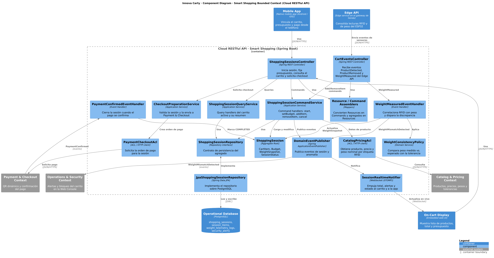

**Interacciones principales**

1. El On-Cart Display y la app móvil llaman a `ShoppingSessionsController` por JSON/HTTPS para iniciar la sesión, fijar el presupuesto, consultar el carrito y pedir el checkout.
2. El Edge API envía a `CartEventsController` los eventos de RFID y de peso consolidados en el gateway de tienda.
3. Los *assemblers* convierten las solicitudes en *Commands* y *Queries*.
4. `ShoppingSessionCommandService` modifica el agregado y consulta los datos del producto a través de `CatalogPricingAcl`.
5. `WeightMeasuredEventHandler` aplica `WeightConsistencyPolicy` y, ante una discrepancia, publica `WeightMismatchDetected`, que llega al contexto Operations & Security y a la Web Console.
6. `CheckoutPreparationService` solicita la orden de pago mediante `PaymentCheckoutAcl`; al confirmarse, `PaymentConfirmedEventHandler` cierra la sesión.
7. `SessionRealtimeNotifier` envía cada cambio al carrito y a la app por WebSocket.
8. `JpaShoppingSessionRepository` persiste el agregado en PostgreSQL.

#### 4.2.1.6. Bounded Context Software Architecture Code Level Diagrams

En esta sección se presentan los diagramas con mayor nivel de detalle sobre la implementación del Smart Shopping Bounded Context: el diagrama de clases UML de la Domain Layer y el diagrama de base de datos que persiste esos objetos.

##### 4.2.1.6.1. Bounded Context Domain Layer Class Diagrams

El siguiente diagrama de clases UML muestra las clases, interfaces y enumeraciones de la Domain Layer, agrupadas en Aggregates, Entities, Value Objects, Domain Services, Repositories y Domain Events. Cada miembro indica su visibilidad (`-` privado, `#` protegido, `+` público), y las relaciones indican su nombre, dirección y multiplicidad: por ejemplo, una `ShoppingSession` **contiene** 0..* `CartItem` y **controla** exactamente un `Budget`.

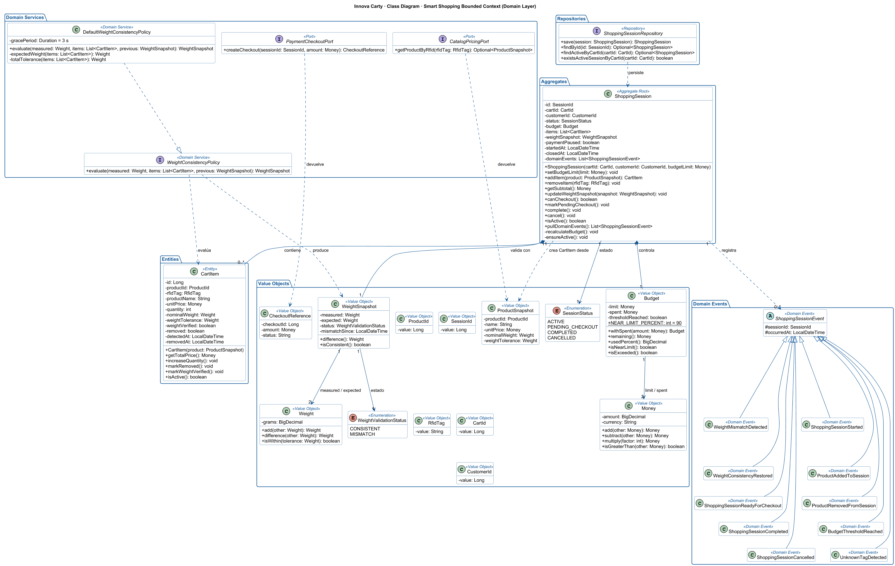
##### 4.2.1.6.2. Bounded Context Database Design Diagram

El siguiente diagrama muestra el modelo relacional en PostgreSQL que persiste los objetos del Smart Shopping Bounded Context. El contexto es dueño de sus tablas: los datos de otros contextos (el carrito físico de Operations & Security y el producto de Catalog & Pricing) se guardan solo como identificadores (`cart_id`, `product_id`), sin clave foránea, para que cada bounded context pueda evolucionar y desplegarse por separado. El diagrama se elaboró en Redgate Data Modeler.

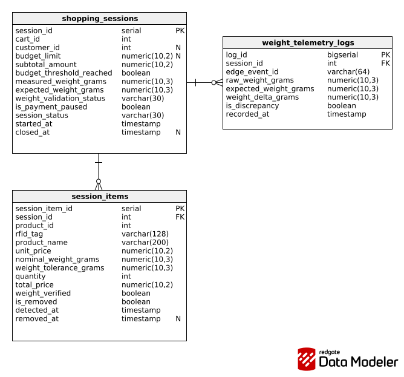

| Tabla | Objeto de dominio | Descripción |
| :--- | :--- | :--- |
| `shopping_sessions` | Agregado `ShoppingSession` con los *embeddables* `Budget` y `WeightSnapshot` | Una fila por sesión de compra: carrito vinculado, comprador opcional, presupuesto límite, total acumulado, último peso medido y esperado, estado de validación de peso, estado de la sesión y fechas de inicio y cierre. |
| `session_items` | Entidad `CartItem` | Productos detectados por RFID en la sesión. Guarda una copia del nombre, precio, peso nominal y tolerancia que devolvió Catalog & Pricing (`ProductSnapshot`), para que un cambio posterior en el catálogo no altere una compra en curso. |
| `weight_telemetry_logs` | Historial de lecturas de peso | Cada lectura estable de la celda de carga, con el peso esperado, la diferencia y si fue una discrepancia. Permite auditar las alertas de peso. |

**Constraints y relaciones**

* **Claves primarias:** `session_id`, `session_item_id` y `log_id` (este último `bigserial`, porque es la tabla con más registros).
* **Claves foráneas:** `session_items.session_id` y `weight_telemetry_logs.session_id` referencian a `shopping_sessions` con `ON DELETE CASCADE`: una sesión tiene cero o muchos productos y cero o muchas lecturas de peso (relación 1 a N).
* **Checks:** `budget_limit` debe ser mayor a 0 cuando existe (US04); `session_status` solo admite `ACTIVE`, `PENDING_CHECKOUT`, `COMPLETED` y `CANCELLED`; `weight_validation_status` solo admite `CONSISTENT` y `MISMATCH`; `quantity` debe ser mayor a 0.
* **Únicos e índices:**
  * Un índice único parcial sobre `shopping_sessions(cart_id)` para las sesiones `ACTIVE` o `PENDING_CHECKOUT` garantiza que un carrito tenga una sola sesión activa (`existsActiveSessionByCartId`, TS02).
  * `edge_event_id` es único en `weight_telemetry_logs`, de modo que los reintentos del Edge API no registran la misma lectura dos veces (TS01).
  * Los índices sobre `session_id` aceleran la carga de la sesión con sus productos y el historial de peso.

### 4.2.2. Bounded Context: Payment & Checkout Bounded Context

El Payment & Checkout Bounded Context convierte una sesión lista para pago en una transacción: genera el QR dinámico, procesa la confirmación de Yape o Plin por webhook, emite el comprobante electrónico y la autorización de salida que el carrito necesita para dejar la tienda. Es un dominio de soporte que se integra con pasarelas externas. A continuación se presentan sus clases a manera de diccionario.

| Clase | Tipo | Propósito | Atributos principales | Métodos principales | Relaciones |
| :--- | :--- | :--- | :--- | :--- | :--- |
| `PaymentTransaction` | Aggregate Root | Orden de pago de una sesión. Controla el ciclo `PENDING` → `QR_GENERATED` → `CONFIRMED` y garantiza que solo una transacción confirmada emita comprobante y autorización de salida. | `id`, `sessionId`, `cartId`, `amount`, `method`, `status`, `qrCodes`, `callbacks`, `receipt`, `exitClearance`, `createdAt`, `confirmedAt`, `posSyncedAt` | `attachQr()`, `currentQr()`, `expireQr()`, `registerCallback()`, `confirm()`, `reject()`, `issueReceipt()`, `issueExitClearance()`, `markSyncedWithPos()` | Compone 0..* `QrDetails`, 0..* `GatewayCallback`, 0..1 `Receipt` y 0..1 `ExitClearanceToken`; registra `PaymentEvent`. |
| `GatewayCallback` | Entity | Webhook recibido de la billetera digital, guardado para auditoría y para evitar procesar dos veces la misma notificación. | `provider`, `externalReference`, `payload`, `signature`, `signatureValid`, `receivedAt` | `markSignature()` | Pertenece a una `PaymentTransaction`; lo valida `WebhookSignatureVerifier`. |
| `Receipt` | Entity | Comprobante electrónico (boleta o factura) de la compra. | `type`, `seriesNumber`, `totalAmount`, `receiptUrl`, `issuedAt` | — | Lo devuelve `ElectronicInvoicingService`. |
| `QrDetails` | Value Object | QR dinámico único por orden y monto, válido por 5 minutos. | `payload`, `amount`, `generatedAt`, `expiresAt`, `VALIDITY` | `isExpired()` | Lo devuelve `DigitalWalletGateway`. |
| `ExitClearanceToken` | Value Object | Autorización de salida que certifica que la canasta fue pagada. | `token`, `issuedAt`, `expiresAt`, `usedAt` | `isValid()`, `markUsed()` | Lo crea `ExitClearanceTokenFactory`; lo consulta Operations & Security. |
| `Money`, `TransactionId`, `SessionId`, `CartId` | Value Objects | Monto en soles e identificadores tipados. `SessionId` y `CartId` referencian objetos de otros contextos solo por id. | `amount`, `currency` / `value` | — | Atributos de `PaymentTransaction`. |
| `PaymentStatus`, `PaymentMethod`, `ReceiptType` | Enumerations | Estados del pago (`PENDING`, `QR_GENERATED`, `CONFIRMED`, `EXPIRED`, `REJECTED`), billetera (`YAPE`, `PLIN`) y tipo de comprobante (`BOLETA`, `FACTURA`). | — | — | Atributos de `PaymentTransaction`, `GatewayCallback` y `Receipt`. |
| `WebhookSignatureVerifier` | Domain Service (interfaz) | Aplica la política de verificación HMAC: ningún webhook se procesa sin firma válida. | — | `verify()` | Valida `GatewayCallback`. |
| `ExitClearanceTokenFactory` | Factory | Crea el token de salida con su vigencia a partir de una transacción confirmada. | `validity` | `create()` | Crea `ExitClearanceToken`. |
| `DigitalWalletGateway`, `ElectronicInvoicingService`, `PosSalesPort` | Ports (interfaces) | Contratos hacia Yape / Plin, el proveedor de facturación electrónica y el Sistema POS. | — | `createDynamicQr()`, `issue()`, `registerSale()` | Implementados en la Infrastructure Layer. |
| `PaymentTransactionRepository` | Repository (interfaz) | Contrato de persistencia del agregado. | — | `save()`, `findById()`, `findBySessionId()`, `findByExternalReference()`, `findExpiredQrBefore()`, `existsOpenBySessionId()` | Persiste `PaymentTransaction`. |
| `PaymentEvent` y subclases | Domain Events | `PaymentOrderCreated`, `DynamicQrGenerated`, `QrExpired`, `WebhookSignatureRejected`, `PaymentConfirmed`, `ReceiptIssued`, `ExitClearanceIssued`, `SaleSyncedWithPos`. | `transactionId`, `sessionId`, `occurredAt` | — | Registrados por `PaymentTransaction`. |

#### 4.2.2.1. Domain Layer

La **Domain Layer** de Payment & Checkout modela el cobro sin cajero y sus reglas de seguridad, sin depender de los detalles técnicos de cada pasarela.

* **Aggregate:** `PaymentTransaction` es la raíz que protege el ciclo de vida del pago. Solo acepta un QR nuevo si la transacción no está confirmada, solo pasa a `CONFIRMED` desde `QR_GENERATED` y solo emite comprobante y autorización de salida si el pago está confirmado. Una sesión tiene como máximo una transacción abierta.
* **Entities:** `GatewayCallback` y `Receipt` tienen identidad propia: cada webhook se guarda con su referencia externa para descartar duplicados, y cada comprobante tiene una serie y un número únicos.
* **Value Objects:** `QrDetails` encapsula la regla de expiración de 5 minutos (`isExpired()`), y `ExitClearanceToken` la vigencia de la autorización de salida (`isValid()`). `Money` y los identificadores tipados completan el modelo.
* **Domain Service:** `WebhookSignatureVerifier` aplica la política HMAC sobre el contenido del webhook; si la firma no es válida, la transacción no cambia y se registra `WebhookSignatureRejected`.
* **Factory:** `ExitClearanceTokenFactory` genera el token aleatorio y su fecha de expiración, de modo que la regla de vigencia no quede repartida en los servicios.
* **Repositories y Ports:** `PaymentTransactionRepository`, `DigitalWalletGateway`, `ElectronicInvoicingService` y `PosSalesPort` son interfaces del dominio; sus implementaciones están en la Infrastructure Layer.
* **Domain Events:** la jerarquía `PaymentEvent` comunica el avance del pago; `PaymentConfirmed` cierra la sesión en Smart Shopping y `ExitClearanceIssued` habilita la salida en Operations & Security.

#### 4.2.2.2. Interface Layer

La **Interface Layer** expone el contexto al On-Cart Display, a la app móvil, a las billeteras digitales y a Operations & Security mediante controladores REST de Spring Boot bajo el prefijo `/api/v1`. Valida el formato de las solicitudes, las convierte en *Commands* o *Queries* y delega en la Application Layer.

##### Controllers

**1. PaymentsController**

| Método | Endpoint | Descripción | Respuesta | User Story |
| :--- | :--- | :--- | :--- | :--- |
| `GET` | `/api/v1/payments/{transactionId}` | Devuelve el estado de la transacción y su monto. | `200 PaymentTransactionResource` · `404` | US08 |
| `GET` | `/api/v1/shopping-sessions/{sessionId}/payment` | Obtiene la transacción de una sesión (usado por el carrito y la app tras el checkout). | `200` · `404` | US08 |
| `GET` | `/api/v1/payments/{transactionId}/qr` | Devuelve el QR vigente y su fecha de expiración. | `200 QrResource` · `410` si expiró | US08 |
| `POST` | `/api/v1/payments/{transactionId}/qr` | Regenera el QR cuando el anterior expiró. | `201 QrResource` · `409` si ya está pagada | US08 |
| `GET` | `/api/v1/payments/{transactionId}/receipt` | Devuelve el comprobante electrónico. | `200 ReceiptResource` · `404` | US08 |

**2. WalletWebhooksController**

| Método | Endpoint | Descripción | Respuesta |
| :--- | :--- | :--- | :--- |
| `POST` | `/api/v1/webhooks/{provider}` | Recibe la notificación de pago de Yape o Plin con la firma en la cabecera. Convierte la solicitud en `ConfirmPaymentFromWebhookCommand`. | `200` si se procesó o era un duplicado · `401` si la firma no es válida |

**3. ExitClearancesController**

| Método | Endpoint | Descripción | Respuesta |
| :--- | :--- | :--- | :--- |
| `GET` | `/api/v1/exit-clearances/{token}?cartId={cartId}` | Operations & Security verifica si un token de salida es válido para el carrito que cruza el perímetro. | `200 ExitClearanceResource` · `404` si no existe o expiró |

##### Resources (DTOs) y Assemblers

| Resource | Atributos | Uso |
| :--- | :--- | :--- |
| `PaymentTransactionResource` | `transactionId`, `sessionId`, `amount`, `currency`, `status`, `method`, `confirmedAt` | Salida de las consultas de pago |
| `QrResource` | `transactionId`, `qrPayload`, `amount`, `expiresAt` | Salida del QR para el On-Cart Display y la app |
| `WalletWebhookResource` | `externalReference`, `transactionId`, `status`, `amount`, `paidAt` + cabecera de firma | Entrada del webhook |
| `ReceiptResource` | `type`, `seriesNumber`, `totalAmount`, `receiptUrl`, `issuedAt` | Comprobante digital en la app |
| `ExitClearanceResource` | `token`, `cartId`, `valid`, `expiresAt` | Respuesta a Operations & Security |

`WalletWebhookCommandFromResourceAssembler` transforma el webhook en `ConfirmPaymentFromWebhookCommand`; `PaymentTransactionResourceFromEntityAssembler`, `QrResourceFromEntityAssembler` y `ReceiptResourceFromEntityAssembler` convierten el agregado en las respuestas. Un `@RestControllerAdvice` traduce `TransactionNotFoundException` → `404`, `QrExpiredException` → `410`, `InvalidWebhookSignatureException` → `401` y `PaymentAlreadyConfirmedException` → `409`.

#### 4.2.2.3. Application Layer

La **Application Layer** orquesta los casos de uso del cobro. Cada servicio es transaccional, carga el agregado desde el repositorio, delega las reglas al dominio, llama a los puertos externos y publica los eventos resultantes.

##### Command Handlers

**PaymentCommandService**

| Command | Flujo | Evento publicado | User Story |
| :--- | :--- | :--- | :--- |
| `CreatePaymentOrderCommand` | Verifica que la sesión no tenga una transacción abierta (`existsOpenBySessionId`) y crea `PaymentTransaction` en estado `PENDING` con el monto final. | `PaymentOrderCreated` | US08 |
| `GenerateDynamicQrCommand` | Solicita el QR a `DigitalWalletGateway`, lo adjunta al agregado y lo pasa a `QR_GENERATED`. | `DynamicQrGenerated` | US08 |
| `ExpireQrCommand` | Marca como `EXPIRED` el QR que superó los 5 minutos sin pago. | `QrExpired` | US08 |
| `ConfirmPaymentFromWebhookCommand` | Busca la transacción por referencia externa, descarta duplicados, verifica la firma con `WebhookSignatureVerifier` y confirma el pago. | `PaymentConfirmed` o `WebhookSignatureRejected` | TS03 |
| `IssueReceiptCommand` | Solicita el comprobante a `ElectronicInvoicingService` y lo asocia a la transacción. | `ReceiptIssued` | US08 |
| `IssueExitClearanceCommand` | Crea el token con `ExitClearanceTokenFactory`. | `ExitClearanceIssued` | US08 |
| `SyncSaleWithPosCommand` | Registra la venta en el Sistema POS mediante `PosSalesPort`; si falla, se reintenta sin bloquear la salida. | `SaleSyncedWithPos` | — |

##### Query Handlers

**PaymentQueryService**: `handle(GetPaymentByIdQuery)`, `handle(GetPaymentBySessionIdQuery)`, `handle(GetCurrentQrQuery)`, `handle(GetReceiptQuery)` y `handle(ValidateExitClearanceQuery)`.

##### Event Handlers

* **ShoppingSessionReadyForCheckoutEventHandler:** reacciona al evento de Smart Shopping y ejecuta `CreatePaymentOrderCommand` y `GenerateDynamicQrCommand`.
* **PaymentConfirmedEventHandler:** tras la confirmación ejecuta, en orden, `IssueReceiptCommand`, `IssueExitClearanceCommand` y `SyncSaleWithPosCommand`.
* **QrExpirationScheduler:** tarea programada que busca los QR vencidos (`findExpiredQrBefore`) y ejecuta `ExpireQrCommand`.

##### Capabilities del bounded context

| Capability | Componente responsable |
| :--- | :--- |
| Crear la orden de pago de una sesión | `ShoppingSessionReadyForCheckoutEventHandler`, `PaymentCommandService` |
| Generar y renovar el QR dinámico | `PaymentCommandService`, `QrExpirationScheduler` |
| Confirmar el pago de forma segura | `PaymentCommandService` + `WebhookSignatureVerifier` |
| Emitir comprobante y autorización de salida | `PaymentConfirmedEventHandler` |
| Sincronizar la venta con el POS | `PaymentCommandService` |
| Consultar el pago, el QR y el comprobante | `PaymentQueryService` |

#### 4.2.2.4. Infrastructure Layer

La **Infrastructure Layer** implementa los contratos del dominio: persistencia, integración con las pasarelas y servicios externos, publicación de eventos y notificación en tiempo real.

* **JpaPaymentTransactionRepository** implementa `PaymentTransactionRepository` con Spring Data JPA sobre PostgreSQL. `PaymentTransaction` se mapea a `payment_transactions`, `QrDetails` a `payment_qr_codes`, `GatewayCallback` a `gateway_callbacks`, `Receipt` a `receipts` y `ExitClearanceToken` a `exit_clearance_tokens`.
* **HmacWebhookSignatureVerifier** implementa `WebhookSignatureVerifier` con HMAC-SHA256 y la clave secreta de cada proveedor.
* **DigitalWalletGatewayClient** implementa `DigitalWalletGateway`: cliente HTTP que solicita el QR dinámico a Yape o Plin y traduce su respuesta a `QrDetails`.
* **ElectronicInvoicingClient** implementa `ElectronicInvoicingService` con el proveedor de facturación electrónica.
* **PosSyncClient** implementa `PosSalesPort` y registra la venta en el Sistema POS del supermercado.
* **DomainEventPublisher** publica los eventos con `ApplicationEventPublisher`; `PaymentConfirmed` llega a Smart Shopping y `ExitClearanceIssued` a Operations & Security.
* **PaymentRealtimeNotifier** envía por WebSocket (STOMP), al tópico `/topic/sessions/{sessionId}`, el QR generado, su expiración y la confirmación del pago, para que el carrito y la app se actualicen sin recargar.

#### 4.2.2.5. Bounded Context Software Architecture Component Level Diagrams

El siguiente **Component Diagram (C4 Model, nivel 3)** descompone el container *Cloud RESTful API* en los componentes de Payment & Checkout. Muestra cómo los controladores reciben las consultas del carrito y de la app, los webhooks de Yape / Plin y las validaciones de Operations & Security; cómo los servicios y *event handlers* orquestan el agregado `PaymentTransaction`; y cómo la Infrastructure Layer conecta el contexto con PostgreSQL, las billeteras, el proveedor de facturación y el Sistema POS.

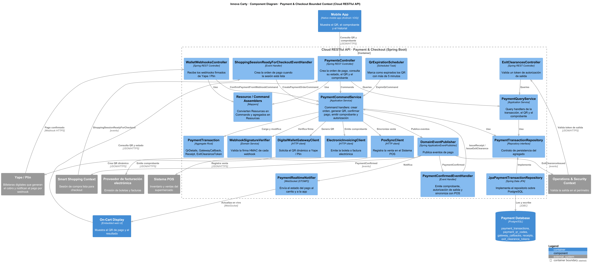

#### 4.2.2.6. Bounded Context Software Architecture Code Level Diagrams

En esta sección se presentan el diagrama de clases de la Domain Layer y el diagrama de base de datos de Payment & Checkout.

##### 4.2.2.6.1. Bounded Context Domain Layer Class Diagrams

El diagrama muestra las clases, interfaces y enumeraciones del dominio con la visibilidad de sus miembros y relaciones con nombre y multiplicidad: por ejemplo, una `PaymentTransaction` **genera** 0..* `QrDetails` y **emite** 0..1 `Receipt`.

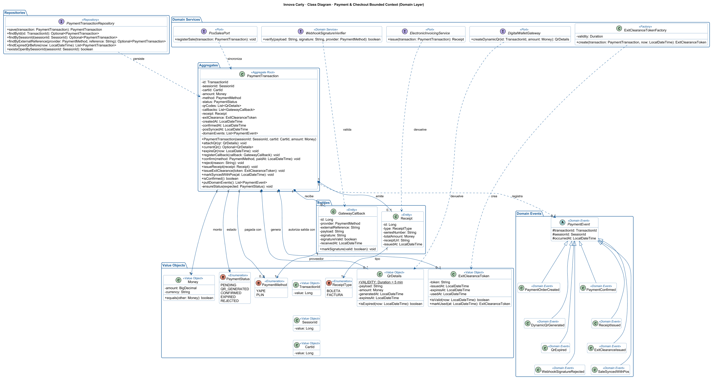

##### 4.2.2.6.2. Bounded Context Database Design Diagram

El modelo relacional en PostgreSQL persiste el agregado `PaymentTransaction` y sus partes. `session_id` y `cart_id` referencian a otros contextos solo por identificador, sin clave foránea. El diagrama se elaboró en Redgate Data Modeler.

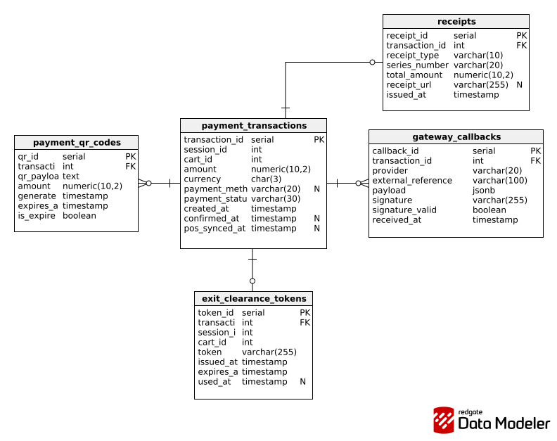

| Tabla | Objeto de dominio | Descripción |
| :--- | :--- | :--- |
| `payment_transactions` | Agregado `PaymentTransaction` | Orden de pago con monto, moneda, billetera, estado y fechas de creación, confirmación y sincronización con el POS. |
| `payment_qr_codes` | Value Object `QrDetails` | QR generados para la transacción; puede haber varios si alguno expiró. |
| `gateway_callbacks` | Entity `GatewayCallback` | Webhooks recibidos con su contenido (`jsonb`), firma y resultado de la verificación. |
| `receipts` | Entity `Receipt` | Comprobante electrónico emitido. |
| `exit_clearance_tokens` | Value Object `ExitClearanceToken` | Autorización de salida con su vigencia y la fecha en que se usó. |

**Constraints y relaciones**

* **Claves primarias:** `transaction_id`, `qr_id`, `callback_id`, `receipt_id` y `token_id`.
* **Claves foráneas:** las cuatro tablas dependientes referencian `payment_transactions.transaction_id`. Una transacción tiene 0..* QR y 0..* webhooks, y como máximo un comprobante y un token de salida (`transaction_id` es único en `receipts` y `exit_clearance_tokens`).
* **Checks:** `amount` mayor a 0; `payment_method` y `provider` solo admiten `YAPE` o `PLIN`; `payment_status` solo admite los cinco estados del enum; `receipt_type` solo admite `BOLETA` o `FACTURA`; `expires_at` de un QR no puede superar 5 minutos desde `generated_at`.
* **Únicos e índices:** `(provider, external_reference)` es único en `gateway_callbacks` para descartar webhooks duplicados; `series_number` y `token` son únicos; un índice único parcial sobre `payment_transactions(session_id)` impide más de una transacción abierta o confirmada por sesión.

### 4.2.3. Bounded Context: Catalog & Pricing Bounded Context

El Catalog & Pricing Bounded Context mantiene el catálogo maestro del supermercado: asocia cada etiqueta RFID a un SKU y define precios vigentes, pesos nominales y márgenes de tolerancia. Es un contexto de especificación: los demás contextos, en especial Smart Shopping, usan sus datos para reconocer y validar cada artículo. A continuación se presentan sus clases a manera de diccionario.

| Clase | Tipo | Propósito | Atributos principales | Métodos principales | Relaciones |
| :--- | :--- | :--- | :--- | :--- | :--- |
| `ProductCatalogItem` | Aggregate Root | Producto del catálogo maestro. Garantiza que el precio sea positivo, que la tolerancia sea válida para el peso nominal y que cada cambio quede registrado en su historial. | `id`, `sku`, `name`, `category`, `price`, `weightProfile`, `rfidTags`, `priceHistory`, `weightHistory`, `active`, `createdAt`, `updatedAt` | `mapRfidTag()`, `unmapRfidTag()`, `changePrice()`, `updateWeightProfile()`, `activate()`, `deactivate()`, `isWithinTolerance()` | Compone 0..* `RfidTagMapping`, `PriceChange` y `WeightProfileChange`, un `Price` y un `WeightProfile`; registra `CatalogEvent`. |
| `CatalogSyncLog` | Aggregate Root | Registro de cada sincronización del catálogo, ya sea la importación desde el POS o la publicación al edge de una tienda. | `direction`, `storeId`, `itemsCount`, `status`, `startedAt`, `finishedAt` | `complete()`, `fail()` | Usa `SyncDirection` y `SyncStatus`. |
| `RfidTagMapping` | Entity | Asociación de una etiqueta RFID con el producto. | `rfidTag`, `active`, `mappedAt` | `deactivate()` | Pertenece a un `ProductCatalogItem`. |
| `PriceChange` / `WeightProfileChange` | Entities | Historial de cambios de precio y de peso/tolerancia, con el administrador que los hizo. | `previousPrice`, `newPrice` / `previous`, `current`, `changedBy`, `changedAt` | — | Pertenecen a un `ProductCatalogItem`. |
| `WeightProfile` | Value Object | Peso nominal y tolerancia de un producto; define el rango aceptado. | `nominalWeight`, `tolerance` | `minWeight()`, `maxWeight()`, `accepts()` | Usa `Weight` y `WeightTolerance`. |
| `WeightTolerance` | Value Object | Variación de peso permitida por empaque o humedad. | `grams` | `isValidFor()` | Parte de `WeightProfile`. |
| `Price`, `Sku`, `RfidCode`, `Weight` | Value Objects | Precio en soles, código comercial, etiqueta RFID y peso en gramos. | `amount`, `currency` / `value` / `grams` | `isPositive()` | Atributos del agregado y sus entidades. |
| `ProductId`, `AdminId`, `StoreId` | Value Objects | Identificadores tipados. `AdminId` y `StoreId` referencian otros contextos solo por id. | `value` | — | — |
| `SyncDirection`, `SyncStatus` | Enumerations | Dirección (`FROM_POS`, `TO_EDGE`) y estado (`PENDING`, `COMPLETED`, `FAILED`) de una sincronización. | — | — | Atributos de `CatalogSyncLog`. |
| `RfidTagUniquenessService` | Domain Service | Aplica la regla de que una etiqueta RFID solo puede estar asociada a un SKU. | `repository` | `ensureAvailable()` | Consulta `ProductCatalogItemRepository`. |
| `EdgeCatalogPublisher`, `PosCatalogSource` | Ports (interfaces) | Contratos hacia el gateway de tienda (edge) y el Sistema POS. | — | `publish()`, `fetchProducts()` | `PosCatalogSource` devuelve `PosProductRecord`. |
| `ProductCatalogItemRepository`, `CatalogSyncLogRepository` | Repositories (interfaces) | Contratos de persistencia de los dos agregados. | — | `save()`, `findById()`, `findBySku()`, `findByRfidTag()`, `existsByRfidTag()`, `findAllActive()`, `findUpdatedSince()`, `findLastCompleted()` | Persisten `ProductCatalogItem` y `CatalogSyncLog`. |
| `CatalogEvent` y subclases | Domain Events | `ProductRegistered`, `RfidTagMapped`, `PriceChanged`, `ProductWeightProfileUpdated`, `CatalogItemUpdated`, `CatalogSyncedWithEdge`. | `productId`, `occurredAt` | — | Registrados por `ProductCatalogItem`. |

#### 4.2.3.1. Domain Layer

La **Domain Layer** de Catalog & Pricing concentra las reglas que mantienen calibrado el catálogo.

* **Aggregates:** `ProductCatalogItem` es la única forma de cambiar un producto. `changePrice()` rechaza precios negativos y `updateWeightProfile()` rechaza tolerancias inválidas (Weight Accuracy Verification Policy); ambos guardan el cambio en su historial y registran el evento correspondiente. `CatalogSyncLog` es un agregado separado porque una sincronización afecta a muchos productos a la vez y tiene su propio ciclo de vida.
* **Entities:** `RfidTagMapping`, `PriceChange` y `WeightProfileChange` tienen identidad dentro del producto y permiten auditar quién cambió qué y cuándo.
* **Value Objects:** `WeightProfile` agrupa el peso nominal y la tolerancia y calcula el rango aceptado; `Price`, `Sku`, `RfidCode`, `Weight` y los identificadores tipados son inmutables.
* **Domain Service:** `RfidTagUniquenessService` aplica la regla de mapeo único de etiquetas RFID, que no puede verificar un solo agregado porque involucra a todo el catálogo.
* **Factory:** el constructor de `ProductCatalogItem` crea el producto activo, con su perfil de peso validado y el evento `ProductRegistered`.
* **Repositories y Ports:** `ProductCatalogItemRepository`, `CatalogSyncLogRepository`, `EdgeCatalogPublisher` y `PosCatalogSource` son interfaces del dominio implementadas en la Infrastructure Layer.
* **Domain Events:** `PriceChanged` y `ProductWeightProfileUpdated` disparan la propagación al edge, y Smart Shopping los usa para invalidar su caché de productos.

#### 4.2.3.2. Interface Layer

La **Interface Layer** expone el catálogo a la Web Console, al contexto Smart Shopping y a las tareas de sincronización mediante controladores REST de Spring Boot bajo el prefijo `/api/v1`.

##### Controllers

**1. ProductsController**

| Método | Endpoint | Descripción | Respuesta | User Story |
| :--- | :--- | :--- | :--- | :--- |
| `GET` | `/api/v1/products?category=&active=` | Lista el catálogo con filtros. | `200 ProductResource[]` | US13 |
| `GET` | `/api/v1/products/{productId}` | Detalle del producto, sus etiquetas RFID y su historial. | `200 ProductResource` · `404` | US13 |
| `POST` | `/api/v1/products` | Registra un producto. | `201` · `409` si el SKU ya existe | US13 |
| `PUT` | `/api/v1/products/{productId}/price` | Actualiza el precio. | `200` · `400` si el precio no es válido | US13 |
| `PUT` | `/api/v1/products/{productId}/weight-profile` | Actualiza peso nominal y tolerancia. | `200` · `400` si la tolerancia no es válida | US13 |
| `POST` | `/api/v1/products/{productId}/rfid-tags` | Asocia una etiqueta RFID al producto. | `201` · `409` si la etiqueta ya está asociada a otro SKU | US13 |
| `DELETE` | `/api/v1/products/{productId}/rfid-tags/{rfidTag}` | Desactiva una etiqueta. | `204` | US13 |

**2. ProductLookupController**

| Método | Endpoint | Descripción | Respuesta |
| :--- | :--- | :--- | :--- |
| `GET` | `/api/v1/products/by-rfid/{rfidTag}` | Consulta que usa `CatalogPricingAcl` de Smart Shopping: devuelve id, nombre, precio, peso nominal y tolerancia. | `200 ProductLookupResource` · `404` si la etiqueta no está registrada |

**3. CatalogSyncController**

| Método | Endpoint | Descripción | Respuesta |
| :--- | :--- | :--- | :--- |
| `POST` | `/api/v1/catalog/sync/pos` | Lanza la importación del catálogo desde el Sistema POS. | `202` |
| `POST` | `/api/v1/catalog/sync/edge?storeId=` | Publica el catálogo vigente al edge de una tienda. | `202` |
| `GET` | `/api/v1/catalog/sync-logs` | Lista las últimas sincronizaciones y su resultado. | `200 CatalogSyncLogResource[]` |

##### Resources (DTOs) y Assemblers

| Resource | Atributos | Uso |
| :--- | :--- | :--- |
| `CreateProductResource` | `sku`, `name`, `category`, `unitPrice`, `nominalWeightGrams`, `weightToleranceGrams` | Entrada de `POST /products` |
| `UpdatePriceResource` | `unitPrice` | Entrada de `PUT /price` |
| `UpdateWeightProfileResource` | `nominalWeightGrams`, `weightToleranceGrams` | Entrada de `PUT /weight-profile` |
| `MapRfidTagResource` | `rfidTag` | Entrada de `POST /rfid-tags` |
| `ProductResource` | `productId`, `sku`, `name`, `category`, `unitPrice`, `nominalWeightGrams`, `weightToleranceGrams`, `allowedRange`, `rfidTags[]`, `active`, `updatedAt` | Salida para la Web Console |
| `ProductLookupResource` | `productId`, `name`, `unitPrice`, `nominalWeightGrams`, `weightToleranceGrams` | Salida para Smart Shopping |
| `CatalogSyncLogResource` | `syncId`, `direction`, `storeId`, `itemsCount`, `status`, `startedAt`, `finishedAt` | Salida del historial de sincronizaciones |

Los *assemblers* `…CommandFromResourceAssembler` convierten cada entrada en su *Command*, y `ProductResourceFromEntityAssembler` y `ProductLookupResourceFromEntityAssembler` convierten el agregado en respuestas. Un `@RestControllerAdvice` traduce `ProductNotFoundException` → `404`, `DuplicateSkuException` y `RfidTagAlreadyMappedException` → `409`, e `InvalidPriceException` e `InvalidWeightToleranceException` → `400`.

#### 4.2.3.3. Application Layer

La **Application Layer** orquesta el mantenimiento del catálogo y su propagación.

##### Command Handlers

**ProductCatalogCommandService**

| Command | Flujo | Evento publicado | User Story |
| :--- | :--- | :--- | :--- |
| `RegisterProductCommand` | Verifica que el SKU no exista y crea el agregado. | `ProductRegistered` | US13 |
| `MapRfidTagCommand` | Valida la etiqueta con `RfidTagUniquenessService` y la asocia al producto. | `RfidTagMapped` | US13 |
| `ChangePriceCommand` | Actualiza el precio y guarda el historial. | `PriceChanged` | US13 |
| `UpdateWeightProfileCommand` | Valida y actualiza peso nominal y tolerancia, y guarda el historial. | `ProductWeightProfileUpdated` | US13 |
| `DeactivateProductCommand` | Retira el producto del catálogo vigente. | `CatalogItemUpdated` | US13 |

**CatalogSyncService**

| Command | Flujo | Evento publicado |
| :--- | :--- | :--- |
| `ImportCatalogFromPosCommand` | Lee los productos con `PosCatalogSource`; registra los nuevos y actualiza el precio de los existentes. Guarda un `CatalogSyncLog` con dirección `FROM_POS`. | `PriceChanged`, `ProductRegistered` |
| `SyncCatalogToEdgeCommand` | Obtiene los productos cambiados desde la última sincronización (`findUpdatedSince`) y los envía al edge de cada tienda. Guarda un `CatalogSyncLog` con dirección `TO_EDGE`. | `CatalogSyncedWithEdge` |

##### Query Handlers

**ProductCatalogQueryService**: `handle(GetAllProductsQuery)`, `handle(GetProductByIdQuery)`, `handle(GetProductByRfidTagQuery)` y `handle(GetCatalogSyncLogsQuery)`.

##### Event Handlers

* **CatalogItemChangedEventHandler:** escucha `PriceChanged`, `ProductWeightProfileUpdated` y `CatalogItemUpdated`, y ejecuta `SyncCatalogToEdgeCommand` para que los carritos validen con los valores nuevos (US13).
* **PosCatalogImportScheduler:** tarea programada que ejecuta `ImportCatalogFromPosCommand` fuera del horario de mayor afluencia.

##### Capabilities del bounded context

| Capability | Componente responsable |
| :--- | :--- |
| Registrar productos y mapear etiquetas RFID | `ProductCatalogCommandService` + `RfidTagUniquenessService` |
| Actualizar precio, peso nominal y tolerancia | `ProductCatalogCommandService` |
| Consultar un producto por RFID | `ProductCatalogQueryService` |
| Importar el catálogo desde el POS | `CatalogSyncService`, `PosCatalogImportScheduler` |
| Propagar los cambios a los servicios edge | `CatalogItemChangedEventHandler`, `CatalogSyncService` |

#### 4.2.3.4. Infrastructure Layer

* **JpaProductCatalogItemRepository** y **JpaCatalogSyncLogRepository** implementan los repositorios con Spring Data JPA sobre PostgreSQL. `ProductCatalogItem` se mapea a `product_catalog_items` (con `Price` y `WeightProfile` como *embeddables*), `RfidTagMapping` a `product_rfid_tags`, `PriceChange` a `product_price_history`, `WeightProfileChange` a `product_weight_history` y `CatalogSyncLog` a `catalog_sync_logs`.
* **EdgeCatalogHttpPublisher** implementa `EdgeCatalogPublisher`: envía al Edge API de cada tienda los productos cambiados, que el gateway guarda en su caché local para validar sin depender de la nube.
* **PosCatalogClient** implementa `PosCatalogSource` y traduce el formato del Sistema POS a `PosProductRecord` (*Anti-Corruption Layer*).
* **DomainEventPublisher** publica los eventos con `ApplicationEventPublisher`; `ProductWeightProfileUpdated` y `PriceChanged` también se notifican a Smart Shopping para invalidar su caché.

#### 4.2.3.5. Bounded Context Software Architecture Component Level Diagrams

El siguiente **Component Diagram (C4 Model, nivel 3)** descompone el container *Cloud RESTful API* en los componentes de Catalog & Pricing. Muestra cómo la Web Console y Smart Shopping interactúan con los controladores, cómo los servicios mantienen los agregados `ProductCatalogItem` y `CatalogSyncLog`, y cómo la Infrastructure Layer se conecta con PostgreSQL, el Edge API y el Sistema POS.

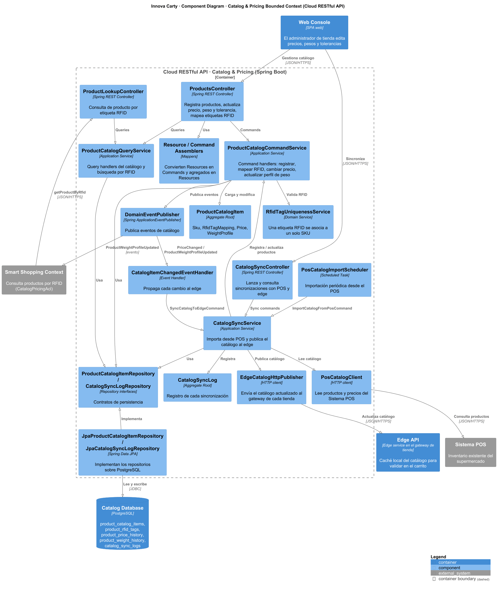

#### 4.2.3.6. Bounded Context Software Architecture Code Level Diagrams

En esta sección se presentan el diagrama de clases de la Domain Layer y el diagrama de base de datos de Catalog & Pricing.

##### 4.2.3.6.1. Bounded Context Domain Layer Class Diagrams

El diagrama muestra las clases, interfaces y enumeraciones del dominio con la visibilidad de sus miembros y relaciones con nombre y multiplicidad: por ejemplo, un `ProductCatalogItem` **se identifica con** 0..* `RfidTagMapping` y **se valida con** exactamente un `WeightProfile`.

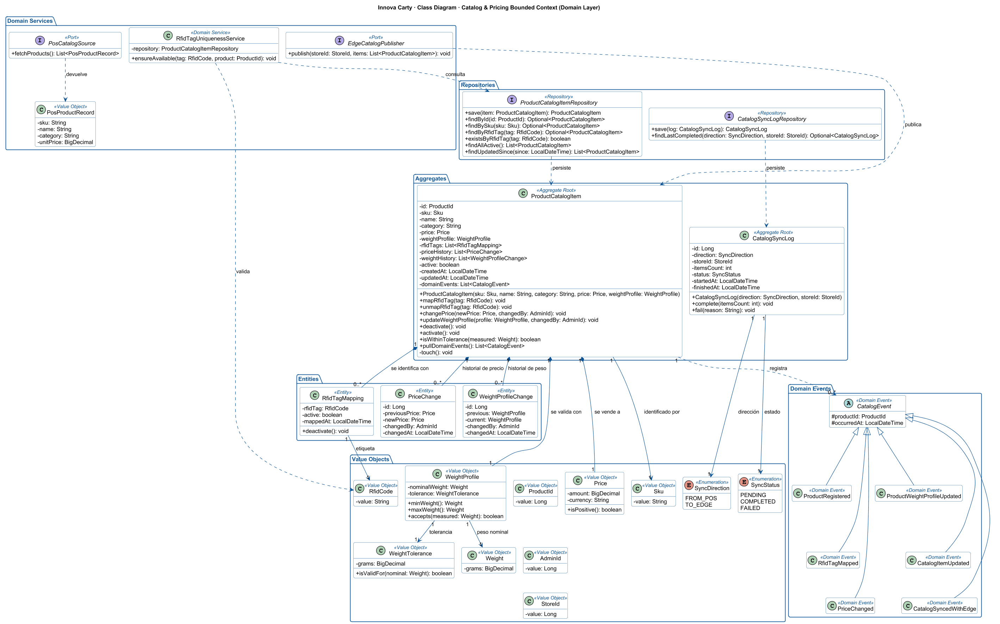

##### 4.2.3.6.2. Bounded Context Database Design Diagram

El modelo relacional en PostgreSQL persiste el catálogo maestro, sus etiquetas RFID, el historial de cambios y las sincronizaciones. Ningún otro contexto escribe en estas tablas. El diagrama se elaboró en Redgate Data Modeler.

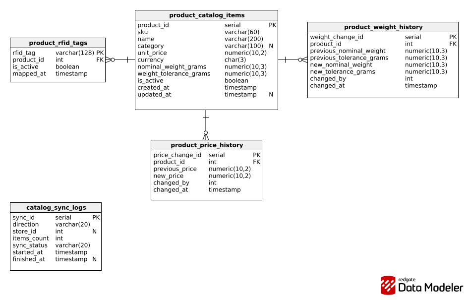

| Tabla | Objeto de dominio | Descripción |
| :--- | :--- | :--- |
| `product_catalog_items` | Agregado `ProductCatalogItem` | SKU, nombre, categoría, precio, moneda, peso nominal, tolerancia, estado y fechas. |
| `product_rfid_tags` | Entity `RfidTagMapping` | Etiquetas RFID asociadas a cada producto. |
| `product_price_history` | Entity `PriceChange` | Precio anterior y nuevo, con el administrador y la fecha del cambio. |
| `product_weight_history` | Entity `WeightProfileChange` | Peso nominal y tolerancia anteriores y nuevos. |
| `catalog_sync_logs` | Agregado `CatalogSyncLog` | Sincronizaciones desde el POS y hacia el edge, con su resultado. |

**Constraints y relaciones**

* **Claves primarias:** `product_id`, `price_change_id`, `weight_change_id` y `sync_id`. En `product_rfid_tags` la clave primaria es la propia `rfid_tag`, lo que garantiza en la base de datos que una etiqueta pertenezca a un solo SKU.
* **Claves foráneas:** `product_rfid_tags`, `product_price_history` y `product_weight_history` referencian `product_catalog_items.product_id` (relación 1 a N). `catalog_sync_logs` no depende de otra tabla.
* **Checks:** `unit_price` no puede ser negativo; `nominal_weight_grams` debe ser mayor a 0 y `weight_tolerance_grams` no puede ser negativo; `direction` solo admite `FROM_POS` o `TO_EDGE` y `sync_status` solo `PENDING`, `COMPLETED` o `FAILED`.
* **Únicos e índices:** `sku` es único; los índices por `product_id` y fecha aceleran la consulta del historial y la búsqueda de etiquetas por producto.

### 4.2.4. Bounded Context: Operations & Security Bounded Context

El Operations & Security Bounded Context supervisa la operación en el piso de venta: convierte las discrepancias de peso en alertas para la Web Console, registra la intervención del supervisor y controla el perímetro de salida con *geofencing* y el freno electromecánico del carrito. Es un contexto de control que reacciona a eventos de los demás. A continuación se presentan sus clases a manera de diccionario.

| Clase | Tipo | Propósito | Atributos principales | Métodos principales | Relaciones |
| :--- | :--- | :--- | :--- | :--- | :--- |
| `SecurityIncident` | Aggregate Root | Incidente de seguridad sobre un carrito, por discrepancia de peso o salida no autorizada. Garantiza que solo un supervisor con credenciales válidas lo resuelva y que todo quede auditado. | `id`, `cartId`, `sessionId`, `type`, `status`, `auditFlag`, `alerts`, `auditLogs`, `openedAt`, `resolvedAt` | `forWeightMismatch()`, `forUnauthorizedExit()`, `raiseAlert()`, `acknowledgeAlert()`, `resolveBySupervisor()`, `flagForAudit()`, `isOpen()` | Compone 1..* `CartAlert` y 0..* `SupervisorAuditLog`; registra `SecurityEvent`. |
| `SmartCart` | Aggregate Root | Carrito físico (ESP32) supervisado desde la consola, con su estado de freno, batería y operación. | `id`, `storeId`, `cartCode`, `deviceMac`, `serialNumber`, `batteryLevel`, `wheelLockState`, `operationalStatus`, `lastPingAt` | `lock()`, `unlock()`, `registerHeartbeat()`, `markInUse()`, `markAvailable()`, `isLocked()` | Pertenece a una tienda (`StoreId`). |
| `CartAlert` | Entity | Alerta mostrada en el panel de la Web Console. | `alertType`, `severity`, `description`, `alarmTriggered`, `createdAt`, `acknowledgedAt` | `acknowledge()` | Pertenece a un `SecurityIncident`. |
| `SupervisorAuditLog` | Entity | Registro de cada intervención de un supervisor. | `supervisorId`, `action`, `credentialVerified`, `notes`, `performedAt` | — | Pertenece a un `SecurityIncident`. |
| `Supervisor` | Entity | Personal autorizado para desbloquear carritos y resolver discrepancias. | `employeeCode`, `fullName`, `credentialHash`, `active` | `canOverride()` | Trabaja en una tienda. |
| `Store` | Entity | Tienda con su perímetro de salida. | `name`, `branchCode`, `address`, `perimeter` | — | Compone un `GeofencePerimeter`. |
| `PerimeterCrossing` | Entity | Cada paso de un carrito por el arco de salida y su resultado. | `cartId`, `sessionId`, `exitClearanceToken`, `result`, `incidentId`, `crossedAt` | — | Puede originar un `SecurityIncident`. |
| `GeofencePerimeter`, `GeoPoint` | Value Objects | Polígono del perímetro de seguridad y sus vértices. | `coordinates` / `latitude`, `longitude` | `contains()` | Parte de `Store`. |
| `BatteryLevel` | Value Object | Nivel de batería del carrito. | `percent` | `isLow()` | Parte de `SmartCart`. |
| `IncidentId`, `CartId`, `SessionId`, `StoreId`, `SupervisorId` | Value Objects | Identificadores tipados. `SessionId` referencia a Smart Shopping solo por id. | `value` | — | — |
| `WheelLockState`, `CartOperationalStatus`, `IncidentType`, `IncidentStatus`, `Severity`, `AuditAction`, `ExitResult` | Enumerations | Estados del freno, del carrito y del incidente; tipo de incidente; severidad; acción auditada; resultado de la salida. | — | — | Atributos de los agregados y entidades. |
| `ExitAuthorizationPolicy` | Domain Service | Decide si un cruce del perímetro es una salida autorizada o debe bloquearse. | — | `decide()` | Evalúa `SmartCart`; devuelve `ExitResult`. |
| `SupervisorCredentialVerifier` | Domain Service (interfaz) | Verifica la credencial del supervisor antes de un desbloqueo. | — | `verify()` | Verifica `Supervisor`. |
| `ExitClearancePort`, `CartActuatorPort` | Ports (interfaces) | Contratos hacia Payment & Checkout (validar el token de salida) y hacia el carrito (freno y alarma). | — | `isValid()`, `lockWheels()`, `releaseWheels()` | Implementados en la Infrastructure Layer. |
| `SecurityIncidentRepository`, `SmartCartRepository`, `SupervisorRepository`, `PerimeterCrossingRepository` | Repositories (interfaces) | Contratos de persistencia. | — | `save()`, `findById()`, `findOpenByCartId()`, `findAllOpenByStore()`, `findAllByStore()`, `findByEmployeeCode()` | Persisten los agregados y entidades. |
| `SecurityEvent` y subclases | Domain Events | `SecurityAlertTriggered`, `CartLocked`, `CartUnlocked`, `DiscrepancyResolvedBySupervisor`, `IncidentFlaggedForAudit`, `ExitRegistered`. | `cartId`, `occurredAt` | — | Registrados por los agregados. |

#### 4.2.4.1. Domain Layer

La **Domain Layer** de Operations & Security modela la prevención de pérdidas y la seguridad física del carrito.

* **Aggregates:** `SecurityIncident` agrupa las alertas y las intervenciones de un mismo problema; un carrito tiene como máximo un incidente abierto de cada tipo. `resolveBySupervisor()` rechaza la operación si la credencial no fue verificada y siempre deja un `SupervisorAuditLog`. `SmartCart` es otro agregado porque su estado (freno, batería, disponibilidad) cambia con más frecuencia que los incidentes y no depende de ellos.
* **Entities:** `CartAlert`, `SupervisorAuditLog`, `Supervisor`, `Store` y `PerimeterCrossing` tienen identidad propia y se conservan para la auditoría.
* **Value Objects:** `GeofencePerimeter` determina si una posición está dentro del perímetro, `BatteryLevel` indica si la batería está baja y los identificadores tipados evitan mezclar ids de distintos contextos.
* **Domain Services:** `ExitAuthorizationPolicy` aplica la regla "un carrito sin autorización de salida que cruza el perímetro se bloquea"; `SupervisorCredentialVerifier` aplica la regla "solo un supervisor con credenciales puede desbloquear un carrito".
* **Factories:** los métodos estáticos `forWeightMismatch()` y `forUnauthorizedExit()` crean el incidente con su tipo, su primera alerta y el evento `SecurityAlertTriggered`.
* **Repositories y Ports:** los repositorios, `ExitClearancePort` y `CartActuatorPort` son interfaces del dominio implementadas en la Infrastructure Layer.
* **Domain Events:** `CartLocked` y `SecurityAlertTriggered` llegan a la Web Console en tiempo real; `DiscrepancyResolvedBySupervisor` permite que Smart Shopping reanude la sesión.

#### 4.2.4.2. Interface Layer

La **Interface Layer** expone el contexto a la Web Console y al Edge API mediante controladores REST de Spring Boot bajo el prefijo `/api/v1`, y recibe los eventos de Smart Shopping.

##### Controllers / Consumers

**1. SecurityIncidentsController**

| Método | Endpoint | Descripción | Respuesta | User Story |
| :--- | :--- | :--- | :--- | :--- |
| `GET` | `/api/v1/stores/{storeId}/incidents?status=OPEN` | Panel de alertas de la Web Console. | `200 SecurityIncidentResource[]` | US11 |
| `GET` | `/api/v1/incidents/{incidentId}` | Detalle del incidente con sus alertas e intervenciones. | `200` · `404` | US11 |
| `POST` | `/api/v1/incidents/{incidentId}/resolve` | El supervisor resuelve la discrepancia con sus credenciales. | `200` · `401` si la credencial no es válida · `409` si ya está resuelto | US11 |
| `POST` | `/api/v1/incidents/{incidentId}/audit-flag` | Marca la compra para auditoría. | `200` | US11 |
| `POST` | `/api/v1/alerts/{alertId}/acknowledge` | Marca la alerta como atendida. | `204` | US11 |

**2. SmartCartsController**

| Método | Endpoint | Descripción | Respuesta |
| :--- | :--- | :--- | :--- |
| `GET` | `/api/v1/stores/{storeId}/carts` | Mapa de carritos activos con estado, batería y freno. | `200 SmartCartResource[]` |
| `GET` | `/api/v1/carts/{cartId}` | Detalle del carrito. | `200` · `404` |
| `POST` | `/api/v1/carts/{cartId}/unlock` | Libera el freno con credenciales del supervisor. | `200` · `401` |

**3. PerimeterEventsController**

| Método | Endpoint | Evento de entrada | Acción |
| :--- | :--- | :--- | :--- |
| `POST` | `/api/v1/perimeter/crossings` | Cruce de perímetro detectado por el sensor del arco de salida | `RegisterPerimeterCrossingCommand` |
| `POST` | `/api/v1/carts/{cartId}/heartbeat` | Estado periódico del carrito (batería, conectividad) | `RegisterHeartbeatCommand` |

**4. WeightMismatchDetectedConsumer**: recibe el evento `WeightMismatchDetected` de Smart Shopping y lo convierte en `OpenWeightMismatchIncidentCommand`.

##### Resources (DTOs) y Assemblers

| Resource | Atributos | Uso |
| :--- | :--- | :--- |
| `SecurityIncidentResource` | `incidentId`, `cartId`, `sessionId`, `type`, `status`, `auditFlag`, `alerts[]`, `openedAt`, `resolvedAt` | Panel de alertas y detalle |
| `ResolveIncidentResource` | `supervisorCode`, `credential`, `notes` | Entrada de `resolve` y `unlock` |
| `SmartCartResource` | `cartId`, `cartCode`, `operationalStatus`, `wheelLockState`, `batteryLevel`, `lastPingAt` | Mapa de carritos |
| `PerimeterCrossingResource` | `eventId`, `cartId`, `exitGate`, `exitClearanceToken`, `detectedAt` | Entrada del Edge API |

Los *assemblers* convierten estas entradas en *Commands* y los agregados en *Resources*. Un `@RestControllerAdvice` traduce `IncidentNotFoundException` → `404`, `InvalidSupervisorCredentialException` → `401` e `IncidentAlreadyResolvedException` → `409`.

#### 4.2.4.3. Application Layer

##### Command Handlers

**SecurityIncidentCommandService**

| Command | Flujo | Evento publicado | User Story |
| :--- | :--- | :--- | :--- |
| `OpenWeightMismatchIncidentCommand` | Si el carrito no tiene un incidente de peso abierto, lo crea con `forWeightMismatch()` y su alerta. | `SecurityAlertTriggered` | US11 |
| `ResolveIncidentCommand` | Busca al supervisor, verifica su credencial con `SupervisorCredentialVerifier` y resuelve el incidente. | `DiscrepancyResolvedBySupervisor` | US11 |
| `FlagIncidentForAuditCommand` | Marca la compra para auditoría y registra la intervención. | `IncidentFlaggedForAudit` | US11 |
| `AcknowledgeAlertCommand` | Marca la alerta como atendida. | — | US11 |

**CartControlCommandService**

| Command | Flujo | Evento publicado |
| :--- | :--- | :--- |
| `LockCartCommand` | Cambia `WheelLockState` a `LOCKED` y ordena al carrito activar el freno y la alarma mediante `CartActuatorPort`. | `CartLocked` |
| `UnlockCartCommand` | Verifica la credencial del supervisor, libera el freno y registra la intervención en el incidente. | `CartUnlocked` |
| `RegisterHeartbeatCommand` | Actualiza batería y `last_ping_at`. | — |

**PerimeterCrossingService**

* `handle(RegisterPerimeterCrossingCommand)` (US12): consulta a Payment & Checkout, mediante `ExitClearancePort`, si el token de salida del carrito es válido; aplica `ExitAuthorizationPolicy`; si la salida está autorizada, guarda el cruce como `AUTHORIZED` y publica `ExitRegistered`; si no, ejecuta `LockCartCommand`, abre un incidente `UNAUTHORIZED_EXIT` y guarda el cruce como `BLOCKED`.

##### Query Handlers

**OperationsQueryService**: `handle(GetOpenIncidentsByStoreQuery)`, `handle(GetIncidentByIdQuery)`, `handle(GetCartsByStoreQuery)` y `handle(GetCartByIdQuery)`.

##### Event Handlers

* **WeightMismatchDetectedEventHandler:** reacciona al evento de Smart Shopping y ejecuta `OpenWeightMismatchIncidentCommand`.
* **WeightConsistencyRestoredEventHandler:** si el comprador corrige la canasta antes de que intervenga el supervisor, marca la alerta como atendida automáticamente.

##### Capabilities del bounded context

| Capability | Componente responsable |
| :--- | :--- |
| Alertar discrepancias de peso en la Web Console | `WeightMismatchDetectedEventHandler`, `SecurityIncidentCommandService` |
| Resolver discrepancias y desbloquear carritos con credenciales | `SecurityIncidentCommandService`, `CartControlCommandService` + `SupervisorCredentialVerifier` |
| Controlar el perímetro de salida (US12) | `PerimeterCrossingService` + `ExitAuthorizationPolicy` |
| Bloquear el carrito y activar la alarma | `CartControlCommandService` |
| Monitorear el estado de los carritos | `CartControlCommandService`, `OperationsQueryService` |

#### 4.2.4.4. Infrastructure Layer

* **JpaSecurityIncidentRepository**, **JpaSmartCartRepository**, **JpaSupervisorRepository** y **JpaPerimeterCrossingRepository** implementan los repositorios con Spring Data JPA sobre PostgreSQL. `SecurityIncident` se mapea a `security_incidents`, `CartAlert` a `cart_alerts`, `SupervisorAuditLog` a `supervisor_audit_logs`, `SmartCart` a `smart_carts`, `Supervisor` a `supervisors`, `Store` a `stores` y `PerimeterCrossing` a `perimeter_crossings`.
* **ExitClearanceAcl** implementa `ExitClearancePort`: consulta `GET /api/v1/exit-clearances/{token}` en Payment & Checkout y traduce la respuesta a un valor booleano.
* **EdgeCartActuatorClient** implementa `CartActuatorPort`: envía al Edge API la orden de activar o liberar el freno y la alarma del ESP32.
* **BCryptSupervisorCredentialVerifier** implementa `SupervisorCredentialVerifier` comparando la credencial con su hash (Spring Security).
* **DomainEventPublisher** publica los eventos con `ApplicationEventPublisher`; `DiscrepancyResolvedBySupervisor` se envía también a Smart Shopping.
* **IncidentRealtimeNotifier** envía por WebSocket (STOMP), al tópico `/topic/stores/{storeId}/incidents`, las alertas y los cambios de estado de los carritos, para que la Web Console los muestre sin recargar.

#### 4.2.4.5. Bounded Context Software Architecture Component Level Diagrams

El siguiente **Component Diagram (C4 Model, nivel 3)** descompone el container *Cloud RESTful API* en los componentes de Operations & Security. Muestra cómo la Web Console, el Edge API y los eventos de Smart Shopping llegan a los controladores y *event handlers*; cómo los servicios aplican las políticas sobre los agregados `SecurityIncident` y `SmartCart`; y cómo la Infrastructure Layer se conecta con PostgreSQL, Payment & Checkout y el carrito.

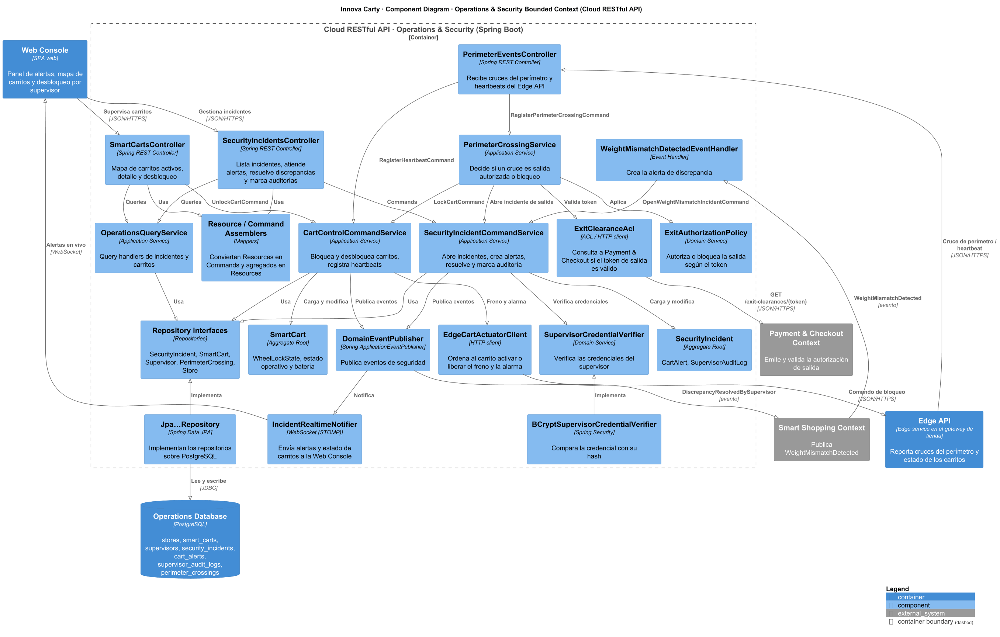

#### 4.2.4.6. Bounded Context Software Architecture Code Level Diagrams

En esta sección se presentan el diagrama de clases de la Domain Layer y el diagrama de base de datos de Operations & Security.

##### 4.2.4.6.1. Bounded Context Domain Layer Class Diagrams

El diagrama muestra las clases, interfaces y enumeraciones del dominio con la visibilidad de sus miembros y relaciones con nombre y multiplicidad: por ejemplo, un `SecurityIncident` **genera** 1..* `CartAlert` y **audita con** 0..* `SupervisorAuditLog`.

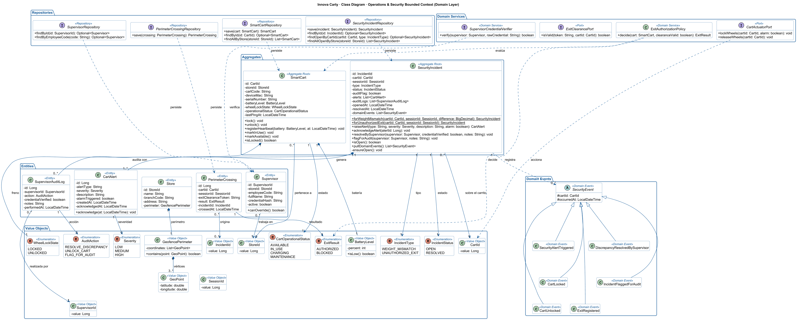

##### 4.2.4.6.2. Bounded Context Database Design Diagram

El modelo relacional en PostgreSQL persiste tiendas, carritos, supervisores, incidentes y cruces del perímetro. `session_id` y `exit_clearance_token` referencian a otros contextos sin clave foránea. El diagrama se elaboró en Redgate Data Modeler.

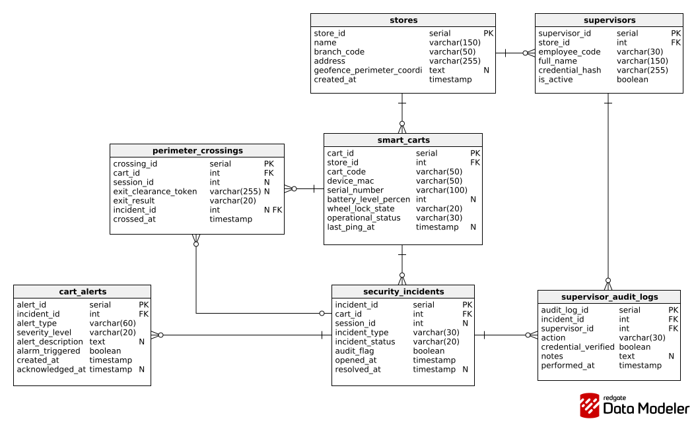

| Tabla | Objeto de dominio | Descripción |
| :--- | :--- | :--- |
| `stores` | Entity `Store` | Tienda con su código de sede y las coordenadas del perímetro. |
| `smart_carts` | Agregado `SmartCart` | Carrito con código QR, MAC, número de serie, batería, estado del freno y estado operativo. |
| `supervisors` | Entity `Supervisor` | Supervisores por tienda con el hash de su credencial. |
| `security_incidents` | Agregado `SecurityIncident` | Incidentes por carrito con tipo, estado, marca de auditoría y fechas. |
| `cart_alerts` | Entity `CartAlert` | Alertas de cada incidente con severidad y si se activó la alarma. |
| `supervisor_audit_logs` | Entity `SupervisorAuditLog` | Intervenciones de los supervisores. |
| `perimeter_crossings` | Entity `PerimeterCrossing` | Cruces del arco de salida y su resultado. |

**Constraints y relaciones**

* **Claves primarias:** `store_id`, `cart_id`, `supervisor_id`, `incident_id`, `alert_id`, `audit_log_id` y `crossing_id`.
* **Claves foráneas:** una tienda tiene 0..* carritos y 0..* supervisores; un carrito tiene 0..* incidentes y 0..* cruces; un incidente tiene 0..* alertas e intervenciones; cada intervención referencia al supervisor que la hizo; un cruce puede referenciar el incidente que originó (`incident_id` opcional).
* **Checks:** `wheel_lock_state` solo admite `LOCKED` o `UNLOCKED`; `operational_status`, `incident_type`, `incident_status`, `severity_level`, `action` y `exit_result` solo admiten los valores de sus enumeraciones; `battery_level_percent` debe estar entre 0 y 100.
* **Únicos e índices:** `branch_code`, `cart_code`, `device_mac` y `employee_code` son únicos; un índice único parcial sobre `security_incidents(cart_id, incident_type)` para los incidentes `OPEN` impide duplicar alertas del mismo problema; los índices por carrito y fecha aceleran el mapa de carritos y el historial de cruces.

<div style="page-break-after: always;"></div>

---

# Capítulo V: Solution UI/UX Design

## 5.1. Style Guidelines

### 5.1.1. General Style Guidelines

Esta sección formaliza los lineamientos visuales y de diseño que unifican la identidad de marca en todos los productos del ecosistema Innova Carty (Landing Page estática, consola web de administración y pantalla táctil integrada al Smart Cart). Las decisiones se sustentan en los principios de diseño de Material Design 3 y en las heurísticas de claridad visual y accesibilidad universal (WCAG 2.1 nivel AA).

#### A. Branding

Innova Carty proyecta una identidad tecnológica, eficiente y confiable para el sector *retail*. El imagotipo oficial de la solución integra la silueta de un carrito de supermercado combinado con trazos de circuitos electrónicos de IoT, un haz de censado y una pantalla central con visualización de montos y código QR, sintetizando el valor del proyecto: "Compra inteligente, pago instantáneo". Esta construcción visual equilibra la agilidad del comercio sin fricciones con la solidez de una plataforma de seguridad y control en tienda.

#### B. Tono de Comunicación y Dimensiones de Voz

Siguiendo el marco de las cuatro dimensiones de tono de voz de Nielsen Norman Group, la comunicación de Innova Carty se estructura de la siguiente manera:

* **Serio vs. Divertido (Tendencia: Serio - 75%):** Prioriza la precisión, la transparencia en los montos cobrados y la certidumbre financiera. Se prescinde de humor o expresiones coloquiales ambiguas que puedan generar desconfianza en el momento del pesaje o la transacción de pago.
* **Formal vs. Casual (Tendencia: Casual balanceado - 60%):** Utiliza un lenguaje directo, accesible y moderno tanto para compradores de diversos perfiles como para el personal de piso de venta, omitiendo tecnicismos complejos de desarrollo de software.
* **Respetuoso vs. Irreverente (Tendencia: Respetuoso - 90%):** Trata las finanzas del usuario con rigurosidad y empatía, guiando de manera clara y cordial al comprador ante inconsistencias o alertas operativas.
* **Entusiasta vs. Sereno (Tendencia: Sereno - 70%):** Transmite calma y seguridad al usuario durante el seguimiento continuo de su presupuesto, proyectando control y estabilidad operativa en los paneles de supervisión.

#### C. Paleta de Colores (Colors)

La identidad cromática se fundamenta directamente en el imagotipo oficial de Innova Carty, utilizando el contraste entre el azul institucional y el verde tecnológico para transmitir innovación, seguridad operativa y agilidad en el flujo comercial:

| Categoría | Nombre del Color | Código Hex | Uso y Principio de Sustento |
| :--- | :--- | :--- | :--- |
| **Primario** | Azul Carty Institucional | `#004F8C` | Extraído de la estructura del carrito y la palabra "INNOVA". Representa la solidez de la infraestructura, confianza transaccional y estabilidad del sistema. |
| **Secundario** | Verde Smart Retail | `#009E60` | Extraído de la palabra "CARTY" y el área de censado. Destinado a llamadas a la acción (*CTAs*), confirmación de escaneo RFID y elementos de ahorro. |
| **Éxito / Autorización** | Verde Lima Conforme | `#2ECC71` | Señalización de pago completado con éxito, autorización de salida perimetral y validación física de peso correcta. |
| **Alerta / Warning** | Ámbar Presupuesto | `#F39C12` | Advertencia de proximidad al límite de presupuesto configurado (90%) y solicitud de reintento de pesaje. |
| **Error / Bloqueo** | Rojo Discrepancia | `#E74C3C` | Detención del flujo de cobro por inconsistencia de masa en la canasta, bloqueo electromecánico perimetral y alerta a supervisión. |
| **Neutro Oscuro** | Azul Carbón Profundo | `#102A43` | Títulos, textos principales e interfaz de pantalla para garantizar una relación de contraste superior a 7:1 (estándar WCAG AAA). |
| **Neutro Claro** | Blanco Nieve | `#FFFFFF` | Fondo del imagotipo, áreas de descanso visual y contenedores de tarjetas para máxima legibilidad bajo la iluminación del supermercado. |

#### D. Tipografía (Typography)

Se seleccionaron familias tipográficas de libre distribución optimizadas para lectura en pantallas digitales y dispositivos embebidos:

* **Fuente Primaria (Títulos y Números):** *Inter* (SemiBold y Bold). Se aplica en encabezados, montos de presupuesto y números en tiempo real por su legibilidad en pantallas táctiles de baja y media resolución montadas en el carrito.
* **Fuente Secundaria (Cuerpo y Etiquetas):** *Roboto* (Regular y Medium). Empleada en descripciones de productos, alertas, tablas del Landing Page y consola administrativa por su rendimiento optimizado en interfaces web y móviles.

| Jerarquía | Fuente | Peso | Tamaño (Desktop / Consola) | Tamaño (On-Cart Display) |
| :--- | :--- | :--- | :--- | :--- |
| **Display / H1** | Inter | Bold (700) | 32px | 28px |
| **Headline / H2** | Inter | SemiBold (600) | 24px | 22px |
| **Title / H3** | Inter | Medium (500) | 20px | 18px |
| **Body / Párrafos** | Roboto | Regular (400) | 16px | 16px |
| **Monto / Contador** | Inter | Bold (700) | 28px | 32px |
| **Caption / Metadatos**| Roboto | Light (300) | 12px | 14px |

#### E. Espaciado y Cuadrícula (Spacing & Layout Grid)

Se adopta un sistema de cuadrícula modular basado en múltiplos de 8dp (8-point grid system), utilizando 4dp como subunidad para ajustes finos de alineación:

* **Espaciado base:** 8px, 16px, 24px, 32px, 48px y 64px para definir márgenes exteriores y separación entre componentes.
* **Touch Targets:** En la pantalla física del carrito y vistas táctiles, todos los botones interactivos mantienen una zona táctil mínima de 48px x 48px para evitar pulsaciones erróneas durante el recorrido en tienda.
* **Elevaciones y Sombras:** Se definen elevaciones estándar de 1dp a 4dp (sombras sutiles) para separar visualmente las tarjetas de productos de los contenedores de fondo sin saturar la interfaz.

### 5.1.2. Web, Mobile and IoT Style Guidelines

En esta sección se definen los lineamientos de diseño e interacción propios de cada punto de contacto de Innova Carty: la Web Console, la app móvil y la interfaz física del Smart Cart (On-Cart Display, tira LED, buzzer y botón). Todos parten de los General Style Guidelines (5.1.1): la misma paleta, la tipografía *Inter* para cifras y títulos y *Roboto* para textos, la cuadrícula de 8 px y los objetivos táctiles de 48 px como mínimo. Lo que cambia entre ellos es la densidad de información y la forma de interacción, porque cada producto se usa en una situación distinta: la Consola en un escritorio o tablet durante el turno, la app en el teléfono del comprador y el carrito con las manos ocupadas y en movimiento.

Estos lineamientos ya están aplicados en los wireframes, mock-ups y prototipos del capítulo (5.4 y 5.5) y centralizados en el Design System de Figma descrito al final de esta sección.

| Producto | Usuario | Tamaño de diseño | Stack de implementación |
| :--- | :--- | :--- | :--- |
| Web Console | Administrador de Tienda (Lucía) | 1440 × 900 px, responsive desde 768 px | Angular + Angular Material |
| App móvil Innova Carty | Comprador (Juan) | 390 × 844 px | Android / iOS |
| On-Cart Display | Comprador (Juan) | 10.1" horizontal, 1024 × 600 px | Pantalla HMI Nextion controlada por el ESP32 (5.6) |

La app operativa **Innova Carty Ops** para supervisores (5.2.3) queda para una entrega posterior; mientras tanto, el supervisor usa la Web Console en tablet (5.4).

#### A. Web Style Guidelines (Web Console)

La Web Console está orientada al administrador de tienda y al supervisor de piso, que necesitan ver el estado de toda la flota, detectar qué carrito requiere atención y resolver la alerta en pocos pasos.

**Estructura de la interfaz (dashboard layout)**

* **Menú lateral fijo (izquierda):** Dashboard, Carts, Alerts, Catalog, Reports, Settings y Help, con ícono y texto; *Alerts* muestra un contador de alertas abiertas. Al pie del menú se muestran la tienda seleccionada y el estado del gateway edge (por ejemplo, "Surco Store #01 · 40 carts · edge gateway online").
* **Barra superior:** búsqueda global de carritos, órdenes o SKUs (atajo `Ctrl K`), selector de idioma EN/ES, notificaciones y perfil del usuario.
* **Contenido:** la vista del módulo seleccionado. El Dashboard sigue el orden KPIs → gráfico de sesiones por hora → alertas en vivo → estado de la flota.

<p align="center">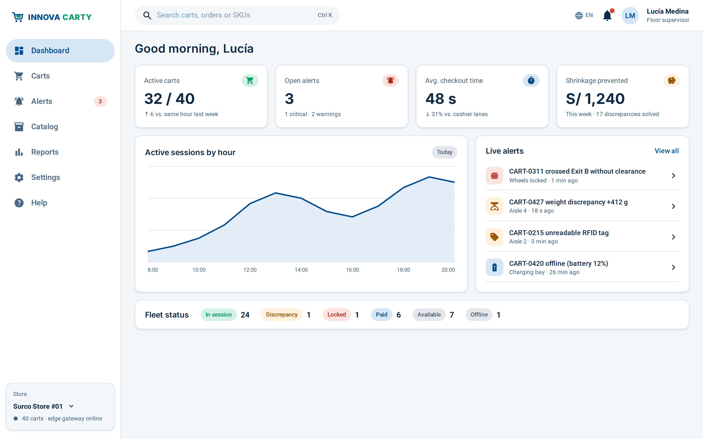</p>

**Componentes clave**

1. **Tarjetas de KPI:** carritos activos, alertas abiertas, tiempo promedio de pago y merma evitada. La cifra va en *Inter* Bold y debajo una comparación breve (por ejemplo, "↓ 31 % vs. cashier lanes").
2. **Tablas:** búsqueda, filtros por estado, ordenamiento y paginación; la fila completa abre el detalle y las filas que requieren atención se resaltan.
3. **Gráficos:** línea o área para series en el tiempo (sesiones por hora) y barras para comparar categorías (alertas por tipo). Se usa un solo color por serie y no se usan gráficos de torta.
4. **Chips de estado del carrito**, los mismos en todas las vistas:

| Estado | Color del chip | Significado |
| :--- | :--- | :--- |
| In session | Verde | Compra en curso sin incidencias |
| Discrepancy | Ámbar | Diferencia de peso; el pago está en pausa |
| Locked | Rojo | Intento de salida sin pago; ruedas bloqueadas |
| Paid · clearance | Azul | Pagado, con autorización de salida vigente |
| Available | Gris claro | Libre, esperando un comprador |
| Offline | Gris | Sin conexión con el gateway |

**Interacciones**

* Estados *hover* y *focus* visibles en botones, filas y enlaces.
* *Toast* de confirmación para cada acción y mensaje de error en el campo que falló.
* Diálogo de confirmación para las acciones críticas, que pide los datos necesarios para la auditoría: desbloquear un carrito (resolución + PIN) o cambiar el peso o la tolerancia de un SKU (el diálogo muestra el rango permitido resultante).
* El Dashboard se actualiza cada 5 s sin recargar la página (US11).

**Responsive y accesibilidad**

* Breakpoints: escritorio ≥ 1280 px, tablet ≥ 768 px; en tablet el menú lateral se colapsa a íconos.
* Contraste mínimo 4.5:1 en textos (WCAG 2.1 AA) y estados que nunca dependen solo del color: cada chip lleva texto.

#### B. Mobile Style Guidelines (app Innova Carty)

La app está orientada al comprador, que quiere vincular un carrito, saber cuánto lleva gastado y pagar sin hacer cola. Se diseña *mobile-first*, para usarse con una sola mano mientras empuja el carrito.

**Navegación**

Barra inferior con cuatro destinos: **Home**, **Cart**, **Receipts** y **Profile**. La acción principal de cada pantalla va siempre en un botón ancho en la parte inferior, al alcance del pulgar.

**Pantallas clave**

1. **Home:** prioriza "Link a cart", la tarea con la que empieza cada visita.
2. **Link a cart:** escaneo del QR que muestra el carrito, con ingreso manual del código de 4 dígitos como alternativa.
3. **Set budget:** monto con sugerencias de S/ 50 a S/ 300, opción de guardarlo como presupuesto por defecto o de comprar sin límite.
4. **Active cart:** la misma sesión que muestra el carrito, sincronizada: lista de productos, Real-Time Total y barra de presupuesto.
5. **Payment:** elección entre Yape, Plin o mostrar el QR en la pantalla del carrito; la app no guarda datos de la tarjeta ni de la billetera.
6. **Receipt and exit pass** y **Receipts history:** comprobante digital con el pase de salida e historial con búsqueda y filtros por fecha, tienda y orden.

<p align="center">
  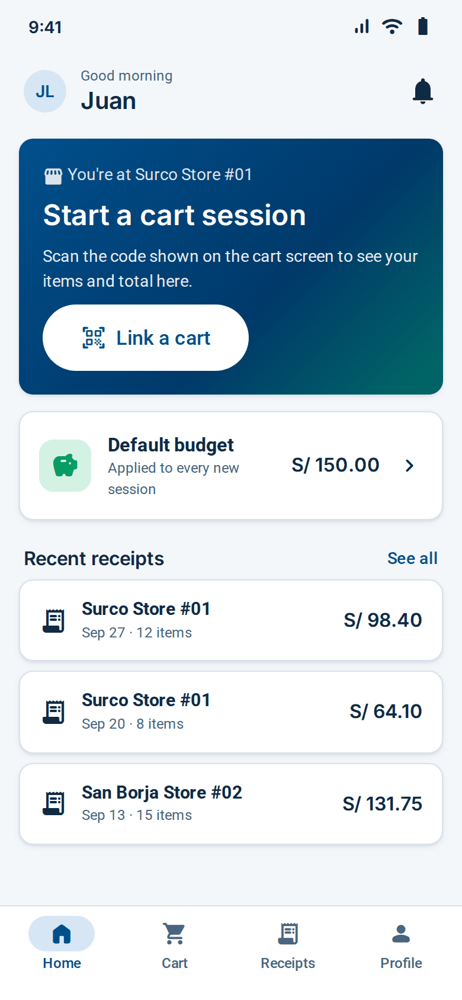
  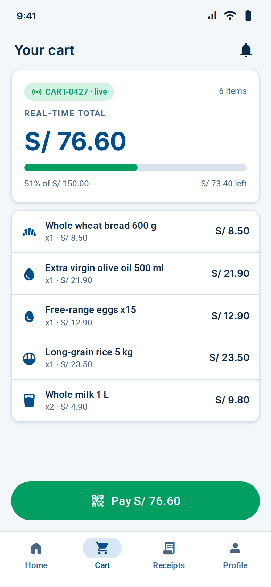
</p>

**Lineamientos**

* El total es el elemento más grande de la vista (*Inter* Bold, 36 px) y la barra de presupuesto cambia de verde a ámbar al llegar al 90 %.
* Retroalimentación inmediata: cada producto que el carrito agrega o retira aparece en la app en menos de 1 s, con una animación de 150 a 300 ms.
* Objetivos táctiles de 48 × 48 px, íconos siempre con texto y soporte para el tamaño de fuente del sistema.
* Mensajes en lenguaje directo y sereno (5.1.1): "Your cart is linked", "You've used 90 % of your budget".

#### C. IoT Style Guidelines (interfaz física del Smart Cart)

En el carrito el comprador tiene las manos ocupadas, se mueve por el pasillo y mira la pantalla solo por momentos. Por eso la interfaz física se basa en pocas acciones, estados muy visibles y la misma información repetida en tres canales: pantalla, luz y sonido.

**On-Cart Display (10.1", 1024 × 600 px, horizontal)**

* **Dos zonas fijas:** a la izquierda la lista de productos (el último agregado arriba y resaltado) y a la derecha el Real-Time Total (*Inter* Bold, 44 px), la barra de presupuesto y las acciones.
* **Barra superior** con la tienda, el código del carrito (`CART-0427`), el estado de conexión, el nivel de batería y el idioma.
* **Una acción principal por pantalla**, siempre en la columna derecha; el botón "Tap to start" mide 72 px de alto.
* **Avisos:** los avisos recuperables (90 % del presupuesto, etiqueta no leída) son *banners* sobre la lista, para no tapar el total; solo la discrepancia de peso usa un diálogo modal, porque pausa el pago.
* **Restricción de la pantalla HMI:** las vistas de Figma se exportan a 1024 × 600 px y se cargan en Nextion Editor como fondos; los datos que cambian (lista, total, barra de presupuesto, código QR) son componentes de texto, barra de progreso y QR que el ESP32 actualiza por UART. Por eso se evitan animaciones complejas y se limita cada pantalla a una sola zona dinámica principal.

<p align="center">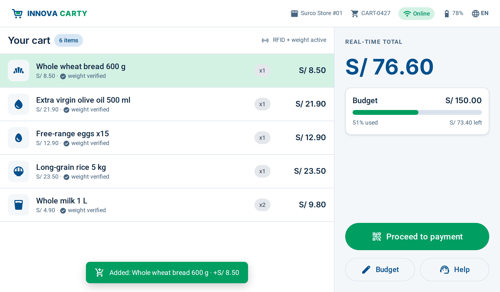</p>

**Tira LED, buzzer y botón**

Los colores de la tira LED son los de la paleta de 5.1.1. El brillo se limita al 25 % para no deslumbrar en el pasillo y para cuidar la batería (5.6).

<p align="center">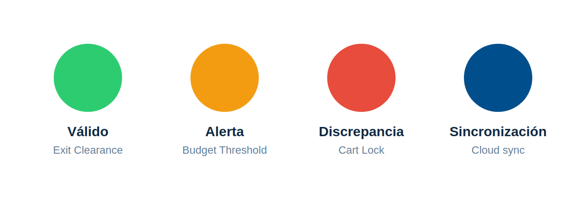</p>

| Situación | Tira LED | On-Cart Display | Buzzer |
| :--- | :--- | :--- | :--- |
| Disponible (Available) | Azul `#004F8C` tenue, fijo | Welcome, "Tap to start" | — |
| En sesión, producto agregado o retirado | Verde `#2ECC71` fijo | Lista actualizada y *toast* con el monto | 1 bip corto (agregado) / 2 bips (retirado) |
| 90 % del presupuesto | Ámbar `#F39C12` fijo | *Banner* ámbar | 2 bips cortos |
| Etiqueta no reconocida | Ámbar, 3 destellos | *Banner* "Place the item again" | 3 bips cortos |
| Discrepancia de peso (pago en pausa) | Rojo `#E74C3C`, parpadeo lento | Diálogo "Weight discrepancy" | 1 bip cada 2 s durante 10 s |
| Salida sin pago (Locked) | Rojo, parpadeo rápido | Pantalla de carrito bloqueado | Alarma intermitente hasta que un supervisor desbloquee |
| Pagado, autorización de salida | Verde, pulso lento durante 15 min | Payment confirmed y pase de salida | Tono doble ascendente |
| Sin conexión / reconectando | Azul, parpadeo | *Banner* "Reconnecting…" | — |
| Batería baja (< 15 %) | Ámbar, un destello cada 10 s | Ícono de batería en rojo | — |

* **Botón de ayuda:** pulsación corta → llama a un supervisor (la alerta aparece en la Consola); pulsación larga de 3 s → cancela la sesión, previa confirmación en pantalla.
* **Automatización sin intervención del usuario:** si el peso no coincide con los productos leídos por más de 3 s, el pago se pausa solo; si el carrito cruza la salida sin autorización, la rueda se bloquea (US09, US12).
* **Sincronización:** cada evento físico se refleja en la pantalla del carrito, en la app y en la Consola en menos de 1 s dentro de la tienda.

**Principios de diseño IoT**

* Estado siempre visible y entendible a 2 m de distancia (tira LED en el borde superior).
* Redundancia de retroalimentación: visual, sonora y digital.
* Robustez: carcasa IP54 y botones físicos que se pueden usar con guantes.
* Consistencia: el mismo estado tiene el mismo nombre y color en el carrito, la app y la Consola.

#### D. Design System en Figma

Los lineamientos están implementados en el Design System de Innova Carty en Figma, que es la base de los mock-ups y del prototipo navegable (5.5):

* **Estilos y tokens:** colores de 5.1.1, estilos de texto *Inter* y *Roboto*, espaciado de 8 px y elevaciones de 1 a 4 dp.
* **Componentes:** botones en forma de píldora (primario, secundario y de peligro), chips de estado, tarjetas de KPI y de producto, tablas, *toasts*, *banners*, diálogos, barra de presupuesto, menú lateral y barra de navegación inferior.
* **Frames por producto:** Web Console (1440 × 900), app móvil (390 × 844) y On-Cart Display (1024 × 600), cada uno con su versión wireframe y mock-up.
* **Prototipo:** cinco puntos de inicio (Landing Page desktop y mobile, Web Console, app móvil y On-Cart Display) y los flujos de los User Goals de 5.4.2: iniciar una sesión con presupuesto, agregar productos y controlar el total, pagar con QR y salir, resolver una discrepancia y actualizar la tolerancia de un producto.

Mantener todo en un solo archivo permite que un cambio, por ejemplo el color de un estado, se aplique a la vez en los tres productos y que el equipo de desarrollo tome las medidas y los colores directamente de Figma.

---

## 5.2. Information Architecture

### 5.2.1. Organization Systems

En esta sección se define cómo se organiza la información en Innova Carty: la estructura visual del contenido y los esquemas con los que se agrupa. Las decisiones responden a que la información cambia en tiempo real (lecturas RFID, peso, presupuesto, alertas) y a que la usan dos segmentos con necesidades distintas: el comprador, que solo mira su propia compra, y el administrador de tienda, que supervisa decenas de carritos a la vez. Las mismas decisiones se aplicaron en los wireframes y mock-ups de 5.4.

**Organización visual del contenido**

Se combinan tres enfoques según el tipo de tarea: jerárquico, secuencial y matricial.

**a) Organización jerárquica (visual hierarchy)**

Es la base de las vistas de resumen. La información se presenta por prioridad: primero lo que el usuario necesita para decidir y, después, el detalle y los históricos.

* **Comprador (On-Cart Display y app):** el **Real-Time Total** y la barra de presupuesto son los elementos más grandes de la vista; debajo o al lado está la lista de productos, con el último agregado arriba y resaltado. Los avisos recuperables aparecen como *banner* sobre la lista para no tapar el total.
* **Administrador (Web Console):** el Dashboard sigue el orden KPIs (carritos activos, alertas abiertas, tiempo promedio de pago, merma evitada) → sesiones por hora → alertas en vivo → estado de la flota. En el detalle de un carrito con discrepancia, la comparación entre peso esperado y medido va antes que la línea de tiempo y los productos.

El color de estado (5.1.1 y 5.1.2) y el tamaño de la tipografía refuerzan esta jerarquía: el ámbar y el rojo se reservan para lo que requiere acción.

**b) Organización secuencial (paso a paso)**

Se usa en las tareas de varios pasos, donde el usuario avanza de una pantalla a la siguiente con una sola acción principal por pantalla:

* Vincular el carrito e iniciar la sesión: *Tap to start* en el carrito o *Link a cart* en la app (User Goal 1).
* Definir el presupuesto: *Set budget* → *Start shopping* (US04).
* Pagar y salir: *Proceed to payment* → QR dinámico → *Payment confirmed* con el pase de salida (US08).
* Resolver una discrepancia: alerta → detalle del carrito → *Verify and unlock* con resolución y PIN (US11).
* Actualizar un producto: Catalog → buscar SKU → *Edit tolerance* → *Save and sync* (US13).

Cada flujo termina en una confirmación explícita, lo que refuerza la sensación de control del usuario.

**c) Organización matricial**

Se usa cuando hay que comparar varias unidades con las mismas variables, principalmente en la Web Console:

* **Carts:** una fila por carrito con estado, número de productos, total, presupuesto, zona, último evento, alertas y batería.
* **Alerts:** alertas agrupadas por tipo (geofence, peso, RFID y dispositivo) con carrito, hora y acción disponible.
* **Catalog:** SKU, categoría, prefijo de etiqueta RFID, precio, peso nominal y tolerancia.
* **Reports** (módulo planificado): ventas y mermas por día, zona y tipo de incidencia.

En la app y en el carrito el uso de tablas es mínimo: el comprador solo ve su propia sesión.

| Producto | Organización principal | Ejemplo |
| :--- | :--- | :--- |
| On-Cart Display | Jerárquica + secuencial | Total y presupuesto a la derecha; flujo inicio → presupuesto → compra → pago |
| App móvil | Secuencial + jerárquica | *Link a cart* → *Set budget* → *Active cart* → *Payment* → *Receipt* |
| Web Console | Jerárquica + matricial | Dashboard con KPIs; tablas de Carts, Alerts y Catalog |

**Sistemas de categorización del contenido**

Complementan la organización visual y definen cómo se agrupa la información.

**a) Por tópicos**

Es el esquema principal y coincide con los módulos de la navegación:

* **Sesión de compra:** carrito vinculado, productos, total y presupuesto (On-Cart Display y *Cart* en la app).
* **Pagos y comprobantes:** pago con Yape, Plin o QR en el carrito, comprobante y pase de salida (*Receipts* en la app).
* **Flota de carritos:** estado, ubicación por zona y batería de cada carrito (*Carts*).
* **Alertas y seguridad:** discrepancias de peso, etiquetas no reconocidas, salidas sin pago y dispositivos fuera de línea (*Alerts*).
* **Catálogo:** productos, precios, pesos nominales y tolerancias (*Catalog*).
* **Reportes:** ventas, mermas evitadas y tiempos de pago (*Reports*).

**b) Por audiencia**

Cada segmento ve solo la información que necesita:

* **Comprador:** su sesión activa, su presupuesto, sus alertas y su historial de comprobantes. Nunca ve información de otros carritos.
* **Administrador de tienda:** la flota completa de su tienda (selector de tienda al pie del menú), las alertas abiertas y resueltas, el catálogo y los reportes. Las acciones críticas quedan registradas con su usuario para auditoría.

**c) Cronológica**

Se usa donde el tiempo es lo que importa, siempre del evento más reciente al más antiguo: el historial de comprobantes, las alertas en vivo, la línea de tiempo de la sesión en el detalle de un carrito y los reportes por fecha.

**d) Alfabética y por código**

Se usa en listados largos para encontrar un elemento rápidamente: el catálogo se ordena por nombre de producto y los carritos por código (`CART-0427`). La búsqueda global de la Consola acepta código de carrito, número de orden (`ORD-20261003-0815`) o SKU.

### 5.2.2. Labeling Systems

Los sistemas de etiquetado definen los nombres con que se presentan categorías, acciones, estados y alertas en la Landing Page, la Consola de Operaciones y la app móvil. Cada concepto del Ubiquitous Language (2.5) tiene una única etiqueta en la interfaz, y el término en inglés se mantiene solo en el código y en la API.

**a) Criterios de etiquetado**

- La interfaz operativa usa español; la Landing está disponible en ES/EN.
- Los botones usan verbos cortos en infinitivo (por ejemplo, "Solicitar demostración").
- Las etiquetas de navegación no superan tres palabras.
- Los recursos de la API se nombran en inglés y en plural (`/api/v1/orders`), según el capítulo IV.

**b) Navegación de la Consola**

| Etiqueta (UI) | Ruta | Concepto del dominio | Sprint |
| :--- | :--- | :--- | :---: |
| Inicio | `/` | Resumen operativo (*Dashboard*) | 1 |
| Carritos | `/carts` | *Smart Cart* y *Shopping Session* | 1 |
| Alertas | `/alerts` | *Discrepancy*, *Budget Threshold Alert*, *Audit Flag* | 1 |
| Catálogo | `/catalog` | *Item Catalog* | 1 |
| Reportes, Configuración, Ayuda | `/reports`, `/settings`, `/help` | Merma, parámetros, soporte | 2 o posterior |

**c) Estados del carrito**

| Estado (dominio / API) | Etiqueta UI | Indicador |
| :--- | :--- | :--- |
| `Shopping` | En compra | Verde |
| `Discrepancy` | Con discrepancia | Ámbar |
| `Locked` | Bloqueado | Rojo |
| `Paid` | Pagado | Azul |
| `Offline` | Fuera de línea | Gris |

**d) Alertas, acciones y campos**

- Las alertas indican la causa y la acción esperada, por ejemplo: "Discrepancia de peso: revisa la canasta".
- Las acciones críticas, como "Desbloquear carrito" o "Guardar cambios", se confirman en un diálogo.
- Los campos del catálogo se nombran "Precio (S/)", "Peso nominal (g)" y "Tolerancia (± g)".

**e) Equivalencias en la Landing**

| Español | Inglés |
| :--- | :--- |
| Conocer solución | Learn the solution |
| Solicitar demostración | Request a demo |
| Descargar la app | Get the app |
| Soy administrador de supermercado | I run a supermarket |

---

### 5.2.3. SEO Tags and Meta Tags

En esta sección se definen las etiquetas meta y metadatos de posicionamiento orgánico (SEO) y optimización para tiendas de aplicaciones (ASO) correspondientes al ecosistema digital de Innova Carty. La configuración garantiza la correcta indexación en motores de búsqueda para el sitio web estático (Landing Page), la adecuada configuración del shell para la aplicación web de gestión (Web Application de Administración), la visualización enriquecida en redes sociales (Open Graph y Twitter Cards) y el posicionamiento en Google Play Store y Apple App Store para las aplicaciones móviles orientadas a clientes y supervisores.

---

#### A. Sitio Web Estático — Landing Page (Página Principal)

Metadatos esenciales de cabecera HTML configurados para indexación pública, descubrimiento comercial y captación de clientes y socios de retail:

| Meta / Etiqueta | Valor Propuesto | Justificación y Regla |
| :--- | :--- | :--- |
| `<title>` | Innova Carty \| Carritos Inteligentes IoT y Pago Instantáneo sin Colas | Título optimizado (< 60 caracteres) que resalta la propuesta de valor y palabras clave estratégicas. |
| `<meta name="description">` | Transforma tu experiencia en el supermercado con Innova Carty: carritos autónomos con escaneo RFID, control de presupuesto en tiempo real y cobro inmediato con QR. | Descripción atractiva (< 160 caracteres) enfocada en maximizar el CTR en los resultados de búsqueda. |
| `<meta name="keywords">` | Innova Carty, carrito inteligente, smart cart retail, IoT supermercados, compras sin colas, escaneo RFID retail, pago QR Yape Plin, control de presupuesto compra, retail tech Peru | Términos clave del dominio que abarcan tecnología IoT, segmento retail y soluciones de cobro digital local. |
| `<meta name="author">` | Innova Carty Tech S.A.C. | Identificación formal del equipo y la organización responsable de la plataforma. |
| `<meta name="robots">` | `index, follow` | Instrucción directa a rastreadores para indexar la página y seguir sus enlaces. |
| `<link rel="canonical">` | `https://www.innovacarty.pe/` | Declaración de la URL canónica principal para evitar penalizaciones por contenido duplicado. |

---

#### B. Aplicación Web — Consola de Operaciones y Supervisión (Web Application)

Metadatos para el shell SPA (`index.html`) del panel de administración y auditoría de tiendas de conveniencia y supermercados:

| Meta / Etiqueta | Valor Propuesto | Justificación y Regla |
| :--- | :--- | :--- |
| `<title>` | Innova Carty Console \| Monitoreo de Flota, Mermas y Piso de Venta | Identificador de entorno operativo restringido para jefes de piso y administradores de tienda. |
| `<meta name="description">` | Panel de supervisión en tiempo real para flotas de carritos inteligentes, control de alertas por discrepancia de peso y gestión perimetral en piso de venta. | Síntesis de las capacidades funcionales y operativas de la consola web. |
| `<meta name="keywords">` | Innova Carty Console, supervisión retail, prevención mermas supermercado, monitoreo IoT carritos, telemetría balanza retail | Palabras clave operativas de auditoría, seguridad en tienda y gestión de hardware. |
| `<meta name="author">` | Innova Carty Tech S.A.C. | Autoría corporativa. |
| `<meta name="robots">` | `noindex, nofollow` | Exclusión deliberada de motores de búsqueda por tratarse de un entorno privado de uso interno. |

---

#### C. Páginas Web Secundarias e Informativas (Landing Page)

Configuración recomendada para las subpáginas estáticas de soporte y marco regulatorio:

| Página | `<title>` | Indexación Sugerida | Propósito y Descripción |
| :--- | :--- | :--- | :--- |
| **Términos y Condiciones** | Términos del Servicio \| Innova Carty | `index, follow` | Define las condiciones de uso del hardware Smart Cart, cobros electrónicos y responsabilidades de tienda. |
| **Política de Privacidad** | Política de Privacidad y Tratamiento de Datos \| Innova Carty | `index, follow` | Transparencia sobre el tratamiento de datos personales y registros de compras bajo la legislación local. |
| **Contacto y Alianzas Retail** | Alianzas Comerciales y Soporte \| Innova Carty | `index, follow` | Formulario para cadenas de supermercados que solicitan pilotos o demos corporativos. |

---

#### D. Metadatos de Previsualización en Redes Sociales (Open Graph y Twitter Cards)

Valores configurados en la raíz del Landing Page para asegurar vistas previas atractivas al compartir enlaces por mensajería (WhatsApp, Telegram) o redes sociales (LinkedIn, X):

| Etiqueta Open Graph / Twitter | Valor Propuesto |
| :--- | :--- |
| `<meta property="og:title">` | Innova Carty — Compra Inteligente, Pago Instantáneo |
| `<meta property="og:description">` | Olvídate de las colas en caja. Carritos de supermercado con lectura automática, cálculo de presupuesto en vivo y salida rápida. |
| `<meta property="og:type">` | `website` |
| `<meta property="og:url">` | `https://www.innovacarty.pe/` |
| `<meta property="og:image">` | `https://www.innovacarty.pe/assets/common/og-preview-carty.png` |
| `<meta name="twitter:card">` | `summary_large_image` |
| `<meta name="twitter:title">` | Innova Carty \| Smart Carts con IoT y Edge Computing |
| `<meta name="twitter:description">` | Innovación en retail: carritos inteligentes que totalizan tu cuenta al instante y permiten auto-pago inmediato. |
| `<meta name="twitter:image">` | `https://www.innovacarty.pe/assets/common/twitter-card-carty.png` |

---

#### E. App Store Optimization (ASO) — Google Play y Apple App Store

Fichas técnicas diseñadas para las aplicaciones móviles del ecosistema expuestas a través de tiendas digitales:

##### 1. Aplicación Consumidor: "Innova Carty" (Comprador Moderno)

| Campo ASO | Valor Propuesto | Restricción / Nota |
| :--- | :--- | :--- |
| **App Title** | Innova Carty: Compras y Pago QR | Optimizado para búsqueda rápida (< 30 caracteres). |
| **App Subtitle** | Tu carrito inteligente en tienda | Subtítulo visible en iOS App Store (< 30 caracteres). |
| **App Keywords** | compras, carrito, supermercado, escanear, presupuesto, retail, autoservicio, Yape, Plin, pagar, boleta, tienda | Separadas por coma, enfocadas en intención de búsqueda de compra y pagos sin colas. |
| **Descripción Corta** | Controla tu gasto en tiempo real, vincula tu carrito inteligente y paga con QR sin hacer filas en caja. | Preview de Google Play (< 80 caracteres). |
| **Descripción Larga** | Innova Carty moderniza la forma de comprar en tu supermercado habitual. Vincula tu smartphone al Smart Cart escaneando el código de inicio, establece un presupuesto máximo antes de recorrer los pasillos y visualiza cómo se actualiza tu lista y total acumulado automáticamente cada vez que agregas un producto con tecnología RFID y pesaje inteligente.<br><br>Al terminar tus compras, no hagas fila en caja: genera tu código de pago QR dinámico, cancela al instante desde tu billetera digital favorita (Yape, Plin o tarjeta bancaria) y recibe tu comprobante electrónico de inmediato para cruzar la salida de forma ágil y segura. Disfruta de un recorrido transparente, ordenado y sin sorpresas presupuestarias en caja. | Texto estructurado para conversión y posicionamiento orgánico en Play Store y App Store. |

---

##### 2. Aplicación Operativa: "Innova Carty Ops" (Supervisores y Personal de Tienda)

| Campo ASO | Valor Propuesto | Restricción / Nota |
| :--- | :--- | :--- |
| **App Title** | Innova Carty Ops: Piso de Venta | Orientado a personal de operaciones y seguridad de tienda (< 30 caracteres). |
| **App Subtitle** | Auditoría y control de carritos | Subtítulo descriptivo en App Store (< 30 caracteres). |
| **App Keywords** | retail, operaciones, supervisión, mermas, auditoría tienda, carrito inteligente, inventario, alertas, geofencing | Palabras clave específicas de gestión interna y prevención de pérdidas. |
| **Descripción Corta** | Monitoriza carritos activos, atiende discrepancias de peso y autoriza salidas desde tu celular. | Preview de Google Play (< 80 caracteres). |
| **Descripción Larga** | Herramienta móvil para supervisores de tienda y jefes de prevención de mermas de cadenas aliadas a Innova Carty. Permite supervisar en tiempo real el desplazamiento y estado de la flota de carritos inteligentes en el piso de venta, recibir notificaciones inmediatas ante discrepancias físicas entre el peso de canasta y las lecturas de productos, y realizar desbloqueos auditados de unidades con código maestro.<br><br>Integra control perimetral por geofencing para verificar transacciones pagadas y optimizar la rotación de mercancía en sala sin generar cuellos de botella para los clientes. | Destinado a la distribución corporativa e instalación en terminales de trabajo móvil de la tienda. |
### 5.2.4. Searching Systems


* **Barra de Búsqueda:** Ubicada en la Consola Web de Operaciones, esta funcionalidad es crítica para que los administradores de tienda y personal de seguridad busquen rápidamente por ID de Carrito / Unidad IoT, SKU / Código de Producto, o ID de Transacción / Sesión de Compra. En la pantalla táctil del carrito inteligente (B2C), se incluye un buscador directo para que el cliente consulte precios, ubicaciones de productos en pasillos y disponibilidad en catálogo.
* **Filtros y Facetas:** Dentro de la consola administrativa, los usuarios operativos podrán filtrar la flota de carritos por estado en tiempo real (En Uso, Inactivo, Alerta por Discrepancia de Peso, Batería Baja), pasillo/zona de la tienda o nivel de riesgo de mermas. En la interfaz del comprador, se permitirá filtrar productos por categoría, promociones vigentes, marcas o restricciones dietéticas.
* **Historial de Búsqueda:** Se mantendrá una bitácora accesible para que el Administrador de Operaciones consulte rápidamente incidencias recientes o carritos auditados con mayor frecuencia. Asimismo, en el perfil del cliente, guardará las búsquedas e historial de compras recurrentes para acelerar la navegación.
* **Resultados Relevantes:** Los resultados en la consola de supervisión se priorizarán según el nivel de severidad de la alerta (p. ej., inconsistencia detectada por celdas de carga o intento de rebasar el perímetro de geofencing). En la interfaz del usuario en carrito, los productos se ordenarán por relevancia de búsqueda, ofertas activas y disponibilidad física en góndola.

### 5.2.5. Navigation Systems

* **Navegación Global:** La barra de navegación en el encabezado proporciona acceso principal a las secciones de la página de inicio (*Home, Features, Benefits, About Us, Plans*).
* **Navegación Contextual:** Enlaces internos y botones estratégicos (CTAs) guían al usuario hacia la siguiente etapa de su recorrido, como la solicitud de una demostración técnica.
---

## 5.3. Landing Page UI Design

El Landing Page es el primer punto de contacto con Innova Carty y atiende a dos audiencias con intenciones distintas: el **Comprador Moderno**, que quiere entender cómo el carrito le ahorra tiempo y descargar la app, y el **Administrador de Tienda**, que evalúa si llevar la solución a su cadena. Por eso la página se organiza como un recorrido vertical de lectura rápida, con un *call-to-action* por segmento desde el primer pantallazo: **"Get the app"** redirige a las tiendas de aplicaciones de la app móvil y **"I run a supermarket"** lleva al formulario de solicitud de demo (US02).

Las decisiones de diseño traducen lo definido en los capítulos anteriores:

* **Style Guidelines (5.1):** Azul Carty Institucional `#004F8C` para navegación y CTAs primarios, Verde Smart Retail `#009E60` para las acciones de conversión ("Request a demo"), *Inter* en títulos y cifras, *Roboto* en cuerpo, cuadrícula de 8 px y botones de 48 px de alto como mínimo.
* **Information Architecture (5.2):** organización jerárquica (hero → métricas → cómo funciona → beneficios → producto → contacto), organización secuencial en "How it works" (cuatro pasos numerados) y categorización por audiencia en "Benefits" (compradores / operadores). La barra de navegación usa etiquetas de una o dos palabras ("How it works", "Benefits", "For supermarkets", "Product", "FAQ").
* **Diseño inclusivo:** contraste mínimo AA en todo el texto, iconos siempre acompañados de texto, orden de lectura lineal compatible con lectores de pantalla y selector de idioma EN/ES visible en el encabezado (el idioma por defecto de la interfaz es inglés, según el enunciado).
* **SEO (5.2.3):** la estructura de encabezados (un único H1 en el hero, H2 por sección) coincide con las palabras clave definidas en los Meta Tags del sitio.

**Herramientas utilizadas.** Siguiendo el enunciado, los wireframes, mock-ups y prototipos se elaboraron en **Figma**, y los wireflows y user flows en **FigJam**. Todas las pantallas aplican el Design System de 5.1 (Material Design 3, *tokens* de color, tipografía *Inter*/*Roboto*, iconos *Material Symbols Rounded*, cuadrícula de 8 px) y se organizan por producto: Landing Page, Web Console, Mobile App y On-Cart Display.

| Artefacto | Herramienta | Enlace |
| :--- | :--- | :--- |
| Wireframes (5.3.1, 5.4.1) | Figma, página *Wireframes* | [Innova Carty · Cap. 5 UI/UX Design](https://www.figma.com/design/tzhuT8VO8nCO23a1yov8Bo/Innova-Carty-%C2%B7-Cap.-5-UI-UX-Design--Copy-) |
| Mock-ups (5.3.2, 5.4.3) | Figma, página *Mock-ups & Prototypes* | [Innova Carty · Cap. 5 UI/UX Design](https://www.figma.com/design/tzhuT8VO8nCO23a1yov8Bo/Innova-Carty-%C2%B7-Cap.-5-UI-UX-Design--Copy-) |
| Prototipos (5.5) | Figma, modo *Prototype* con 5 flujos de inicio | [Ver prototipo](https://www.figma.com/proto/tzhuT8VO8nCO23a1yov8Bo/Innova-Carty-%C2%B7-Cap.-5-UI-UX-Design--Copy-?node-id=3-4861&starting-point-node-id=3%3A4861) |
| Wireflows y User Flows (5.4.2, 5.4.4) | FigJam | [Innova Carty · Cap. 5 Wireflows & User Flows](https://www.figma.com/board/tqjtVpruUDlH0AL9PVZgYA/Innova-Carty-%C2%B7-Cap.-5-Wireflows---User-Flows--Copy-) |

Como apoyo, la carpeta [`design/chapter-5`](design/chapter-5/README.md) conserva la versión HTML/CSS de las mismas pantallas, que se usó para grabar los videos del prototipo (5.5).

### 5.3.1. Landing Page Wireframe

Los wireframes muestran la estructura y la jerarquía del contenido sin color ni imágenes finales. En la versión **Desktop Web Browser** (1440 px) el contenido se distribuye en un contenedor de 1200 px con márgenes laterales de 120 px: el hero divide mensaje y visual en dos columnas, los pasos de "How it works" se leen en una fila de cuatro tarjetas y el formulario de demo se acompaña de las preguntas frecuentes para resolver objeciones antes del envío. En **Mobile Web Browser** (390 px) todo pasa a una sola columna, la navegación se colapsa en un menú hamburguesa, los CTAs ocupan el ancho completo para el uso con el pulgar y los beneficios se separan en pestañas por audiencia para no duplicar el largo de la página.

<table>
  <tr><th>Desktop Web Browser</th><th>Mobile Web Browser</th></tr>
  <tr>
    <td align="center">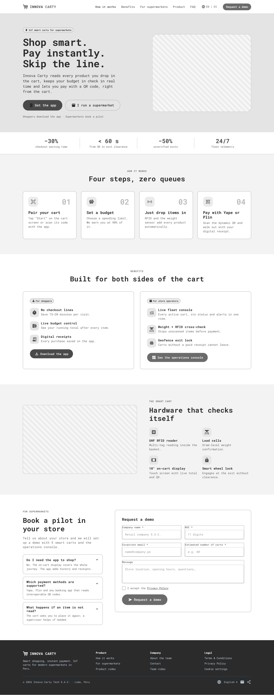</td>
    <td align="center" valign="top">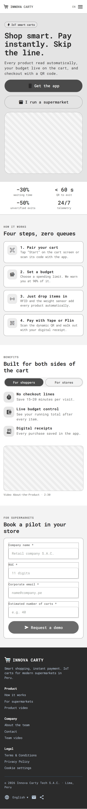</td>
  </tr>
</table>

### 5.3.2. Landing Page Mock-up

El mock-up aplica el Design System completo. El hero usa un degradado del azul institucional al verde de marca para reforzar el binomio "confianza + agilidad" del imagotipo; las cifras de impacto (−30 % de espera, < 60 s del QR a la salida, −50 % de salidas no verificadas) provienen de los objetivos del Lean UX Canvas. Cada sección termina en una acción concreta: descargar la app, ver la consola o solicitar la demo. El formulario de contacto valida RUC, correo corporativo y número de carritos antes de enviar, tal como describen los criterios de aceptación de US02, y el pie de página contiene los enlaces a Términos y Condiciones y a la Política de Privacidad (US03).

<table>
  <tr><th>Desktop Web Browser</th><th>Mobile Web Browser</th></tr>
  <tr>
    <td align="center">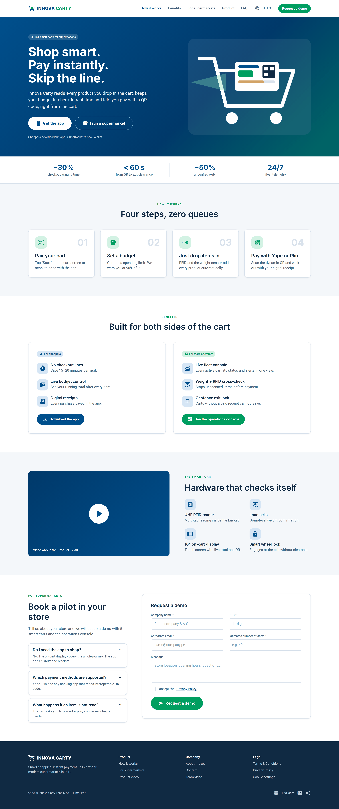</td>
    <td align="center" valign="top"></td>
  </tr>
</table>

---

## 5.4. Applications UX/UI Design

El alcance de diseño de esta entrega cubre los tres productos digitales con los que interactúan los segmentos objetivo:

| Producto | Segmento / User Persona | Plataforma y tamaño de diseño | Historias que soporta |
| :--- | :--- | :--- | :--- |
| **On-Cart Display** | Comprador Moderno (Juan López) | Pantalla táctil de 10" embebida en el Smart Cart, 1024 × 600 px horizontal | US04, US05, US06, US07, US08, US09, US10 |
| **Innova Carty** (app móvil) | Comprador Moderno (Juan López) | Android / iOS, 390 × 844 px | US04, US05, US08 |
| **Innova Carty Console** (aplicación web) | Administrador de Tienda (Lucía) | Desktop Web Browser, 1440 × 900 px, responsive desde 768 px; Angular Material | US11, US12, US13 |

El User Persona del Segmento 1 es **Juan López** (2.3.1). Para el Segmento 2 se usa como persona de trabajo a **Lucía Medina**, supervisora de piso, construida a partir de las entrevistas a Erick Shapiama y Camila (2.2.2) mientras se completa su ficha en 2.3.1.

La app operativa **Innova Carty Ops** definida en los ASO elements (5.2.3) se deja para una entrega posterior: en este sprint el supervisor de piso usa la Consola, que es responsive y funciona en tablet. Los datos de ejemplo (productos, montos, carrito `CART-0427`, tienda "Surco Store #01") son los mismos en todas las pantallas para que los flujos se puedan seguir de punta a punta.

### 5.4.1. Applications Wireframes

Los wireframes fijan la ubicación de la información y de las acciones antes de aplicar color. Las decisiones comunes a los tres productos son:

* **Jerarquía visual:** lo que el usuario necesita para decidir va primero y más grande. En el carrito y en la app es el **Real-Time Total** y la barra de presupuesto; en la Consola son los KPIs y las alertas abiertas.
* **Organización secuencial** para tareas de varios pasos (vincular carrito → presupuesto → comprar → pagar) y **matricial** para la supervisión de la flota (tabla de carritos con estado, zona, último evento y batería).
* **Una acción principal por pantalla**, ubicada siempre en el mismo lugar: columna derecha en el On-Cart Display, parte inferior en la app móvil y esquina superior derecha o diálogo en la Consola.
* **Estados explícitos:** cada situación del dominio (discrepancia, etiqueta no reconocida, umbral de presupuesto, carrito bloqueado, pago confirmado) tiene su propia pantalla o estado, lo que permite usarlas como pasos en los wireflows.
* **Diseño inclusivo:** objetivos táctiles de 48 px como mínimo (72 px en el botón de inicio del carrito, donde el usuario suele tener las manos ocupadas), iconos siempre acompañados de texto y estados que no dependen solo del color.

#### On-Cart Display

<table>
  <tr>
    <td align="center"><br><sub>Welcome</sub></td>
    <td align="center"><br><sub>Set budget</sub></td>
    <td align="center"><br><sub>Shopping session</sub></td>
  </tr>
  <tr>
    <td align="center"><br><sub>Item removed</sub></td>
    <td align="center"><br><sub>Tag not recognized</sub></td>
    <td align="center"><br><sub>Budget threshold alert</sub></td>
  </tr>
  <tr>
    <td align="center"><br><sub>Weight discrepancy (locked)</sub></td>
    <td align="center"><br><sub>Pay with QR</sub></td>
    <td align="center"><br><sub>Payment confirmed</sub></td>
  </tr>
</table>

La pantalla del carrito se divide en dos zonas fijas: a la izquierda la lista de productos (el último agregado arriba y resaltado) y a la derecha el total, el presupuesto y las acciones. Los avisos (etiqueta no leída, 90 % del presupuesto) aparecen como banner sobre la lista para no tapar el total; solo la discrepancia de peso usa un diálogo modal, porque bloquea el pago.

#### Mobile App

<table>
  <tr>
    <td align="center"><br><sub>Sign in</sub></td>
    <td align="center"><br><sub>Home</sub></td>
    <td align="center"><br><sub>Link a cart</sub></td>
    <td align="center"><br><sub>Set budget</sub></td>
  </tr>
  <tr>
    <td align="center"><br><sub>Active cart</sub></td>
    <td align="center"><br><sub>Payment</sub></td>
    <td align="center"><br><sub>Receipt and exit pass</sub></td>
    <td align="center"><br><sub>Receipts history</sub></td>
  </tr>
</table>

La app usa una barra de navegación inferior con cuatro destinos (Home, Cart, Receipts, Profile). La pantalla de inicio prioriza "Link a cart", que es la tarea con la que empieza cada visita; el historial de comprobantes incluye búsqueda y filtros por fecha, tienda y orden.

#### Web Console

<table>
  <tr>
    <td align="center"><br><sub>Sign in</sub></td>
    <td align="center"><br><sub>Dashboard</sub></td>
    <td align="center"><br><sub>Carts</sub></td>
  </tr>
  <tr>
    <td align="center"><br><sub>Cart detail (discrepancy)</sub></td>
    <td align="center"><br><sub>Verify and unlock</sub></td>
    <td align="center"><br><sub>Alerts</sub></td>
  </tr>
  <tr>
    <td align="center"><br><sub>Catalog</sub></td>
    <td align="center"><br><sub>Edit tolerance</sub></td>
    <td></td>
  </tr>
</table>

La Consola sigue el patrón *dashboard layout* de 5.1.2: menú lateral con seis módulos, barra superior con búsqueda global (carritos, órdenes o SKUs) y el contenido del módulo al centro. Las acciones críticas (desbloquear un carrito, cambiar una tolerancia) se confirman en un diálogo que pide los datos necesarios para la auditoría.

### 5.4.2. Applications Wireflow Diagrams

Se elaboró un wireflow por cada *user goal* de los User Personas. Cada paso es un wireframe y cada flecha indica la interacción que provoca el cambio de pantalla; cuando una interacción solo cambia el estado de la misma vista (por ejemplo, un producto que se agrega a la lista), se agrega un nuevo paso con el wireframe del estado resultante.

| # | User goal | User Persona | Producto(s) |
| :---: | :--- | :--- | :--- |
| 1 | Iniciar una sesión de compra con presupuesto | Juan (Segmento 1) | On-Cart Display, Mobile App |
| 2 | Agregar productos y controlar el total | Juan (Segmento 1) | On-Cart Display |
| 3 | Pagar con QR y salir de la tienda | Juan (Segmento 1) | On-Cart Display, Mobile App |
| 4 | Resolver una discrepancia de peso | Lucía (Segmento 2) | Web Console |
| 5 | Actualizar precio, peso y tolerancia de un producto | Lucía (Segmento 2) | Web Console |

#### User goal 1: Start a shopping session with a budget

*Como comprador, quiero tomar un carrito, vincularlo y fijar un límite de gasto para empezar a comprar sabiendo cuánto puedo gastar.* El flujo principal ocurre en la pantalla del carrito (tocar "Tap to start", ingresar el monto, "Start shopping"). La segunda fila muestra la ruta equivalente desde la app: Juan escanea el código QR que muestra el carrito, define el presupuesto en su teléfono y ve la misma sesión sincronizada.


#### User goal 2: Add products and keep the total under control

*Como comprador, quiero que cada producto que pongo o saco del carrito actualice mi total para no pasarme de mi presupuesto.* La primera fila es el camino esperado: al llegar al 90 % aparece la alerta ámbar y Juan decide retirar un producto. Las dos filas siguientes muestran los dos estados de excepción que se generan desde la misma pantalla: peso sin lectura RFID (pago en pausa) y etiqueta que no está en el catálogo.


#### User goal 3: Pay with QR and leave the store

*Como comprador, quiero pagar desde el carrito con Yape o Plin y salir sin pasar por caja.* Desde el carrito se genera el QR dinámico y, al confirmarse el pago, se activa la autorización de salida; al terminar, el carrito vuelve a la pantalla de bienvenida para el siguiente cliente. La segunda fila muestra el pago iniciado desde la app, que termina en el comprobante y el pase de salida.


#### User goal 4: Resolve a weight discrepancy from the Console

*Como supervisora de piso, quiero ver qué carrito tiene una discrepancia de peso y desbloquearlo después de revisarlo, para que el cliente siga comprando sin que salga mercancía sin pagar.* Lucía entra a la alerta desde el dashboard o desde el módulo de alertas, compara el peso esperado con el medido y desbloquea el carrito registrando la resolución y su PIN.


#### User goal 5: Update a product's price, weight and tolerance

*Como administradora de tienda, quiero ajustar el peso nominal y la tolerancia de un producto para que los carritos dejen de generar falsas discrepancias.* Desde el catálogo busca el SKU, edita sus valores en un diálogo que muestra el rango permitido resultante y guarda; la regla se sincroniza con el gateway edge y con los carritos.


### 5.4.3. Applications Mock-ups

Los mock-ups aplican el Design System de Innova Carty sobre los wireframes. Los criterios principales son:

* **Color con significado de dominio:** verde para lo validado y las acciones de avance (producto verificado, "Proceed to payment", autorización de salida), ámbar para advertencias recuperables (90 % del presupuesto, etiqueta no leída, discrepancia en la Consola) y rojo solo para bloqueos (pago en pausa, geofence, carrito bloqueado). Los mismos colores se usan en la tira LED del carrito (5.1.2), de modo que el estado se entiende igual en el dispositivo, en la app y en la Consola.
* **Cifras en *Inter* Bold:** el total y los montos son el elemento más grande de cada vista (44 px en el carrito, 36 px en la app), con separación clara entre precio unitario y subtotal.
* **Material Design 3 / Angular Material:** botones con forma de píldora, tarjetas con elevación de 1 a 4 dp, *chips* de estado, tablas con paginación y diálogos para confirmar acciones críticas.
* **Retroalimentación inmediata:** cada lectura RFID muestra un *toast* con el producto y el monto sumado o restado, y el último producto se resalta en la lista.
* **Consistencia entre productos:** el carrito `CART-0427` de Juan es el mismo que Lucía ve en la Consola con la discrepancia de +412 g, y el pedido `ORD-20261003-0815` es el que aparece en el comprobante de la app.

#### On-Cart Display

<table>
  <tr>
    <td align="center"><br><sub>Welcome</sub></td>
    <td align="center"><br><sub>Set budget</sub></td>
    <td align="center"><br><sub>Shopping session</sub></td>
  </tr>
  <tr>
    <td align="center"><br><sub>Item removed</sub></td>
    <td align="center"><br><sub>Tag not recognized</sub></td>
    <td align="center"><br><sub>Budget threshold alert</sub></td>
  </tr>
  <tr>
    <td align="center"><br><sub>Weight discrepancy (locked)</sub></td>
    <td align="center"><br><sub>Pay with QR</sub></td>
    <td align="center"><br><sub>Payment confirmed</sub></td>
  </tr>
</table>

#### Mobile App

<table>
  <tr>
    <td align="center"><br><sub>Sign in</sub></td>
    <td align="center"><br><sub>Home</sub></td>
    <td align="center"><br><sub>Link a cart</sub></td>
    <td align="center"><br><sub>Set budget</sub></td>
  </tr>
  <tr>
    <td align="center"><br><sub>Active cart</sub></td>
    <td align="center"><br><sub>Payment</sub></td>
    <td align="center"><br><sub>Receipt and exit pass</sub></td>
    <td align="center"><br><sub>Receipts history</sub></td>
  </tr>
</table>

#### Web Console

<table>
  <tr>
    <td align="center"><br><sub>Sign in</sub></td>
    <td align="center"><br><sub>Dashboard</sub></td>
    <td align="center"><br><sub>Carts</sub></td>
  </tr>
  <tr>
    <td align="center"><br><sub>Cart detail (discrepancy)</sub></td>
    <td align="center"><br><sub>Verify and unlock</sub></td>
    <td align="center"><br><sub>Alerts</sub></td>
  </tr>
  <tr>
    <td align="center"><br><sub>Catalog</sub></td>
    <td align="center"><br><sub>Edit tolerance</sub></td>
    <td></td>
  </tr>
</table>

### 5.4.4. Applications User Flow Diagrams

Cada User Flow parte del wireflow del mismo *user goal* (5.4.2) y lo completa con los mock-ups de las pantallas, las decisiones del sistema o del usuario (rombos ámbar), el inicio y el fin del flujo (óvalos verdes) y las respuestas del sistema que no tienen una pantalla propia (recuadros rojos). Se elaboraron en [FigJam](https://www.figma.com/board/tqjtVpruUDlH0AL9PVZgYA/Innova-Carty-%C2%B7-Cap.-5-Wireflows---User-Flows--Copy-) con la siguiente convención de líneas:

* **Línea azul continua:** ruta esperada (*happy path*) y rutas alternativas válidas que también cumplen el objetivo (por ejemplo, hacer lo mismo desde la app móvil).
* **Línea roja punteada:** rutas no esperadas (*unhappy paths*) y cómo el usuario vuelve al flujo.

#### User goal 1: Start a shopping session with a budget

**User goal:** Juan toma un carrito, lo vincula y fija un límite de gasto.

* **Happy path:** toca "Tap to start" en el carrito, ingresa S/ 150.00 y toca "Start shopping"; la sesión queda activa con la barra de presupuesto en 0 %.
* **Ruta alternativa:** si usa la app, escanea el QR de la pantalla de bienvenida, la app detecta `CART-0427` y el presupuesto definido en el teléfono se sincroniza con el carrito.
* **Unhappy paths:** si el monto es cero, negativo o no numérico, el campo se marca en rojo con el mensaje "Enter an amount greater than S/ 0" y no se avanza (US04, escenario 2). Si la cámara no detecta el código, Juan ingresa manualmente los 4 dígitos del carrito.


#### User goal 2: Add products and keep the total under control

**User goal:** cada producto que Juan pone o saca actualiza el total para no superar su presupuesto.

* **Happy path:** el lector RFID reconoce la etiqueta, la celda de carga confirma el peso dentro de la tolerancia y el producto se suma al total. Mientras el total esté por debajo del 90 %, Juan sigue comprando hasta estar lista para pagar.
* **Ruta alternativa:** al llegar al 90 % aparece la alerta ámbar (US05, escenario 2); Juan retira un producto y el total se descuenta automáticamente (US07), o edita su presupuesto.
* **Unhappy paths:** si la etiqueta no existe en el catálogo, el carrito avisa con sonido y banner y pide colocar el producto otra vez (US06, escenario 2). Si se detecta peso sin lectura RFID por más de 3 segundos, el pago se pausa (US09, escenario 2) y se notifica a un supervisor; si Juan no logra corregirlo, la resolución pasa a la Consola (User goal 4).


#### User goal 3: Pay with QR and leave the store

**User goal:** Juan paga desde el carrito con su billetera digital y sale sin pasar por caja.

* **Happy path:** sin discrepancias abiertas, toca "Proceed to payment", escanea el QR dinámico con Yape, el webhook de la pasarela confirma el pago (TS03), el carrito muestra el comprobante con la autorización de salida activa por 15 minutos y Juan cruza la salida.
* **Ruta alternativa:** paga desde la app eligiendo Yape o Plin; el comprobante y el pase de salida quedan guardados en "Receipts".
* **Unhappy paths:** si hay una discrepancia activa no se puede generar el QR (US08, escenario 1) y se vuelve al User goal 2. Si el QR vence antes de la confirmación, se genera uno nuevo. Si el carrito cruza el perímetro sin autorización de salida, se bloquean las ruedas, suena la alarma y se envía la alerta a la Consola (US12, escenario 1).


#### User goal 4: Resolve a weight discrepancy from the Console

**User goal:** Lucía identifica el carrito con discrepancia y lo desbloquea después de revisarlo.

* **Happy path:** inicia sesión, abre la alerta desde el dashboard, revisa en el detalle la diferencia entre peso esperado (9,314 g) y medido (9,726 g), verifica el carrito en persona y lo desbloquea indicando la resolución y su PIN (US11, escenario 2). El carrito vuelve a "In session".
* **Ruta alternativa:** llega al mismo detalle desde el módulo "Alerts", que agrupa también los eventos de geofence y de dispositivos.
* **Unhappy paths:** credenciales incorrectas (cuenta bloqueada tras 5 intentos), PIN incorrecto (se limpia el campo y se reintenta) o producto no verificable en persona, en cuyo caso se marca la compra con un *audit flag* y el carrito sigue bloqueado.


#### User goal 5: Update a product's price, weight and tolerance

**User goal:** Lucía ajusta la tolerancia de un SKU que genera falsas discrepancias.

* **Happy path:** desde el dashboard entra a "Catalog", busca el SKU, edita peso nominal y tolerancia (el diálogo muestra el rango permitido resultante) y guarda; la regla se propaga a la base de datos central y a los servicios edge (US13).
* **Unhappy paths:** la búsqueda no encuentra el producto (se ofrece limpiar filtros o agregarlo), los valores no son válidos (tolerancia fuera de 0–15 % o peso no positivo) o la sincronización con algunos carritos falla; en ese caso el cambio queda guardado en la nube, se muestra cuántos carritos están pendientes y la sincronización se reintenta automáticamente.


---

## 5.5. Applications Prototyping

El prototipo de Innova Carty es navegable y simula la interacción de los cuatro productos sobre Desktop y Mobile Web Browser: Landing Page (desktop y mobile), Web Console, Mobile App y On-Cart Display. Se construyó en **Figma** sobre los mismos mock-ups de 5.3.2 y 5.4.3, con 124 interacciones (*On click → Navigate to*, *Scroll to* en el Landing Page y *After delay* para los eventos de la pasarela de pago) y cinco puntos de inicio, uno por producto: **[ver prototipo en Figma](https://www.figma.com/proto/tzhuT8VO8nCO23a1yov8Bo/Innova-Carty-%C2%B7-Cap.-5-UI-UX-Design--Copy-?node-id=3-4861&starting-point-node-id=3%3A4861)**.

Los criterios de interacción fueron:

* **Rutas de los User Flows:** cada enlace del prototipo corresponde a una flecha de los diagramas de 5.4.4, incluidas las rutas alternativas y las principales rutas no esperadas.
* **Sistema de navegación (5.2.5):** barra superior con anclas en el Landing Page, menú lateral persistente en la Consola, barra inferior de cuatro destinos en la app móvil y navegación lineal sin menú en el carrito, donde cada pantalla tiene una sola acción principal.
* **Eventos físicos simulados:** el carrito reacciona a sensores (RFID, celda de carga, geofence) y a la confirmación de la pasarela de pago. Como esos eventos no los provoca un clic del usuario, en Figma la confirmación del pago avanza sola con una interacción *After delay*, y la versión HTML del prototipo ([`design/chapter-5/app/index.html`](design/chapter-5/app/index.html)), usada para grabar los videos, incluye un panel **"Simulate an event"** que dispara cada evento (leer un producto, retirarlo, etiqueta dañada, peso sin etiqueta, 90 % del presupuesto, webhook de pago).
* **Tipos de interacción:** *tap* para acciones principales, diálogos modales solo para acciones que bloquean o necesitan auditoría, *toasts* para confirmar cambios sin interrumpir y banners para avisos que el usuario puede resolver a su ritmo.
* **Fidelidad:** un botón alterna entre la vista de mock-up y la de wireframe sobre la misma pantalla.

Para cada aplicación se grabó un video que recorre sus flujos principales con una narración en pantalla que explica cada paso:

| Aplicación | Flujos que recorre | Captura del video | Video |
| :--- | :--- | :---: | :--- |
| **Landing Page** | Propuesta de valor, cómo funciona, beneficios por segmento, solicitud de demo en desktop y en mobile |  | https://upcedupe-my.sharepoint.com/:v:/g/personal/u202215285_upc_edu_pe/IQA7U_OJ5SBPQ5swi1vDQS_rAZ5GIOYru7w3N4Qta_5sfk4?nav=eyJyZWZlcnJhbEluZm8iOnsicmVmZXJyYWxBcHAiOiJPbmVEcml2ZUZvckJ1c2luZXNzIiwicmVmZXJyYWxBcHBQbGF0Zm9ybSI6IldlYiIsInJlZmVycmFsTW9kZSI6InZpZXciLCJyZWZlcnJhbFZpZXciOiJNeUZpbGVzTGlua0NvcHkifX0&e=EOAKlC |
| **Web Console** | User goals 4 y 5: alerta, detalle de discrepancia, desbloqueo, alertas y edición de tolerancia |  | https://upcedupe-my.sharepoint.com/:v:/g/personal/u202215285_upc_edu_pe/IQC1PPls7hf9RaIzjBAUK6h5Abo-enDu9N9q9RNkc2-brIQ?nav=eyJyZWZlcnJhbEluZm8iOnsicmVmZXJyYWxBcHAiOiJPbmVEcml2ZUZvckJ1c2luZXNzIiwicmVmZXJyYWxBcHBQbGF0Zm9ybSI6IldlYiIsInJlZmVycmFsTW9kZSI6InZpZXciLCJyZWZlcnJhbFZpZXciOiJNeUZpbGVzTGlua0NvcHkifX0&e=MM9h0y |
| **Mobile App** | User goals 1 y 3 desde el teléfono: vincular carrito, presupuesto, carrito en vivo, pago y comprobantes |  | https://upcedupe-my.sharepoint.com/:v:/g/personal/u202215285_upc_edu_pe/IQDS7gSNSSz7Qb5s11kpWA78ASUqg6hyA6b6imrhRnS1dOo?nav=eyJyZWZlcnJhbEluZm8iOnsicmVmZXJyYWxBcHAiOiJPbmVEcml2ZUZvckJ1c2luZXNzIiwicmVmZXJyYWxBcHBQbGF0Zm9ybSI6IldlYiIsInJlZmVycmFsTW9kZSI6InZpZXciLCJyZWZlcnJhbFZpZXciOiJNeUZpbGVzTGlua0NvcHkifX0&e=IFIRAb |
| **On-Cart Display** | User goals 1, 2 y 3 en el carrito: inicio, presupuesto, productos, excepciones, QR y salida |  | https://upcedupe-my.sharepoint.com/:v:/g/personal/u202215285_upc_edu_pe/IQD647e27AZ_RrTN3SF9jpwfATyx50FqHGl7CUAYbktz4Vo?nav=eyJyZWZlcnJhbEluZm8iOnsicmVmZXJyYWxBcHAiOiJPbmVEcml2ZUZvckJ1c2luZXNzIiwicmVmZXJyYWxBcHBQbGF0Zm9ybSI6IldlYiIsInJlZmVycmFsTW9kZSI6InZpZXciLCJyZWZlcnJhbFZpZXciOiJNeUZpbGVzTGlua0NvcHkifX0&e=aHdy95 |

---

## 5.6. IoT Device Design

### Introducción

El diseño IoT de Innova Carty se basa en un único tipo de dispositivo, el **Smart Cart**: un carrito de supermercado al que se le integra un ESP32 con todos los sensores y actuadores que necesita una sesión de compra autónoma. El carrito envía sus eventos al **Edge API** del gateway de la tienda, que los valida con una copia local del catálogo y los sincroniza con el backend en la nube, desde donde se actualizan la Web Console y la app móvil.

No se usan varios dispositivos independientes, porque la identificación de productos, la validación de peso, el control del presupuesto y la seguridad de salida ocurren sobre la misma entidad en movimiento, el carrito, y deben evaluarse juntas durante la misma sesión. La solución escala agregando más Smart Carts por tienda, no más tipos de dispositivo.

**Smart Cart (ESP32) → Edge API (gateway de tienda) → RESTful API en la nube → Web Console / app móvil**

Criterios de diseño:

* Integración directa con el Edge API por la red Wi-Fi de la tienda, con operación local cuando no hay conexión con la nube.
* Instalación sobre la estructura de un carrito existente, con la electrónica en una carcasa IP54 y mantenimiento por módulos (RFID, balanza, pantalla, batería).
* Indicadores físicos visibles y comprensibles con las manos ocupadas (pantalla, luz y sonido; ver 5.1.2).
* Autonomía para una jornada completa de tienda (14 h) y recarga nocturna en el corral de carritos.
* Seguridad física ante una salida sin pago: bloqueo de rueda decidido en el propio carrito (`Shopping Cart Lock`).
* Coherencia con el Smart Shopping y el Operations & Security Bounded Context (4.2) y con las interfaces de 5.1.2 y 5.4.

### Nodos del sistema IoT

| Nodo | Hardware | Software | Alimentación | Consumo típico | Consumo máximo |
| :--- | :--- | :--- | :--- | :---: | :---: |
| **Smart Cart** (uno por carrito) | ESP32 DevKit V1 + sensores y actuadores de esta sección | Firmware C++ (Arduino / PlatformIO) | Batería Li-ion 3S2P, 11.1 V, 77.7 Wh | 6.2 W en sesión · 2.0 W en espera | 24 W (todo activo y solenoide energizado) |
| **Edge Gateway** (uno por tienda) | Raspberry Pi 4 Model B 4 GB con microSD de 32 GB | Edge API en Python (Flask) + SQLite con la caché del catálogo y la cola de eventos | Fuente 5.1 V / 3 A desde la red eléctrica, con UPS | 2.7 W | 6.4 W |
| **Beacon de puerta** (uno por salida) | Prototipo: ESP32 en modo iBeacon; producción: beacon BLE comercial | Anuncio BLE con el identificador de la puerta | 5 V USB (prototipo) o pila CR2477 | 0.3 W | 0.6 W |

La red Wi-Fi de la tienda (puntos de acceso con WPA2 y una red separada para los carritos) es infraestructura existente del supermercado y no forma parte del diseño. Los consumos del Edge Gateway corresponden a mediciones publicadas para la Raspberry Pi 4 en reposo y con los cuatro núcleos al máximo; el del beacon es un valor de diseño que se medirá en el prototipo.

### Diseño físico del dispositivo

**Sensores y módulos**

| Módulo / sensor | Función | Ubicación en el carrito | Evento que genera |
| :--- | :--- | :--- | :--- |
| Lector RFID MFRC522 (13.56 MHz) | Leer la etiqueta de cada producto que se agrega o retira (`RFID Product Tag`) | Zona de lectura en el borde superior, junto al manubrio | Etiqueta leída |
| 4 celdas de carga de 50 kg + HX711 | Medir el peso de la canasta para validar cada producto (`Weight Confirmation`) | Entre la canasta y una placa rígida en la base | Cambio de peso estable |
| Escáner BLE integrado del ESP32 | Detectar el beacon de la puerta de salida | Interno (antena del ESP32) | Puerta de salida detectada |
| Botón de ayuda | Llamar a un supervisor o cancelar la sesión | Bajo la pantalla | Ayuda solicitada |
| Divisor de tensión al ADC | Medir el nivel de la batería | Dentro de la carcasa | Batería baja |

**Actuadores e interfaces**

| Actuador / interfaz | Función | Ubicación | Comando que recibe |
| :--- | :--- | :--- | :--- |
| Pantalla Nextion NX1060P101, 10.1", 1024 × 600 px | On-Cart Display: lista, total, presupuesto, QR de pago y avisos | Sobre el manubrio, inclinada hacia el comprador | Mostrar pantalla / actualizar sesión |
| Tira LED WS2812B de 24 LED | Mostrar el estado del carrito a distancia | Borde superior de la canasta | Cambiar estado del LED |
| Buzzer pasivo | Alertas sonoras locales | Dentro de la carcasa | Emitir patrón de sonido |
| Módulo relé 5 V + solenoide 12 V | Trabar la rueda delantera ante una salida sin pago | Horquilla de la rueda delantera | Bloquear / desbloquear rueda |

**Componentes de soporte**

| Componente | Función | Consideración de diseño |
| :--- | :--- | :--- |
| ESP32 DevKit V1 (ESP32-WROOM-32) | Leer sensores, aplicar las reglas locales y comunicarse con el Edge API | Wi-Fi y BLE integrados; dentro de la carcasa IP54 con acceso al puerto USB solo para soporte técnico |
| Batería Li-ion 3S2P (6 celdas 18650 de 3500 mAh) + BMS 3S 10 A | Energía para la jornada completa | En la bandeja inferior, para mantener bajo el centro de gravedad |
| Convertidor buck XL4015 (5.1 V / 5 A) | Riel de 5 V para pantalla, LED, relé y ESP32 | Margen sobre el pico calculado de 3 A |
| Fusible de 5 A (acción lenta) + interruptor general | Protección y apagado para mantenimiento | Accesibles solo con herramienta |
| Contactos de carga 12.6 V / 2 A | Recarga en el corral de carritos | Se acoplan solos al empujar el carrito al corral |
| Carcasa IP54 | Proteger la electrónica de golpes y líquidos | Con canaleta para los cables por el bastidor trasero |

**Ubicación de los componentes**

<p align="center"></p>

### Diseño del circuito

El ESP32 se alimenta con 5 V en el pin VIN; su regulador de 3.3 V alimenta también al MFRC522 y a la parte digital del HX711. Los demás periféricos usan el riel de 5 V y el solenoide se conecta directamente a la batería a través del relé.

**Asignación de pines**

| GPIO | Señal | Conectado a | Nivel | Observación |
| :--- | :--- | :--- | :---: | :--- |
| 5 | SPI SS | MFRC522 SDA | 3.3 V | Bus VSPI |
| 18 | SPI SCK | MFRC522 SCK | 3.3 V | Bus VSPI |
| 23 | SPI MOSI | MFRC522 MOSI | 3.3 V | Bus VSPI |
| 19 | SPI MISO | MFRC522 MISO | 3.3 V | Bus VSPI |
| 21 | RST | MFRC522 RST | 3.3 V | — |
| 26 | UART2 TX | Nextion RX | 3.3 V | 115 200 bps |
| 27 | UART2 RX | Nextion TX | 3.3 V | TX de la Nextion en nivel TTL de 3.3 V |
| 16 | DT | HX711 DOUT | 3.3 V | VDD del HX711 a 3.3 V para no enviar 5 V al ESP32 |
| 4 | SCK | HX711 PD_SCK | 3.3 V | — |
| 25 | Datos LED | WS2812B DIN | 3.3 V → 5 V | A través del 74AHCT125 y una resistencia de 330 Ω |
| 32 | PWM | Buzzer (transistor 2N2222) | 3.3 V | Canal LEDC para generar tonos |
| 33 | Salida digital | Módulo relé IN | 3.3 V | El relé conmuta el solenoide de 12 V |
| 13 | Entrada | Botón de ayuda | 3.3 V | Pull-up interno |
| 36 (VP) | ADC1_CH0 | Divisor 100 kΩ / 27 kΩ de la batería | 0–2.7 V | ADC1 funciona con Wi-Fi activo (el ADC2 no) |

Se dejan libres los pines de arranque GPIO 0, 2, 12 y 15 y los de la memoria flash (GPIO 6 a 11). GPIO 5 también interviene en el arranque, pero se puede usar como SS porque la línea queda en alto en reposo, que es el valor que necesita el ESP32 al encender. El MFRC522 no tolera 5 V, por eso se alimenta con 3.3 V.

**Diagrama de conexiones**

<p align="center"></p>

**Arquitectura de alimentación**

| Riel | Origen | Alimenta | Corriente máxima |
| :--- | :--- | :--- | :---: |
| +BAT (9.0–12.6 V) | Batería 3S2P → BMS → fusible 5 A → interruptor | Buck de 5 V, solenoide (a través del relé) y divisor de medición | 2.7 A con batería baja |
| +5V | Buck XL4015 | Nextion, tira LED, relé, buzzer, VCC del HX711 y VIN del ESP32 | 3.0 A |
| +3V3 | Regulador del ESP32 DevKit | ESP32, MFRC522 y VDD del HX711 | 0.55 A |

En la versión anterior del diseño se usaban dos celdas 18650 en paralelo con un cargador TP4056. El cálculo de consumo de la siguiente sección muestra que esa batería (3.7 V × 6 Ah ≈ 22 Wh) solo daría unas 3 h de uso continuo con la pantalla de 10.1", y el TP4056 solo carga una celda a 1 A. Además, a 3.7 V se necesitarían dos elevadores de tensión (a 5 V para la pantalla y a 12 V para el solenoide). Con un paquete 3S2P de 11.1 V el solenoide se alimenta directamente, el riel de 5 V se obtiene con un convertidor reductor eficiente (≈ 90 %) y la carga se hace con un cargador de 12.6 V en el corral.

### Consumo energético y autonomía

Consumo por componente en el riel de 5 V (el ESP32 y el MFRC522 se cuentan a la entrada del regulador lineal, por eso su corriente es la misma a 5 V):

| Componente | En sesión (típico) | En espera | Máximo | Fuente del dato |
| :--- | :---: | :---: | :---: | :--- |
| ESP32 DevKit V1 (Wi-Fi + escaneo BLE) | 130 mA | 60 mA | 500 mA | Hoja de datos (picos de transmisión Wi-Fi) |
| Lector MFRC522 | 26 mA | 10 mA | 30 mA | Hoja de datos del módulo |
| HX711 + 4 celdas de carga (puente de 1 kΩ) | 6 mA | 0 mA (*power down*) | 10 mA | Cálculo con la excitación del puente |
| Nextion NX1060P101 10.1" | 800 mA | 250 mA (brillo al 20 %) | 2 000 mA | Fabricante: ≈ 800 mA promedio y fuente recomendada de 2 A; espera estimada |
| Tira WS2812B, 24 LED (brillo limitado al 25 %) | 145 mA | 40 mA | 385 mA | 20 mA por color al 100 %, 1 mA en reposo por LED |
| Buzzer pasivo | 0 mA | 0 mA | 30 mA | Uso intermitente |
| Bobina del módulo relé | 0 mA | 0 mA | 75 mA | Solo con la rueda bloqueada |
| **Total riel de 5 V** | **1 107 mA (5.5 W)** | **360 mA (1.8 W)** | **3 030 mA (15.2 W)** | |
| Solenoide 12 V (riel +BAT) | 0 W | 0 W | 7.2 W (0.6 A) | Valor de diseño, a confirmar con el modelo comprado |

**Consumo máximo del nodo Smart Cart:** 15.2 W / 0.90 (eficiencia del buck) + 7.2 W del solenoide ≈ **24 W**, es decir 2.2 A a 11.1 V o 2.7 A con la batería en su tensión mínima de 9 V. Con este valor se dimensionan el fusible de 5 A, el BMS de 10 A y el buck de 5 A.

**Autonomía.** Se considera una jornada de 14 h (8:00 a 22:00) con el carrito 6 h en sesión, 8 h en espera y 5 min con la rueda bloqueada:

| Concepto | Cálculo | Energía |
| :--- | :--- | :---: |
| En sesión | 5.5 W × 6 h | 33.2 Wh |
| En espera | 1.8 W × 8 h | 14.4 Wh |
| Bloqueo (relé) | 0.38 W × 0.08 h | 0.03 Wh |
| Subtotal en el riel de 5 V | | 47.6 Wh |
| Energía tomada de la batería | 47.6 Wh / 0.90 + 7.2 W × 0.08 h (solenoide) | **53.5 Wh** |
| Energía útil de la batería | 11.1 V × 7.0 Ah × 0.90 (corte del BMS y envejecimiento) | **69.9 Wh** |

La batería cubre la jornada completa con un 31 % de reserva, y en uso continuo en sesión rinde unas **11 h** (69.9 Wh / 6.2 W). La recarga completa con el cargador de 12.6 V / 2 A toma entre 4 y 5 h, por lo que se realiza por la noche en el corral. Cuando la batería baja del 15 % el carrito avisa en la pantalla y en la Consola, y al 5 % rechaza iniciar una sesión nueva.

### Comunicación con el Edge API

El carrito se comunica con el Edge API del gateway de la tienda mediante **HTTP con JSON sobre la red Wi-Fi de la tienda**. Cada solicitud se autentica con una clave propia del dispositivo en la cabecera `X-API-Key`, guardada en la memoria NVS del ESP32. En producción el tráfico va cifrado con TLS y el certificado del gateway queda fijado en el firmware; en el prototipo del Sprint 2 se puede usar HTTP dentro de la red del laboratorio.

| Endpoint del Edge API | Cuándo lo usa el carrito | Respuesta |
| :--- | :--- | :--- |
| `POST /api/v1/carts/{cartId}/events` | Cada vez que ocurre un evento: etiqueta leída, cambio de peso, puerta detectada, botón, batería baja | `200` con el producto o la sesión actualizada y la lista de comandos para el carrito |
| `POST /api/v1/carts/{cartId}/heartbeats` | Cada 2 s en sesión y cada 10 s en espera, con batería, señal Wi-Fi y peso actual | `200` con los comandos pendientes, por ejemplo un desbloqueo hecho desde la Consola |

Ejemplo de un producto agregado:

```http
POST /api/v1/carts/CART-0427/events
X-API-Key: <clave del dispositivo>
Content-Type: application/json

{
  "eventId": "CART-0427-000158",
  "type": "TAG_READ",
  "occurredAt": "2026-10-28T15:04:12Z",
  "data": { "rfidTag": "04A1B2C3D4", "basketWeightGrams": 9314 }
}
```

```json
{
  "accepted": true,
  "item": { "sku": "SKU-40105", "name": "Whole wheat bread 600 g", "unitPrice": 8.50, "nominalWeightGrams": 610, "tolerancePercent": 6 },
  "session": { "total": 76.60, "budget": 150.00, "budgetUsedPercent": 51 },
  "commands": [
    { "type": "SET_LED_STATE", "value": "IN_SESSION" },
    { "type": "BEEP", "value": "ITEM_ADDED" },
    { "type": "SHOW_SCREEN", "value": "SESSION" }
  ]
}
```

El Edge API reenvía los eventos a la nube (`POST /api/v1/telemetry`, TS01) con el mismo `eventId`, de modo que los reintentos no se registran dos veces. Si el carrito pierde la conexión con el gateway, guarda los eventos en una cola local y los reenvía al reconectarse; mientras tanto muestra "Reconnecting…", no permite pagar y mantiene activo el bloqueo de salida, que se decide en el propio carrito.

**Reglas que se evalúan en el carrito.** Para responder en menos de 1 s sin depender de la red, el ESP32 aplica tres reglas locales: (1) considera estable el peso cuando 5 lecturas seguidas del HX711 (10 muestras por segundo) varían menos de 5 g, para no reaccionar al movimiento del carrito; (2) si el peso aumenta sin una lectura RFID durante 3 s, envía el evento de discrepancia y pausa el pago, regla que confirma el Smart Shopping Bounded Context (US09, US10); y (3) si detecta el beacon de una puerta y no tiene una autorización de salida vigente, bloquea la rueda de inmediato y luego informa al Edge API (US12).

**Lectura RFID y retiro de productos.** El MFRC522 lee a unos 3 cm, por lo que el comprador pasa cada producto por la zona de lectura al agregarlo y también al retirarlo; la variación de peso indica si entró o salió (US06, US07). El UID de cada etiqueta de 13.56 MHz se registra en el campo `rfidPrefix` del catálogo (Web Console, US13). Para una versión de producción se evaluará un lector RFID UHF con antena en la canasta, que hace inventario continuo sin que el comprador tenga que pasar cada producto.

**Tiempos de respuesta**

| Tramo | Tiempo estimado |
| :--- | :---: |
| Lectura de la etiqueta (sondeo del MFRC522 cada 100 ms) | ≤ 100 ms |
| Procesamiento en el ESP32 y armado del JSON | ≤ 20 ms |
| Solicitud y respuesta HTTP con el Edge API por Wi-Fi | ≤ 100 ms |
| Búsqueda del producto en la caché del catálogo del Edge API | ≤ 50 ms |
| Actualización de la pantalla Nextion por UART | ≤ 50 ms |
| **Producto en el carrito → total actualizado en pantalla** | **≤ 320 ms** (objetivo: < 1 s) |
| Edge API → nube → Web Console y app (asíncrono, no bloquea al carrito) | ≈ 1 s |
| Peso estable para validar el producto | 0.5 – 1 s |
| Puerta detectada (2 escaneos BLE) → rueda bloqueada | ≤ 1 s |
| Desbloqueo desde la Consola → carrito (por el *heartbeat*) | ≤ 3 s |

### Estructura del firmware

El firmware se organiza con el framework **ModestIoT** visto en el curso: el carrito es un *Device* que contiene sus *Sensors* y *Actuators*; cada sensor genera *Events* que procesa el *EventHandler* del dispositivo, y cada acción sobre un actuador llega como un *Command* a su *CommandHandler*. El envío al Edge API lo hace el manejador de eventos del dispositivo y los comandos de la respuesta se ejecutan con el manejador de comandos, sin una clase cliente fuera de esa jerarquía.

| Elemento de ModestIoT | Componente del Smart Cart | Eventos / comandos |
| :--- | :--- | :--- |
| Device | Smart Cart | Mantiene el estado del carrito (disponible, en sesión, con discrepancia, bloqueado, pagado, sin conexión) |
| Sensor | Lector RFID | Etiqueta leída |
| Sensor | Balanza (HX711) | Cambio de peso estable |
| Sensor | Escáner BLE de puerta | Puerta de salida detectada |
| Sensor | Botón de ayuda | Ayuda solicitada · cancelar sesión |
| Sensor | Monitor de batería | Batería baja |
| Actuator | Tira LED | Cambiar estado del LED |
| Actuator | Buzzer | Emitir patrón de sonido |
| Actuator | Traba de rueda (relé + solenoide) | Bloquear rueda · desbloquear rueda |
| Actuator | Pantalla Nextion | Mostrar pantalla · actualizar sesión |

Librerías previstas: `MFRC522` (lector RFID), `HX711` (balanza), `Adafruit NeoPixel` (tira LED), `NimBLE-Arduino` (escaneo BLE, más liviana que la pila BLE por defecto y compatible con Wi-Fi), `ArduinoJson` y `HTTPClient` del core del ESP32. La comunicación con la Nextion usa comandos de texto por UART (`t0.txt="S/ 76.60"`, `page 2`), que no requieren una librería adicional.

### Flujos de interacción

Los siguientes diagramas se elaboraron como *Diagram as Code* con Mermaid.

**Producto agregado a la canasta**


**Discrepancia de peso**


**Cruce de la puerta de salida**


**Estados del dispositivo**


Los estados coinciden con los filtros de la Web Console (*Available*, *In session*, *Discrepancy*, *Locked*, *Paid · clearance*, *Offline*) y con los colores de la tira LED definidos en 5.1.2.

### Relación con la arquitectura del sistema

| Etapa | Componente | Responsabilidad |
| :---: | :--- | :--- |
| 1 | Smart Cart (ESP32) | Leer RFID, peso, puerta y botón; aplicar las reglas locales; mostrar el estado y ejecutar los comandos |
| 2 | Edge API (gateway de tienda) | Validar con la caché del catálogo, devolver comandos al carrito, encolar y reenviar eventos a la nube |
| 3 | RESTful API en la nube | Persistir la sesión, aplicar las reglas de negocio de los bounded contexts y generar las alertas |
| 4 | Base de datos | Guardar sesiones, productos, eventos de telemetría y alertas |
| 5 | Web Console | Mostrar la flota y las alertas al administrador y permitir el desbloqueo |
| 6 | App móvil Innova Carty | Mostrar la sesión, el pago y el comprobante al comprador |

### Prototipo físico para el Sprint 2

El dispositivo se construye como un prototipo funcional sobre una base de acrílico o MDF que simula la canasta, con los mismos componentes y pines de esta sección, para validar las historias del Smart Cart con hardware real antes de montarlo en un carrito.

| Componente | Cant. | Uso en el prototipo |
| :--- | :---: | :--- |
| ESP32 DevKit V1 (30 pines) | 2 | Uno para el Smart Cart y otro como beacon BLE de la puerta |
| Lector MFRC522 + etiquetas adhesivas de 13.56 MHz | 1 + 10 | Una etiqueta por producto de prueba |
| Celda de carga tipo barra de 20 kg + HX711 | 1 | Reemplaza a las 4 celdas de 50 kg en la base de prueba; es más fácil de calibrar |
| Pantalla Nextion de 5" o 7" (serie Enhanced, con componente QR) | 1 | Usa el mismo firmware y las mismas pantallas escaladas; la de 10.1" cuesta unos 160 € y se deja para el carrito final |
| Tira o anillo WS2812B de 24 LED | 1 | Estados del carrito |
| 74AHCT125 + resistencia de 330 Ω + capacitor de 1000 µF | 1 | Adaptación de nivel y protección de la tira LED |
| Buzzer pasivo + transistor 2N2222 + resistencia de 1 kΩ | 1 | Patrones de sonido |
| Módulo relé de 5 V + cerradura solenoide de 12 V + diodo 1N4007 | 1 | Simula la traba de la rueda |
| Pulsador | 1 | Botón de ayuda |
| Fuente de 12 V / 3 A + buck XL4015 + fusible de 5 A | 1 | Reemplaza a la batería en la mesa de trabajo; usa el mismo riel +BAT |
| 6 celdas 18650 + BMS 3S | 1 juego | Etapa final, para medir el consumo real y la autonomía |
| Placa perforada, borneras, cables y carcasa | — | Montaje |
| Raspberry Pi 4 o una laptop en la misma red | 1 | Ejecuta el Edge API durante las pruebas |

**Armado por etapas.** Cada etapa termina con una prueba que se registra como evidencia (foto, video corto o log del monitor serie):

1. ESP32 + MFRC522: imprimir el identificador de cada etiqueta y asociarlo a un producto del catálogo.
2. Balanza: tarar y calibrar con un peso conocido (por ejemplo, un paquete de 1 kg) hasta lograr lecturas estables de ± 5 g.
3. Pantalla Nextion: mostrar la pantalla de sesión y actualizar el total desde el ESP32.
4. Tira LED y buzzer: reproducir los estados y patrones de la tabla de 5.1.2.
5. Relé, solenoide y beacon: bloquear la traba al acercar el carrito al beacon sin autorización.
6. Wi-Fi y Edge API: enviar los eventos, recibir los comandos y ver el carrito en la Web Console.
7. Batería: medir la corriente en sesión y en espera y comparar con el cálculo de consumo.

**Pruebas de aceptación del dispositivo**

| Prueba | Historia | Resultado esperado |
| :--- | :---: | :--- |
| Pasar un producto registrado y colocarlo | US05, US06 | El total se actualiza en menos de 1 s, LED verde y 1 bip |
| Pasar una etiqueta que no está en el catálogo | US06 | *Banner* "Place the item again" y 3 bips; el total no cambia |
| Pasar de nuevo un producto y retirarlo | US07 | El total disminuye y el peso baja en el valor nominal |
| Superar el 90 % del presupuesto | US04, US05 | *Banner* y LED ámbar, 2 bips |
| Colocar un producto sin pasar la etiqueta | US09, US10 | A los 3 s el pago se pausa, LED rojo y alerta en la Web Console |
| Confirmar el pago (webhook simulado) | US08, TS03 | Pase de salida en pantalla y LED verde durante 15 min |
| Acercarse al beacon de salida sin pagar | US12 | La traba se activa en menos de 1 s, suena la alarma y aparece la alerta *Locked* |
| Desbloquear desde la Web Console | US11 | El carrito vuelve a *In session* en menos de 3 s |
| Cortar el Wi-Fi durante la compra y reconectar | TS01 | Los eventos se reenvían al reconectar y no se duplican |

<div style="page-break-after: always;"></div>

---

# Capítulo VI: Product Implementation, Validation & Deployment

## 6.1. Software Configuration Management

En esta sección se establecen las decisiones, convenciones y herramientas utilizadas por el equipo InnovaCarty para gestionar de manera consistente el desarrollo, integración y despliegue de los diferentes productos digitales que conforman InnovaCarty. La solución IoT está compuesta por seis productos principales: Landing Page, Web Application, Mobile Application, Backend Web Service, Edge Application y Embedded Application.


### 6.1.1. Software Development Environment Configuration

En esta sección se presentan las herramientas utilizadas durante el ciclo de vida del proyecto InnovaCarty. Estas herramientas permiten la colaboración entre los miembros del equipo en las actividades de gestión, diseño, desarrollo, pruebas, documentación y despliegue de los diferentes productos digitales que conforman la solución IoT.

Las herramientas se organizan según las siguientes disciplinas:

1. Project Management
2. Requirements Management
3. Product UX/UI Design
4. Software Development
5. Software Testing
6. Software Documentation
7. Software Deployment


#### Project Management

Esta disciplina se centra en la planificación, seguimiento y control del trabajo realizado por el equipo durante los sprints.

<ul>
  <li>
    <strong>Jira:</strong> Herramienta utilizada para organizar el Product Backlog, registrar User Stories y Technical Stories, planificar Sprints y realizar seguimiento del estado de los work-items del equipo.<br>
    <strong>Ruta de referencia:</strong>
    <a href="https://www.atlassian.com/software/jira" target="_blank">
      https://www.atlassian.com/software/jira
    </a>
  </li>
  <li>
    <strong>Trello:</strong> Herramienta visual utilizada como board de apoyo para mostrar el avance de tareas durante los sprints y evidenciar el estado del trabajo realizado por el equipo.<br>
    <strong>Ruta de referencia:</strong>
    <a href="https://trello.com" target="_blank">
      https://trello.com
    </a>
  </li>
</ul>

#### Requirements Management

La gestión de requisitos permite documentar las necesidades de los segmentos objetivo, definir User Stories, Technical Stories y criterios de aceptación asociados con las funcionalidades y características de calidad de InnovaCarty.

<ul>
  <li>
    <strong>Markdown:</strong> Lenguaje utilizado para redactar el Product Backlog, Sprint Backlog, evidencias de implementación y documentación del proyecto dentro del Project Report.<br>
    <strong>Ruta de referencia:</strong>
    <a href="https://www.markdownguide.org/" target="_blank">
      https://www.markdownguide.org/
    </a>
  </li>
  <li>
    <strong>Gherkin:</strong> Lenguaje utilizado para redactar criterios de aceptación en formato Given-When-Then, facilitando la especificación del comportamiento esperado de las User Stories.<br>
    <strong>Ruta de referencia:</strong>
    <a href="https://cucumber.io/docs/gherkin/" target="_blank">
      https://cucumber.io/docs/gherkin/
    </a>
  </li>
</ul>

#### Product UX/UI Design

El diseño de experiencia de usuario y de interfaz permite definir la propuesta visual de InnovaCarty para los diferentes productos que interactúan directamente con sus usuarios, incluyendo la Landing Page, la Web Application y la Mobile Application.

<ul>
  <li>
    <strong>Figma:</strong> Herramienta utilizada para la elaboración de wireframes, mock-ups y prototipos de la Landing Page, Web Application y Mobile Application.<br>
    <strong>Ruta de referencia:</strong>
    <a href="https://www.figma.com/" target="_blank">
      https://www.figma.com/
    </a>
  </li>
  <li>
    <strong>Miro:</strong> Herramienta colaborativa utilizada para actividades de análisis, identificación de bounded contexts y organización visual de ideas relacionadas con el dominio de la solución.<br>
    <strong>Ruta de referencia:</strong>
    <a href="https://miro.com/" target="_blank">
      https://miro.com/
    </a>
  </li>
  <li>
    <strong>UXPressia:</strong> Herramienta utilizada para trabajar artefactos de entendimiento del usuario, como User Personas, Empathy Maps, Customer Journey Maps e Impact Maps.<br>
    <strong>Ruta de referencia:</strong>
    <a href="https://uxpressia.com/" target="_blank">
      https://uxpressia.com/
    </a>
  </li>
  <li>
    <strong>Lucidchart:</strong> Herramienta utilizada para elaborar diagramas de apoyo arquitectónico y de modelado, incluyendo diagramas de clases y diagramas de base de datos.<br>
    <strong>Ruta de referencia:</strong>
    <a href="https://www.lucidchart.com/" target="_blank">
      https://www.lucidchart.com/
    </a>
  </li>
</ul>

#### Software Development

El desarrollo de InnovaCarty comprende la implementación de los diferentes productos digitales que conforman la solución IoT: Landing Page, Web Application, Mobile Application, Backend Web Services, Edge Application y Embedded Application. Cada producto utiliza tecnologías y entornos de desarrollo especializados según sus responsabilidades dentro de la arquitectura.

<ul>
  <li>
    <strong>GitHub:</strong> Plataforma utilizada para alojar los repositorios del proyecto, administrar el control de versiones y mantener la trazabilidad de los cambios realizados sobre los diferentes productos digitales de InnovaCarty.<br>
    <strong>Ruta de referencia:</strong>
    <a href="https://github.com" target="_blank">
      https://github.com
    </a><br>
    <strong>Organización del proyecto:</strong>
    <a href="https://github.com/InnovaCarty-11848" target="_blank">
      https://github.com/InnovaCarty-11848
    </a>
  </li>
  <li>
    <strong>WebStorm:</strong> IDE utilizado para el desarrollo de la Web Application con Angular, TypeScript, HTML y CSS.<br>
    <strong>Ruta de descarga:</strong>
    <a href="https://www.jetbrains.com/webstorm/" target="_blank">
      https://www.jetbrains.com/webstorm/
    </a>
  </li>
  <li>
    <strong>IntelliJ IDEA:</strong> IDE utilizado para el desarrollo del Backend Web Service implementado con Java y Spring Boot.<br>
    <strong>Ruta de descarga:</strong>
    <a href="https://www.jetbrains.com/idea/" target="_blank">
      https://www.jetbrains.com/idea/
    </a>
  </li>
  <li>
    <strong>CLion:</strong> IDE utilizado para el desarrollo de la Embedded Application de InnovaCarty. Permite implementar, compilar y depurar el software ejecutado por los dispositivos embebidos que forman parte de la solución IoT.<br>
    <strong>Ruta de descarga:</strong>
    <a href="https://www.jetbrains.com/clion/download/" target="_blank">
      https://www.jetbrains.com/clion/download/
    </a>
  </li>
  <li>
    <strong>PyCharm:</strong> IDE utilizado para el desarrollo de la Edge Application de InnovaCarty mediante Python, permitiendo implementar y depurar los componentes de software ejecutados en la capa Edge de la solución.<br>
    <strong>Ruta de descarga:</strong>
    <a href="https://www.jetbrains.com/pycharm/download/" target="_blank">
      https://www.jetbrains.com/pycharm/download/
    </a>
  </li>
  <li>
    <strong>Flutter:</strong> Framework utilizado para implementar la Mobile Application de InnovaCarty a partir de una única base de código, permitiendo desarrollar las interfaces y funcionalidades destinadas al acceso móvil a la solución.<br>
    <strong>Ruta de descarga:</strong>
    <a href="https://docs.flutter.dev/install" target="_blank">
      https://docs.flutter.dev/install
    </a>
  </li>
  <li>
    <strong>Angular:</strong> Framework utilizado para implementar la Single Page Application correspondiente a la Web Application de InnovaCarty, incluyendo componentes, rutas, servicios y consumo de APIs REST.<br>
    <strong>Ruta de referencia:</strong>
    <a href="https://angular.dev/" target="_blank">
      https://angular.dev/
    </a>
  </li>
  <li>
    <strong>Spring Boot:</strong> Framework utilizado para implementar los servicios REST del backend y organizar la lógica correspondiente a los diferentes bounded contexts de InnovaCarty.<br>
    <strong>Ruta de referencia:</strong>
    <a href="https://spring.io/projects/spring-boot" target="_blank">
      https://spring.io/projects/spring-boot
    </a>
  </li>
  <li>
    <strong>Spring Security:</strong> Framework utilizado para proteger los endpoints del backend mediante mecanismos de autenticación y autorización.<br>
    <strong>Ruta de referencia:</strong>
    <a href="https://spring.io/projects/spring-security" target="_blank">
      https://spring.io/projects/spring-security
    </a>
  </li>
  <li>
    <strong>MySQL:</strong> Sistema gestor de base de datos relacional utilizado para la persistencia de la información administrada por el Backend Web Service de InnovaCarty.<br>
    <strong>Ruta de referencia:</strong>
    <a href="https://www.mysql.com/" target="_blank">
      https://www.mysql.com/
    </a>
  </li>
  <li>
    <strong>Stripe:</strong> Plataforma utilizada para implementar el flujo de suscripción y pago mediante Stripe Checkout en modo de prueba.<br>
    <strong>Ruta de referencia:</strong>
    <a href="https://stripe.com/" target="_blank">
      https://stripe.com/
    </a>
  </li>
</ul>

#### Software Testing

Las pruebas y validaciones de InnovaCarty comprenden la revisión del comportamiento de sus diferentes productos digitales, la ejecución de los principales flujos funcionales, la inspección de las comunicaciones HTTP y la validación de la información persistida.

<ul>
  <li>
    <strong>Swagger UI:</strong> Herramienta utilizada para probar los endpoints REST del backend, revisar los contratos de request y response y validar los recursos documentados mediante OpenAPI.<br>
    <strong>Ruta de referencia:</strong>
    <a href="https://swagger.io/tools/swagger-ui/" target="_blank">
      https://swagger.io/tools/swagger-ui/
    </a>
  </li>
  <li>
    <strong>Chrome DevTools:</strong> Herramienta utilizada para inspeccionar requests, responses, errores de comunicación, carga de recursos y comportamiento de la Web Application desde el navegador.<br>
    <strong>Ruta de referencia:</strong>
    <a href="https://developer.chrome.com/docs/devtools/" target="_blank">
      https://developer.chrome.com/docs/devtools/
    </a>
  </li>
  <li>
    <strong>MySQL Workbench:</strong> Herramienta utilizada para consultar y validar los datos persistidos por la aplicación durante las pruebas funcionales.<br>
    <strong>Ruta de descarga:</strong>
    <a href="https://www.mysql.com/products/workbench/" target="_blank">
      https://www.mysql.com/products/workbench/
    </a>
  </li>
</ul>

#### Software Documentation

La documentación permite describir la arquitectura, endpoints, diagramas, decisiones de diseño y evidencias de desarrollo de los diferentes componentes del proyecto.

<ul>
  <li>
    <strong>OpenAPI Specification / Swagger:</strong> Estándar utilizado para documentar los servicios REST proporcionados por el Backend Web Service de InnovaCarty.<br>
    <strong>Ruta de referencia:</strong>
    <a href="https://swagger.io/specification/" target="_blank">
      https://swagger.io/specification/
    </a>
  </li>
  <li>
    <strong>PlantUML:</strong> Herramienta utilizada para representar diagramas de clases, diagramas de base de datos y otros diagramas asociados con la arquitectura de la solución.<br>
    <strong>Ruta de referencia:</strong>
    <a href="https://plantuml.com/" target="_blank">
      https://plantuml.com/
    </a>
  </li>
  <li>
    <strong>Markdown:</strong> Lenguaje utilizado para redactar el Project Report y mantener documentación versionada junto con los repositorios del proyecto.<br>
    <strong>Ruta de referencia:</strong>
    <a href="https://www.markdownguide.org/" target="_blank">
      https://www.markdownguide.org/
    </a>
  </li>
</ul>

#### Software Deployment

El despliegue de InnovaCarty utiliza servicios diferenciados de acuerdo con las características de cada producto digital que forma parte de la solución.

<ul>
  <li>
    <strong>GitHub Pages:</strong> Servicio utilizado para desplegar públicamente la Landing Page de InnovaCarty.<br>
    <strong>Ruta de referencia:</strong>
    <a href="https://pages.github.com/" target="_blank">
      https://pages.github.com/
    </a>
  </li>
  <li>
    <strong>Firebase Hosting:</strong> Servicio utilizado para desplegar la Web Application desarrollada con Angular.<br>
    <strong>Ruta de referencia:</strong>
    <a href="https://firebase.google.com/products/hosting" target="_blank">
      https://firebase.google.com/products/hosting
    </a>
  </li>
  <li>
    <strong>Firebase App Distribution:</strong> Servicio utilizado para distribuir versiones de prueba de la Mobile Application desarrollada con Flutter entre los miembros del equipo y usuarios autorizados para realizar pruebas. Permite administrar y entregar builds pre-release de la aplicación antes de una eventual publicación en una tienda de aplicaciones.<br>
    <strong>Ruta de referencia:</strong>
    <a href="https://firebase.google.com/docs/app-distribution" target="_blank">
      https://firebase.google.com/docs/app-distribution
    </a>
  </li>
  <li>
    <strong>Render:</strong> Plataforma utilizada para desplegar el Backend Web Service de InnovaCarty.<br>
    <strong>Ruta de referencia:</strong>
    <a href="https://render.com/" target="_blank">
      https://render.com/
    </a>
  </li>
  <li>
    <strong>Railway:</strong> Plataforma utilizada para desplegar la base de datos MySQL utilizada por InnovaCarty.<br>
    <strong>Ruta de referencia:</strong>
    <a href="https://railway.com/" target="_blank">
      https://railway.com/
    </a>
  </li>
</ul>

### 6.1.2. Source Code Management

<p>
El código fuente del proyecto InnovaCarty se organiza en repositorios independientes con el propósito de facilitar el seguimiento de modificaciones, la revisión del código y la gestión del ciclo de vida de cada uno de los productos digitales que conforman la solución IoT. GitHub es utilizado como plataforma de colaboración y alojamiento de los repositorios, mientras que Git se emplea como sistema distribuido de control de versiones.
</p>

<h4>Repositorios del Proyecto</h4>

<p>
Los repositorios del proyecto se encuentran centralizados dentro de la organización <strong>8721-Desarrollo-de-Soluciones-IOT</strong> en GitHub:
<a href="https://github.com/8721-Desarrollo-de-Soluciones-IOT" target="_blank">
https://github.com/8721-Desarrollo-de-Soluciones-IOT
</a>.
</p>

<table>
  <thead>
    <tr>
      <th>Producto</th>
      <th>URL del Repositorio</th>
    </tr>
  </thead>
  <tbody>
    <tr>
      <td>Project Report</td>
      <td>
        <a href="https://github.com/8721-Desarrollo-de-Soluciones-IOT/docs" target="_blank">
          https://github.com/8721-Desarrollo-de-Soluciones-IOT/docs
        </a>
      </td>
    </tr>
    <tr>
      <td>Landing Page</td>
      <td>
        <a href="https://github.com/8721-Desarrollo-de-Soluciones-IOT/" target="_blank">
          https://github.com/8721-Desarrollo-de-Soluciones-IOT/
        </a>
      </td>
    </tr>
  </tbody>
</table>

<h4>GitFlow Workflow</h4>

<p>
El equipo adopta GitFlow como workflow de control de versiones para organizar el desarrollo de cada producto de InnovaCarty. Esta estrategia permite separar las versiones estables del producto, el trabajo de integración, el desarrollo de nuevas funcionalidades, la preparación de releases y las correcciones urgentes realizadas sobre versiones publicadas.
</p>

<p>
El workflow se aplica de manera independiente en los repositorios correspondientes a los diferentes productos del proyecto.
</p>

<p><strong>Ramas principales:</strong></p>

<ul>
  <li>
    <strong><code>main</code>:</strong> Rama principal que contiene las versiones estables y desplegables de cada producto. El código integrado en esta rama debe corresponder a una versión preparada para ser utilizada en los entornos de despliegue definidos por el equipo.
  </li>
  <li>
    <strong><code>develop</code>:</strong> Rama de integración que contiene las funcionalidades completadas para la siguiente versión del producto. Las nuevas funcionalidades se integran primero en esta rama antes de formar parte de una release.
  </li>
</ul>

<p><strong>Ramas de soporte:</strong></p>

<ul>
  <li>
    <strong><code>feature/&lt;scope&gt;-&lt;functionality&gt;</code>:</strong>
    Ramas utilizadas para desarrollar nuevas funcionalidades. Se crean a partir de
    <code>develop</code> y, una vez completadas y revisadas, se integran nuevamente en
    <code>develop</code>.
    <br><br>
    Ejemplos:
    <code>feature/monitoring</code>,
    <code>feature/management</code>,
    <code>feature/alerts</code>,
    <code>feature/payments</code>.
    <code>feature/sales</code>.
    <br><br>
  </li>

  <li>
    <strong><code>release/&lt;version&gt;</code>:</strong>
    Ramas utilizadas para preparar una nueva versión estable del producto. Se crean a partir de <code>develop</code> cuando las funcionalidades previstas para la versión han sido completadas.
    <br><br>
    Ejemplos:
    <code>release/1.0.0</code>,
    <code>release/1.1.0</code>.
    <br><br>
    Una vez validada la versión, la rama se integra en <code>main</code> y posteriormente los cambios necesarios se sincronizan nuevamente con <code>develop</code>.
    <br><br>
  </li>

  <li>
    <strong><code>hotfix/&lt;version&gt;-&lt;issue&gt;</code>:</strong>
    Ramas utilizadas para realizar correcciones urgentes sobre una versión estable existente. Se crean a partir de <code>main</code> y utilizan una nueva versión de tipo PATCH.
    <br><br>
    Ejemplos:
    <code>hotfix/1.0.1-authentication-error</code>,
    <code>hotfix/1.1.1-telemetry-validation</code>.
    <br><br>
    Una vez finalizada la corrección, sus cambios se integran tanto en <code>main</code> como en <code>develop</code> para evitar que el defecto vuelva a aparecer en versiones posteriores.
  </li>
</ul>

<h4>Conventional Commits</h4>

<p>
El equipo utiliza la especificación Conventional Commits para mantener mensajes de commit claros, consistentes y trazables en los distintos repositorios de InnovaCarty. La estructura general utilizada es:
</p>

<pre><code>&lt;type&gt;[optional scope]: &lt;description&gt;</code></pre>

<p>
El <code>type</code> identifica la naturaleza del cambio realizado, mientras que el
<code>scope</code> permite indicar opcionalmente el módulo, bounded context o componente afectado.
</p>

<table>
  <thead>
    <tr>
      <th>Tipo</th>
      <th>Descripción</th>
    </tr>
  </thead>
  <tbody>
    <tr>
      <td><code>feat</code></td>
      <td>Incorporación de una nueva funcionalidad al producto.</td>
    </tr>
    <tr>
      <td><code>fix</code></td>
      <td>Corrección de un error o comportamiento incorrecto.</td>
    </tr>
    <tr>
      <td><code>docs</code></td>
      <td>Cambios relacionados únicamente con documentación.</td>
    </tr>
    <tr>
      <td><code>style</code></td>
      <td>Cambios de formato que no modifican el comportamiento del software.</td>
    </tr>
    <tr>
      <td><code>refactor</code></td>
      <td>Modificación interna del código que no agrega funcionalidades ni corrige errores.</td>
    </tr>
    <tr>
      <td><code>test</code></td>
      <td>Creación, modificación o corrección de pruebas.</td>
    </tr>
    <tr>
      <td><code>build</code></td>
      <td>Cambios relacionados con compilación, dependencias o configuración de construcción.</td>
    </tr>
    <tr>
      <td><code>chore</code></td>
      <td>Tareas de mantenimiento que no modifican directamente las funcionalidades del producto.</td>
    </tr>
  </tbody>
</table>

<p><strong>Ejemplos de commits para los productos de InnovaCarty:</strong></p>

<pre><code>feat(benefits): add product benefits section
fix(toolbar): fix toolbar landing page
feat(equipment): add equipment monitoring dashboard
feat(alerts): add equipment alert visualization
feat(iam): implement user authentication
feat(batch): add batch management
fix(laboratory): fix laboratory subscription and staff management endpoints
feat(telemetry): implement telemetry processing
feat(sensors): add sensor data acquisition
feat(equipment): expose equipment telemetry endpoints
fix(telemetry): correct telemetry validation
fix(iam): correct authentication token validation
docs(report): update sprint execution evidence
</code></pre>

<h4>Semantic Versioning</h4>

<p>
El equipo utiliza Semantic Versioning 2.0.0 como convención para identificar las versiones estables de los productos de InnovaCarty. Cada release utiliza el formato
<code>MAJOR.MINOR.PATCH</code>.
</p>

<ul>
  <li>
    <strong>MAJOR:</strong> Se incrementa cuando se incorporan cambios incompatibles con versiones anteriores.
  </li>
  <li>
    <strong>MINOR:</strong> Se incrementa cuando se incorporan nuevas funcionalidades manteniendo compatibilidad con la versión anterior.
  </li>
  <li>
    <strong>PATCH:</strong> Se incrementa cuando se realizan correcciones compatibles con la versión anterior.
  </li>
</ul>

<p>
Por ejemplo, una primera versión estable puede identificarse como <code>1.0.0</code>. La incorporación posterior de una nueva funcionalidad compatible generaría la versión
<code>1.1.0</code>, mientras que una corrección sobre dicha versión produciría
<code>1.1.1</code>.
</p>

<p>
Al integrar una release o hotfix en la rama <code>main</code>, se utiliza un tag de Git asociado con la versión correspondiente siguiendo la convención
<code>vMAJOR.MINOR.PATCH</code>, por ejemplo:
<code>v1.0.0</code>, <code>v1.1.0</code> o <code>v1.1.1</code>.
</p>

### 6.1.3. Source Code Style Guide & Conventions


En esta sección se establecen las convenciones de programación y nomenclatura que serán aplicadas en los diferentes productos digitales de InnovaCarty. El objetivo es mantener un código consistente, legible y mantenible entre los miembros del equipo, aun cuando la solución utiliza diferentes lenguajes y tecnologías para la Landing Page, Web Application, Mobile Application, Backend Web Service, Edge Application y Embedded Application.

Como convención general, todos los identificadores definidos por el equipo, incluyendo clases, interfaces, métodos, funciones, variables, archivos, componentes, servicios, endpoints y elementos del dominio, deben utilizar nombres en inglés. Asimismo, los términos asociados al dominio deben mantenerse alineados con el Ubiquitous Language establecido para InnovaCarty.

**Referencias de guías de estilo adoptadas**
<table>
  <thead>
    <tr>
      <th>Lenguaje / Tecnología</th>
      <th>Guía de referencia</th>
    </tr>
  </thead>
  <tbody>
    <tr>
      <td>HTML / CSS</td>
      <td>
        <a href="https://google.github.io/styleguide/htmlcssguide.html" target="_blank">
          Google HTML/CSS Style Guide
        </a>
      </td>
    </tr>
    <tr>
      <td>JavaScript</td>
      <td>
        <a href="https://google.github.io/styleguide/jsguide.html" target="_blank">
          Google JavaScript Style Guide
        </a>
      </td>
    </tr>
    <tr>
      <td>TypeScript</td>
      <td>
        <a href="https://google.github.io/styleguide/tsguide.html" target="_blank">
          Google TypeScript Style Guide
        </a>
      </td>
    </tr>
    <tr>
      <td>Angular</td>
      <td>
        <a href="https://angular.dev/style-guide" target="_blank">
          Angular Style Guide
        </a>
      </td>
    </tr>
    <tr>
      <td>Java</td>
      <td>
        <a href="https://google.github.io/styleguide/javaguide.html" target="_blank">
          Google Java Style Guide
        </a>
      </td>
    </tr>
    <tr>
      <td>Spring Boot</td>
      <td>
        <a href="https://docs.spring.io/spring-boot/index.html" target="_blank">
          Spring Boot Reference Documentation
        </a>
      </td>
    </tr>
    <tr>
      <td>Dart / Flutter</td>
      <td>
        <a href="https://dart.dev/effective-dart/style" target="_blank">
          Effective Dart: Style
        </a>
      </td>
    </tr>
    <tr>
      <td>Python</td>
      <td>
        <a href="https://peps.python.org/pep-0008/" target="_blank">
          PEP 8 - Style Guide for Python Code
        </a>
      </td>
    </tr>
    <tr>
      <td>C++</td>
      <td>
        <a href="https://google.github.io/styleguide/cppguide.html" target="_blank">
          Google C++ Style Guide
        </a>
      </td>
    </tr>
    <tr>
      <td>Gherkin</td>
      <td>
        <a href="https://cucumber.io/docs/gherkin/reference/" target="_blank">
          Gherkin Reference
        </a>
      </td>
    </tr>
  </tbody>
</table>

Estas referencias se utilizan como base para establecer criterios comunes de nomenclatura, formato y organización. Cuando una tecnología establece una convención específica distinta de las demás, se prioriza la convención correspondiente a dicha tecnología.

**Nomenclatura General**

Aunque cada lenguaje posee convenciones propias, se establece como regla común que todos los nombres sean descriptivos, estén redactados en inglés y representen claramente la responsabilidad del elemento correspondiente.

<table>
  <thead>
    <tr>
      <th>Elemento</th>
      <th>Convención</th>
      <th>Ejemplo</th>
    </tr>
  </thead>
  <tbody>
    <tr>
      <td>Clases Java / TypeScript</td>
      <td>PascalCase</td>
      <td><code>EquipmentService</code>, <code>LaboratoryDashboard</code></td>
    </tr>
    <tr>
      <td>Interfaces TypeScript</td>
      <td>PascalCase</td>
      <td><code>SignInRequest</code>, <code>EquipmentResource</code></td>
    </tr>
    <tr>
      <td>Métodos y funciones Java / TypeScript</td>
      <td>lowerCamelCase</td>
      <td><code>getEquipmentById()</code>, <code>registerLaboratory()</code></td>
    </tr>
    <tr>
      <td>Variables Java / TypeScript</td>
      <td>lowerCamelCase</td>
      <td><code>laboratoryId</code>, <code>selectedEquipment</code></td>
    </tr>
    <tr>
      <td>Constantes Java / TypeScript</td>
      <td>UPPER_SNAKE_CASE</td>
      <td><code>API_BASE_URL</code>, <code>DEFAULT_LANGUAGE</code></td>
    </tr>
    <tr>
      <td>Archivos Angular</td>
      <td>kebab-case</td>
      <td><code>equipment-detail.ts</code>, <code>laboratory-dashboard.html</code></td>
    </tr>
    <tr>
      <td>Clases CSS</td>
      <td>kebab-case</td>
      <td><code>.summary-card</code>, <code>.toolbar-actions</code></td>
    </tr>
    <tr>
      <td>Clases y Widgets Dart</td>
      <td>UpperCamelCase</td>
      <td><code>EquipmentAlert</code>, <code>TelemetryCard</code></td>
    </tr>
    <tr>
      <td>Variables y métodos Dart</td>
      <td>lowerCamelCase</td>
      <td><code>equipmentId</code>, <code>loadAlerts()</code></td>
    </tr>
    <tr>
      <td>Archivos Dart</td>
      <td>snake_case</td>
      <td><code>equipment_alert.dart</code>, <code>telemetry_service.dart</code></td>
    </tr>
    <tr>
      <td>Clases Python</td>
      <td>UpperCamelCase</td>
      <td><code>TelemetryProcessor</code>, <code>DeviceGateway</code></td>
    </tr>
    <tr>
      <td>Funciones y variables Python</td>
      <td>snake_case</td>
      <td><code>process_telemetry()</code>, <code>sensor_value</code></td>
    </tr>
    <tr>
      <td>Constantes Python</td>
      <td>UPPER_SNAKE_CASE</td>
      <td><code>MAX_RETRY_COUNT</code>, <code>EDGE_API_URL</code></td>
    </tr>
    <tr>
      <td>Clases y tipos C++</td>
      <td>UpperCamelCase</td>
      <td><code>EnvironmentMonitor</code>, <code>ContainerMonitor</code></td>
    </tr>
    <tr>
      <td>Funciones C++</td>
      <td>lowerCamelCase</td>
      <td><code>readTemperature()</code>, <code>sendTelemetry()</code></td>
    </tr>
    <tr>
      <td>Variables C++</td>
      <td>snake_case</td>
      <td><code>sensor_value</code>, <code>device_status</code></td>
    </tr>
    <tr>
      <td>Constantes C++</td>
      <td>UPPER_SNAKE_CASE</td>
      <td><code>MAXIMUM_TEMPERATURE</code>, <code>RETRY_INTERVAL</code></td>
    </tr>
    <tr>
      <td>REST Resources</td>
      <td>kebab-case plural</td>
      <td><code>/api/v1/equipments</code>, <code>/api/v1/raw-materials</code></td>
    </tr>
  </tbody>
</table>

**Convenciones para Landing Page**

La Landing Page se desarrolla utilizando HTML, CSS y JavaScript, manteniendo una estructura orientada a separar el contenido, la presentación visual y el comportamiento de la interfaz.

- Utilizar HTML semántico para estructurar el contenido de la página.
- Utilizar nombres de clases CSS en inglés y en kebab-case.
- Evitar estilos inline cuando una regla pueda ser reutilizada mediante clases CSS.
- Mantener una nomenclatura descriptiva para secciones y componentes.

**Convenciones para Web Application**

La Frontend Web Application se desarrolla utilizando Angular y TypeScript, organizada mediante bounded contexts y una separación de responsabilidades entre las distintas capas de la aplicación.

- Uso de Angular standalone components.
- Separación por bounded context dentro de src/app.
- Organización por capas: domain, application, infrastructure y presentation.
- Uso de stores y signals para gestión de estado.
- Uso de services/endpoints para encapsular comunicación HTTP.
- Uso de archivos de traducción para soporte bilingüe ES/EN.
- Uso de nombres en inglés para componentes, entidades, comandos y recursos.

**Convenciones Backend Web Service**

El Backend Web Service se desarrolla utilizando Java y Spring Boot, organizado mediante bounded contexts y principios de Domain-Driven Design.
Se adoptan las siguientes convenciones:

* Organización por bounded context dentro del paquete platform.
* Uso de capas domain, application, infrastructure e interfaces.
* Uso de REST controllers dentro de interfaces.rest.
* Uso de resources y assemblers para transformar datos de entrada y salida.
* Uso de command services y query services para separar casos de uso.
* Uso de repositories como puertos de persistencia del dominio.
* Uso de entidades JPA, assemblers y adapters dentro de infrastructure.
* Uso de endpoints REST con recursos en plural y parámetros de recurso en path.
* Uso de Javadoc para clases públicas relevantes.

**Convenciones Mobile Application**

El Mobile Application se desarrollará utilizando Flutter y Dart, manteniendo separadas las responsabilidades relacionadas con presentación, lógica de aplicación, modelos y comunicación con servicios externos.

* Organización de las funcionalidades de acuerdo con los módulos o bounded contexts utilizados por InnovaCarty.
* Separación entre screens, widgets, models, services y repositories.
* Uso de widgets reutilizables para elementos comunes de la interfaz.
* Uso de services o repositories para realizar la comunicación con el Backend Web Service.
* Evitar incorporar lógica de negocio compleja directamente dentro de widgets.
* Separación entre navegación, presentación de información y acceso a datos.
* Uso de componentes reutilizables cuando una funcionalidad visual sea utilizada en diferentes pantallas.

**Convenciones Edge Application**

La Edge Application se desarrollará utilizando Python y será responsable de recibir información proveniente de los dispositivos IoT, procesarla localmente y sincronizarla con los servicios cloud de InnovaCarty.

* Organización del código en módulos según su responsabilidad.
* Separación entre comunicación con dispositivos, procesamiento de telemetría, almacenamiento temporal y comunicación con el Backend Web Service.
* Uso de clases para encapsular responsabilidades como procesamiento, comunicación y administración de dispositivos.
* Manejo controlado de errores y excepciones relacionados con comunicación y procesamiento de datos.
* Almacenamiento de credenciales y configuraciones sensibles fuera del código fuente.
* Uso de nombres en inglés coherentes con los sensores, dispositivos y conceptos del dominio.
* Evitar concentrar adquisición, procesamiento y comunicación dentro de un único módulo.

**Convenciones Embedded Applications**

Los Embedded Applications se desarrollarán utilizando C++ y serán ejecutados en dispositivos ESP32 encargados de recolectar información proveniente de sensores y comunicarla hacia la Edge Application. La solución contempla dispositivos destinados tanto al monitoreo de ambientes del laboratorio como al monitoreo de contenedores de almacenamiento.

* Separación entre adquisición de sensores, procesamiento de mediciones, control de actuadores y comunicación con la Edge Application.
* Organización del código en archivos .h y .cpp de acuerdo con la responsabilidad de cada módulo.
* Uso de clases para representar sensores, actuadores, dispositivos y servicios de comunicación cuando corresponda.
* Uso de constantes para representar pines, intervalos de lectura, límites y parámetros de configuración.
* Mantener separadas las responsabilidades de lectura de sensores, procesamiento de datos y envío de telemetría.
* Uso de nombres en inglés para sensores, mediciones, estados, actuadores y operaciones.
* Mantener funciones pequeñas y enfocadas en una única responsabilidad.

<h4>Ejemplo TypeScript</h4>

<pre><code>export class SubscriptionPlan {
  constructor(params: {
    id: number;
    code: string;
    name: string;
    priceAmount: number;
    currency: string;
  }) {
    this.id = params.id;
    this.code = params.code;
    this.name = params.name;
    this.priceAmount = params.priceAmount;
    this.currency = params.currency;
  }
}
</code></pre>

<h4>Ejemplo Java</h4>

<pre><code>public class EquipmentCommandService {

    private final EquipmentRepository equipmentRepository;

    public EquipmentCommandService(
            EquipmentRepository equipmentRepository) {
        this.equipmentRepository = equipmentRepository;
    }

    public Equipment registerEquipment(
            RegisterEquipmentCommand command) {

        var equipment = new Equipment(command);

        return equipmentRepository.save(equipment);
    }
}
</code></pre>

<h4>Ejemplo REST Controller</h4>

<pre><code>@RestController
@RequestMapping("/api/v1/equipments")
public class EquipmentController {

    @GetMapping("/{equipmentId}")
    public ResponseEntity&lt;EquipmentResource&gt; getEquipmentById(
            @PathVariable Long equipmentId) {
        // Application service invocation
    }
}
</code></pre>

<h4>Ejemplo Dart</h4>

<pre><code>class EquipmentAlert {
  final int id;
  final String message;
  final String severity;

  EquipmentAlert({
    required this.id,
    required this.message,
    required this.severity,
  });
}

Future&lt;List&lt;EquipmentAlert&gt;&gt; loadEquipmentAlerts() async {
  return [];
}
</code></pre>

<h4>Ejemplo Python</h4>

<pre><code>MAX_RETRY_COUNT = 3
EDGE_API_URL = "http://localhost:8080"


class TelemetryProcessor:

    def process_measurement(self, sensor_value):
        if sensor_value is None:
            return

        self.send_telemetry(sensor_value)

    def send_telemetry(self, sensor_value):
        pass
</code></pre>

<h4>Ejemplo C++</h4>

<pre><code>const float MAXIMUM_TEMPERATURE = 30.0;
const int TELEMETRY_INTERVAL = 5000;

class EnvironmentMonitor {
 public:
  void readTemperature();
  void sendTelemetry();

 private:
  float temperature_value;
};

void EnvironmentMonitor::readTemperature() {
  temperature_value = 25.5;
}

void EnvironmentMonitor::sendTelemetry() {
  // Send collected telemetry to the Edge Application
}
</code></pre>

<h4>Ejemplo Gherkin</h4>

<pre><code>Feature: Batch traceability

  Scenario: Link raw material to a production batch
    Given the QA Manager is authenticated
    And a production batch exists
    And a raw material exists in the laboratory inventory
    When the QA Manager links the raw material to the batch
    Then the system should register the raw material usage
    And the batch traceability history should include the linked material
</code></pre>

### 6.1.4. Software Deployment Configuration

En esta sección el equipo especifica la configuración técnica y los procedimientos de despliegue continuo (CI/CD) adoptados para disponibilizar públicamente cada uno de los productos digitales que conforman la solución integral de Innova Carty. La estrategia combina integración continua automatizada desde los repositorios de GitHub hacia plataformas de infraestructura moderna en la nube (*Platform as a Service* y *Serverless Hosting*), asegurando alta disponibilidad, certificados SSL/TLS automáticos y trazabilidad de versiones.

#### A. Resumen de Entornos de Despliegue

| Producto Digital | Plataforma de Despliegue | Propósito y Responsabilidad | Enlace / Ruta de Acceso |
| :--- | :--- | :--- | :--- |
| **Landing Page** | Vercel | Alojamiento y distribución global del sitio web estático para la captación comercial y difusión de la propuesta de valor hacia consumidores y cadenas de supermercados. | [Ver Landing Page](https://innova-carty-landing-page.vercel.app/#app) |
| **Web Application (Consola de Operaciones)** | Vercel | Alojamiento de la Single Page Application (SPA) en Angular para la administración de flota, supervisión de piso de venta, resolución de discrepancias y calibración de catálogo. | [Ver Consola Web](https://innova-carty-web-app.vercel.app/sign-in) |
| **Mock API Services (Sprint 1)** | Render | Servicio web en la nube ejecutando `json-server` sobre Node.js para alimentar la consola web bajo el prefijo unificado `/api/v1`. | [Ver API Mock](https://innova-carty-web-app.vercel.app/api/v1) |
| **Backend REST API (Spring Boot - Sprint 2)** | Render | Contenedor de ejecución para los microservicios Java / Spring Boot que gobernarán los cuatro Bounded Contexts del núcleo transaccional. | [Acceso a Render](https://render.com/) |
| **Relational Database** | Railway | Instancia administrada de base de datos relacional (PostgreSQL) para la persistencia transaccional y bitácoras de auditoría. | [Acceso a Railway](https://railway.app/) |

---

#### B. Procedimientos de Configuración y Despliegue por Producto

##### 1. Landing Page (`innova-carty-landing-page`)
Para el despliegue del Landing Page se seleccionó **Vercel**, aprovechando su red de distribución global (Edge Network) y soporte nativo para despliegue continuo a partir de repositorios estáticos:
1. **Vinculación con GitHub:** Se enlazó el proyecto en Vercel con el repositorio oficial `innova-carty-landing-page` de la organización.
2. **Definición de Rama de Producción:** Se configuró la rama `main` como entorno de producción (*Production Branch*) y la rama `develop` para generación de previsualizaciones automáticas (*Preview Deployments*).
3. **Parámetros de Construcción:** 
   * **Framework Preset:** `Other`.
   * **Build Command:** Ninguno (servido directamente como sitio estático optimizado).
   * **Output Directory:** `./` (raíz del repositorio).
4. **Validación del Despliegue:** Tras el despliegue automático, se verificó el correcto funcionamiento del diseño responsivo, el selector bilingüe (ES/EN), la validación del formulario de demostración comercial y las metas SEO/Open Graph.

##### 2. Frontend Web Application (`innova-carty-frontend-web-app`)
La Consola de Operaciones fue desarrollada en **Angular** y su despliegue se automatizó en **Vercel** mediante su motor de compilación para Single Page Applications:
1. **Vinculación de Repositorio:** Conexión directa con `innova-carty-frontend-web-app` desde la interfaz de Vercel.
2. **Parámetros de Construcción:**
   * **Framework Preset:** `Angular`.
   * **Build Command:** `ng build --configuration production`.
   * **Output Directory:** `dist/innova-carty-frontend-web-app/browser`.
3. **Manejo de Enrutamiento del Cliente (`vercel.json`):** Para evitar errores de recurso no encontrado (HTTP 404) al recargar rutas internas del navegador (como `/carts`, `/alerts` o `/catalog`), se incorporó en la raíz del repositorio el archivo de configuración con reglas de reescritura (*rewrites*):
   ```json
   {
     "rewrites": [
       { "source": "/(.*)", "destination": "/index.html" }
     ]
   }
   ```

---

## 6.2. Landing Page, Services & Applications Implementation

### 6.2.1. Sprint 1

#### 6.2.1.1. Sprint Planning 1

El Sprint 1 es el primer sprint de implementación de Innova Carty. Su objetivo es poner en línea los dos productos que el cliente ve primero: el Landing Page, que presenta la propuesta de valor y capta supermercados interesados en un piloto, y la primera versión de la consola web de operaciones, donde el administrador de tienda supervisa la flota de carritos y calibra el catálogo. Como los servicios en Spring Boot se implementan en el Sprint 2, la consola consume en este sprint una API fake (json-server) que expone los mismos recursos y el mismo prefijo `/api/v1` definidos en el capítulo IV, de modo que el cambio al backend real no requiera modificar las vistas.

| Sprint # | Sprint 1 |
| :--- | :--- |
| **Sprint Planning Background** | |
| Date | 2026-09-28 |
| Time | 08:00 PM |
| Location | Reunión virtual (Discord) |
| Prepared By | Huanca Navarro, Gustavo Esau |
| Attendees (to planning meeting) | Huanca Navarro, Gustavo Esau / Díaz Fiestas, Jorge Luis / Berrocal Ramirez, Omar Christian / Pardo Chumpitazi, Kevin Patrick / Paico Calderon, July Zelmira / Trillo Hernández, Anghel Melanie / Crisanto Calle, Deybbi Anderson |
| Sprint 0 Review Summary | No aplica: es el primer sprint de implementación. En las entregas previas el equipo validó el problema y los segmentos (capítulos I y II), definió los requisitos y el Product Backlog (capítulo III), diseñó la arquitectura y el dominio (capítulo IV) y elaboró la guía de estilo, wireframes, mock-ups y prototipos (capítulo V), que sirven de base para este sprint. |
| Sprint 0 Retrospective Summary | No aplica: es el primer sprint. Como acuerdo de inicio, el equipo adopta GitFlow con ramas `feature/*` por integrante, Conventional Commits y revisión de los cambios antes de integrarlos a `develop`. |
| **Sprint Goal & User Stories** | |
| Sprint 1 Goal | *Our focus is on* publicar el Landing Page de Innova Carty y la primera versión de la consola web de operaciones. *We believe it delivers* una presentación clara de la propuesta de valor para compradores y supermercados, un canal para solicitar pilotos y una vista en tiempo real del estado de los carritos con gestión de pesos y tolerancias del catálogo *to* compradores modernos y administradores de operaciones de supermercados. *This will be confirmed when* el Landing Page y la consola están desplegados y accesibles por URL pública, un visitante puede enviar una solicitud de demo, y un administrador puede iniciar sesión, revisar y desbloquear un carrito con discrepancia de peso y editar la tolerancia de un producto. |
| Sprint 1 Velocity | 20 Story Points |
| Sum of Story Points | 20 Story Points (US01: 3, US02: 3, US03: 1, US11: 8, US13: 5) |

Las historias se tomaron en el orden del Product Backlog (3.3). Las historias técnicas TS01, TS02 y TS03 quedan para el Sprint 2, junto con los servicios en Spring Boot que reemplazan a la API fake. La velocidad se fijó en 20 Story Points porque es el primer sprint del equipo y una parte del tiempo se destina a configurar los repositorios, el flujo de GitFlow y los despliegues en Vercel.

#### 6.2.1.2. Aspect Leaders and Collaborators

Para el Sprint 1 el equipo organiza el trabajo por aspectos. Cada aspecto tiene un líder (L), responsable de coordinar las tareas, integrar los cambios en `develop` y validar el resultado con el equipo, y colaboradores (C), que implementan tareas del aspecto en sus propias ramas `feature/*`. La matriz de liderazgo y colaboración (LACX) queda así:

| Team Member (Last Name, First Name) | GitHub Username | Landing Page | Frontend Web App | API fake y documentación de servicios | Testing | Despliegue | Gestión del Sprint |
| :--- | :--- | :---: | :---: | :---: | :---: | :---: | :---: |
| Huanca Navarro, Gustavo Esau | petitavo | L | L | C | C | C | C |
| Díaz Fiestas, Jorge Luis | LuisDiazpe | C | C | L | C | C | C |
| Berrocal Ramirez, Omar Christian | OmBRz | C | C | C | C | C | C |
| Pardo Chumpitazi, Kevin Patrick | Kevinyin11 | C | C | C | C | L | C |
| Paico Calderon, July Zelmira | u20211d760 | C | C | C | C | C | L |
| Trillo Hernández, Anghel Melanie | AM27TH | C | C | C | C | C | C |
| Crisanto Calle, Deybbi Anderson | Dacc03 | C | C | C | L | C | C |

* **Landing Page:** secciones, formulario de demo, páginas legales, SEO e idioma ES/EN (US01, US02, US03).
* **Frontend Web App:** consola de operaciones en Angular y Angular Material: dashboard, carritos, alertas, desbloqueo y catálogo (US11, US13).
* **API fake y documentación de servicios:** recursos de json-server bajo `/api/v1` y su documentación para 6.2.1.7.
* **Testing:** pruebas unitarias de la Web App y pruebas de aceptación de las historias del sprint (6.2.1.5).
* **Despliegue:** configuración de Vercel para los dos productos y evidencia de 6.2.1.8.
* **Gestión del Sprint:** Sprint Backlog en Jira, seguimiento de tareas y registro de la colaboración del equipo.

#### 6.2.1.3. Sprint Backlog 1

El Sprint Backlog 1 detalla las historias seleccionadas en la Sprint Planning (6.2.1.1), sus tareas y su responsable según la matriz de liderazgo (6.2.1.2). Al cierre del sprint se completaron las 20 Story Points comprometidas.

| Historia | SP | Tarea | Responsable | Estado |
| :--- | :---: | :--- | :--- | :---: |
| **US01** Propuesta de valor en Landing | 3 | Secciones de propuesta de valor y "Cómo funciona" | Huanca Navarro, Gustavo Esau | Terminado |
| | | Beneficios por segmento y sección de hardware del carrito | Berrocal Ramirez, Omar Christian | Terminado |
| | | Sección de app para compradores con enlaces a tiendas | Pardo Chumpitazi, Kevin Patrick | Terminado |
| | | Botones de llamada a la acción por segmento | Trillo Hernández, Anghel Melanie | Terminado |
| **US02** Solicitud de demo | 3 | Formulario con RUC, razón social, correo y unidades | Díaz Fiestas, Jorge Luis | Terminado |
| | | Validación de campos y mensajes de error | Berrocal Ramirez, Omar Christian | Terminado |
| | | Mensaje de confirmación de envío | Díaz Fiestas, Jorge Luis | Terminado |
| **US03** Términos y privacidad | 1 | Páginas de Términos y Condiciones y de Política de Privacidad, con enlace en el pie de página | Pardo Chumpitazi, Kevin Patrick | Terminado |
| **US11** Monitoreo en la consola | 8 | Inicio de sesión del personal | Huanca Navarro, Gustavo Esau | Terminado |
| | | Dashboard con refresco cada 5 segundos | Díaz Fiestas, Jorge Luis | Terminado |
| | | Lista de carritos con filtros | Berrocal Ramirez, Omar Christian | Terminado |
| | | Detalle del carrito con discrepancia de peso | Trillo Hernández, Anghel Melanie | Terminado |
| | | Desbloqueo con PIN de supervisor y confirmación | Pardo Chumpitazi, Kevin Patrick | Terminado |
| | | Alertas por tipo | Crisanto Calle, Deybbi Anderson | Terminado |
| | | Pruebas de aceptación de US11 | Crisanto Calle, Deybbi Anderson | Terminado |
| **US13** Catálogo y tolerancias | 5 | Listado de productos con precio, peso nominal y tolerancia | Berrocal Ramirez, Omar Christian | Terminado |
| | | Modal de edición de peso nominal y tolerancia | Trillo Hernández, Anghel Melanie | Terminado |
| **Soporte del sprint** | 0 | API fake con json-server bajo `/api/v1` y su documentación | Díaz Fiestas, Jorge Luis | Terminado |
| | | Configuración de repositorios y flujo GitFlow | Paico Calderon, July Zelmira | Terminado |
| | | Despliegue en Vercel de la Landing y la Consola | Pardo Chumpitazi, Kevin Patrick | Terminado |
| | | Pruebas unitarias de la Web App | Crisanto Calle, Deybbi Anderson | Terminado |
| | | Sprint Backlog en Jira y seguimiento de tareas | Paico Calderon, July Zelmira | Terminado |

**Total comprometido:** 20 SP (US01: 3, US02: 3, US03: 1, US11: 8, US13: 5).
**Total completado:** 20 SP.

Las historias técnicas TS01, TS02 y TS03 quedan para el Sprint 2, junto con los servicios en Spring Boot que reemplazarán a la API fake.

#### 6.2.1.4. Development Evidence for Sprint Review

En el Sprint 1 el equipo implementó los dos productos del objetivo del sprint, cada uno en su propio repositorio:

* **Landing Page** (US01, US02, US03): sitio estático en HTML5, CSS3 y JavaScript con Material Design. Tiene las secciones de propuesta de valor, cómo funciona, beneficios por segmento, hardware del carrito, app para compradores, formulario de solicitud de demo con validación, preguntas frecuentes y equipo. Incluye además las páginas de Términos y Condiciones y de Política de Privacidad, los meta tags SEO, Open Graph y Twitter Cards definidos en 5.2.3, y el cambio de idioma ES/EN.
* **Frontend Web Application** (US11, US13): consola de operaciones en Angular 22, TypeScript y Angular Material, organizada por bounded context (`iam`, `monitoring`, `catalog` y `shared`). Tiene inicio de sesión del personal, un dashboard que se refresca cada 5 segundos, la lista de carritos con filtros, el detalle del carrito con la discrepancia de peso y el desbloqueo con PIN de supervisor, las alertas por tipo y el catálogo con edición de pesos nominales y tolerancias. Como los servicios en Spring Boot se implementan en el Sprint 2, la consola consume una API fake (json-server) que expone los recursos bajo `/api/v1`, el mismo prefijo de los endpoints del capítulo IV.

| Repository | Branch | Commit Id | Commit Message | Commit Message Body | Committed on (Date) |
| :--- | :--- | :--- | :--- | :--- | :--- |
| [petitavo/innova-carty-landing-page](https://github.com/petitavo/innova-carty-landing-page) | main | f1d2019 | feat: initial version of landing page | Secciones de la propuesta de valor, formulario de demo, páginas legales, SEO, idioma ES/EN y equipo (US01, US02, US03). | 03/10/2026 |
| [petitavo/innova-carty-frontend-web-app](https://github.com/petitavo/innova-carty-frontend-web-app) | main | 4e5c8d1 | feat: initial version of web app console | Consola Angular con inicio de sesión, dashboard, carritos, detalle y desbloqueo, alertas y catálogo, más la API fake con json-server (US11, US13). | 03/10/2026 |

#### 6.2.1.5. Testing Suite Evidence for Sprint Review
Para el Sprint 1 se diseñaron Unit Tests sobre los componentes y servicios Angular de la consola de operaciones, y Acceptance Tests bajo el enfoque BDD (Gherkin) para las historias de usuario US01, US02, US03 (Landing Page) y US11, US13 (Frontend Web App). Los archivos `.feature` cubren los escenarios de aceptación definidos en 3.1, y los Steps se implementaron en TypeScript con Jest/Jasmine y Cucumber.

**Unit Tests**

| Clase / Componente | Comportamiento probado | Repositorio |
| :--- | :--- | :--- |
| `DemoRequestFormComponent` | Valida formato de correo y campos obligatorios antes de habilitar el envío (US02, Escenario 2) | innova-carty-landing-page |
| `LanguageSwitcherComponent` | Alterna el contenido entre ES/EN al hacer clic en el selector de idioma (US01) | innova-carty-landing-page |
| `DashboardService` | Refresca el listado de carritos activos cada 5 segundos y expone su estado (US11) | innova-carty-frontend-web-app |
| `CartUnlockComponent` | Habilita el desbloqueo solo si el PIN de supervisor ingresado es válido (US11, Escenario 2) | innova-carty-frontend-web-app |
| `CatalogToleranceService` | Actualiza el peso nominal y el margen de tolerancia de un SKU y propaga el cambio (US13) | innova-carty-frontend-web-app |

**Acceptance Tests (BDD - Gherkin)**

```gherkin
# us02_registro_contacto_corporativo.feature
Feature: Registro de contacto corporativo para supermercados
  Como visitante del segmento administrador de retail
  Quiero enviar una solicitud de información comercial
  Para evaluar la implementación de los Smart Carts en mi cadena de tiendas

  Scenario: Envío de solicitud comercial válido
    Given el representante de supermercado completa los campos obligatorios de RUC, razón social, correo corporativo y cantidad estimada de unidades
    When pulsa en "Solicitar Demostración"
    Then el sistema registra los datos comerciales y presenta un mensaje de confirmación de envío

  Scenario: Detección de correo o campos inválidos
    Given el visitante ingresa un formato de correo electrónico no válido o deja campos vacíos requeridos
    When intenta enviar el formulario
    Then el sistema bloquea el envío y resalta visualmente los campos con inconsistencias
```

```gherkin
# us11_monitoreo_tiempo_real.feature
Feature: Monitoreo en tiempo real desde consola web operativa
  Como administrador de operaciones
  Quiero visualizar en un tablero web el estado de todos los carritos activos
  Para intervenir oportunamente ante cualquier incidencia

  Scenario: Visualización del mapa y estado de carritos
    Given el administrador inicia sesión en la aplicación web de operaciones
    When carga el módulo de monitoreo
    Then el sistema expone el listado completo de unidades activas, indicando su ID, estado de sesión, saldo actual y alertas vigentes

  Scenario: Asistencia y desbloqueo manual por supervisor
    Given un carrito se encuentra bloqueado por discrepancia de peso
    When el supervisor acude, verifica el contenido e ingresa sus credenciales de auditoría
    Then el sistema restablece la sesión y permite al cliente continuar su compra
```

Repositorio de control de versiones para Testing: mismos repositorios de producto (`innova-carty-landing-page` e `innova-carty-frontend-web-app`), bajo ramas `feature/testing-*`. La siguiente tabla resume los commits relacionados con Testing en este Sprint:

| Repository | Branch | Commit Id | Commit Message | Commit Message Body | Committed on (Date) |
| :--- | :--- | :--- | :--- | :--- | :--- |
| [Dacc03/innova-carty-frontend-web-app](https://github.com/Dacc03/innova-carty-frontend-web-app) | feature/testing-dashboard | a1f2c3d | test: add unit tests for DashboardService | Pruebas unitarias del refresco periódico de carritos activos y mapeo de estados (US11). | 05/10/2026 |
| [Dacc03/innova-carty-frontend-web-app](https://github.com/Dacc03/innova-carty-frontend-web-app) | feature/testing-acceptance | b4d5e6f | test: add acceptance feature for US11 monitoring | Archivo .feature y steps en TypeScript para el monitoreo en tiempo real de carritos (US11). | 05/10/2026 |
| [petitavo/innova-carty-frontend-web-app](https://github.com/petitavo/innova-carty-frontend-web-app) | feature/testing-dashboard-review | c7e8f9a | test: review dashboard unit tests with testing lead | Ajustes sugeridos por Deybbi sobre mocks del servicio de dashboard (US11). | 05/10/2026 |
| [LuisDiazpe/innova-carty-frontend-web-app](https://github.com/LuisDiazpe/innova-carty-frontend-web-app) | feature/testing-catalog | d2a3b4c | test: add unit tests for CatalogToleranceService | Pruebas unitarias de actualización de peso nominal y tolerancia de SKU (US13). | 06/10/2026 |
| [OmBRz/innova-carty-frontend-web-app](https://github.com/OmBRz/innova-carty-frontend-web-app) | feature/testing-unlock | e5f6a7b | test: add unit tests for CartUnlockComponent | Casos de PIN válido e inválido en el desbloqueo de carrito por supervisor (US11). | 06/10/2026 |
| [Kevinyin11/innova-carty-landing-page](https://github.com/Kevinyin11/innova-carty-landing-page) | feature/testing-demo-form | f8a9b0c | test: add unit tests for DemoRequestFormComponent | Validación de formato de correo y campos obligatorios del formulario de demo (US02). | 06/10/2026 |
| [u20211d760/innova-carty-landing-page](https://github.com/u20211d760/innova-carty-landing-page) | feature/testing-acceptance | a0b1c2d | test: add acceptance feature for US02 demo request | Archivo .feature y steps para el registro de contacto corporativo (US02). | 06/10/2026 |
| [AM27TH/innova-carty-landing-page](https://github.com/AM27TH/innova-carty-landing-page) | feature/testing-language | b3c4d5e | test: add unit tests for LanguageSwitcherComponent | Pruebas del cambio de idioma ES/EN en la landing page (US01). | 06/10/2026 |
#### 6.2.1.6. Execution Evidence for Sprint Review

En el Sprint 1 el equipo puso en funcionamiento los dos productos del Sprint Goal. El **Landing Page** presenta la propuesta de valor a compradores y supermercados, permite solicitar una demostración y enlaza a la consola de operaciones (US01, US02, US03). La **Frontend Web Application** es la primera versión de la consola de operaciones: el personal inicia sesión, ve el estado de la flota en tiempo real, revisa los carritos y sus alertas, resuelve una discrepancia de peso o una salida bloqueada y mantiene el catálogo con sus pesos nominales y tolerancias (US11, US13). A continuación se muestran las vistas principales en el orden en que se navegan.

##### Landing Page

El Landing Page es una sola página con una barra de navegación fija. Los enlaces *How it works*, *Benefits*, *Product*, *For supermarkets* y *FAQ* llevan a cada sección y se resaltan según la sección visible; el selector **ES | EN** cambia el idioma y el botón **Request a demo** lleva al formulario.

**1. Hero.** Es la primera vista al ingresar. Presenta el mensaje principal ("Shop smart. Pay instantly. Skip the line."), una descripción breve del carrito inteligente y dos llamadas a la acción por segmento: **Get the app** para el comprador e **I run a supermarket** para el supermercado. El enlace *Discover the solution* baja a la siguiente sección.


**2. Cifras de impacto y "How it works".** Muestra los indicadores que respaldan la propuesta (−30 % de tiempo de espera, menos de 60 s del QR a la salida, −50 % de salidas no verificadas y telemetría 24/7) y explica el uso en cuatro pasos: vincular el carrito, fijar un presupuesto, colocar los productos y pagar con Yape o Plin.


**3. Beneficios por segmento.** Separa los beneficios para compradores (sin colas, control del presupuesto, comprobantes digitales) y para operadores de tienda (consola en vivo, validación de peso y RFID, bloqueo por geofencing). Cada tarjeta termina en una acción: **Get the app** o **See the operations console**, que abre la Web Application.


**4. Producto.** Presenta el hardware del Smart Cart: lector RFID UHF, celdas de carga, pantalla de 10" y freno inteligente de ruedas, junto al espacio del video About-the-Product.


**5. App para compradores y sección para supermercados.** Anuncia la app móvil con los botones de Google Play y App Store, y abre la sección *For supermarkets* con el formulario de solicitud de demo.


**6. Solicitud de demo y preguntas frecuentes.** El formulario pide razón social, RUC, correo corporativo, número estimado de carritos y un mensaje, y exige aceptar la Política de Privacidad antes de enviar con **Request a demonstration** (US02). A la izquierda, las preguntas frecuentes se despliegan como acordeón.


**7. Equipo y pie de página.** Presenta a los siete integrantes del equipo. El pie de página repite los enlaces del producto, da acceso a la consola de operaciones (*Operations console*) y a las páginas de Términos y Condiciones y Política de Privacidad (US03), además del correo de contacto.


##### Frontend Web Application (consola de operaciones)

Se ingresa a la consola desde el botón **See the operations console** o el enlace *Operations console* del Landing Page. Después del inicio de sesión, el menú lateral (**Dashboard**, **Carts**, **Alerts** y **Catalog**) permite moverse entre las vistas; la barra superior incluye la búsqueda de carritos, las notificaciones y el perfil del supervisor, y el panel inferior indica la tienda y el estado del gateway edge.

**1. Inicio de sesión.** El personal de tienda ingresa con su correo de trabajo y contraseña. El acceso está restringido al personal autorizado y la actividad queda registrada para auditoría; para la revisión del sprint se muestra una cuenta de demostración.


**2. Dashboard.** Es la vista de inicio. Resume los carritos activos, las alertas abiertas, el tiempo promedio de pago y las pérdidas evitadas; muestra las sesiones activas por hora, las alertas en vivo y el estado de la flota. Se refresca cada 5 segundos (US11). Desde *Live alerts* se abre directamente el carrito afectado.


**3. Carritos.** Lista todos los carritos con su estado, número de productos, total, presupuesto, zona, último evento, alertas y batería. Los filtros por estado (*In session*, *Discrepancy*, *Locked*, *Paid · clearance*, *Available*, *Offline*) y la búsqueda por carrito, orden o zona permiten encontrar un carrito; los que requieren atención se resaltan. Al hacer clic en una fila se abre su detalle.


**4. Alertas.** Agrupa las alertas abiertas por tipo (geofence, peso, RFID y dispositivos) y conserva las resueltas. Cada alerta explica qué ocurrió y ofrece una acción para ir al carrito (*Open cart*, *Go to exit*, *Locate*) o marcarla como atendida (*Acknowledge*).


**5. Detalle del carrito con discrepancia de peso.** Al abrir el carrito con alerta de peso se compara el peso esperado según las lecturas RFID con el peso medido, la diferencia y la tolerancia; el pago queda en pausa. El supervisor puede **Verify and unlock** con su PIN o **Add audit flag**. La vista muestra también el comprador, el total frente al presupuesto, la línea de tiempo de la sesión y los productos del carrito. *Back to carts* regresa a la lista.


**6. Detalle del carrito bloqueado en la salida.** Cuando un carrito cruza la salida sin autorización de pago, la consola muestra la salida bloqueada con las ruedas trabadas, el monto pendiente y la línea de tiempo del cruce. El supervisor verifica la situación y desbloquea el carrito o lo marca para auditoría.


**7. Catálogo y tolerancias de peso.** Lista los productos con su SKU, categoría, prefijo de etiqueta RFID, precio, peso nominal y tolerancia, y resalta las tolerancias mayores a 5 %. Permite buscar por nombre, SKU o etiqueta, filtrar por categoría y ver la hora de la última sincronización con los carritos (US13).


**8. Edición de peso nominal y tolerancia.** El ícono de lápiz abre el modal de edición del producto. Al cambiar el peso nominal o la tolerancia, el modal calcula el rango permitido y advierte que al guardar (**Save and sync**) la nueva regla se envía al gateway edge y a los carritos.


**9. Registro de producto.** El botón **Add product** abre el mismo formulario vacío. Los campos se validan antes de guardar; por ejemplo, el SKU debe tener el formato `SKU-00000`.


#### 6.2.1.7. Services Documentation Evidence for Sprint Review

En el Sprint 1 los servicios en Spring Boot todavía no se implementan (quedan para el Sprint 2 con TS01, TS02 y TS03). Por eso, en este sprint se documentan los recursos de la **API fake** construida con **json-server**, que consume la Web Console para las historias US11 y US13. La API expone los recursos bajo el prefijo `/api/v1`, con los mismos nombres de recursos que los bounded contexts del capítulo IV, de modo que en el Sprint 2 solo cambie la URL base (`apiBaseUrl`) y no las vistas de Angular.

La API está en el mismo repositorio de la Web App:

* `server/db.json`: datos semilla de la tienda *Surco Store #01* (1 tienda, 16 carritos, 11 sesiones, 21 alertas y 15 productos).
* `server/app.js`: crea el servidor json-server, agrega las rutas de autenticación y reescribe `/api/v1/*` hacia los recursos.
* `server/server.js`: levanta la API en local (`http://localhost:3000/api/v1`) y guarda los cambios en `server/db.local.json` para no alterar los datos semilla.
* `api/index.js`: función *serverless* de Vercel que sirve la misma API en el despliegue; ahí los datos viven en memoria y vuelven al estado inicial cuando la función se reinicia.

La documentación de uso está en la sección *API fake (Sprint 1)* del `README.md` del repositorio. A partir del Sprint 2, los endpoints reales se documentarán con **OpenAPI** mediante `springdoc-openapi` y se publicarán en **Swagger UI**.

**Cómo ejecutar la API fake en local**

```bash
npm install
npm run api        # solo la API fake en http://localhost:3000/api/v1
npm start          # API fake + Web Console en http://localhost:4200 (proxy de /api)
npm run api:reset  # vuelve a los datos semilla
```

**Endpoints documentados en el Sprint 1**

| Recurso | Acción | Verbo HTTP | Sintaxis de llamada | Parámetros | Ejemplo de request | Ejemplo de response | User Story |
| :--- | :--- | :---: | :--- | :--- | :--- | :--- | :---: |
| Authentication | Iniciar sesión del personal | `POST` | `/api/v1/authentication/sign-in` | Body: `email`, `password` | `{"email":"lucia.medina@retailco.pe","password":"****"}` | `200` con `id`, `fullName`, `role`, `storeId` y `token`; `401` si las credenciales no coinciden | US11 |
| Authentication | Verificar el PIN del supervisor | `POST` | `/api/v1/authentication/verify-pin` | Body: `userId`, `pin` | `{"userId":1,"pin":"****"}` | `204` si el PIN es correcto; `403` si no | US11 |
| Stores | Ver la tienda y sus KPIs | `GET` | `/api/v1/stores` | — | `GET /api/v1/stores` | `200` con `name: "Surco Store #01"`, `fleetSize: 40`, `gatewayStatus: "ONLINE"`, `avgCheckoutSeconds: 48` | US11 |
| Session stats | Sesiones activas por hora | `GET` | `/api/v1/session-stats` | — | `GET /api/v1/session-stats` | `200` con la lista `{ hour, sessions }` para el gráfico del Dashboard | US11 |
| Carts | Listar los carritos | `GET` | `/api/v1/carts` | `status`, `_sort`, `_order` (opcionales) | `GET /api/v1/carts?status=DISCREPANCY` | `200` con `id`, `status`, `zone`, `itemsCount`, `total`, `budget`, `lastEvent`, `battery`, `sessionId` | US11 |
| Carts | Ver el detalle de un carrito | `GET` | `/api/v1/carts/{id}` | `id` (path) | `GET /api/v1/carts/CART-0427` | `200` con el carrito en estado `DISCREPANCY` y `lastEvent: "+412 g without tag"`; `404` si no existe | US11 |
| Carts | Desbloquear un carrito | `PATCH` | `/api/v1/carts/{id}` | `id` (path); body con `status`, `lastEvent`, `lastEventAt` | `PATCH /api/v1/carts/CART-0427` · `{"status":"IN_SESSION"}` | `200` con el carrito actualizado | US11 |
| Shopping sessions | Ver la sesión de compra | `GET` | `/api/v1/shopping-sessions/{id}` | `id` (path) | `GET /api/v1/shopping-sessions/ORD-20261003-0815` | `200` con `expectedWeight: 9314`, `measuredWeight: 9726`, `weightTolerance: 266` y los productos | US11 |
| Alerts | Listar las alertas | `GET` | `/api/v1/alerts` | `cartId`, `status`, `_sort`, `_order` (opcionales) | `GET /api/v1/alerts?_sort=createdAt&_order=desc` | `200` con `id`, `cartId`, `type` (`GEOFENCE`, `WEIGHT`, `RFID`, `DEVICE`), `severity`, `status` (`OPEN`, `ACKNOWLEDGED`, `RESOLVED`) | US11 |
| Alerts | Atender o resolver una alerta | `PATCH` | `/api/v1/alerts/{id}` | `id` (path); body con `status` | `PATCH /api/v1/alerts/1` · `{"status":"ACKNOWLEDGED"}` | `200` con la alerta actualizada | US11 |
| Cart events | Línea de tiempo del carrito | `GET` / `POST` | `/api/v1/cart-events` | `cartId`, `_sort`, `_order`; body del evento | `GET /api/v1/cart-events?cartId=CART-0427&_sort=occurredAt&_order=desc` | `200` con los eventos; `201` al registrar el evento de desbloqueo | US11 |
| Audit logs | Registrar una acción de auditoría | `POST` | `/api/v1/audit-logs` | Body: `cartId`, `action` (`UNLOCK`, `AUDIT_FLAG`), `resolution`, `note`, `userId` | `{"cartId":"CART-0427","action":"UNLOCK","resolution":"Producto verificado en persona","userId":1}` | `201` con el registro creado | US11 |
| Products | Listar el catálogo | `GET` | `/api/v1/products` | `q`, `category`, `_page`, `_limit` (opcionales) | `GET /api/v1/products?q=milk` | `200` con `id` (SKU), `name`, `category`, `price`, `nominalWeight` (g), `tolerance` (% del peso nominal), `rfidPrefix` | US13 |
| Products | Registrar un producto | `POST` | `/api/v1/products` | Body con los campos del producto | `{"id":"SKU-30001","name":"Brown sugar 1 kg","price":5.2,"nominalWeight":1010,"tolerance":3}` | `201` con el producto creado | US13 |
| Products | Actualizar precio, peso y tolerancia | `PATCH` | `/api/v1/products/{id}` | `id` (path); body con los campos a cambiar | `PATCH /api/v1/products/SKU-10021` · `{"nominalWeight":1032,"tolerance":3}` | `200` con el producto actualizado; `404` si el SKU no existe | US13 |

Para desbloquear un carrito, la Web Console primero verifica el PIN (`verify-pin`) y, si es correcto, actualiza el carrito y la sesión, resuelve sus alertas abiertas y registra el evento y el log de auditoría en una sola operación (`CartSupervisionService`).

**Captura de la API fake en ejecución**


*Figura: API fake en local (terminal con `npm run api`) y respuesta de `GET /api/v1/carts/CART-0427` desplegada en Vercel.*

**Commits relacionados con los servicios y su documentación**

| Repository | Branch | Commit Id | Commit Message | Commit Message Body | Committed on (Date) |
| :--- | :--- | :--- | :--- | :--- | :--- |
| [innova-carty-frontend-web-app](https://github.com/8721-Desarrollo-de-Soluciones-IOT/innova-carty-frontend-web-app) | main | [`4e5c8d1`](https://github.com/8721-Desarrollo-de-Soluciones-IOT/innova-carty-frontend-web-app/commit/4e5c8d103d81d6fbe76cd1b84ada4a907347cc4f) | feat: initial version of web app console | Sin cuerpo. Agrega la API fake (`server/`), la función serverless `api/index.js` y la sección *API fake* del README. | 03/10/2026 |
| [innova-carty-frontend-web-app](https://github.com/8721-Desarrollo-de-Soluciones-IOT/innova-carty-frontend-web-app) | main | [`b780f95`](https://github.com/8721-Desarrollo-de-Soluciones-IOT/innova-carty-frontend-web-app/commit/b780f957e12485b749c87a925186278944313781) | chore: trigger deploy | Sin cuerpo. Dispara el despliegue de la Web Console y de la API fake en Vercel. | 03/10/2026 |
| [innova-carty-frontend-web-app](https://github.com/8721-Desarrollo-de-Soluciones-IOT/innova-carty-frontend-web-app) | main | [`33eba1d`](https://github.com/8721-Desarrollo-de-Soluciones-IOT/innova-carty-frontend-web-app/commit/33eba1dabe67a04b8d00bb7eb23c9491531b3a5f) | feat: show open alerts per cart in cart list | Sin cuerpo. Usa `GET /api/v1/alerts` para mostrar las alertas abiertas de cada carrito. | 03/10/2026 |

---

#### 6.2.1.8. Software Deployment Evidence for Sprint Review

En el Sprint 1 se desplegaron en **Vercel** los dos productos del objetivo del sprint. Cada proyecto de Vercel está conectado a su repositorio de la organización en GitHub, de modo que cada *push* a `main` genera un despliegue de producción y cada *pull request* genera una vista previa. La API fake no necesita un servidor aparte: se despliega junto con la Web Console como una **función serverless de Vercel** (`api/index.js`), por lo que la consola publicada y su API comparten el mismo dominio.

| Producto | Plataforma | Repositorio | URL pública |
| :--- | :--- | :--- | :--- |
| Landing Page | Vercel (sitio estático) | [innova-carty-landing-page](https://github.com/8721-Desarrollo-de-Soluciones-IOT/innova-carty-landing-page) | https://innova-carty-landing-page.vercel.app/ |
| Web Console (Angular) | Vercel | [innova-carty-frontend-web-app](https://github.com/8721-Desarrollo-de-Soluciones-IOT/innova-carty-frontend-web-app) | https://innova-carty-web-app.vercel.app/sign-in |
| API fake (json-server) | Vercel (función serverless del mismo proyecto) | [innova-carty-frontend-web-app](https://github.com/8721-Desarrollo-de-Soluciones-IOT/innova-carty-frontend-web-app) (carpetas `api` y `server`) | https://innova-carty-web-app.vercel.app/api/v1/carts |

**Despliegue del Landing Page**

1. En Vercel se eligió **Add New → Project** y se importó el repositorio `innova-carty-landing-page`.
2. Como es un sitio estático (`index.html`, `terms.html`, `privacy.html` y la carpeta `assets`), se usó el *Framework Preset* **Other**, sin comando de *build* y con la raíz del repositorio como *Output Directory*.
3. Se asignó la rama `main` como rama de producción y se ejecutó el primer despliegue.
4. Se verificó en la URL pública que cargan todas las secciones, el cambio de idioma ES/EN, la validación del formulario de demo y las páginas de Términos y Condiciones y Política de Privacidad (US01, US02, US03).


**Despliegue de la Web Console y de la API fake**

1. En Vercel se importó el repositorio `innova-carty-frontend-web-app` con el *Framework Preset* **Angular**, *Build Command* `ng build` y *Output Directory* `dist/frontend-web-app/browser`.
2. La consola llama a la API con la ruta relativa `apiBaseUrl: '/api/v1'` (`src/environments/environment.ts`), así que funciona igual en local, donde `proxy.conf.json` redirige `/api` a `localhost:3000`, y en Vercel.
3. El archivo `vercel.json` define dos reglas de *rewrite*: `/api/v1/:path*` hacia la función `api/index.js`, que crea la API con `server/app.js` y los datos de `server/db.json`, y cualquier otra ruta hacia `index.html`, para que las rutas de Angular (`/carts`, `/alerts`, `/catalog`) funcionen al recargar la página.

   ```json
   {
     "rewrites": [
       { "source": "/api/v1/:path*", "destination": "/api?path=:path*" },
       { "source": "/((?!api/).*)", "destination": "/index.html" }
     ]
   }
   ```

4. Se verificó en la URL pública el inicio de sesión, el Dashboard, el detalle del carrito `CART-0427` con su discrepancia, el desbloqueo con PIN y la edición de tolerancias del catálogo (US11, US13), y que `GET /api/v1/stores` responde con la tienda *Surco Store #01*.


**Resultado.** Los dos productos y la API fake quedaron accesibles por URL pública, lo que cumple la condición de confirmación del objetivo del Sprint 1. Como en Vercel los datos de la API fake viven en memoria, los cambios hechos durante una demostración se pierden cuando la función se reinicia; es una limitación aceptada para este sprint. En el Sprint 2 la consola apuntará al backend en Spring Boot cambiando solo `apiBaseUrl`.

---

#### 6.2.1.9. Team Collaboration Insights during Sprint

En el Sprint 1 el equipo trabajó con GitFlow: cada integrante desarrolló sus tareas en una rama `feature/*` creada desde `develop`, y los líderes de aspecto revisaron los cambios antes de integrarlos. Al cierre del sprint, `develop` se integró en `main` para generar la versión desplegada. Las tareas se asignaron según la matriz de liderazgo y colaboración (6.2.1.2) y se registraron en Jira (6.2.1.3).

La colaboración se evidencia con los gráficos de **GitHub Insights** de los repositorios de la organización [8721-Desarrollo-de-Soluciones-IOT](https://github.com/8721-Desarrollo-de-Soluciones-IOT): *Contributors*, que muestra los commits de cada integrante en el periodo del sprint, y *Network*, que muestra las ramas `feature/*` y sus integraciones en `develop` y `main`.

| Repositorio | Producto | Insights |
| :--- | :--- | :--- |
| [innova-carty-landing-page](https://github.com/8721-Desarrollo-de-Soluciones-IOT/innova-carty-landing-page) | Landing Page | [Contributors](https://github.com/8721-Desarrollo-de-Soluciones-IOT/innova-carty-landing-page/graphs/contributors) · [Network](https://github.com/8721-Desarrollo-de-Soluciones-IOT/innova-carty-landing-page/network) |
| [innova-carty-frontend-web-app](https://github.com/8721-Desarrollo-de-Soluciones-IOT/innova-carty-frontend-web-app) | Web Console y API fake | [Contributors](https://github.com/8721-Desarrollo-de-Soluciones-IOT/innova-carty-frontend-web-app/graphs/contributors) · [Network](https://github.com/8721-Desarrollo-de-Soluciones-IOT/innova-carty-frontend-web-app/network) |
| [docs](https://github.com/8721-Desarrollo-de-Soluciones-IOT/docs) | Informe del proyecto | [Contributors](https://github.com/8721-Desarrollo-de-Soluciones-IOT/docs/graphs/contributors) · [Network](https://github.com/8721-Desarrollo-de-Soluciones-IOT/docs/network) |

**Landing Page**


**Frontend Web Application**


**Top committers del sprint**


| Integrante | GitHub Username | Aspecto que lideró | Aportes en el Sprint 1 | Commits | % del total |
| :--- | :--- | :--- | :--- | :---: | :---: |
| Trillo Hernández, Anghel Melanie | AM27TH | — | Botones de llamada a la acción; detalle del carrito con discrepancia; modal de edición de peso y tolerancia. | 15 | 38 % |
| Paico Calderon, July Zelmira | u20211d760 | Gestión del Sprint | Configuración de repositorios y GitFlow; Sprint Backlog en Jira y seguimiento de tareas. | 9 | 23 % |
| Berrocal Ramirez, Omar Christian | OmBRz | — | Beneficios por segmento y sección de hardware; validación del formulario; lista de carritos con filtros; listado del catálogo. | 5 | 13 % |
| Huanca Navarro, Gustavo Esau | petitavo | Landing Page, Frontend Web App | Secciones de propuesta de valor y "Cómo funciona"; inicio de sesión del personal; integración de ramas en `develop`. | 4 | 10 % |
| Díaz Fiestas, Jorge Luis | LuisDiazpe | API fake y documentación de servicios | Formulario de demo y mensaje de confirmación; dashboard con refresco cada 5 segundos; API fake con json-server y su documentación. | 3 | 8 % |
| Crisanto Calle, Deybbi Anderson | Dacc03 | Testing | Alertas por tipo; pruebas unitarias de la Web App; pruebas de aceptación de US11. | 2 | 5 % |
| Pardo Chumpitazi, Kevin Patrick | Kevinyin11 | Despliegue | Sección de app para compradores; páginas legales; desbloqueo con PIN; despliegue en Vercel. | 1 | 3 % |
| **Total** | | | | **39** | **100 %** |

Los gráficos *Contributors* de los repositorios de producto solo cuentan los commits integrados en `main`, sin incluir los merges: en el Landing Page se registran 4 commits de AM27TH y 2 de petitavo, y en la Web App 2 commits de petitavo, porque la primera versión de cada producto se integró en pocos commits grandes. El total de 39 commits de la tabla corresponde al gráfico *Top committers* de la organización, que incluye también el repositorio `docs` del informe.

**Análisis.** En el sprint se registraron 39 commits y los siete integrantes aportaron al menos uno, lo que muestra que todo el equipo participó en los repositorios. La distribución, sin embargo, no fue pareja: Anghel Melanie Trillo (15) y July Paico (9) concentran el 61 % de los commits. En el caso de July, esto responde a su rol de líder de Gestión del Sprint, que incluyó configurar los repositorios y el flujo de GitFlow. El número de commits no mide por sí solo el aporte de cada integrante, porque algunos líderes de aspecto dedicaron buena parte de su tiempo a revisar e integrar ramas `feature/*` en `develop`, y otros entregaron cambios grandes en pocos commits; por ejemplo, la primera versión de la Web Console y de su API fake se integró en un solo commit (`4e5c8d1`). El equipo identificó que varios integrantes agruparon mucho trabajo en commits poco frecuentes, lo que hace más difícil revisar los cambios y rastrear a qué tarea corresponde cada uno.

Como mejora para el Sprint 2, el equipo acordó hacer commits más pequeños y frecuentes, cada uno con una sola tarea, siguiendo Conventional Commits; vincular cada commit con el código de la historia o tarea de Jira para mejorar la trazabilidad; e integrar los cambios en `develop` mediante *pull requests* a lo largo del sprint, en lugar de concentrarlos en los últimos días, para repartir mejor la carga de integración.

---

<div style="page-break-after: always;"></div>

---

### 6.2.2. Sprint 2

#### 6.2.2.1. Sprint Planning 2

El Sprint 2 reemplaza la API fake del Sprint 1 por los servicios reales y conecta por primera vez el carrito físico con la plataforma. Su objetivo es que una compra completa funcione de punta a punta: el ESP32 del carrito reporta los productos que lee por RFID y su peso, el comprador ve en la aplicación móvil su total y su presupuesto y paga con QR, y el administrador sigue el proceso desde la consola web. Las historias se tomaron en el orden del Product Backlog (3.3), empezando por las historias técnicas TS01 y TS02 que el Sprint 1 dejó pendientes, porque las demás dependen de ellas.

| Sprint # | Sprint 2 |
| :--- | :--- |
| **Sprint Planning Background** | |
| Date | 2026-10-12 |
| Time | 08:00 PM |
| Location | Reunión virtual (Discord) |
| Prepared By | Huanca Navarro, Gustavo Esau |
| Attendees (to planning meeting) | Huanca Navarro, Gustavo Esau / Díaz Fiestas, Jorge Luis / Berrocal Ramirez, Omar Christian / Pardo Chumpitazi, Kevin Patrick / Paico Calderon, July Zelmira / Trillo Hernández, Anghel Melanie / Crisanto Calle, Deybbi Anderson |
| Sprint 1 Review Summary | Se completaron las 20 Story Points comprometidas (US01, US02, US03, US11 y US13). El Landing Page y la primera versión de la consola web quedaron desplegados en Vercel y accesibles por URL pública; en la revisión se mostró el envío de una solicitud de demo, el inicio de sesión del personal, el desbloqueo con PIN de un carrito con discrepancia de peso y la edición de tolerancias del catálogo. La consola trabajó con una API fake (json-server) bajo `/api/v1`, por lo que el paso pendiente es reemplazarla por los servicios en Spring Boot. |
| Sprint 1 Retrospective Summary | Funcionó trabajar con GitFlow y con un líder por aspecto que revisa e integra las ramas `feature/*`. Como punto de mejora, el equipo detectó que varios integrantes agruparon mucho trabajo en pocos commits grandes y que la integración se concentró en los últimos días (6.2.1.9). Para el Sprint 2 acordó hacer commits pequeños y frecuentes con Conventional Commits, vincular cada commit con el código de su historia o tarea, integrar mediante *pull requests* durante todo el sprint y que cada integrante lidere al menos un aspecto. |
| **Sprint Goal & User Stories** | |
| Sprint 2 Goal | *Our focus is on* implementar los servicios de Innova Carty en Spring Boot, recibir la telemetría del carrito físico y lanzar la aplicación móvil del comprador. *We believe it delivers* el registro automático de los productos por RFID, el total acumulado y el control del presupuesto en tiempo real, y el pago autónomo con QR sin pasar por caja *to* compradores modernos y administradores de operaciones de supermercados. *This will be confirmed when* el carrito `CART-0427` envía sus tags RFID y su peso al backend desplegado, un comprador vincula el carrito desde la app, ve su total, fija un presupuesto y paga con QR, y la consola web muestra el carrito y su orden de compra con datos del backend en lugar de la API fake. |
| Sprint 2 Velocity | 39 Story Points |
| Sum of Story Points | 39 Story Points (TS01: 5, TS02: 5, US06: 8, US05: 5, US04: 3, US08: 8, TS03: 5) |

La velocidad sube de 20 a 39 Story Points porque los repositorios, el flujo de GitFlow y los despliegues ya quedaron configurados en el Sprint 1, y porque las historias del sprint comparten la misma base: la orden de compra (TS02) y la telemetría del carrito (TS01) que alimentan el registro por RFID, el total, el presupuesto y el pago. El detalle de las historias y su responsable está en el Sprint Backlog 2 (6.2.2.3).

#### 6.2.2.2. Aspect Leaders and Collaborators

Para el Sprint 2 el equipo mantiene la organización por aspectos del Sprint 1: cada aspecto tiene un líder (L), que coordina las tareas, revisa los *pull requests* hacia `develop` y valida el resultado con el equipo, y colaboradores (C), que implementan tareas del aspecto en sus ramas `feature/*`. Según el acuerdo de la retrospectiva del Sprint 1, esta vez cada integrante lidera un aspecto, y los aspectos se alinean con las historias del Sprint Backlog 2 (6.2.2.3). La matriz de liderazgo y colaboración (LACX) queda así:

| Team Member (Last Name, First Name) | GitHub Username | Backend (Spring Boot y Supabase) | Device Gateway y Telemetría (ESP32) | Mobile App (Flutter) | Pagos | Integración de la Web Console | Testing | Despliegue (Render y Vercel) |
| :--- | :--- | :---: | :---: | :---: | :---: | :---: | :---: | :---: |
| Huanca Navarro, Gustavo Esau | petitavo | C | L | C | C | C | C | C |
| Díaz Fiestas, Jorge Luis | LuisDiazpe | L | C | C | C | C | C | C |
| Berrocal Ramirez, Omar Christian | OmBRz | C | C | L | C | C | C | C |
| Pardo Chumpitazi, Kevin Patrick | Kevinyin11 | C | C | C | C | C | C | L |
| Paico Calderon, July Zelmira | u20211d760 | C | C | C | L | C | C | C |
| Trillo Hernández, Anghel Melanie | AM27TH | C | C | C | C | C | L | C |
| Crisanto Calle, Deybbi Anderson | Dacc03 | C | C | C | C | L | C | C |

* **Backend (Spring Boot y Supabase):** API RESTful organizada por bounded context, base de datos PostgreSQL en Supabase y órdenes de compra (TS02).
* **Device Gateway y Telemetría (ESP32):** contrato entre el carrito y el backend: reporte de tags RFID, peso, batería y zona, eventos del carrito y consulta de estado con la cabecera `X-Device-Key` (TS01, US06).
* **Mobile App (Flutter):** app del comprador para vincular el carrito con su QR, ver el total en vivo y fijar el presupuesto (US04, US05).
* **Pagos:** pago autónomo con QR por Yape, Plin o tarjeta y confirmación del pago hacia el carrito (US08, TS03).
* **Integración de la Web Console:** cambio de la API fake al backend real, envío del JWT y acceso solo para cuentas de personal.
* **Testing:** unit tests y acceptance tests BDD de las historias del sprint (6.2.2.5).
* **Despliegue (Render y Vercel):** backend en Render con Docker, Web Console y Landing Page en Vercel, y evidencia de 6.2.2.8.

#### 6.2.2.3. Sprint Backlog 2

| User Story ID | Título | Story Points | Asignado a | Estado |
| :---: | :--- | :---: | :--- | :---: |
| **TS02** | Creación y Consulta de Órdenes de Compra | 5 | Diaz Fiestas, Jorge Luis | To Do |
| **TS01** | Recepción e Ingesta de Telemetría desde Dispositivo Edge | 5 | Huanca Navarro, Gustavo Esau | To Do |
| **US06** | Registro Automático de Artículo mediante Lectura RFID | 8 | Trillo Hernández, Anghel Melanie | To Do |
| **US05** | Visualización Dinámica del Total Acumulado | 5 | Crisanto Calle, Deybbi Anderson | To Do |
| **US04** | Configuración de Presupuesto Límite de Compra | 3 | Berrocal Ramirez, Omar Christian | To Do |
| **US08** | Liquidación de Orden y Pago Autónomo con QR Dinámico | 8 | Paico Calderon, July Zelmira | To Do |
| **TS03** | Webhook de Confirmación de Pagos Externos | 5 | Pardo Chumpitazi, Kevin Patrick | To Do |

#### 6.2.2.4. Development Evidence for Sprint Review

En el Sprint 2 el equipo reemplazó la API fake del Sprint 1 por los servicios reales en Spring Boot y agregó la aplicación móvil, de modo que el carrito inteligente, la consola web y la app trabajan sobre la misma plataforma:

* **Backend (Web Services)** (TS01, TS02, US04, US05, US06, US08): API RESTful en Spring Boot 3.5 con Java 21, Spring Data JPA y PostgreSQL en **Supabase**, desplegada en **Render** con Docker. Está organizada por bounded context (`iam`, `catalog`, `monitoring`, `payment`, `shopping`, `devices` y `shared`) y documentada con OpenAPI en Swagger UI.
  * **TS01 (telemetría del dispositivo edge):** el ESP32 del carrito reporta sus tags RFID, el peso estable, la batería y la zona con `PUT /api/v1/devices/carts/{id}/state`, envía eventos (`GEOFENCE`, `CHECKOUT`, `CARD_PAYMENT`, `LOCAL_UNLOCK`, etc.) con `POST /api/v1/devices/carts/{id}/events` y consulta su estado cada 2 s con `GET /api/v1/devices/carts/{id}`. Las llamadas se autentican con la cabecera `X-Device-Key`.
  * **US06 (registro automático por RFID):** al recibir los tags, el backend los empareja con el catálogo, abre la sesión de compra si no existe y recalcula el total, el peso esperado y la tolerancia. Si el peso medido sale de la tolerancia, el carrito pasa a `DISCREPANCY` y se genera una alerta.
  * **TS02 (órdenes de compra):** cada compra se registra como una **sesión de compra** (`ShoppingSession`, id `ORD-…`) con sus productos, total y estado (`ACTIVE`, `PAID`, `CANCELLED`). El administrador las consulta en `/api/v1/shopping-sessions` y el comprador en `/api/v1/me/sessions`.
  * **US05 (total acumulado) y US04 (presupuesto):** el comprador vincula el carrito escaneando su QR (`POST /api/v1/me/cart`), ve el total en vivo (`GET /api/v1/me/cart`) y fija su presupuesto (`PATCH /api/v1/me/cart`).
  * **US08 (pago autónomo con QR):** el comprador paga la sesión abierta con Yape, Plin o tarjeta (`POST /api/v1/payments`). En este sprint el pago es **simulado**: genera un código de operación, deja la sesión en `PAID` y el carrito habilita la salida en su siguiente consulta.
  * **TS03 (webhook de pagos externos):** como los pagos se simulan dentro de la propia API, en este sprint no se expone un webhook para una pasarela externa. La confirmación del pago la hace `POST /api/v1/payments` y la recibe el carrito por su heartbeat.
* **Frontend Web Application:** la consola de operaciones deja la API fake y apunta al backend en Render (`apiBaseUrl`). Envía el JWT en cada solicitud, cierra la sesión cuando vence y solo deja entrar a cuentas de personal (`ADMIN`). Se agregó el cambio de idioma ES/EN y la identificación del prototipo físico `CART-0427`.
* **Mobile Application:** nueva app en Flutter con dos vistas según el rol del inicio de sesión. El **comprador** se registra, vincula el carrito con su QR, ve los productos y el total en vivo, fija su presupuesto, paga escaneando el QR de pago del carrito y consulta sus comprobantes. El **administrador** ve la flota en vivo, las alertas y el detalle del carrito con la verificación de peso, y lo desbloquea con su PIN.
* **Landing Page:** mejoras de interacción (estados *hover* en botones y enlaces, animación del carrito del hero).

| Repository | Branch | Commit Id | Commit Message | Commit Message Body | Committed on (Date) |
| :--- | :--- | :--- | :--- | :--- | :--- |
| innova-carty-backend | main | `50a19a5` | feat: add Spring Boot platform API with Supabase, devices gateway and simulated payments | IAM (sign-in, registro de compradores y PIN de supervisor con JWT), Monitoring compatible con el contrato de la API fake, gateway de dispositivos ESP32, pagos simulados Yape / Plin / tarjeta, endpoints "Mi carrito" para la app, datos demo, Swagger UI, Dockerfile y blueprint de Render. | 10/11/2026 |
| innova-carty-backend | main | `f1c38a9` | fix: close a paid order when the cart restarts | Sin cuerpo. Cierra la sesión pagada cuando el carrito se reinicia. | 10/11/2026 |
| innova-carty-backend | main | `4faf8ee` | feat(catalog): show the demo products with Spanish names | Renombra al español los productos demo, los ítems de las órdenes guardadas y los títulos de eventos al iniciar (idempotente). | 10/11/2026 |
| innova-carty-frontend-web-app | main | `d25299e` | feat: connect the console to the Spring Boot backend on Render | Apunta `apiBaseUrl` a la API en Render, envía el JWT en cada request, solo permite cuentas ADMIN, conserva la API fake en `npm run start:fake` y elimina la función fake de Vercel. | 10/11/2026 |
| innova-carty-frontend-web-app | main | `9cddb79` | feat(i18n): add Spanish and English to the console with a language switch | Español por defecto con selector ES / EN, textos de la API y estados traducidos, distintivo del prototipo físico y prefijo RFID compatible con UIDs NTAG215. | 10/11/2026 |
| innova-carty-mobile-app | main | `6c3383e` | feat: add Flutter app with shopper and admin views | Login donde el rol decide la vista, registro de comprador, "Mi carrito" (vincular con QR, productos en vivo, presupuesto, pago simulado y comprobantes) y vista de administrador (flota, alertas, detalle y desbloqueo con PIN). | 10/11/2026 |
| innova-carty-mobile-app | main | `0ee99db` | feat(i18n): add Spanish and English to the app with a language switch | Español por defecto con selector ES / EN guardado en el teléfono, textos de la API en español y distintivo del prototipo físico. | 10/11/2026 |
| innova-carty-mobile-app | main | `884798e` | feat(shopper): pay by scanning the payment QR of the cart | Botón QR junto a Pagar: lee `INNOVACARTY\|CART-0427\|PAY\|total`, vincula el carrito si hace falta y abre Yape / Plin / tarjeta (US08). | 10/11/2026 |
| innova-carty-landing-page | feature/melanie | `3105e22` | feat: add hover states to buttons | Sin cuerpo. | 07/10/2026 |
| innova-carty-landing-page | feature/melanie | `b2bb00c` | feat: add hover state to hero chip | Sin cuerpo. | 07/10/2026 |
| innova-carty-landing-page | feature/melanie | `0d55fab` | feat: animate hero cart illustration | Sin cuerpo. | 07/10/2026 |
| innova-carty-landing-page | feature/melanie | `cb44063` | feat: add hover lift to navigation and language links | Sin cuerpo. Integrado a `main` con el PR #1. | 07/10/2026 |

#### 6.2.2.5. Testing Suite Evidence for Sprint Review

En el Sprint 2 se mantuvieron y ampliaron los Unit Tests de la consola web (Angular, `ng test`) para el nuevo inicio de sesión contra el backend y el cambio de idioma, y se agregaron Unit Tests a la aplicación móvil (Flutter, `flutter test`) para la lectura del QR del carrito, el formato de montos y la vista según el rol. Para los Web Services se agregaron Unit Tests con JUnit 5 y Mockito sobre las reglas de dominio del carrito y los pagos, y Acceptance Tests bajo el enfoque BDD con Cucumber: los archivos `.feature` en Gherkin describen los escenarios de las historias del sprint y los Steps en Java llaman a la API como lo hacen sus tres clientes (el carrito con `X-Device-Key`, la app del comprador y la consola web). Todos los tests del backend se ejecutan con `mvn test` (40 tests: 25 unit tests y 15 escenarios).

**Unit Tests**

| Clase / Componente | Comportamiento probado | User Story | Repositorio |
| :--- | :--- | :---: | :--- |
| `CartLifecycleService` (`CartLifecycleServiceTest`) | Abre una orden `ACTIVE` vinculada al carrito y la cancela al cerrar la sesión sin pago | TS02 | innova-carty-backend |
| `CartLifecycleService` (`CartLifecycleServiceTest`) | Empareja los tags RFID con el catálogo (gana el prefijo más largo), ignora tags desconocidos, recalcula total, cantidad, peso esperado y tolerancia, y quita el producto cuyo tag ya no se lee | US06, US05 | innova-carty-backend |
| `CartLifecycleService` (`CartLifecycleServiceTest`) | Pasa el carrito a `DISCREPANCY` y genera una alerta `WEIGHT` si el peso sale de la tolerancia; acepta diferencias dentro de la tolerancia y vuelve a `IN_SESSION` al corregirse | US06 | innova-carty-backend |
| `CartLifecycleService` (`CartLifecycleServiceTest`) | Guarda el presupuesto en la orden y el carrito y rechaza uno negativo | US04 | innova-carty-backend |
| `CartLifecycleService` (`CartLifecycleServiceTest`) | Solo permite pagar carritos con productos, sin discrepancia y sin pago previo; al pagar deja orden y carrito en `PAID`; bloquea las ruedas con alerta `GEOFENCE` crítica si un carrito sin pagar llega a la salida | US08 | innova-carty-backend |
| `CartLifecycleService` (`CartLifecycleServiceTest`) | Vincula la app del comprador a la orden abierta; rechaza carritos de otro comprador o desconectados | US05 | innova-carty-backend |
| `PaymentService` (`PaymentServiceTest`) | Aprueba el pago del comprador vinculado con código de operación de 8 dígitos y el total de la orden; rechaza métodos desconocidos, carritos de otro comprador y carritos que no se pueden pagar; cobra la tarjeta del carrito al comprador vinculado | US08, TS03 | innova-carty-backend |
| `AuthService` (`iam/infrastructure/auth.service.spec.ts`) | Inicia sesión contra la API y conserva al usuario; queda sin sesión con credenciales incorrectas; rechaza cuentas de comprador (usan la app); arma las iniciales del avatar | US11 | innova-carty-frontend-web-app |
| Reglas de dominio de monitoreo (`monitoring/domain/model/monitoring-domain.spec.ts`) | Marca los carritos en discrepancia o bloqueados para el supervisor; cuenta como activos solo los carritos con comprador; calcula la diferencia entre peso medido y esperado y la compara con la tolerancia; trata las alertas atendidas como abiertas | US11 | innova-carty-frontend-web-app |
| `allowedRange` (`catalog/domain/model/product.entity.spec.ts`) | Devuelve el rango de peso aceptado de un producto y lo reduce al peso nominal con tolerancia 0 | US13 | innova-carty-frontend-web-app |
| `I18n` y `translateServerText` (`shared/i18n/i18n.spec.ts`) | Inicia en español y cambia a inglés; ambos idiomas tienen las mismas claves; traduce los textos que escriben la API y los carritos (eventos, alertas, zonas) y conserva los nombres de producto | — | innova-carty-frontend-web-app |
| `parseCartId` / `parseCartQr` (`test/widget_test.dart`) | Lee el id del carrito desde los distintos formatos de QR, distingue el QR de vinculación del QR de pago e ignora QR que no son de un carrito | US05, US08 | innova-carty-mobile-app |
| Formato de montos (`test/widget_test.dart`) | Muestra los soles con dos decimales | US05 | innova-carty-mobile-app |
| Vista según rol (`test/widget_test.dart`) | El rol del inicio de sesión (`SHOPPER` o `ADMIN`) decide la vista de la app | US11 | innova-carty-mobile-app |
| Idiomas (`test/widget_test.dart`) | Español por defecto e inglés con el selector; textos de la API en español; mismas claves en ambos idiomas | — | innova-carty-mobile-app |

**Acceptance Tests (BDD - Gherkin)**

Los escenarios se escribieron a partir de los criterios de aceptación de 3.1 y se ejecutan contra la API completa con la base H2 en memoria y los datos de demostración (productos del prototipo con sus tags NTAG215 y cuentas demo). Los Steps están en `src/test/java/com/innovacarty/platform/acceptance/SmartCartSteps.java` y el reporte se genera en `target/cucumber-report.html`.

**TS01** · `src/test/resources/features/ts01_telemetria_dispositivo_edge.feature`

```gherkin
Feature: Recepción e ingesta de telemetría desde el dispositivo edge (TS01)
  Como plataforma de Innova Carty
  Quiero recibir el estado y los eventos que envía el ESP32 de cada carrito
  Para mantener actualizado el estado del carrito para la consola, la app y el propio carrito

  Scenario: El carrito reporta su estado con una clave de dispositivo válida
    Given un carrito inteligente nuevo conectado a la tienda
    When el carrito reporta los siguientes tags RFID:
      | tag            | cantidad |
      | 04414793C92A81 | 1        |
    Then la respuesta tiene el código 200
    And el carrito queda en estado "IN_SESSION"

  Scenario: Se rechaza la telemetría con una clave de dispositivo inválida
    Given un carrito inteligente nuevo conectado a la tienda
    When el carrito reporta su estado con la clave de dispositivo "clave-incorrecta"
    Then la respuesta tiene el código 401

  Scenario: El carrito cruza la salida sin pagar
    Given un carrito inteligente nuevo conectado a la tienda
    And el carrito reporta los siguientes tags RFID:
      | tag            | cantidad |
      | 04414793C92A81 | 1        |
    When el carrito reporta el evento "GEOFENCE" en la zona "Salida 1"
    Then el carrito queda en estado "LOCKED"
    And la consola muestra una alerta "GEOFENCE" abierta para el carrito
```

**US06** · `src/test/resources/features/us06_registro_automatico_rfid.feature`

```gherkin
Feature: Registro automático de artículo mediante lectura RFID (US06)
  Como comprador moderno
  Quiero que los productos que coloco en el carrito se registren solos
  Para no tener que escanear cada artículo

  Scenario: Los tags leídos se registran como productos del catálogo
    Given un carrito inteligente nuevo conectado a la tienda
    When el carrito reporta los siguientes tags RFID:
      | tag            | cantidad |
      | 04414793C92A81 | 1        |
      | 044D4593C92A81 | 2        |
    Then el carrito tiene 3 productos y un total de S/ 9.80

  Scenario: Un tag que no está en el catálogo no se cobra
    Given un carrito inteligente nuevo conectado a la tienda
    When el carrito reporta los siguientes tags RFID:
      | tag            | cantidad |
      | 04414793C92A81 | 1        |
      | 04FFFFFFFFFFFF | 1        |
    Then el carrito tiene 1 productos y un total de S/ 4.80

  Scenario: El peso no coincide con los productos leídos
    Given un carrito inteligente nuevo conectado a la tienda
    And el carrito reporta los siguientes tags RFID:
      | tag            | cantidad |
      | 04414793C92A81 | 1        |
      | 044D4593C92A81 | 2        |
    When la celda de carga reporta un peso estable de 1700 g
    Then el carrito queda en estado "DISCREPANCY"
    And la consola muestra una alerta "WEIGHT" abierta para el carrito
```

**US05** · `src/test/resources/features/us05_total_acumulado.feature`

```gherkin
Feature: Visualización dinámica del total acumulado (US05)
  Como comprador moderno
  Quiero ver en mi celular los productos y el total de mi carrito en tiempo real
  Para controlar cuánto voy gastando

  Background:
    Given un carrito inteligente nuevo conectado a la tienda
    And un comprador registrado en la app

  Scenario: El comprador vincula el carrito y ve su total
    Given el carrito reporta los siguientes tags RFID:
      | tag            | cantidad |
      | 04414793C92A81 | 1        |
    When el comprador vincula el carrito escaneando su QR
    And el comprador consulta su carrito
    Then la app muestra 1 productos y un total de S/ 4.80

  Scenario: El total se actualiza al agregar productos
    Given el comprador vincula el carrito escaneando su QR
    When el carrito reporta los siguientes tags RFID:
      | tag            | cantidad |
      | 04414793C92A81 | 1        |
      | 044D4593C92A81 | 2        |
    And el comprador consulta su carrito
    Then la app muestra 3 productos y un total de S/ 9.80
```

**US04** · `src/test/resources/features/us04_presupuesto_limite.feature`

```gherkin
Feature: Configuración de presupuesto límite de compra (US04)
  Como comprador moderno
  Quiero fijar un presupuesto para mi compra
  Para no gastar más de lo planeado

  Background:
    Given un carrito inteligente nuevo conectado a la tienda
    And un comprador registrado en la app
    And el comprador vincula el carrito escaneando su QR

  Scenario: El comprador fija su presupuesto
    When el comprador fija un presupuesto de S/ 50.00
    Then la respuesta tiene el código 200
    And el presupuesto del carrito es S/ 50.00

  Scenario: No se acepta un presupuesto negativo
    When el comprador fija un presupuesto de S/ -10.00
    Then la respuesta tiene el código 409
```

**US08** · `src/test/resources/features/us08_pago_autonomo_qr.feature`

```gherkin
Feature: Liquidación de orden y pago autónomo con QR dinámico (US08)
  Como comprador moderno
  Quiero pagar mi compra desde la app escaneando el QR del carrito
  Para salir de la tienda sin pasar por caja

  Background:
    Given un carrito inteligente nuevo conectado a la tienda
    And un comprador registrado en la app
    And el carrito reporta los siguientes tags RFID:
      | tag            | cantidad |
      | 04414793C92A81 | 1        |
      | 044D4593C92A81 | 2        |
    And el comprador vincula el carrito escaneando su QR

  Scenario: Pago aprobado con Yape
    When el comprador paga con "YAPE"
    Then la respuesta tiene el código 201
    And el pago queda aprobado por S/ 9.80 con un código de operación de 8 dígitos
    And el carrito queda en estado "PAID"

  Scenario: El pago se pausa si hay una discrepancia de peso
    Given la celda de carga reporta un peso estable de 1700 g
    When el comprador paga con "PLIN"
    Then la respuesta tiene el código 409

  Scenario: Una orden pagada no se cobra dos veces
    Given el comprador paga con "YAPE"
    When el comprador paga con "YAPE"
    Then la respuesta tiene el código 409
```

**TS02** · `src/test/resources/features/ts02_ordenes_compra.feature`

```gherkin
Feature: Creación y consulta de órdenes de compra (TS02)
  Como plataforma de Innova Carty
  Quiero registrar cada compra como una orden con sus productos y su total
  Para que el comprador y el administrador puedan consultarla

  Background:
    Given un carrito inteligente nuevo conectado a la tienda
    And un comprador registrado en la app

  Scenario: La orden se crea al leer el primer producto
    When el carrito reporta los siguientes tags RFID:
      | tag            | cantidad |
      | 04414793C92A81 | 1        |
      | 044D4593C92A81 | 2        |
    And el administrador consulta las órdenes de compra del carrito
    Then la orden aparece con estado "ACTIVE", 2 líneas de producto y un total de S/ 9.80

  Scenario: El comprador consulta su orden pagada
    Given el carrito reporta los siguientes tags RFID:
      | tag            | cantidad |
      | 04414793C92A81 | 1        |
    And el comprador vincula el carrito escaneando su QR
    And el comprador paga con "PLIN"
    When el comprador consulta sus compras
    Then la orden aparece con estado "PAID", 1 líneas de producto y un total de S/ 4.80
```

Al ejecutarse por primera vez, 7 escenarios fallaron y revelaron un error del backend: al crear una orden nueva, los cambios hechos en la misma petición (los productos de la primera lectura o el comprador que vincula un carrito vacío) no se guardaban. Se corrigió en `CartLifecycleService.startSession` y los 15 escenarios pasaron.

Repositorio de control de versiones para Testing: los mismos repositorios de producto ([innova-carty-frontend-web-app](https://github.com/8721-Desarrollo-de-Soluciones-IOT/innova-carty-frontend-web-app), [innova-carty-mobile-app](https://github.com/8721-Desarrollo-de-Soluciones-IOT/innova-carty-mobile-app) e [innova-carty-backend](https://github.com/8721-Desarrollo-de-Soluciones-IOT/innova-carty-backend)). En la consola web y en la app los tests se subieron junto con las funcionalidades que prueban; en el backend se subieron en commits propios:

| Repository | Branch | Commit Id | Commit Message | Commit Message Body | Committed on (Date) |
| :--- | :--- | :--- | :--- | :--- | :--- |
| innova-carty-frontend-web-app | main | `d25299e` | feat: connect the console to the Spring Boot backend on Render | Actualiza `auth.service.spec.ts` para el inicio de sesión con JWT y el rechazo de cuentas de comprador. | 10/11/2026 |
| innova-carty-frontend-web-app | main | `9cddb79` | feat(i18n): add Spanish and English to the console with a language switch | Agrega `i18n.spec.ts` (cambio de idioma y traducción de los textos de la API). | 10/11/2026 |
| innova-carty-mobile-app | main | `6c3383e` | feat: add Flutter app with shopper and admin views | Agrega `test/widget_test.dart` (lectura del QR, formato de soles y vista según rol). | 10/11/2026 |
| innova-carty-mobile-app | main | `0ee99db` | feat(i18n): add Spanish and English to the app with a language switch | Agrega las pruebas de idiomas. | 10/11/2026 |
| innova-carty-mobile-app | main | `884798e` | feat(shopper): pay by scanning the payment QR of the cart | Agrega la prueba que distingue el QR de vinculación del QR de pago (US08). | 10/11/2026 |
| innova-carty-backend | main | `730c2ac` | fix: keep the new shopping session managed so its first changes are saved | El id de la orden es asignado, así que `save()` hace merge y devuelve una copia gestionada; se trabajaba sobre el objeto original y se perdían los productos leídos en la misma petición o el comprador vinculado a un carrito vacío. Detectado por los acceptance tests. | 10/11/2026 |
| innova-carty-backend | main | `64fdfba` | test: add unit tests for CartLifecycleService and PaymentService | Orden, productos RFID y total, verificación de peso, presupuesto, reglas de pago, bloqueo por geofence y vinculación de la app (TS02, US04, US05, US06, US08); pagos simulados Yape / Plin / tarjeta (US08). | 10/11/2026 |
| innova-carty-backend | main | `3292caf` | test: add acceptance tests for the sprint 2 user stories | Features en Gherkin para TS01, TS02, US04, US05, US06 y US08 con steps de Cucumber que llaman a la API como el carrito, la app del comprador y la consola web. | 10/11/2026 |

#### 6.2.2.6. Execution Evidence for Sprint Review

En el Sprint 2 Innova Carty funciona de punta a punta con datos reales: el carrito físico (`CART-0427`, ESP32 con lector RFID y celda de carga) envía los productos que lee al backend en Render; el comprador vincula el carrito desde la app móvil, ve su total en vivo, fija un presupuesto y paga; y el administrador supervisa la flota desde la consola web o la vista de administrador de la app, atiende las alertas y desbloquea carritos con su PIN. A continuación se muestran las vistas principales en el orden en que se navegan.

##### Frontend Web Application (consola de operaciones)

**1. Inicio de sesión contra el backend.** La consola ahora valida las credenciales con la API en Render y solo deja entrar a cuentas de personal (`ADMIN`); las cuentas de comprador usan la app móvil. El recuadro inferior muestra la cuenta de demostración con su PIN de supervisor para la revisión del sprint.


**2. Dashboard.** Después de iniciar sesión, el Dashboard muestra los indicadores de la tienda (carritos activos, alertas abiertas, tiempo promedio de pago y pérdidas evitadas), las sesiones activas por hora, las alertas en vivo y el estado de la flota. Los datos vienen de los endpoints `/api/v1/stores`, `/api/v1/carts`, `/api/v1/alerts` y `/api/v1/session-stats` del backend, y la vista se refresca cada 5 segundos.


**3. Detalle del carrito.** El detalle de `CART-0427` compara el peso esperado según los productos leídos por RFID con el peso medido, la diferencia y la tolerancia; como la diferencia supera la tolerancia, el pago queda en pausa y el supervisor puede **Verify and unlock** con su PIN o **Add audit flag**. La vista muestra también al comprador, el total frente al presupuesto fijado desde la app (US04, US05), la línea de tiempo de la sesión y los productos de la orden con su tag RFID (US06, TS02).


##### Mobile Application (comprador y administrador)

La app móvil en Flutter consume la misma API en Render. Compradores y personal de tienda usan la misma app: la cuenta con la que se inicia sesión decide si se muestra la vista de comprador o la de administrador.

**1. Inicio de sesión.** El comprador o el personal ingresa con su correo y contraseña; desde aquí también se crea una cuenta de comprador nueva. La app permite cambiar entre español e inglés, y el recuadro inferior muestra las cuentas de demostración para la revisión del sprint.

<p align="center">
  
</p>

**2. Escaneo del QR y carrito vinculado.** El comprador escanea con la cámara el QR del carrito para vincularlo a su cuenta (TS02). Al vincularse, la app muestra `CART-0427` con la orden abierta, el estado del prototipo físico y el total en S/ 0.00 mientras aún no se leen productos.

<p align="center">
  
  
</p>

**3. Productos leídos por RFID en tiempo real.** Cada producto que el lector RFID del carrito identifica aparece en la app con su cantidad, precio unitario y subtotal; el total se recalcula en vivo (US05, US06).

<p align="center">
  
</p>

**4. Presupuesto.** Desde **Poner un presupuesto** el comprador fija un monto máximo; la barra de progreso muestra cuánto le queda frente al total del carrito (US04).

<p align="center">
  
  
</p>

**5. Pago.** Al presionar **Pagar**, el comprador elige entre Yape, Plin o tarjeta y confirma el monto. En el prototipo el pago es simulado y no mueve dinero real (US08).

<p align="center">
  
  
</p>

**6. Comprobante y salida.** Con el pago aprobado, la app muestra el comprobante (método, número de operación, carrito, pedido y detalle) y el carrito pasa a **Pagado**, por lo que no se bloqueará al cruzar la puerta de salida.

<p align="center">
  
  
</p>

**7. Historial de pagos.** En **Mis pagos** el comprador consulta sus compras anteriores y puede volver a abrir cada comprobante.

<p align="center">
  
</p>

**8. Vista de administrador: flota y alertas.** Con una cuenta `ADMIN`, la app muestra la flota de la tienda con los indicadores de carritos activos, carritos que requieren atención y total de la flota, y filtros por estado. La pestaña **Alertas** lista las alertas abiertas (pedido de ayuda, peso que no coincide, salida sin pagar, etiqueta RFID ilegible, carrito sin conexión) con las acciones **Ver carrito**, **Reconocer** y **Resolver** (US11).

<p align="center">
  
  
</p>

**9. Detalle del carrito y desbloqueo con PIN.** El detalle de un carrito con discrepancia compara el peso medido con el esperado y la tolerancia, y lista los productos y la actividad de la sesión. Con **Verificar y desbloquear**, el supervisor indica qué pasó (revisado, producto agregado, producto retirado o pagó en caja) y confirma con su PIN (US11).

<p align="center">
  
  
</p>

#### 6.2.2.7. Services Documentation Evidence for Sprint Review

En el Sprint 2 los Web Services de Innova Carty se implementaron en Spring Boot y se documentaron con **OpenAPI** mediante `springdoc-openapi`. La documentación se publica en **Swagger UI** junto con la API desplegada en Render, y cubre doce grupos de recursos: Authentication, Carts, Shopping sessions, Alerts, Cart events, Audit logs, Session stats, Products, Stores, Payments, My cart y Devices. Los recursos que ya consumía la consola en el Sprint 1 conservan las mismas rutas bajo `/api/v1`, por lo que la consola solo cambió su URL base.

* **Swagger UI (desplegado):** https://innova-carty-backend.onrender.com/swagger-ui.html
* **Especificación OpenAPI (JSON):** https://innova-carty-backend.onrender.com/v3/api-docs
* **Swagger UI (local):** http://localhost:8080/swagger-ui.html (`mvn spring-boot:run`, base H2 en memoria con datos demo)
* **Repositorio de Web Services:** https://github.com/8721-Desarrollo-de-Soluciones-IOT/innova-carty-backend

**Seguridad.** Los endpoints de personal y comprador usan un **JWT** (HS256) que devuelve `POST /api/v1/authentication/sign-in`; en Swagger UI se pega en **Authorize** (esquema `bearer`). Los endpoints del carrito usan la cabecera `X-Device-Key` (esquema `deviceKey`). En el plan gratuito de Render el servicio se suspende tras 15 minutos sin uso y la primera solicitud tarda alrededor de un minuto.

**Endpoints documentados en el Sprint 2**

| Recurso | Acción | Verbo HTTP | Sintaxis de llamada | Parámetros | Ejemplo de request | Ejemplo de response | User Story |
| :--- | :--- | :---: | :--- | :--- | :--- | :--- | :---: |
| Authentication | Iniciar sesión (personal o comprador) | `POST` | `/api/v1/authentication/sign-in` | Body: `email`, `password` | `{"email":"lucia.medina@retailco.pe","password":"****"}` | `200` con `id`, `email`, `fullName`, `role` (`ADMIN` o `SHOPPER`), `jobTitle`, `storeId` y `token`; `401` si las credenciales no coinciden | US11 |
| Authentication | Registrar un comprador | `POST` | `/api/v1/authentication/sign-up` | Body: `fullName`, `email`, `password` | `{"fullName":"Camila Ríos","email":"camila.rios@gmail.com","password":"****"}` | `201` con el usuario `SHOPPER` y su `token`; `409` si el correo ya existe o los datos no son válidos | US05 |
| Authentication | Verificar el PIN del supervisor | `POST` | `/api/v1/authentication/verify-pin` | Body: `userId`, `pin` | `{"userId":1,"pin":"****"}` | `204` si el PIN es correcto; `403` si no | US11 |
| Devices | Heartbeat del carrito | `GET` | `/api/v1/devices/carts/{cartId}` | `cartId` (path); cabecera `X-Device-Key` | `GET /api/v1/devices/carts/CART-0427` | `200` con `cartId`, `status`, `sessionId`, `shopper`, `itemsCount`, `total`, `budget`, `paid`, `locked` | TS01 |
| Devices | Reportar tags RFID, peso, batería y zona | `PUT` | `/api/v1/devices/carts/{cartId}/state` | `cartId` (path); body: `items[{tag, quantity}]`, `measuredWeight` (g, `-1` sin celda), `battery`, `zone` | `{"items":[{"tag":"04A1B2C3D4E580","quantity":1}],"measuredWeight":1032,"battery":87,"zone":"Pasillo 3"}` | `200` con el estado del carrito; abre la sesión, recalcula total y peso esperado, y pasa a `DISCREPANCY` si el peso sale de la tolerancia | TS01, US06 |
| Devices | Reportar un evento del carrito | `POST` | `/api/v1/devices/carts/{cartId}/events` | `cartId` (path); body: `type` (`BOOT`, `GEOFENCE`, `HELP`, `CHECKOUT`, `CHECKOUT_CANCELLED`, `CARD_PAYMENT`, `LOCAL_UNLOCK`, `UNKNOWN_TAG`, `EXIT`), `detail`, `zone` | `{"type":"GEOFENCE","detail":"Puerta 1","zone":"Salida 1"}` | `200` con el estado del carrito; con `GEOFENCE` sin pago el carrito queda `LOCKED` y se genera una alerta crítica | TS01 |
| My cart | Vincular el carrito a la app | `POST` | `/api/v1/me/cart` | Body: `cartId` (leído del QR) | `{"cartId":"CART-0427"}` | `200` con `cart` y `session`; `409` si el carrito está offline o vinculado a otro comprador | US05 |
| My cart | Ver el carrito vinculado en vivo | `GET` | `/api/v1/me/cart` | — (JWT del comprador) | `GET /api/v1/me/cart` | `200` con `cart` (estado, total, presupuesto) y `session` (productos, total, peso esperado); `404` si no hay carrito vinculado | US05, US06 |
| My cart | Fijar el presupuesto | `PATCH` | `/api/v1/me/cart` | Body: `budget` (`0` = sin presupuesto) | `{"budget":50.0}` | `200` con el carrito y la sesión actualizados; `409` si es negativo | US04 |
| My cart | Desvincular el carrito | `DELETE` | `/api/v1/me/cart` | — | `DELETE /api/v1/me/cart` | `204` | US05 |
| My cart | Mis compras | `GET` | `/api/v1/me/sessions` | — | `GET /api/v1/me/sessions` | `200` con las sesiones del comprador (`id` `ORD-…`, `items`, `total`, `status`) | TS02 |
| My cart | Mis pagos (comprobantes) | `GET` | `/api/v1/me/payments` | — | `GET /api/v1/me/payments` | `200` con los pagos del comprador | US08 |
| Payments | Pagar la sesión abierta de un carrito | `POST` | `/api/v1/payments` | Body: `cartId`, `method` (`YAPE`, `PLIN`, `CARD`) | `{"cartId":"CART-0427","method":"YAPE"}` | `201` con `id`, `operationCode` (8 dígitos), `cartId`, `sessionId`, `method`, `amount`, `status: "APPROVED"`, `paidAt`; el carrito pasa a `PAID`. `400` método inválido, `403` carrito no vinculado, `409` carrito vacío, bloqueado, en discrepancia o ya pagado | US08, TS03 |
| Payments | Listar pagos | `GET` | `/api/v1/payments` | `cartId` (opcional) | `GET /api/v1/payments?cartId=CART-0427` | `200` con los pagos ordenados del más reciente al más antiguo | US08 |
| Shopping sessions | Listar órdenes de compra | `GET` | `/api/v1/shopping-sessions` | `cartId` (opcional) | `GET /api/v1/shopping-sessions?cartId=CART-0427` | `200` con las sesiones del carrito | TS02 |
| Shopping sessions | Ver una orden de compra | `GET` | `/api/v1/shopping-sessions/{id}` | `id` (path) | `GET /api/v1/shopping-sessions/ORD-20261110-0427` | `200` con `items`, `total`, `budget`, `expectedWeight`, `measuredWeight`, `weightTolerance`, `status`; `404` si no existe | TS02 |
| Shopping sessions | Actualizar una orden | `PATCH` | `/api/v1/shopping-sessions/{id}` | `id` (path); body con los campos a cambiar | `{"status":"CANCELLED"}` | `200` con la sesión actualizada | TS02 |
| Carts | Listar los carritos | `GET` | `/api/v1/carts` | `status` (opcional) | `GET /api/v1/carts?status=DISCREPANCY` | `200` con `id`, `status`, `zone`, `itemsCount`, `total`, `budget`, `lastEvent`, `battery`, `sessionId` | US11 |
| Carts | Ver un carrito | `GET` | `/api/v1/carts/{id}` | `id` (path) | `GET /api/v1/carts/CART-0427` | `200` con el carrito; `404` si no existe | US11 |
| Carts | Registrar un carrito | `POST` | `/api/v1/carts` | Body con `id` y datos del carrito | `{"id":"CART-0428","zone":"Entrada"}` | `201` con el carrito en `AVAILABLE`; `409` si ya existe | US11 |
| Carts | Actualizar un carrito | `PATCH` | `/api/v1/carts/{id}` | `id` (path); body: `status`, `zone`, `lastEvent`, `battery`, `total`, `budget`… | `{"zone":"Pasillo 2"}` | `200` con el carrito actualizado | US11 |
| Carts | Desbloquear con PIN | `POST` | `/api/v1/carts/{id}/unlock` | `id` (path); body: `pin`, `resolution`, `note` | `{"pin":"****","resolution":"Producto verificado en persona"}` | `200` con el carrito en sesión; resuelve sus alertas y registra el log de auditoría. `403` PIN incorrecto, `409` si no está bloqueado | US11 |
| Carts | Cerrar la sesión del carrito | `POST` | `/api/v1/carts/{id}/finish` | `id` (path) | `POST /api/v1/carts/CART-0427/finish` | `200` con el carrito disponible otra vez | TS02 |
| Carts | Eliminar un carrito | `DELETE` | `/api/v1/carts/{id}` | `id` (path) | `DELETE /api/v1/carts/CART-0428` | `204` | US11 |
| Alerts | Listar alertas | `GET` | `/api/v1/alerts` | `cartId`, `status`, `_order` (opcionales) | `GET /api/v1/alerts?status=OPEN&_order=desc` | `200` con `id`, `cartId`, `type` (`GEOFENCE`, `WEIGHT`, `RFID`, `DEVICE`), `severity`, `status` | US11 |
| Alerts | Ver / crear / atender una alerta | `GET` / `POST` / `PATCH` | `/api/v1/alerts/{id}`, `/api/v1/alerts` | `id` (path); body de la alerta o `status` | `PATCH /api/v1/alerts/1` · `{"status":"ACKNOWLEDGED"}` | `200` / `201` con la alerta | US11 |
| Cart events | Línea de tiempo del carrito | `GET` / `POST` | `/api/v1/cart-events` | `cartId`, `_order`, `_limit`; body del evento | `GET /api/v1/cart-events?cartId=CART-0427&_order=desc&_limit=20` | `200` con los eventos (RFID, peso, presupuesto, pago…); `201` al registrar uno | TS01 |
| Audit logs | Logs de auditoría | `GET` / `POST` | `/api/v1/audit-logs` | `cartId` (opcional); body: `cartId`, `action`, `resolution`, `note` | `GET /api/v1/audit-logs?cartId=CART-0427` | `200` con los registros; `201` al crear uno | US11 |
| Session stats | Sesiones por hora | `GET` | `/api/v1/session-stats` | — | `GET /api/v1/session-stats` | `200` con la lista `{ hour, sessions }` | US11 |
| Products | Catálogo | `GET` | `/api/v1/products`, `/api/v1/products/{id}` | `id` (path) | `GET /api/v1/products/SKU-IC-001` | `200` con `id`, `name`, `category`, `price`, `nominalWeight`, `tolerance`, `rfidPrefix` | US06, US13 |
| Products | Registrar / actualizar / eliminar producto | `POST` / `PATCH` / `DELETE` | `/api/v1/products`, `/api/v1/products/{id}` | Body con los campos del producto (solo `ADMIN`) | `PATCH /api/v1/products/SKU-IC-001` · `{"tolerance":3}` | `201` / `200` / `204` | US13 |
| Stores | Tiendas | `GET` | `/api/v1/stores`, `/api/v1/stores/{id}` | `id` (path) | `GET /api/v1/stores/1` | `200` con la tienda y sus KPIs | US11 |

**Documentación desplegada en Swagger UI**

Al abrir Swagger UI se carga la especificación `/v3/api-docs` (OpenAPI 3.1) de la **Innova Carty Platform API v1**, servida desde `https://innova-carty-backend.onrender.com`. La descripción indica cómo autenticarse: iniciar sesión con `POST /api/v1/authentication/sign-in` y pegar el token en **Authorize**; los endpoints del carrito usan la cabecera `X-Device-Key`. El candado de cada endpoint indica que requiere autenticación.


*Figura: cabecera de la documentación, selector de servidor, botón Authorize y los grupos **Session stats** (gráfico de sesiones por hora del Dashboard) y **Audit logs** (acciones del supervisor).*


*Figura: **Authentication** (inicio de sesión del personal o comprador, registro de comprador y verificación del PIN del supervisor), **Cart events** (línea de tiempo de cada carrito) y el inicio del grupo **Carts**.*


*Figura: resto de **Carts** (actualización parcial, cierre de sesión, desbloqueo con PIN y eliminación) y el grupo **My cart**, que usa la vista del comprador en la app: vincular, ver, desvincular, fijar presupuesto, mis pagos y mis compras (US04, US05, TS02).*


*Figura: **Shopping sessions** (órdenes de compra con sus productos y pesos, TS02), **Products** (catálogo con precio, peso nominal, tolerancia y tag RFID) y el inicio de **Alerts**.*


*Figura: **Payments** (pagos simulados Yape / Plin / tarjeta; el carrito pasa a `PAID`, US08) y **Devices**, el gateway del ESP32: heartbeat, eventos y reporte de tags, peso, batería y zona (TS01, US06).*

**Esquemas (modelos de request y response)**

La sección *Schemas* describe la estructura de cada request y response, con el tipo de cada campo y los valores permitidos de los enumerados.


*Figura: `DeviceStateRequest` es lo que envía el carrito (tags con su cantidad, peso medido, batería y zona); `DeviceCartResource` es la respuesta que el ESP32 usa para mostrar el total y saber si está pagado (`paid`) o bloqueado (`locked`).*


*Figura: `Product` con precio, peso nominal, tolerancia y prefijo RFID; `PayRequest` (`cartId`, `method`) y `Payment`, la respuesta del pago con su código de operación, monto, estado y fecha.*


*Figura: `LinkRequest` (id del carrito leído del QR) y `Cart` con sus estados `AVAILABLE`, `IN_SESSION`, `DISCREPANCY`, `LOCKED`, `PAID` y `OFFLINE`.*


*Figura: `MyCartResource`, la respuesta de "Mi carrito", que reúne el carrito y su sesión de compra con total, presupuesto y pesos esperado, medido y tolerancia.*


*Figura: `SessionItem` (producto de la orden con SKU, tag RFID, cantidad, precio y peso) y `ShoppingSession` con sus estados `ACTIVE`, `PAID` y `CANCELLED`.*


*Figura: `DeviceEventRequest` (evento del carrito), `UnlockRequest` (PIN, resolución y nota del desbloqueo) y `CartEvent` con su tono `OK`, `INFO`, `WARNING` o `CRITICAL`.*


*Figura: modelos de IAM. `AuthenticatedUserResource` devuelve el usuario con su `role` y el `token` JWT que se usa en **Authorize**.*


*Figura: `AuditLog` (acción del supervisor) y `Alert` con sus tipos `GEOFENCE`, `WEIGHT`, `RFID`, `DEVICE` y severidades `CRITICAL`, `WARNING`, `INFO`.*


*Figura: estados de la alerta (`OPEN`, `ACKNOWLEDGED`, `RESOLVED`), `BudgetRequest` (presupuesto del comprador, US04), `Store` con los KPIs de la tienda y `SessionStat` para el gráfico del Dashboard.*

**Commits relacionados con los servicios y su documentación**

| Repository | Branch | Commit Id | Commit Message | Commit Message Body | Committed on (Date) |
| :--- | :--- | :--- | :--- | :--- | :--- |
| innova-carty-backend | main | `50a19a5` | feat: add Spring Boot platform API with Supabase, devices gateway and simulated payments | Agrega los controllers con anotaciones OpenAPI (`@Tag`, `@Operation`), la configuración de Swagger UI (`OpenApiConfiguration`, esquemas `bearer` y `deviceKey`) y la tabla de endpoints del README. | 10/11/2026 |
| innova-carty-backend | main | `4faf8ee` | feat(catalog): show the demo products with Spanish names | Los datos de ejemplo que se ven en Swagger UI quedan en español. | 10/11/2026 |

#### 6.2.2.8. Software Deployment Evidence for Sprint Review

En el Sprint 2 se agrega un tercer producto desplegado: los **Web Services en Spring Boot**, publicados en **Render** a partir de su repositorio y con la base de datos PostgreSQL en **Supabase**. La Web Console, que en el Sprint 1 usaba una API fake como función serverless de Vercel, se volvió a desplegar en Vercel apuntando al backend en Render. El Landing Page sigue en Vercel con la misma configuración del Sprint 1.

| Producto | Plataforma | Repositorio | URL pública |
| :--- | :--- | :--- | :--- |
| Landing Page | Vercel (sitio estático) | [innova-carty-landing-page](https://github.com/8721-Desarrollo-de-Soluciones-IOT/innova-carty-landing-page) | https://innova-carty-landing-page.vercel.app/ |
| Web Console (Angular) | Vercel | [innova-carty-frontend-web-app](https://github.com/8721-Desarrollo-de-Soluciones-IOT/innova-carty-frontend-web-app) | https://innova-carty-web-app.vercel.app/sign-in |
| Web Services (Spring Boot) | Render (Docker, plan gratuito) + Supabase (PostgreSQL) | [innova-carty-backend](https://github.com/8721-Desarrollo-de-Soluciones-IOT/innova-carty-backend) | https://innova-carty-backend.onrender.com/api/v1 · [Swagger UI](https://innova-carty-backend.onrender.com/swagger-ui.html) |

**Despliegue de los Web Services en Render**

1. El repositorio incluye un `Dockerfile` de dos etapas: la primera compila el proyecto con Maven y Java 21 (`maven:3.9-eclipse-temurin-21`) y la segunda ejecuta el `app.jar` con `eclipse-temurin:21-jre`, limitando la memoria de la JVM a los 512 MB del plan gratuito de Render.
2. El archivo `render.yaml` (*blueprint*) define el servicio web `innova-carty-backend` con `runtime: docker`, plan `free`, región Virginia y la ruta de verificación `/actuator/health`.
3. Las credenciales no se guardan en el repositorio: la conexión a Supabase (`SPRING_DATASOURCE_URL`, `SPRING_DATASOURCE_USERNAME`, `SPRING_DATASOURCE_PASSWORD`) y la clave de los carritos (`DEVICE_API_KEY`) se cargan como variables de entorno en Render, y `JWT_SECRET` la genera Render.
4. Se verificó que `GET /actuator/health` responde `{"status":"UP"}` y que Swagger UI carga la especificación **Innova Carty Platform API v1** desde `https://innova-carty-backend.onrender.com`. En el plan gratuito el servicio se suspende tras 15 minutos sin uso, por lo que la primera solicitud tarda alrededor de un minuto.


**Despliegue de la Web Console conectada al backend**

1. En `src/environments/environment.ts` la propiedad `apiBaseUrl` pasó de la ruta relativa `/api/v1` (API fake) a `https://innova-carty-backend.onrender.com/api/v1` (commit `d25299e`). La API fake se conserva solo para desarrollo local con `npm run start:fake`.
2. Como la API fake ya no se despliega, `vercel.json` queda con una sola regla de *rewrite* hacia `index.html`, para que las rutas de Angular funcionen al recargar la página.
3. El 10/11/2026 se generó un nuevo despliegue de producción en Vercel con la versión de `main` que incluye el commit `9cddb79` (cambio de idioma ES/EN), y el dominio `innova-carty-web-app.vercel.app` pasó a apuntar a ese despliegue.
4. Se verificó en la URL pública el inicio de sesión con la cuenta de administrador de demostración y que el Dashboard carga los carritos, las alertas y las sesiones por hora desde el backend en Render.

```text
$ vercel ls innova-carty-web-app
  Age   Deployment                                                         Status   Environment
  11m   https://innova-carty-web-r9is9r876-petitavos-projects.vercel.app   Ready    Production   (10/11/2026)
  18m   https://innova-carty-web-1q05du8al-petitavos-projects.vercel.app   Ready    Preview
  38d   https://innova-carty-web-asab1el9i-petitavos-projects.vercel.app   Ready    Production   (Sprint 1)
  38d   https://innova-carty-web-mlo93v38t-petitavos-projects.vercel.app   Ready    Production   (Sprint 1)
```


**Landing Page**

El Landing Page mantiene el despliegue del Sprint 1 (sitio estático en Vercel, rama `main` como producción). Su último despliegue de producción es del 07/10/2026 e incluye las mejoras de interacción integradas con el PR #1.


**Resultado.** Los tres productos quedaron accesibles por URL pública y la Web Console trabaja con los servicios reales en lugar de la API fake, como se planteó en el Sprint 1. A diferencia de la API fake, los datos ahora se guardan en Supabase y no se pierden cuando el servicio se reinicia.

#### 6.2.2.9. Team Collaboration Insights during Sprint

*(Pendiente)*

## 6.3. Validation Interviews

### 6.3.1. Diseño de Entrevistas

**Objetivo:** Validar con usuarios reales que la Landing Page, la aplicación móvil, la Web Console y el Smart Cart permiten alcanzar los *user goals* de los User Personas (sección 5.4.2), e identificar problemas de usabilidad para corregirlos en el siguiente sprint.

**Metodología:**
* Sesiones individuales de 20 a 25 minutos, presenciales o por Google Meet, grabadas con el consentimiento del participante.
* Como mínimo 3 participantes por segmento objetivo, que encajen con los User Personas de la sección 2.3.1.
* Al inicio se explica el propósito de la sesión y se aclara que se evalúa el producto y no al participante.
* Las tareas se plantean como objetivos, sin indicar detalles de la interfaz (dónde hacer clic o qué menú usar). El participante interactúa libremente y comenta en voz alta lo que piensa.
* Un integrante del equipo opera el carrito físico (CART-0427) para generar los eventos de cada tarea: lectura RFID, salida por la baliza, pedido de ayuda y pago.
* Después de cada tarea se hacen preguntas cortas y al final se aplican las preguntas de cierre.
* Las observaciones se registran con referencia a la sesión y al minuto del video, y se analizan con las heurísticas de Nielsen (sección 6.3.3).

#### Segmento 1: Comprador Moderno / Consumidor Final

**Productos evaluados:** Landing Page, aplicación móvil (vista de comprador) y Smart Cart.

| # | Tarea (objetivo para el participante) | User goal relacionado |
| :---: | :--- | :--- |
| 1 | Revisa esta página y explica qué ofrece Innova Carty y cómo empezarías a usarlo. | Landing Page |
| 2 | Ingresa a la aplicación con tu cuenta. | — |
| 3 | Empieza tu compra con este carrito y fija un presupuesto de S/ 20. | User goal 1 |
| 4 | Agrega productos e indica cuánto llevas gastado y cuánto te queda. | User goal 2 |
| 5 | Paga tu compra con Yape y sal de la tienda. | User goal 3 |
| 6 | Revisa el comprobante de una compra anterior. | User goal 3 |

#### Segmento 2: Administrador de Tienda / Operaciones Retail

**Productos evaluados:** Landing Page, Web Console, aplicación móvil (vista de administrador) y Smart Cart.

| # | Tarea (objetivo para el participante) | User goal relacionado |
| :---: | :--- | :--- |
| 1 | Revisa esta página y explica qué ofrece Innova Carty y cómo solicitarías información. | Landing Page |
| 2 | Ingresa a la consola con la cuenta de administrador. | — |
| 3 | Indica cuántos carritos están en uso y si hay alguna alerta activa. | User goal 4 |
| 4 | Identifica qué productos lleva el cliente del carrito CART-0427. | User goal 4 |
| 5 | Un cliente intentó salir sin pagar: atiende la alerta y libera el carrito. | User goal 4 |
| 6 | Identifica qué carrito está pidiendo ayuda. | User goal 4 |
| 7 | Cambia el precio de un producto e identifica su etiqueta RFID. | User goal 5 |
| 8 | Verifica el pago que acaba de realizar el cliente. | User goal 3 |
| 9 | Revisa el estado de los carritos desde el celular. | User goal 4 |

#### Preguntas de cierre (ambos segmentos)
* ¿Qué fue lo más útil de lo que probaste? ¿Y lo menos útil?
* ¿Qué cambiarías o agregarías?
* Del 1 al 5, ¿qué tan fácil fue usarlo? ¿Qué tan útil te resultaría?
* El carrito también validará el peso de los productos para detectar artículos no escaneados. ¿Te parece útil?
* ¿Qué te preocuparía de usarlo en una tienda real?
* *(Segmento 2)* ¿Lo implementarías? ¿Con cuántos carritos empezarías y cuánto pagarías al mes por cada uno?
* Del 0 al 10, ¿qué tan probable es que lo recomiendes?

### 6.3.2. Registro de Entrevistas

#### Segmento 1: Comprador Moderno / Consumidor Final

*(Pendiente: 3 entrevistas.)*

#### Segmento 2: Administrador de Tienda / Operaciones Retail

##### Entrevista 1:

| Atributo | Detalle |
| --- | --- |
| Nombre | Sebastián Ramírez |
| Edad | 23 años |
| Distrito | Lince |
| Ocupación | Administrador de minimarket (formato pequeño, similar a Tiendas Mass) |
| Entrevistador | Diaz Fiestas, Jorge Luis |
| Fecha de entrevista | 11 de noviembre de 2026 |
| Modalidad | Google Meet |
| Timing | 00:00 - 24:42 (Duración: 24 min 42 s) |
| Enlace a la grabación | *[Ver en YouTube](https://youtu.be/6kxTbrWjZgI)* |
| Captura de pantalla de la grabación | [](https://youtu.be/6kxTbrWjZgI) |
| Resumen | Sebastián Ramírez probó la Landing Page, la Web Console y la aplicación móvil en la vista de administrador mientras el entrevistador operaba el carrito físico CART-0427. Destacó la supervisión de carritos en tiempo real, las alertas de seguridad y los pagos digitales como funcionalidades útiles. Identificó oportunidades de mejora en los reportes, las notificaciones y la facilidad de uso. Como referencia de adopción, planteó iniciar con 2 carritos, pagar entre S/ 80 y S/ 100 mensuales por carrito y calificó su disposición a recomendar la solución con 9/10. |

*(Pendiente: entrevistas 2 y 3 de este segmento.)*

### 6.3.3. Evaluaciones según heurísticas

Las observaciones de las sesiones de validación (sección 6.3.2) se evalúan con las 10 heurísticas de usabilidad de Nielsen (1994). Cada problema se asocia a la sesión y al minuto del video donde se observó, a la heurística que incumple y a un nivel de severidad según la siguiente escala:

| Nivel | Severidad |
| :---: | :--- |
| 0 | No es un problema de usabilidad |
| 1 | Problema cosmético: se corrige si hay tiempo |
| 2 | Problema menor: baja prioridad |
| 3 | Problema mayor: alta prioridad |
| 4 | Catastrófico: impide completar la tarea |

**Heurísticas de referencia:** H1. Visibilidad del estado del sistema · H2. Relación entre el sistema y el mundo real · H3. Control y libertad del usuario · H4. Consistencia y estándares · H5. Prevención de errores · H6. Reconocer antes que recordar · H7. Flexibilidad y eficiencia de uso · H8. Diseño estético y minimalista · H9. Ayudar a reconocer, diagnosticar y recuperarse de errores · H10. Ayuda y documentación.

#### Segmento 2: Administrador de Tienda / Operaciones Retail

**Productos evaluados:** Landing Page, Web Console, aplicación móvil (vista de administrador) y Smart Cart (`CART-0427`).

| # | Sesión (video y minuto) | Descripción | Heurística | Severidad | Alternativa de solución |
| :---: | :--- | :--- | :--- | :---: | :--- |
| 1 | [Entrevista S2-1](https://youtu.be/6kxTbrWjZgI) · Sebastián Ramírez · *mm:ss* | El Dashboard muestra indicadores del momento (carritos activos, alertas abiertas, tiempo promedio de pago, pérdidas evitadas), pero no hay reportes por día, semana o mes ni forma de exportarlos. El administrador no puede revisar el historial de ventas, alertas y discrepancias para tomar decisiones. | H7. Flexibilidad y eficiencia de uso | 3 | Agregar una vista **Reportes** en la Web Console con filtros por rango de fechas y por carrito, gráficos de sesiones, alertas y pérdidas evitadas, y exportación a CSV/PDF. |
| 2 | [Entrevista S2-1](https://youtu.be/6kxTbrWjZgI) · Sebastián Ramírez · *mm:ss* | Las alertas (salida sin pago, discrepancia de peso, pedido de ayuda) solo se ven si la consola o la app están abiertas en esa vista. No hay notificación push, sonido ni aviso visible fuera de la pantalla, así que una alerta crítica puede pasar desapercibida. | H1. Visibilidad del estado del sistema | 3 | Enviar notificaciones push a la app móvil de administrador (Firebase Cloud Messaging) para alertas críticas y agregar a la consola un aviso sonoro, un contador en la pestaña del navegador y un *toast* persistente hasta que alguien atienda la alerta. |
| 3 | [Entrevista S2-1](https://youtu.be/6kxTbrWjZgI) · Sebastián Ramírez · *mm:ss* | El ícono de notificaciones de la barra superior no indica cuántas alertas nuevas hay ni de qué tipo, y no se distingue claramente lo leído de lo pendiente. | H1. Visibilidad del estado del sistema | 2 | Mostrar un *badge* con el número de alertas sin atender, agrupar el panel de notificaciones por tipo y severidad, y marcar las ya revisadas. |
| 4 | [Entrevista S2-1](https://youtu.be/6kxTbrWjZgI) · Sebastián Ramírez · *mm:ss* | La consola está en español por defecto, pero algunas acciones clave siguen en inglés (*Verify and unlock*, *Add audit flag*, *Acknowledge*, *Open cart*), al igual que gran parte de la Landing Page. Esto obliga al usuario a interpretar las acciones al atender una alerta. | H4. Consistencia y estándares | 2 | Completar la traducción de botones, estados y mensajes en la Web Console, la app móvil y la Landing Page con los archivos i18n existentes, y revisar que todo cambie con el selector ES / EN. |
| 5 | [Entrevista S2-1](https://youtu.be/6kxTbrWjZgI) · Sebastián Ramírez · *mm:ss* | La interfaz usa términos técnicos que no son del lenguaje de un administrador de minimarket, como *geofence*, *gateway edge*, *audit flag* o *tolerancia*, lo que dificulta entender qué pasó con un carrito y qué hay que hacer. | H2. Relación entre el sistema y el mundo real | 2 | Usar etiquetas del lenguaje de la tienda ("Salida no autorizada", "Conexión del carrito", "Marcar para revisión", "Margen de peso permitido") y agregar *tooltips* con una explicación corta. |
| 6 | [Entrevista S2-1](https://youtu.be/6kxTbrWjZgI) · Sebastián Ramírez · *mm:ss* | Para atender una salida bloqueada o una discrepancia, el usuario tuvo que pasar por varias vistas (Alertas → detalle del carrito → verificación con PIN) sin una guía de qué hacer primero. En una tienda con poco personal esto alarga el tiempo de respuesta. | H7. Flexibilidad y eficiencia de uso | 2 | Agregar en cada alerta una acción directa ("Verificar y liberar") que abra el modal del PIN sin salir de la lista, y mostrar en el detalle del carrito los pasos sugeridos según el tipo de alerta. |
| 7 | [Entrevista S2-1](https://youtu.be/6kxTbrWjZgI) · Sebastián Ramírez · *mm:ss* | La consola no tiene ayuda integrada ni un recorrido inicial que explique los estados del carrito (*In session*, *Discrepancy*, *Locked*, *Paid · clearance*, *Offline*) y qué significa cada alerta. | H10. Ayuda y documentación | 1 | Incluir un *onboarding* breve en el primer inicio de sesión y una sección de ayuda con la leyenda de estados y alertas, accesible desde el perfil del supervisor. |

#### Resumen de resultados

| Severidad | Cantidad | Problemas (#) | Prioridad en el siguiente sprint |
| :---: | :---: | :--- | :--- |
| 4 | 0 | — | — |
| 3 | 2 | S2-1, S2-2 | Alta: se incorporan al Sprint Backlog 3 como historias de usuario. |
| 2 | 4 | S2-3, S2-4, S2-5, S2-6 | Media: se atienden en el Sprint 3 si la capacidad lo permite. |
| 1 | 1 | S2-7 | Baja: se registran en el Product Backlog. |

En la primera sesión no hubo problemas catastróficos: el participante completó las tareas de supervisión, atención de alertas y desbloqueo de carritos. Los dos problemas de mayor severidad son la falta de reportes históricos y de notificaciones fuera de la pantalla, y coinciden con las oportunidades de mejora que el participante mencionó al cierre (reportes, notificaciones y facilidad de uso). Los demás hallazgos tienen que ver con la consistencia del idioma y el vocabulario de la interfaz, y se corrigen principalmente con cambios de textos e i18n.

## 6.4. Video About-the-Product

*(Pendiente)*


# Conclusiones

* El trabajo de needfinding confirmó en gran medida los Problem Statements planteados al inicio del proyecto. Las entrevistas con compradores y administradores de tienda mostraron que la pérdida de tiempo en caja, la falta de visibilidad del gasto durante la compra y la dificultad para controlar el peso y la tolerancia de productos a granel son fricciones reales y recurrentes, lo que respalda la necesidad de una solución como el carrito inteligente. Sin embargo, también se identificaron matices que no estaban contemplados en la formulación original del problema, como la resistencia de algunos usuarios del Segmento 2 a modificar procesos operativos ya establecidos, lo que obliga a repensar la forma en que se comunica el valor de la herramienta a este perfil.

* En cuanto a los assumptions realizados sobre el comportamiento de los segmentos, varios se validaron con las entrevistas y otros debieron ajustarse. Se asumía que el comprador moderno del Segmento 1 estaría dispuesto a usar un dispositivo adicional dentro de la tienda si este le ahorraba tiempo, y esto se confirmó de manera consistente en los testimonios recogidos. En cambio, se había asumido que el administrador de tienda priorizaría sobre todo la reducción de mermas, cuando en la práctica surgió con más fuerza su preocupación por la rapidez de implementación y por no alterar el flujo de trabajo del personal. Este hallazgo llevó al equipo a ajustar el enfoque de las hipótesis hacia una propuesta de valor que combine eficiencia con baja fricción de adopción.

* Respecto a los Hypotheses Statements, se planteó que si se ofrecía al comprador una visibilidad en tiempo real de su gasto y un proceso de pago sin filas, entonces aumentaría su intención de usar el carrito inteligente frente al método tradicional. Las validaciones cualitativas con los segmentos entrevistados apoyan esta hipótesis, ya que los usuarios valoraron positivamente la posibilidad de ver el total acumulado y de salir de la tienda sin pasar por una caja convencional. La hipótesis relacionada con el administrador de tienda, que planteaba que un sistema de monitoreo de discrepancias de peso reduciría su percepción de riesgo operativo, se validó parcialmente, pues el interés fue real pero condicionado a que la herramienta sea fácil de configurar y no represente una carga adicional de trabajo.

* Los criterios de éxito definidos para esta etapa del proceso se cumplieron de manera satisfactoria. Se logró identificar y validar los pains y needs principales de ambos segmentos, se construyeron personas y mapas de empatía representativos de los hallazgos de las entrevistas, y se tradujo ese conocimiento en un modelo de dominio y un backlog coherente con las necesidades reales detectadas. El contraste entre lo esperado y lo obtenido evidencia que el proceso de needfinding cumplió su propósito de reducir la incertidumbre antes de avanzar hacia el diseño y la implementación de la solución.

* De cara a los siguientes pasos del Roadmap, se recomienda profundizar la validación con el Segmento 2 mediante pruebas de usabilidad enfocadas en la facilidad de configuración del sistema de monitoreo, dado que ahí se concentra la principal objeción detectada. También se recomienda incorporar pruebas de campo con el prototipo del carrito inteligente para confirmar en un entorno real las hipótesis validadas hasta ahora solo de forma cualitativa, y mantener como prioridad en el roadmap el desarrollo de las funcionalidades de pago digital y notificación de presupuesto, que fueron las más valoradas por el Segmento 1 durante esta fase de investigación.

---

# Bibliografía

Delgado De La Vega, F. L. (2026). *Impacto de la calidad del servicio sobre la satisfacción de clientes en supermercados del distrito de San Borja* [Tesis de maestría, Universidad San Ignacio de Loyola]. Repositorio Institucional USIL. https://repositorio.usil.edu.pe/server/api/core/bitstreams/ee6274c8-9c66-4253-a9ac-061089c0a4d2/content

Vega, M., Sánchez, E., & Andia, A. (2025). *Diseño e implementación del piloto de CBDC minorista en Perú* (Documento de Trabajo DT. N°. 2025-003). Banco Central de Reserva del Perú (BCRP). https://www.bcrp.gob.pe/docs/Publicaciones/Documentos-de-Trabajo/2025/documento-de-trabajo-003-2025.pdf

Villalobos Paz, O. E. (2023). *Implementación de Lean Management para reducir la merma en la categoría de carnes rojas de una cadena de supermercados* [Tesis de pregrado, Universidad San Ignacio de Loyola]. Repositorio Institucional USIL. https://repositorio.usil.edu.pe/server/api/core/bitstreams/c87882f3-3aba-4144-b03a-17371dc5dc8a/content

Yuziv Duda, I. (2024). *Desarrollo de un carrito de compras inteligente con tecnologías RFID* [Trabajo de fin de grado, Universitat Politècnica de Catalunya]. UPCommons. https://upcommons.upc.edu/server/api/core/bitstreams/97602e01-0e36-4bfa-b24a-db590a741147/content

<div style="page-break-after: always;"></div>

---

# Anexos

* **Tablero de Miro (Design-Level EventStorming, Domain Message Flows y Bounded Context Canvases):** https://miro.com/app/board/uXjVEd-agkM=/

*(Pendiente — evidencias adicionales: consentimientos de entrevista, capturas, etc.)*
